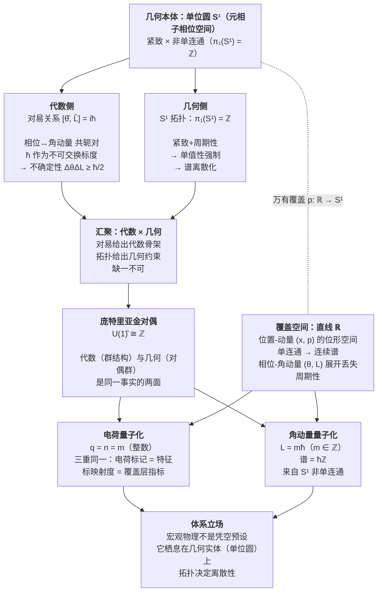

# 体系通览图：一个圆周（S¹）决定量子整值性

> 这张图把体系内几条独立线索（§5.3 代数×几何、电荷绕数、庞特里亚金对偶、覆盖空间层指标）收进一个核心命题：**一个圆周的紧致非单连通性，同时决定电荷量子化、角动量量子化，并通过庞特里亚金对偶把代数的对易关系与几何的谱离散性缝成一体。**

## Mermaid 通览图

## 图的结构解读（四层）

| 层 | 内容 | 对应体系资产 |
| --- | --- | --- |
| 第一层：根本体 | 单位圆 $S^1$：紧致 × 非单连通（$\pi_1=\mathbb{Z}$） | 元相子相位空间（公设 2：半径 $\hbar$） |
| 第二层：两次投影 | 代数侧（对易 $[\hat\theta,\hat L]=i\hbar$）＋ 几何侧（$S^1$ 拓扑强制单值性），缺一不可 | §5.3「代数与几何缺一不可」 |
| 第三层：缝合点 | 庞特里亚金对偶 $\widehat{U(1)}\cong\mathbb{Z}$：代数（群结构）与几何（对偶群）同一事实两面 | 《电荷的几何本质》§3.1 |
| 第四层：两大量子化落点 | 电荷量子化 $q=n$（三重同一）＋ 角动量量子化 $L=m\hbar$（谱$\hbar\mathbb{Z}$），同根源 | 电荷绕数 / 角动量谱 |

## 贯穿线：覆盖空间

直线 $\mathbb{R}$ 是圆周 $S^1$ 的**万有覆盖空间**（$p:\mathbb{R}\to S^1$，$p(x)=e^{ix}$）。

- **位置-动量 $(x,p)$** 生在 $\mathbb{R}$（单连通，得到连续谱）
- **相位-角动量 $(\theta,L)$** 生在 $S^1$（非单连通，得到离散谱 $\hbar\mathbb{Z}$）

相位-角动量是**本原共轭对**（元相子天性转圈），位置-动量是它在直线覆盖空间上展开、丢失周期性后的理想化投影。

## 相关文献

| 线索 | 文献 |
| --- | --- |
| 代数×几何互补（§5.3） | 《量子化的拓扑解释（修订稿二版）》思源笔记 |
| 电荷 = 特征标层指标、三重同一、庞特里亚金对偶 | 《电荷的几何本质》§3.1、《电荷的拓扑归约》 |
| 电荷整值与角动量整值同根源 | 《电荷的几何本质》§3.1、《单位圆、整数与物理离散性的同源结构》 |

## 修正记录

- 2026-08-30 创建：整合 §5.3 代数×几何、电荷绕数、庞特里亚金对偶、覆盖空间四条线索为一张体系通览图。
