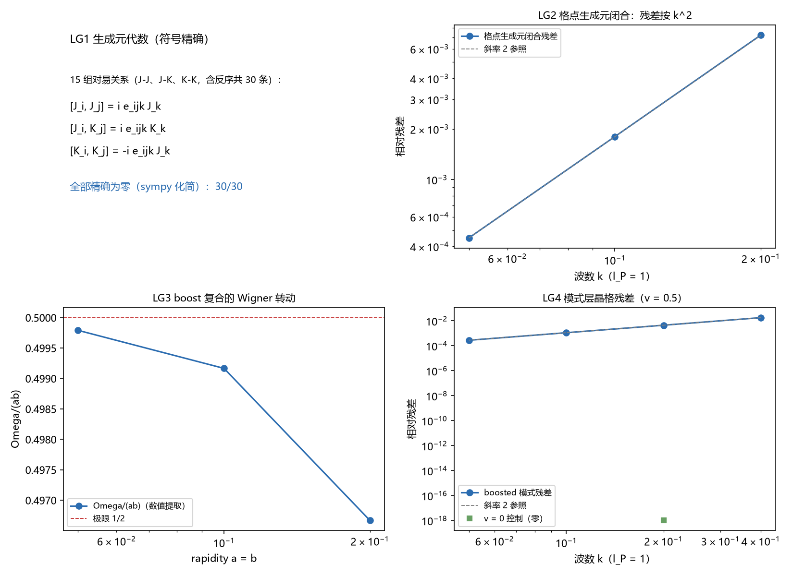

# 元相子晶格为何不落入固定晶格困境：逐层回应与现役冲突清点

> 作者：傅天行（天行新学研究院）
> 预印本：傅天行. (2026). 元相子晶格为何不落入固定晶格困境：逐层回应与现役冲突清点. 天行新学研究院预印本.
> 日期：2026-10-12
> 状态：待作者确认
> 严格程度声明：本文逐条核对《固定普朗克时空晶格理论的多重困境：从相对论冲突到宇宙学不相容》（下称《困境》）的各条批评对元相子理论的适用性。文中"判据第 N 条"指天行新学研究院验证材料目录 [22] 内的判据编号，条目唯一、来源可查。本文结论按四级标注：解析恒等式、条件性命题、判据级数值支撑、纲领性主张；关键结论随文标注等级，未标处按其来源判据的既有定级为准。本文不验证元相子本体论本身，不宣布争论终结；第七节如实列出两条承重未闭合项与各冲突转为排除的判定条件。
> **关键词**：元相子；时空晶格；洛伦兹不变性；背景独立性；格点费米子；实验约束

**修订记录**：
- **2026-10-12 落盘**（触发：作者指示对《固定普朗克时空晶格理论的多重困境》作完整回应）
    - 初版成文，九节结构与现役冲突清单；嵌入 9 张数值验证图
- **2026-10-12 评审修订**（依据：[[评审报告/评审报告-元相子晶格为何不落入固定晶格困境-2026-10-12]]，A0/B7/C4）
    - B 级七项：严格程度声明校准、补文内引用编号、Unicode 乘号改 LaTeX、超光速扩张补因果说明、辨析注记补引用、补本修订记录、§8 背景独立诉求处理补限定句
    - C 级四项：关键词粗体、参考文献两条目格式、"现役冲突"首次出现补界定

## 摘要

《困境》一文从相对论冲突、理论构建障碍与宇宙学不相容三个层面审视固定晶格进路，结论为固定晶格未被完全排除，其生存空间已压缩到需要非平凡机制抑制洛伦兹破缺效应的狭窄区域。本文对该文的各条批评逐层核对，判定其对元相子理论的适用性，并如实清点现役冲突。

核对的起点是靶子的界定。《困境》的批评对象由其引言自我限定：全局周期、刚性结构与预设几何的离散时空，其论证另含"离散是唯一基本层"的隐含前提。元相子晶格在三点上与靶子不同构：晶格经离散镶嵌与边缘补位持续生长，刚性不成立；连续与离散同为基本层（波性侧与粒性侧平权、波主粒从），唯一性不成立；格点几何由单位圆相位旋转导出。格距刚性一点本理论保留，这正是优选参考系与格点钉扎效应的共同来源。

逐层核对的结果如下。相对论层：微分同胚不变性在弱场线性层已判据化，标架读数在重标下不变，离散比安基恒等式精确成立（判据 11 项全部通过）；洛伦兹破缺以分层定理处理，低能端绝对运动态在结构上不可读，高能端破坏以预定形态出现，最低阶修正被色散偶性与反射对称性精确禁止，线性通道不适用，二次通道通过现有最紧约束并余约八个数量级。理论构建层：Nielsen-Ninomiya 定理被接受为构造约束，费米子取复合位错形态，两因子升维在途；连续极限由双层基本结构拆解，不要求晶格消解。宇宙学层：晶格生长给出膨胀的微观机制，宇宙学常数作理论输入，哈勃张力无机制。

实验层：引力波速与光速精确相等（GW170817 裕度 $10^{15}$），等效原理以零自由参数推导并与 MICROSCOPE 的 $10^{-15}$ 级上限相容，边际洛伦兹通道由精确对称性封口且单圈对照已完成。现役冲突收敛为两条：格点钉扎在"缺陷即真实粒子"读法下给出 $r = 1.5\times10^{-8}$ 的洛伦兹破缺读数，与实验相差五至十二个数量级，其闭合取决于缺陷宽度的参数裁决；边际通道的量子稳定性（反常）未证。本文给出"未闭合"与"根本缺陷"的界线判据：闭合该冲突是否要求放弃核心承诺。按此判据逐条核对，无一条登记冲突已证为根本缺陷；两条承重项的闭合结果决定实验生死。

## 一、引言

### 1.1 被回应论文的论证结构

《困境》[1] 的论证分三层展开。相对论层指出固定晶格通过引入全局静止参考系破坏洛伦兹不变性，通过提供优先坐标网格违背广义协变性，并援引 Loll 关于格点上微分同胚约束对易子的结果 [16]，指出约束代数只在格距趋零、晶格结构消解的极限无异常闭合。理论构建层以 Nielsen-Ninomiya 定理说明周期性格点无法同时满足局域性、无倍增子与手征对称性，并指出连续极限下还原爱因斯坦场方程的困难源于微分结构在离散化中的丧失。宇宙学层指出静态晶格无法容纳动态膨胀，哈勃张力与宇宙学常数的晶格方案多停留在唯象拟合。

《困境》的结论分两问给出。原则性一问，即固定晶格是否与相对论的理论结构相容，答案是否定的，冲突被判定为根本性。现象学一问，即固定晶格是否已被实验排除，答案更为微妙：未被完全排除，但生存空间压缩到需要高度非平凡的抑制机制。该文特别指出，GRB 090510 的观测排除的是预言论线性洛伦兹破缺以普朗克能标为特征的模型；若主导修正为二次或更高阶，模型可能仍然与观测相容，然而依赖精细调节抑制最低阶效应会带来自然性问题。

该文的学术姿态值得肯定：它区分了原则性冲突与现象学约束，区分了线性与二次两种色散情形，并明确拒绝"一刀切排除"的过强表述。本文的回应沿用它的区分结构，逐条核对。

### 1.2 回应的范围与本文结构

本文回应的是批评的适用性，不重述元相子理论的全部推导。元相子理论把物理真空设定为无穷元相子的束缚振荡晶格：元相子物侧为复平面动态单位圆，相位每满周闭合推进一个格距 $l_P$、历时一拍 $t_P$，格点坐标 $x^a = l_Pn^a$，物理时间由摆程计数给出，光速 $c = l_P/t_P$ 是单螺旋几何的换算恒等式 [10]。体系的唯一公理是心物波粒二象，晶格是公理在实在层面的承载。

第二节界定《困境》的靶子与元相子晶格的定位差异。第三至六节按《困境》的四层结构逐层核对，各节先引原文批评，再给出体系回应与判据读数。第七节是本文与一般辩护文的分野：如实清点现役冲突与未闭合项，给出每一条转为排除的判定条件。第八节给出"未闭合"与"根本缺陷"的界线判据。第九节结论。

本文的立场可以先行给出：对结构层的批评，体系有判据级回应；对参数接口层的残余暴露，体系如实承认未闭合。这两件事互不替代。

## 二、批评的靶子与元相子晶格的定位

### 2.1 《困境》的靶子与隐含前提

《困境》在引言中明确限定讨论对象："具有全局周期性、刚性结构和预设几何的离散时空模型"。这个限定是本文核对的第一关键。该文的多数论证（长度收缩改变格子计数、静态晶格与膨胀不相容、取向平均可抑制破缺）都依附于"刚性"与"静态"这两个定语。

第二关键是隐含前提。《困境》的第一步论证（优选参考系）与第三步论证（紫外截断）在"离散是唯一基本层"的前提下成立，圈量子引力、因果集与格点路径积分确实承担这一代价。体系内部的辨析注记（[[冲突诊断/注记-离散时空破坏洛伦兹不变性论证的辨析]]）早已识别该前提并逐环核对：前提成立时论证有效，前提不成立时论证的第三步断裂。

元相子理论恰好不接受该前提。这构成回应的第一层。

### 2.2 元相子晶格：生长、双层基本结构与导出几何

元相子晶格与《困境》靶子的差异有三。其一，晶格持续生长。离散镶嵌（内部落位）使相邻元相子的碰撞点处诞生新元相子，落位概率 $p = 3H_0t_P \approx 3.7\times10^{-61}$；边缘元相子缺邻居处强制补位。格点阵持续增长，膨胀是格点生长的宏观名称。静态晶格与动态膨胀的不相容性在此不适用。

其二，连续与离散同为基本层。波性侧（相位连续旋转）与粒性侧（离散跃迁与格点）平权而波主粒从，宏观连续性是向波性连续的返回，离散化不造成微分结构的丧失。第三层（涌现层）的平滑化以波性连续为背景，与声子晶格"从离散制造连续"的本体论路径不同。

其三，格点几何为导出量。三类正交元相子给出三个空间方向，格距由 $\hbar$、$c$、$G$ 确定，格点坐标由满周计数直接给出。《困境》批评的"从存在最小长度到特定晶体几何的概念跳跃"在此不适用：本理论的格点结构由公设直接给出，不需要额外假设某种晶体。

有一点本理论如实保留：格距刚性。晶格静止系客观存在，这是一个真实定义的优选参考系。回应的重心因此不在否认它的存在，而在证明它不可读（低能层）与它的残余以预定形态出现（普朗克层）。

## 三、相对论层

### 3.1 微分同胚不变性与坐标网格的绝对性

《困境》援引 Gambini-Pullin 与 Loll 的冲突 [16]：格点本身定义优先坐标网格，节点是物理实体，坐标变换不再具有任意性；Loll 的结果表明微分同胚约束代数只在格距趋零、晶格结构"消失"的极限无异常闭合，这构成"固定晶格的不变性只能在晶格不再存在的极限恢复"的悖论。

体系对此的回应分两层。绝对坐标只是簿记：空间只有相对位置有意义，格点归属的重标是瞬时、全局、无信息传递的操作，与规范变换同型。重标自由度不需要晶格消解来腾出空间，Loll 悖论的结构在体系内不出现。

可读量全部走标架与记录场。记录是碰撞事件的读数，坐标无关（标量性）；坐标重标的无穷小表述项恰是场空间规范变换 $h_{\mu\nu}\to h_{\mu\nu}+\partial_\mu\xi_\nu+\partial_\nu\xi_\mu$，线性化曲率组合对其不变；乘积格上的离散比安基恒等式 $D^\mu G_{\mu\nu} = 0$ 精确成立。

判据第 469 条给出 11 项读数，2026-09-27 定级条件性定理级：标架读数在重标下的相对偏差 $4.5\times10^{-16}$（对照量：坐标分量直读漂移 $0.364$）；规范表述项的线性化爱因斯坦张量为零（$4.0\times10^{-15}$）；重标分解余项按幅度二阶（比值 $4.045$）；离散比安基相对 $1.3\times10^{-15}$（二阶模板）与 $1.9\times10^{-15}$（四阶模板），$R$ 单独散度 $1.18$ 作判别对照。

边界如实声明：判据化止于弱场线性层，非线性缝合假设未关闭。强场与广义相对论差异开启处的内容归引力线攻坚在途。

### 3.2 洛伦兹破缺：存在、不可读与预定签名

《困境》的第二步论证是：固定晶格选出静止系，boost 后同一物理区域被不同数量的格子覆盖，依赖格子计数的量随观测者速度改变；色散关系为周期函数，高能区偏离线性，boost 可把波长压到格距以下，格子结构与静止系所见不同。三步推出低能极限只能近似恢复洛伦兹不变性。

体系的回应（分层定理 [2]）把"存在"与"可读"分开。优选参考系存在（格距刚性如实保留），绝对运动态在结构上不可读：任何读出"我相对晶格的绝对速度"的实验需要全局同步钟与坐标原点两类外部参照，两类在体系内都不存在。时钟层经整体 $U(1)$ 对称性不可观测，格点坐标经整体重标记不变，可探测量只依赖相位差。

不可读性有本体论根基 [12]。每个元相子拥有独立圆心、独立复平面与独立零度基准，单点绝对属性依赖各自基准而无物理意义，可观测的只有经平行搬运比较得到的差。观测者本身由晶格构成，其四类基本测量操作（快照抄写、摆程计数、格点间隔比较、光信号接力）的协议不携带绝对速度参数。

低能精确性因此不落在"近似恢复"层级。晶格色散关系从哈密顿导出 [3]：

$$\omega^2(\mathbf{k}) = \frac{4}{t_P^2}\sum_{a=x,y,z}\sin^2\frac{k_al_P}{2},$$

低能展开给出 $\omega^2 = c^2k^2 - \frac{c^2l_P^2}{12}\sum_a k_a^4 + O(k^6)$，主导项精确重现 $\omega = c|\mathbf{k}|$（$k = 10^{-4}$ 时三方向 $\omega/ck = 1.000000$）。波动方程 $\partial_t^2\delta\phi - c^2\nabla^2\delta\phi = 0$ 由哈密顿导出，连续极限的作用量为洛伦兹标量，洛伦兹群是连续极限的精确对称群。

观测者响应一侧 [4] 给出钟慢尺缩的数值验证：运动束缚态由 boost 解描述，$v = 0.3c$ 时实测频率与 $\omega_b/\gamma$ 的偏差 $0.07\%$（收缩阱口径 $0.054\%$），残差按 $(l_P/\xi)^2$ 与 $(\omega_b\gamma v l_P/c^2)^2$ 标度。多观测者全局协议（判据第 470 至 472 条）把同时性相对性、洛伦兹群晶格表达与闭环 holonomy 判据化，均达条件性定理级。

洛伦兹群的晶格表达 [6] 给出群论层面的构造：15 组对易关系（含反序共 30 条）符号精确为零；格点生成元闭合残差按 $k^2$ 收缩；boost 复合的 Wigner 转动角趋近极限 $1/2$；模式层残差在 $v = 0.5$ 档按 $k^2$，$v = 0$ 控制为零。

![图 2：晶格色散与首阶洛伦兹破坏的方向指纹三面板。(a) 精确色散 $\omega t_P = 2\vert\sin(k l_P/2)\vert$（蓝色）与低能直线 $k l_P$（灰色虚线）在低能段重合；(b) 三个方向的首阶偏离随 $l_P k$ 增长，标度为 $(E/E_P^{(t)})^2$，$[100]$ 偏离最强；(c) 三方向首阶系数比 $1:\frac{1}{2}:\frac{1}{3}$ 即精确比 $6:3:2$，系数为 $-1/24$、$-1/48$、$-1/72$。](images/em_dispersion_lv.png)

高能端的破坏是预定签名。首阶洛伦兹破坏项为

$$\frac{\delta\omega}{\omega} = -\frac{l_P^2}{24}\frac{\sum_a k_a^4}{k^2} = -\frac{1}{24}\left(\frac{E}{E_P^{(t)}}\right)^2\frac{\sum_a k_a^4}{k^4},$$

方向比 $6:3:2$ 由立方对称性固定。关键在于：最低阶破坏被精确禁止。色散对 $k_a$ 为偶函数（$\sin^2$ 展开无奇次项），$(E/E_P)$ 一阶的 CPT 奇类破坏不出现，首个破坏项必为 $k^4$ 阶；反射对称性另行封死 $\varepsilon$ 型通道。

这直接回应《困境》的自然性质疑。该文指出，若模型必须依赖精细调节抑制最低阶效应，其自然性本身成问题。体系的抑制不靠调节：最低阶效应被对称性精确禁止，二次系数由几何常数固定，无自由参数。

### 3.3 等效原理、宏观物体与"足球问题"

《困境》指出固定晶格在加速参考系中行为异常：自由落体观测者将看到晶格加速，"引力"被探测到，几何化描述被破坏。该文还提出"足球问题"：若晶格节点与物质场的耦合是局域的，宏观物体中大量粒子与晶格节点的集体耦合效应应经多体相干增强被放大，观测并未发现。

体系对等效原理的回应是推导 [5] 而非承认。弱等效原理由双折算系数相除给出：引力耦合经碰撞写入法线场倾角 $\delta\theta = Et_P/\hbar$（写入幅度等于当拍作用量份额，增益为一，判据 TA1 至 TA5 共 10/10），惯性抵抗经变率继承读出 $m_i = E/c^2$，两半读出同一份缺陷总能量，相除得

$$\frac{m_g}{m_i} = \frac{c^2t_P}{\hbar} = \frac{1}{m_P},$$

零自由参数。组成普适判据（判据第 459 条，7/7）给出多形态系统（单质点、两质点互连、三质点链、四质点链）自由落体的质心加速度结构无关，相对散布 $3.55\times10^{-10}$，Eötvös 参数读数 $3.16\times10^{-10}$（数值残差，物理值为零），与 MICROSCOPE 的 $10^{-15}$ 级上限相容 [21]。

"足球问题"在体系内的形态与《困境》所述不同型。体系的两条修正通道都不随系统总动量增长：模式色散修正依赖单个光子的能量；观测者响应偏差按 $(l_P/\xi)^2$ 与 $(\omega_b\gamma v l_P/c^2)^2$ 下降，宏观系统（内部尺度 $\xi$ 大）的相对偏差更小。耦合经总能量走份额层，缺陷内部结构不进入任何换算率，多体相干增强没有对应机制。

边界声明：足球问题的"不同型"论证（修正通道不随总动量增长）尚未判据化，登记为后续项。体系的这一侧与 GUP 型模型分属不同的修正结构，该论断的严格化留待独立工作。

## 四、理论构建层

### 4.1 费米子倍增与手征结构

《困境》援引 Nielsen-Ninomiya 定理 [15]：格点上无质量费米子算符无法同时满足周期性解析、连续极限正确、无倍增子与精确手征对称四项条件，倍增子由紧致布里渊环面的拓扑强制；Wilson 费米子以破坏手征对称性为代价。该文指出，若放弃全局平移不变性，拓扑强制机制不再可用，故固定晶格的周期性恰是费米子倍增问题的根源。

体系不声称规避该定理，而把它接受为构造约束（判据第 489 至 492 条）。费米子取复合位错形态：粒子是均匀缠绕背景上的缺陷算符，读作 $S^1\times\mathbb{R}$ 上的 Dirac 型算符；手征性的来源 [11] 为 $\pi$ 扭转奇偶的 $\mathrm{SO}(3)$ 双覆盖加复结构符号的真空自发选择。这条路线不把基本手征费米子硬塞进周期格点，倍增子问题在构造层被正面承担。

当前状态如实报告。判据第 490 条给出代数阻塞：内部模式代数（取自双模式态空间的 $SU(2)$ 等距群）占满 $2\times2$，没有余量留给时空 Clifford，宇称算符在 2 分量设定下不存在（15 个非平凡候选的偏差全为 $1.0$），(2+1) 维 4 分量对照同样无解（14 个候选穷举）。出路是把内部模式代数与时空 Clifford 拆为两个张量因子，判据第 491、492 条给出两因子结构的显式投影。Wilson 项可采，处方读数为权衡而非最优化：双重子劈裂随 $r$ 单调增，扫描区间内无内点最优。

边界如实声明：有限格距手征破缺对弱作用结构的定量修正未闭合；宇称与手征投影判据待升维后同判。

### 4.2 连续极限的还原问题

《困境》指出：广义相对论是光滑度规场的偏微分方程理论，离散化破坏微分结构；在量子引力中 $a\to0$ 物理上不可实现，理论必须在有限格距下定义自身，有限格距下的物理与连续理论的关系变得模糊。

体系的回应是三层结构。波性侧连续基本层不预设离散结构，逻辑上先行；粒性侧离散基本层是连续旋转的周期事件；涌现层是对波粒结构的平滑化，平滑化以波性连续为背景，是向波性连续的返回。连续极限不需要 $a\to0$ 作为物理过程，微分结构的丧失不出现。

技术层面的支撑有三。低能色散的主导项精确重现 $\omega = ck$，波动方程由哈密顿导出（判据 D1 至 D5）；离散比安基恒等式精确成立，格点（离散本体）不破坏守恒结构；曲率不走 Regge 剖分路线，曲率住基准方向场（联络），度规由碰撞写入法线场生成，收敛问题转换为相位场动力学的长波极限。

边界如实声明：非线性缝合假设未关闭，强场处的连续还原在途。

## 五、宇宙学层

### 5.1 生长晶格与动态膨胀

《困境》指出静态晶格无法自然容纳动态膨胀：宇宙膨胀意味着尺度因子随时间演化，而固定晶格的节点间距在定义上不变；暴胀会把晶格间距拉伸到远超普朗克尺度的量级，动摇其作为普朗克尺度离散结构的基础。

体系的晶格非静态。膨胀的微观机制 [8][9] 为：离散镶嵌使新元相子在相邻元相子的碰撞点诞生、复刻即将折返者的状态（同步节律、相位对齐），邻居无感知，时空顺滑膨胀；格点归属重排满足相邻反相、隔一同相，格距全程保持 $l_P$。边缘元相子缺邻居处强制补位，边缘半径超光速扩张（创生边界与信号边界不同：空间生成不受光速限制，信号传播仍以 $c$ 为界）。观测到的哈勃膨胀由内部落位承载：$p = 3H_0t_P$，格点增长率 $= 3H_0$，给出处处局部的均匀膨胀 $v = H_0d$。

暴胀问题在此不适用：格距不因膨胀被拉伸，新格点由创生补入。离散镶嵌给出恒速膨胀源（$H = p/(3t_P)$，$p$ 恒定则指数膨胀），补广义相对论留白的"恒速膨胀源从何而来"。

《困境》对若干预印本方案（BCC 晶格弛豫、FCC 几何相变）的批评（"从存在最小长度到特定晶体几何是巨大概念跳跃"）对本理论不适用：格点结构由公设 2 的三类正交方向直接给出，不需要从最小长度另行假设晶体几何。

### 5.2 宇宙学常数与哈勃张力

体系的宇宙学常数地位经 2026-09-21 主动收窄：$\Lambda$ 作理论输入（与 $\hbar$、$c$、$G$ 同列），三条源项化路径（缺陷补充、基态能量、均匀场）经核对全部判负，框架不承担恒定引力源。暗能量论文的中心主张收窄为"解释膨胀的均匀性与格点的持续增长"。这与《困境》对唯象方案的批评相容：体系不用一个几何假设替换宇宙学常数假设，而是明示该常数为输入。

哈勃张力如实报告：体系无机制，$H_0$ 由 67.4 放大到 73.02 的方案在体系内没有对应物。这一项属未答，不构成判否，代价是该文对应段落的批评继续成立。

## 六、实验约束的适用范围

### 6.1 光子色散：线性与二次的区分

《困境》正确指出：被 GRB 090510 排除的是预言论线性洛伦兹破缺以普朗克能标为特征的模型 [18]；若主导修正为二次或更高阶，模型可能仍然与观测相容。该区分对本理论是决定性的，体系恰好落在二次侧，且这一落位有结构性依据而非精细调节。

无线性项有两条依据：色散 $\omega^2(\mathbf{k})$ 对 $k_a$ 为偶函数，$(E/E_P)$ 一阶的 CPT 奇类破坏不出现；反射对称性另行封死 $\varepsilon$ 型（CPT 奇）边际通道（判据 P1 至 P4 与 R1 至 R4）。GRB 090510 的线性界（$E_{QG,1} > 7.6E_{\rm Planck}$）打不到本理论。

二次通道的对照已定量。把首阶破坏写成标准形式 $\delta\omega/\omega = -(E/E_{QG,2})^2$，方向依赖给出等效能标：$[100]$ 为 $4.899E_P$（$5.98\times10^{19}$ GeV）、$[110]$ 为 $6.928E_P$、$[111]$ 为 $8.485E_P$。对照 LHAASO 对 GRB 221009A 的二次界（$E_{QG,2} > 6\times10^{-8}E_{Pl}$）[19]，体系高约 8 个数量级，通过。低能段（eV 至 GeV）效应与已抄录上界差 5 至 47 个数量级。

![图 7：二次偏离与观测对照两面板。(a) 框架二次偏离随光子能量的变化，三条曲线为三个方向族，$[100]$ 偏离最强；1 eV 处 $\delta\omega/\omega \sim 3\times10^{-58}$，$10^{20}$ eV 处 $\sim 3\times10^{-18}$；(b) 同样三条曲线换算为 640 Mpc 距离上的群速度延迟，阴影为现有高能计时分析的量级带。](images/lv_sme_mapping.png)

延迟读数已给出：640 Mpc 距离上，13 TeV 光子延迟 $10^{-15}$ 秒量级，$10^{20}$ eV 光子延迟 $0.18$ 至 $0.55$ 秒（按方向 $6:3:2$ 分档）。三通道适用性已判：真空双折射与谱线展宽通道对本理论不适用（框架算符对 $k$ 为偶，无螺旋度依赖；规则晶格为相干色散，无随机泡沫），高能计时通道适用。

口径警示一并登记：高能档效应与低能常数上界直接相比会读出虚假排除（$30$ EeV 档效应与 $10^{-35}$ 之比为 $2.8\times10^{17}$，该比值无物理意义）。高能段（PeV 至 EeV）的灵敏度抄录与两侧量纲换算口径待办。

### 6.2 引力波与其他精密检验

《困境》指出引力波为洛伦兹不变性提供独立检验通道，且引力波约束的强度并不简单优于光子约束。体系接受该判断，并给出对照：光与引力在同一张格点、同一套模板上传播，极限速度相同，$c_s = c$ 为精确相等。GW170817 [20] 的对照中体系预言为零偏差，落在观测区间 $-3\times10^{-15} \leq (v_{\rm gw}-c)/c \leq +7\times10^{-16}$ 内，裕度 $10^{15}$。

等效原理类检验：WEP 推导零自由参数（见 3.3 节）；引力时间延迟（Shapiro）与光偏折在 $\lambda = 1$ 下给全值，与测定相符；$\lambda = 0$（只改钟）给半值，已被观测排除。全部对照为相容性确认，不构成对体系预言的实验证实。

### 6.3 边际通道与自然性判据

《困境》援引 Collins 等人的自然性论证 [17]：把已知粒子相互作用与普朗克尺度的优选参考系放在一起，圈图修正会生成百分级的洛伦兹破坏，除非裸参数被极度精细调节。体系对该判据做过专项辨析 [13]，结论为：它是举证责任而非禁令，其全部重量落在四维边际算符通道上。

体系对两个通道分别作答。六维通道（$k^4$ 型）属不可关方向，重整化流按能标压低，低能实验看不到；边际通道由精确对称性封口：标量扇区被立方对称性精确禁止（方向系数矩阵在立方群下的群平均只留迹的三分之一乘单位阵）；张量扇区由键能形式构造性满足各向同性关系 $C_{11} - C_{12} = 2C_{44}$；CPT 奇类由反射对称性禁止（含反射的立方群下其不变量空间维数为零）。

单圈生成量已算（判据 S1 至 S4）：对称模板下一圈生成的边际各向异性为零，方向差 $-4.35\times10^{-5}$ 只按 $p^2a^2$ 收缩，属不可关残留；沿一个方向把模板破缺 $5\%$ 后生成量升到 $-1.378\times10^{-3}$（相对二次系数约 $2.3\%$），与破缺幅度同阶。CPSU 的百分级估计对应破缺情形，对称模板下不出现。

剩余暴露如实声明：量子层面的对称性精确性（反常）未证。该暴露有一个锐利形式：若上述对称性只是"大体成立但差一点"，体系立刻被观测排除；观测把"该对称性必须精确成立"逼了出来，可行方案只剩这一条。

## 七、现役冲突与未闭合清单

本节是本文与一般辩护文的分野。前六节的回应不取消下述事实：体系内存在未被抑制机制覆盖的读数，以及尚未完成的关键计算。所谓现役冲突，指尚未解除、也未判定为不可解除的登记项，其性质与判否（已判定不成立）及相容确认（已与观测对表通过）相区分。逐条清点如下。

### 7.1 格点钉扎的洛伦兹张力

机制：缺陷（粒子）被格点钉扎，其静止能量随相对晶格的位置变化。写成桥无关比值 $r = \Delta E_{\rm PN}/M$（与量纲桥无关），在模型刚度 $K = 0.005$ 档读数为 $r = 1.51\times10^{-8}$（判据 E1 至 E6）。对照既有洛伦兹破坏实验约束（原子钟比对、物质波干涉、天体观测，量级 $10^{-15}$ 至 $10^{-20}$），读数在界外 5 至 12 个数量级。

两条逃逸路线的现状。路线一（缺陷宽度压低）有定量出口：$r \sim \exp(-9.5\,\xi/l_P)$，把 $r$ 压到 $10^{-15}$ 需 $\xi/l_P \ge 3.99$，压到 $10^{-20}$ 需 $\ge 5.21$，而模型自带的缺陷宽度只有 $2.25$ 格距。框架若把物理粒子的结构宽度认到 4 格距以上，张力自动消解；该认定需要独立依据。路线二（钉扎属本体位置层、不进入物侧读数）待裁决。参数区四窗口对照轮另行给出：单一 $K$ 设定下宽度窗与前三窗交集为空（差值 $38$ 至 $151$ 倍），该负结论已解读为通道分岔，待裁决。

方法论红线一并声明：用"选 $K$ 让 $r$ 变小"消解本张力属于构造决定结论，不能算解决；$K$ 必须经独立途径（量纲桥）确定，读数落在安全区才算闭合。

本条与《困境》的关系最直接：该文说固定晶格的生存空间压缩到需要非平凡抑制机制的狭窄区域。在色散通道，体系的抑制机制是结构性的（对称性禁止加几何固定系数）；在钉扎通道，抑制机制尚未取得。这是现役冲突与未闭合的合流处。

### 7.2 边际通道的量子稳定性

6.3 节的对称性封口在经典与匹配层成立，单圈对照已完成（对称模板零、破缺模板百分级）。剩余缺口是量子层面：封口所依赖的对称性（立方对称性、反射对称性）是否在量子修正下保持精确，即反常问题，未计算。这是 CPSU 判据的核心诉求，体系目前只答到匹配层。

### 7.3 未闭合项清点

| 项目 | 现状 | 性质 |
|---|---|---|
| 钉扎-洛伦兹张力 | $r = 1.51\times10^{-8}$，界外 5 至 12 个数量级 | 参数区未定，裁决在途 |
| 边际通道量子稳定性 | 单圈对照完成，反常未证 | 缺计算 |
| 低能不可探测性的形式化 | 复合体构成规则、快照抄写投影、非线性缝合三前提未关闭 | 形式化在途 |
| 费米子升维构造 | 两因子张量积待升维，宇称与手征判据待同判 | 构造在途 |
| 高能段灵敏度口径 | PeV 至 EeV 段对照条件未齐 | 材料工作 |
| 足球问题判据化 | "修正通道不随总动量增长"未判据化 | 缺判据 |
| 强场与非线性 | 广义协变性判据化止于弱场线性层 | 在途 |
| 缺陷密度定量 | Kibble 产量环缺独立依据 | 定量缺口 |
| 哈勃张力 | 无机制 | 未答 |
| 宇宙学常数数值 | 作理论输入 | 主动划界 |
| 重子不对称 | 候选来源已登记，定量未闭合 | 定量缺口 |

已解除的先例三条，供处置模式的参照：弛豫项导致可见光不能传播（裁决弛豫项取零后消解）；时钟均匀性与记录统计的口径冲突（撤回并改触发式后相容）；参考系拖曳的定性张力（2026-09-20 改判解除，零读数为旧版写规则产物）。三例的共同模式是：登记冲突、回源查机制、修正后消解。

## 八、未闭合与根本缺陷的界线

现役冲突的分布有信息量。结构层指控（优选系、微分同胚、背景独立）已有判据级回应，残余冲突全部落在参数与观测量对接的接口：刚度 $K$、耦合 $\kappa_\phi$、缺陷宽度、量纲桥、高能灵敏度口径。这一聚集说明结构层与接口层可以分开处置，接口层未闭合不反推结构层错误。

"未闭合"分四档，处置路径不同。其一，缺计算与形式化（边际反常、低能不可探测性形式化、高能抄录）；其二，参数区未定（钉扎张力、量纲桥）；其三，缺结构元素（费米子两因子构造）；其四，主动划界（哈勃张力、宇宙学常数数值、重子不对称）。四档都停在体系内部可继续工作的位置。

根本缺陷的判据可以写明确 [14]：闭合该冲突是否要求放弃核心承诺（晶格实在、连续与离散双层基本结构、公理层）。按此判据逐条核对，无一条登记冲突跨过该线。准确命题需要限定："没有一条冲突已被证明是根本缺陷"与"已证明所有冲突都可解"是两回事；前者成立，后者未成立。

两条承重项。钉扎张力与边际通道的量子稳定性是悬置的冲突，不是已消解的冲突，其闭合结果决定实验生死。其余项属工程量级，不决定生死。

对《困境》总结论的对表可以收束如下。该文的"原则性冲突"判断依赖"离散是唯一基本层"的前提；前提替换为双层基本结构后，结构层冲突逐条降级为已有回应的条目。需补一句限定：本理论不宣称满足背景独立性的诉求，处理方式是换位（承认优选系存在，改证低能不可读与高能签名），该换位与背景独立方案的路线差异在 [[连续与离散的二元基本结构：元相子几何动力学对时空本体的重构|二元基本结构]] [7] 有对照。

该文的"狭窄区域"判词分通道：在色散通道不成立（无线性项由精确对称性给出，二次系数由几何固定，不依赖精细调节）；在钉扎通道成立，那里还没有结构性抑制机制。该文"未被完全排除"的结论与体系处境相容，体系要做的是把两条承重项逐一闭合，而非宣布争论终结。

## 九、结论

对《困境》的四层批评，体系的回应分布如下。相对论层的两条结构指控有判据级回应（广义协变性 11 项判据、分层定理与洛伦兹群晶格表达），洛伦兹破缺的实验对照通过且余量大；理论构建层的 Nielsen-Ninomiya 被接受为约束并在构造中，连续极限由双层基本结构拆解；宇宙学层的膨胀机制已建立，宇宙学常数地位已收窄，哈勃张力未答；实验层的线性通道不适用、二次通道通过、引力波与等效原理相容。

残余暴露收敛为两点：钉扎-洛伦兹张力（读数与实验相差 5 至 12 个数量级，闭合取决于参数区与两条逃逸路线的裁决）；边际通道的量子稳定性（反常未证）。其余各项按性质归入补计算、构造在途或主动划界。

《困境》的学术价值在于它把批评组织成可核对的清单，并明确拒绝过强表述。本文沿同一精神组织回应：给判据、给读数、给边界，并如实列出未闭合项。固定晶格理论的处境在体系内被理解为参数与接口的闭合问题，其解决路径在册可循；在问题闭合之前，本文不主张胜利，只主张靶子的准确性与回应的可核对性。

## 参考文献

[1] [[固定普朗克时空晶格理论的多重困境：从相对论冲突到宇宙学不相容]]. 工作区文档，2026.（本文的回应对象；原文未署作者信息）

[2] 傅天行. [[晶格何以不破坏洛伦兹不变性：元相子理论的时空机制与分层定理]]. 天行新学研究院预印本.

[3] 傅天行. [[元相子振荡晶格的色散关系：低能光速涌现与洛伦兹破坏首阶项]]. 天行新学研究院预印本.

[4] 傅天行. [[观测者响应与洛伦兹涌现：束缚态时钟的时间膨胀与长度收缩推导]]. 天行新学研究院预印本.

[5] 傅天行. [[等效原理与广义协变性的几何归结：元相子框架下的推导、实验约束与判否边界]]. 天行新学研究院预印本.

[6] 傅天行. [[狭义相对论的定理化：从晶格几何到洛伦兹结构]]. 天行新学研究院预印本.

[7] 傅天行. [[连续与离散的二元基本结构：元相子几何动力学对时空本体的重构]]. 天行新学研究院预印本.

[8] 傅天行. [[时空的持续创生：元相子理论的膨胀机制]]. 天行新学研究院预印本.

[9] 傅天行. [[暗能量的元相子本质：离散镶嵌作为恒速膨胀源的物侧落实]]. 天行新学研究院预印本.

[10] 傅天行. [[元相方程：从欧拉公式到连续与离散统一的螺旋动力学]]. 天行新学研究院预印本.

[11] 傅天行. [[手征性的几何本质与宇称不守恒：模态复结构与宇称自发破缺]]. 天行新学研究院预印本.

[12] 傅天行. [[以太问题的终结：从洛伦兹以太到元相子介质]]. 天行新学研究院预印本.

[13] 傅天行. [[冲突诊断/注记-CPSU 自然性判据对固定晶格的适用性]]. 天行新学研究院内部材料.

[14] 傅天行. [[冲突诊断/注记-固定晶格批评对元相子理论的适用性核对：回应资产、现役冲突与未闭合判据]]. 天行新学研究院内部材料.

[15] Nielsen H B, Ninomiya M. A no-go theorem for regularizing chiral fermions[J]. Physics Letters B, 1981, 105(2-3): 219-223.

[16] Loll R. On the diffeomorphism commutators of lattice quantum gravity[J]. Nuclear Physics B, 1998, 532(1-3): 275-288.

[17] Collins J, Pérez A, Sudarsky D, Urrutia L. Lorentz invariance and quantum gravity: an additional fine-tuning problem?[J]. Physical Review Letters, 2004, 93(19): 191301.

[18] Stecker F W, Couturier C, Cohen-Tanugi J, et al. Constraints on Lorentz invariance violation from Fermi-Large Area Telescope observations of gamma-ray bursts[J]. Physical Review D, 2013, 87(4): 043001.

[19] LHAASO Collaboration. Stringent tests of Lorentz invariance violation from LHAASO observations of GRB 221009A[J]. Physical Review Letters, 2024, 133: 071501. (arXiv:2402.06009)

[20] Abbott B P, et al. Gravitational waves and gamma-rays from a binary neutron star merger: GW170817 and GRB 170817A[J]. The Astrophysical Journal Letters, 2017, 848(2): L13.

[21] Touboul P, et al. MICROSCOPE mission: final results of the test of the equivalence principle[J]. Physical Review Letters, 2022, 129(12): 121102.

[22] 傅天行. 天行新学研究院验证材料目录（`验证脚本/README.md` 列表式索引）. 内部材料. 本文涉及的判据编号：第 469、470 至 472、457、459、468、476、489 至 492、P1 至 P4、R1 至 R4、S1 至 S4、D1 至 D5、E1 至 E6、M4 条.
