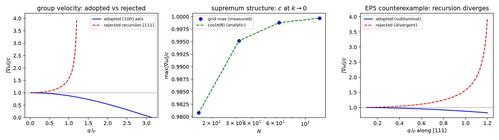
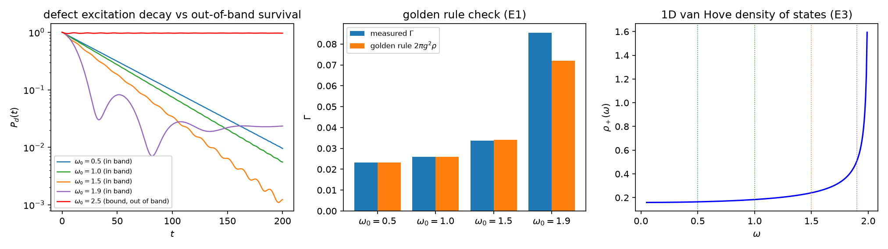

# 光的传播总论：时空晶格中的双层机制、光锥接合与移交判据

- **作者**：傅天行（天行新学研究院）
- **预印本**：傅天行. (2026). 光的传播总论：时空晶格中的双层机制、光锥接合与移交判据. 天行新学研究院预印本.
- **日期**：2026-10-01
- **状态**：已转正（作者指示 2026-10-01：自审、修订与转正一次性执行；机器预检全过）
- **关键词**：光的传播；实轴方向场；波矢；光锥接合；尺度锁定；移交；无扰动判定；黄金规则；各向同性涌现
- **理论位置**：本文是光传播线的总论文，整合三条判据（第 522、523、524 条）与三份先行材料：[[理论总纲/元相子理论的时空观：体系对时空的完整认识|时空观]] §五的机制口径、[[内部草稿/注记-光锥-波场双层方案：链式接力困境的辨析与消解（2026-10-01）|光锥-波场双层方案注记]] 的机制重述、[[事件层移交的算符形式：真空采样无扰动的成文判定|成文判定]] 的算符形态，并把心侧校准的介入位置（[[内部草稿/注记-传递为何需要校准：反事实推演、校准对象三层说与最大相干性的精确化（2026-10-01）|传递为何需要校准注记]]）纳入总图
- **修订记录**：
  - **2026-10-01 初版**（触发：作者指示整合光传播线成总论正稿）
  - **2026-10-01 补验证图与脚本链接**（触发：作者指出正稿缺乏数值验证图片与脚本清单）
    - §五、§六、§七 各嵌对应判据三面板图（images/ 三件，脚本已含绘图），§九 末补三脚本与注记清单
  - **2026-10-01 §七开放项按判据第 525、526 条收窄**（触发：光传播线收口同步）
    - 三维维数面闭合与通道二分待判入文，余项收窄为通道型判定、归一系数、A 系数数值、折射
  - **2026-10-01 自审修订与转正**（作者指示：写后自审、修订、转正一次性执行；机器预检全过，七维自审无 A 级，B 级 1 项（五条参考文献补正文标注 [2][5][6][7][11][12]）、C 级 1 项（摘要限定候选映射类））

---

## 摘要

光在时空晶格中如何传播、为何向四面八方、方向由谁决定、途中为何不被扰动，这四个问题在体系内由一个双层机制统一回答。传播动力学住连续演化层：实轴方向场的近邻相干耦合给出晶格波动方程，球面扩散、干涉、$1/r$ 稀释与三条正交关系全部在此层，长波极限逐项还原麦克斯韦波动方程。事件侧读出住离散层：摆程碰撞把传播读出为因果前沿每拍一格。两层在光锥上精确接合，接合的机制是尺度锁定：耦合标度由节律公理导出（$K_0 = 1/(2\pi t_P)$），故波层群速处处不超过 $c$、上确界恰为 $l_P/t_P$（判据第 522 条，3/3）。

事件层的移交经受三映射判决：复制类因谱半径大于一被份额守恒排除，投影类因完全退相干与 Zeno 扩散化被排除，幺正移交被三重实验事实唯一选出（判据第 523 条，5/5），真空采样对传播份额无扰动由此成为候选映射类中算符层面的必然读法。发射与探测端的份额产生与吸收受黄金规则结构定律约束（判据第 524 条，3/3）。低能各向同性精确（预言 B2），普朗克层留下 $6{:}3{:}2$ 方向指纹（预言 B1）。心侧校准贯穿两层：波层为哈密顿对齐形状的连续展开，事件层为感知-校正链的读取-抄写环节，校准天然幺正，与移交判据互相印证。

## 一、问题与理论位置

光的传播在体系内已有分立成果：波动方程与三条正交关系的几何来源（[3]）、链式接力表述的困境与双层重述（[1]）、群速上限的判据（[5]）、移交的算符判定（[8]）、发射率的结构定律（[7]）。本文的任务是把这条线整合为一幅总图，给出全部命题的严格程度分级，并标明剩余缺口。四个驱动问题：光靠什么走；为何向四面八方；方向由谁决定；途中为何不被扰动。

## 二、光的载体：实轴方向场与波矢的起源

每个格点上的元相子有相位圆，实轴的朝向角 $\alpha_n$ 自由，全体排布构成实轴方向场 [3]。单点朝向是规范自由度，无物理内容；物理内容在相邻格点的朝向差。波矢由此定义：

$$k_a l_P \propto \alpha_{n+\hat a} - \alpha_n$$

光的两种形态：基态光子为元相子本身（时空砖块，速度必然为 $c$），激发光子为校准波（叠加在晶格上的朝向扰动）。电场与磁场住基准方向场承载的联络曲率，波矢住实轴方向场，同一列波的两个层面（两条独立读数通道）[3]。$\mathbf{E}\perp\mathbf{B}\perp\mathbf{k}$ 与 $\vert\mathbf{E}\vert = c\vert\mathbf{B}\vert$ 由曲率的时间结构与空间结构正交一次给出。

## 三、历史表述与其困难：链式接力的三堵墙

早先的接力表述（邻居抄下指向继续向前）作为三维传播机制有三处硬伤 [1]。其一，拓扑错位：链预设唯一后继，球面波前没有；其二，抄写语义：全份抄本使激发能量指数爆炸，与球面稀释（场幅 $\propto 1/r$、能流守恒）不可兼得；其三，干涉：单链本体排除多路径振幅叠加，与双缝矛盾。三堵墙说明接力只讲对了速度与定域性，传播本身另有所在。此表述已降格为一维插图（时空观 §五 [2]，2026-10-01 修订）。

## 四、双层机制：连续波动为体，事件读出为影

**连续演化层。** 实轴方向场在公理 4 近邻相干耦合下作连续波动演化（U 过程）。晶格色散为

$$\omega^2(\mathbf{k}) = \frac{4}{t_P^2}\sum_a \sin^2\!\left(\frac{k_a l_P}{2}\right)$$

长波极限精确给出 $\omega = c\vert\mathbf{k}\vert$ 与波动方程 $\partial_t^2\alpha = c^2\nabla^2\alpha$ [4]。等频球面上全部模式被激发即球面波，点源无后继选择问题；线性叠加给出干涉；能量经 $4\pi r^2$ 球面守恒给出 $1/r$ 稀释。全向铺开、干涉、稀释都是模式层属性，无需任何逐格选择。

**事件层。** 摆程碰撞是时钟（$t = Nt_P$）、采样网格与引力写入事件 [12]，并把传播读出为因果前沿每拍一格。接力属于读出侧：它是前沿的事件侧影子，"邻居抄下指向继续向前"只作一维插图。

**层属纪律。** 连续是内容，离散是尺子（层属总图，2026-09-26）[13]。若把离散当动力学本身（逐拍差分更新），斜向高动量模式无实数频率解、长波端超光速，体系自毁（判据第 441 条 [10]）；连续演化加逐拍采样读出则全域良性。双层搭配是体系内部唯一自洽的选择。

## 五、光锥接合与尺度锁定

**命题一（群速上限）。** 由色散的解析梯度，

$$\vert\nabla_{\mathbf{k}}\omega\vert^2 = \frac{c^2}{4}\,\frac{\sum_a \sin^2(k_a l_P)}{\sum_a \sin^2(k_a l_P/2)} \le c^2$$

证明用 $\sin(k_a l_P) = 2\sin(k_a l_P/2)\cos(k_a l_P/2)$：平方后分子恰为分母的四倍乘以 $\cos^2$ 加权平均，而 $\cos^2 \le 1$。等号仅当全部非零分量的 $\cos^2$ 同为一，即 $k \to 0$。严格程度：定理级（数学不等式）。

**命题二（网格极值结构）。** 在网格 $k_a = -\pi + 2\pi j/N$ 上，加权平均的逐点最大值在全部非零分量同取 $\pm 2\pi/N$ 的格点取得，$\max\vert\nabla_{\mathbf{k}}\omega\vert/c = \cos(\pi/N)$ 精确成立，随 $N$ 单调趋于一。上确界 $c$ 在 $k \to 0$ 取得，与事件层每拍一格为同一个数。定理级。

**接合的机制：尺度锁定。** 两层读出同一个 $c$ 的原因是耦合标度由公理层锚定于节律：$K_0 = \bar t_P c^2/l_P^2 = 1/(2\pi t_P)$（[4] §2，判据核对已闭合 [1]），$\omega_P K_0 = 1/t_P^2$，速度无自由参数。若无锁定，两层光锥错开，体系不自洽；锁定成立，重合是恒等式级的必然。接力几何第三条（速度与耦合强度无关）的严格读法即此尺度唯一性。

**判据支撑。** 判据第 522 条（3/3，[5]）：四档布里渊区网格上 $\max\vert\nabla\omega\vert/c = \cos(\pi/N)$ 精确至 $10^{-12}$；恒真检验以第 441 条判弃的递推路线为反例，其斜向群速超光速并发散（实测至 3.96）。

## 六、事件层移交与无扰动判定

单激发扇区上份额由振幅承载，候选逐拍映射三类：幺正搬运 $U = e^{-iHt_P}$、复制 $(I + \varepsilon A)$（$\lambda_{\max}(A) = d$，$d$ 为配位数）、投影（逐拍按 $\vert\psi\vert^2$ 采样坍缩）。

**命题三（复制类排除）。** 谱 $1 + \varepsilon\lambda_k$ 中正谱分量使任何与之重叠的初态范数至少以 $(1 + d\varepsilon)^n$ 增长，份额总量指数爆炸，与能量守恒矛盾；即便归一化，残留副本使份额定理的整份单点化失效。解析论证。

**命题四（投影类排除）。** 单次局域基投影即 $\rho \mapsto \sum_n \Pi_n\rho\Pi_n$，全部非对角元清零，逐拍投影下跨缝相干性在任何两拍之间均不存活，条纹对比度恒为零；传播同时从弹道降为扩散，连续采样极限下 Zeno 冻结。解析论证加实验输入。

**命题五（幺正类唯一性与无扰动判定）。** 条纹存活、份额守恒、光速前沿三重事实在三类模型中仅与幺正类相容，故真空逐拍采样若对应物理算符，该算符与演化算子重合：采样是演化的读出视图，份额以幺正移交逐拍传递，无残留副本、无坍缩、无 Zeno。判据第 523 条（5/5，含复制映射能量爆炸 $7.7\times10^{74}$ 与投影映射到达归零两反例）提供数值支撑 [6]；命题三、四为其解析形态。判决级。

**移交与记录的分界。** 移交：幺正、无副本残差、无全局协议。记录（宏观 R）：非幺正、不可逆残差、锁定合取、跨层。微观 R 的现实化对象是移交本身，移交的"读出"读作感知-校正链的感知环节（速览第 14 条），是校准动作而非仪器读数 [8]；移交与记录的算符特征分界沿测量三层判据的分层口径 [11]。

**心侧校准的介入位置。** 校准贯穿两层 [9]：波层，连续幺正演化整体地是校准关系的相干展开（公理 4 哈密顿 $-\sum\cos(\theta_j - \theta_i)$ 的最小化方向即对齐，耦合项就是校准关系的物侧投影）；事件层，移交是感知-校正链的离散环节。校准不在拍间插入额外选择或推动（否则落回离散递推或投影类，被第 441、523 条排除），且校准天然幺正：负反馈对齐在算符上就是旋转。三映射排除的两种方式恰都不具有对齐的形状，判据与心侧介入互相印证。校准逐拍的对象是节律同拍与邻居相位可比较性，全局取向为相干性的全历史提升（天行力为方向对齐度 $\tilde D$ 的变分导数），非瞬时极值。

## 七、发射与探测：接口份额的产生与吸收

发射 = 源缺陷内部振荡把一份能量 $\hbar\omega$ 注入真空模式连续谱；探测 = 快照抄写（跨层事件），方向与落点在探测时按份额定理实现；发射方向的随机性来自源相位与真空相位涨落，各向同性源给各向同性统计。

**命题六（黄金规则结构定律）。** 发射率 $\Gamma = 2\pi\vert g\vert^2 \rho(\omega_0)$，态密度由色散唯一给出。判据第 524 条（3/3，[7]）：三档带内频率实测比值贴近 1 至千分位；一维范霍夫奇点驱动标度（$\Gamma(1.9)/\Gamma(1.0)$ 实测 3.29 对理论 2.77，容差内）；带外反例（缺陷频率移出能带则发射消失，束缚态权重 0.97）。结构定律的意义在约束：任何候选耦合通道的发射率必须写成矩阵元平方乘态密度。判决级。

进展（2026-10-01，判据第 525、526 条）：三维维数面闭合——三维黄金规则成立（DOS 标度常数性 1.04、$\kappa^2$ 律时间尺度比 3.48、带外束缚 0.96，判据 3/3）；通道问题细化为二分待判——位移型低频平坦（$\Gamma\omega_0^2/\rho$ 常数）与速度型低频禁戒（$\Gamma/\rho$ 常数，$\Gamma \propto \omega^2$）签名互斥可判（判别量 0.422 对期望 0.444，判据 3/3）。余项收窄为：通道型判定（需缺陷微观结构）、位移耦合归一系数（解析与数值差 3.4）、爱因斯坦 A 系数数值、介质折射机制（P1-50）。真空采样无扰动判定的成文已由 [8] 闭合。

## 八、全向性的涌现与普朗克指纹

低能各向同性精确：$\omega = c\vert\mathbf{k}\vert$ 与方向无关，MM 类检验零结果（预言 B2，A 级）。晶格的方向骨架不消失：高频首阶修正 $\delta\omega/\omega = -\frac{l_P^2}{24}\sum_a k_a^4/k^2$，方向依赖比 $6{:}3{:}2$、标度 $(E/E_P^{(t)})^2$（预言 B1，A 级）。

紫外边界取层属分工：可分辨上限 $\omega_N = \pi/t_P$，存在性上限 $\omega_{BZ} = 2\sqrt{3}/t_P$，区间内模式存在而不可分辨（第 442 条）。一电子伏特光子偏离约 $3\times10^{-58}$，目前不可测，作正确性判据保留。

## 九、严格程度分级总表

| 命题 | 内容 | 级别 |
| --- | --- | --- |
| 一 | 群速上限 $\le c$，等号 $k \to 0$ | 定理级 |
| 二 | 网格极值 $\cos(\pi/N)$ 精确 | 定理级 |
| 三、四 | 复制类与投影类排除 | 解析论证加判据 |
| 五 | 幺正类唯一性、无扰动判定 | 判决级 |
| 六 | 黄金规则结构定律 | 判决级 |
| 尺度锁定 | $K_0$ 由节律公理导出 | 条件性导出（线性化框架） |
| 心侧介入位置 | 波层对齐形状、事件层感知-校正 | 体系内论证（论证级） |
| A 系数数值、折射 | 未完成 | 开放（P1-50） |

三份数值验证脚本与注记随文可查，图 1 至图 3 与之一一对应：

- 判据第 522 条：`验证脚本/minimal_verification_light_cone_bound.py`，注记见 [5]
- 判据第 523 条：`验证脚本/minimal_verification_vacuum_sampling_zeno.py`，注记见 [6]
- 判据第 524 条：`验证脚本/minimal_verification_emission_rate_scaling.py`，注记见 [7]

判据编号、模型设定、容差预算与边界声明见各注记，图存 `images/`。

## 十、结论

光的传播在时空晶格中是双层一体的过程：连续波动是内容，向四面八方的铺开、干涉与稀释是它的属性；离散碰撞是尺子，把传播读出为每拍一格的因果前沿；尺度锁定使两层在光锥上精确重合；移交判据使途中份额不被扰动；黄金规则钉死接口的收发速率。方向由源写入实轴方向场的朝向差图案（波矢）决定，四散由低能各向同性涌现，晶格的方向指纹藏在普朗克层。链式接力的旧表述退役为一维插图，传话与水波在光锥边界上合为一体。

## 参考文献

1. [[内部草稿/注记-光锥-波场双层方案：链式接力困境的辨析与消解（2026-10-01）|注记-光锥-波场双层方案：链式接力困境的辨析与消解（2026-10-01）]]
2. [[理论总纲/元相子理论的时空观：体系对时空的完整认识|元相子理论的时空观：体系对时空的完整认识]]
3. [[电磁场总论：元相子几何视角的完整图景|电磁场总论：元相子几何视角的完整图景]]
4. [[元相子振荡晶格的色散关系：低能光速涌现与洛伦兹破坏首阶项|元相子振荡晶格的色散关系：低能光速涌现与洛伦兹破坏首阶项]]
5. [[验证脚本/注记-光锥不等式：连续色散群速上限与递推路线反例（判据J1至J3）|注记-光锥不等式（判据J1至J3，第522条）]]
6. [[验证脚本/注记-真空采样的三映射判决（第523条）：无扰动判定与传播反证|注记-真空采样的三映射判决（第523条）]]
7. [[验证脚本/注记-发射率标度判据（第524条）：黄金规则、范霍夫效应与带外反例|注记-发射率标度判据（第524条）]]
8. [[事件层移交的算符形式：真空采样无扰动的成文判定|事件层移交的算符形式：真空采样无扰动的成文判定]]
9. [[内部草稿/注记-传递为何需要校准：反事实推演、校准对象三层说与最大相干性的精确化（2026-10-01）|注记-传递为何需要校准：反事实推演、校准对象三层说与最大相干性的精确化（2026-10-01）]]
10. [[验证脚本/注记-紫外完备性判据（第441条）：递推路线的无解区与超光速、连续路线的全域良性|注记-紫外完备性判据（第441条）]]
11. [[测量的三层判据：从相互作用分层到单次测量机器|测量的三层判据]]
12. [[记录机制：碰撞即写入的算符形式、三维缺陷读数与弦的分层|记录机制：碰撞即写入的算符形式]]
13. [[内部草稿/注记-层属总图：连续层与离散层的分工（波函数、光的局域传播、引力度规与紫外截断）|注记-层属总图（2026-09-26）]]
