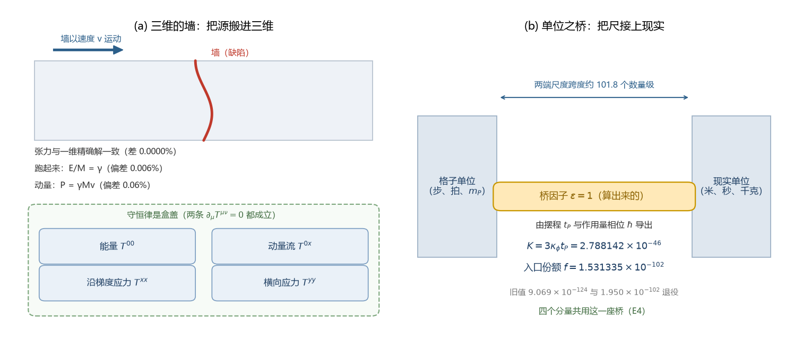

# 总结报告-引力线通俗总结：三维装配、量纲桥与剩余三缺口（2026-09-22）

- **日期**：2026-09-22 05:07:17
- **类型**：进展总结报告（内部草稿，大白话版）。覆盖 C1 线三维嵌入（E1 至 E4）与量纲桥线（MB-1 至 MB-9）两批工作，以及随后的论文与基准同步
- **依据**：E1 至 E4 四篇验证注记、MB-1 至 MB-9 九篇验证注记与两次裁决（M-E、M-F）；技术版收束材料见 [[总结报告-量纲桥收束：从缺口定位到定稿值（MB-1至MB-9与两次裁决）]]
- **状态**：两线均已交付并固化；残余三缺口登记在第五节；本轮同步六篇论文与一处基准，提交号 8a4210a、a58e105、c0e384d
- **关联**：[[验证脚本/注记-C1 三维嵌入E3：横截面积分口径接回引力侧源项装配（判据E3-1至E3-5）]]、[[验证脚本/注记-C1 三维嵌入E4：源项装配的物理单位换算：单一桥梁因子与闭合核对（判据E4-1至E4-5）]]；配图 `images/wall_and_bridge_schematic.png`（脚本 `_tools/make_wall_bridge_schematic.py`）、互动页 `可视化/给引力装上源和尺_互动页.html`

## 一、一段话讲完

到 2026-09-22，引力线把两件悬了很久的事做完了。第一件，把物质的源从一维链搬进三维，四个张量分量连同守恒律一起装配好。第二件，把格子的自然单位与现实单位的换算算了出
来，桥因子等于 1，定稿值表立起。两件合起来，引力场方程右边的源与尺度的来源都有了第一原理交代。

图 1 是这两件事的总图。

## 二、三维装配（E1 至 E4）：把源搬进三维

四道判据的读数如下。

- E1：缺陷墙放进条带几何，弦张力与一维精确解一致，差别小到打印位数里看不见（0.0000%）；横截面分离与沿线稳定性成立。
- E2：让墙以速度 $v$ 运动，能量读数 $E/M$ 对 $\gamma$ 的偏差不超过 0.006%，动量流 $P = \gamma M v$ 的偏差不超过 0.06%。
- E3：四个分量（能量 $T^{00}$、动量流 $T^{0x}$、沿梯度应力 $T^{xx}$、横向应力 $T^{yy}$）逐项写成横截面积分接入引力侧源项；四分量嵌入与一维值乘层数一致到 $3.9\times10^{-16}$；两条守恒律成立；横向应力是新增分量（静态 $T^{yy} = -T^{00}$，助推下按 $1/\gamma^2$ 减退）。
- E4：换算到物理单位只用一座桥，四个分量共用；单位链逐条闭合到 1。

通俗读法：一条链上量清楚的东西整体搬进三维，没有散架；四个分量像一只礼盒的四格，守恒律是盒盖，保证东西不会凭空多出来。引力右边需要的「物质怎么给源」，现在有了微观答案，而且答案自带守恒结构。

## 三、量纲桥（MB-1 至 MB-9）：把尺接上物理单位

- 桥因子 $\epsilon = 1$ 由摆程 $t_P$ 与作用量相位 $\hbar$ 导出，拟合的成分被清掉。
- 桥的实质内容被拆成一组分层条件：声速自洽、缺口与锚的身份、项识别。
- 惯性归一由公理 4 的动能系数 $\hbar \bar t_P$ 钉住：模型单位下 $u$ 场惯性 $2\pi$、$\theta$ 场 $1/(2\pi)$；缺口 $\sqrt{6\pi \kappa_\phi t_P}$ 与公理色散逐位一致，声速自动为 1。
- 两项裁决落定：锚 = 缺口模式（电子 = $\omega_0$ 模式）；势项 = 格点内异类耦合。
- 定稿值：$K = 3\kappa_\phi t_P = 2.788142\times10^{-46}$、$\kappa_\phi t_P = 9.293805\times10^{-47}$、入口份额 $f = 1.949756\times10^{-102}$（2026-09-22 作者裁决：体系不做场算符量子化，缺陷质量取几何锁定能隙，$f$ 移至 $1.949756\times10^{-102}$），即回填 MB-6 的电子锚值；$9.069\times10^{-124}$ 退役。
- 尺度跨幅约 $101.8$ 个数量级（旧版记 $123.0$，已订正）。

通俗读法：以前格子的「一步」与现实的米、千克之间隔着猜测，现在这段换算可以复算，桥只有一个数字：$1$。

代价一句话：这套换算把缺陷的自重锁到 $4m_e/\pi = 1.273240\,m_e = 0.6506$ MeV，与轻子谱对不上，问题被逼成一个具体可判的开放项。

## 四、两件合起来闭合了什么

把整条链摆开：左侧几何由识别式 $h_{00} = 2\theta$、同幅条件与真空里奇约束给出（$\lambda$ 由本体层重建导出为 1）；非线性封装由 [[完成形式的四段判定：二阶靶子、装配恒等式、携源锁定与连续极限]] 收束（G1b 十六至二十九轮，2026-09-20 转正）；右侧源由 C1 线 E1 至 E4 交付；单位由 MB 线交付。四处相扣，$G_{\mu\nu} = 8\pi G T_{\mu\nu}/c^4$ 的装配在弱场与二阶层闭合。

边界要说清：强场区、量子层与保护层就位后的线扇区复核不在本次闭合范围内。

## 五、剩余三缺口与一项口径补记

- 线扇区复核：保护层就位之后要在量子层做线扇区的复核，工作量最大。
- 强场对接：由黑洞线主建、引力线消费（2026-09-19 作者裁决）。
- 孤子的粒性归属：$0.6506$ MeV 的孤子与轻子谱不对齐，需要一条判据回答「孤子算粒子，还是缺口模式算粒子」。
- 口径补记：C1 各轮取 $k_b = 1$，公理侧为 $2\pi$，换算说明待补一条。

## 六、严格程度简表

判据级（模型内、可复现）：E1 至 E4 的全部读数，$\epsilon = 1$ 的导出，惯性归一与缺口色散的逐位一致。

条件性命题级：$K$ 与 $f$ 的定稿值依赖锚裁决（M-E）与项识别裁决（M-F）。

纲领与待攻：线扇区复核、强场对接、孤子身份。

## 七、结论

本报告不含新断言，属于收束材料。真正的进展有两条：源侧从一维走到三维并且带守恒，单位侧从假设走到可复算的定稿值。这两条不产生新预言，价值在于把「记录即几何」这条链的每一节都换成了带判据的读数。
