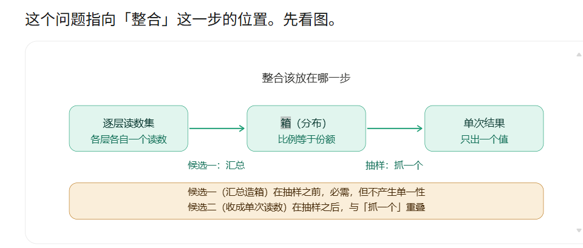

# 注记-从份额到概率：随机性的位置、单次结果的产生与玻恩诠释的关系

- **日期**：2026-09-25 05:58:44
- **层级**：内部草稿（未确认）
- **定位**：把「概率从哪来」与「单次结果怎么产生」这两问的链条在一处讲完。该链条此前散在五六份材料里，本稿首次给出从头到尾的叙述，并划清与玻恩规则、玻恩诠释及各主要诠释的关系。本稿为综述与辨析，不新增科学断言。
- **依据**：[[序参量份额定理：Born规则、归一化与幺正性的系综推导]]（份额到概率的数学推导）；[[份额的抽样口径与半经典分工：束缚振荡晶格上的抽样机制读数]]（抽样规则的模型侧）；[[内部草稿/注记-采样三联：自触发、无偏性与带限连续极限的合成命题]]（无偏性）；[[验证脚本/注记-单系统Born采样的最小验证：相位均匀性与份额角向采样]]（M4，第 37 条）；[[内部草稿/注记-相位均匀性的辨析：共同节拍与共同相位基准的区分、Weyl 等分布的论证逻辑与条件性边界]]（触发基准的辨析）；[[内部草稿/总结报告-L 组判据状态总览（2026-09-25）]]（读数可靠性）；[[内部草稿/研究方向-心侧入场：主体抽样、整合功能与物侧搭档（判据草案）]]（整合与抽样）；[[理论攻坚/测量问题攻坚纲领：三条承重墙的闭合]]（裁决点 3）；[[内部草稿/注记-概率与位置的体系侧解释及其自洽审查：份额来源、两层采样与分层完备性]]（份额与分层）
- **状态**：综述与辨析稿。材料事实照引，对照与判断自标。
- **修订记录**：
  - **2026-09-25 初版**（触发：作者批准把该链条写成单独注记）
  - **2026-09-25 附表并入**（触发：作者指示把 L 组总览的附表移入本文）
    - 并入「整合位置的口径核对」附表，并同步第二节第四段与第三节其三的措辞，消除正文与附录的相抵
    - 图移入 `images/integration_position_chain.png` 并改用标准图注写法；附表自称由「本节」统一为「本附录」

---

## 一、为什么要单独写这一篇

「概率从哪来」这一问的答案已经分散成型：数学推导在《序参量份额定理》，抽样规则在《份额的抽样口径与半经典分工》与采样三联注记，相位均匀性在 M4 与相位均匀性辨析注记，读数可靠性与整合在 L 组与心侧入场草案。

没有任何一处给出从头到尾的叙述。本文补这一处，并把它与玻恩规则、玻恩诠释的关系说清。

## 二、链条的四段

**第一段，份额给出分布形状。** 体系里概率的原始量是份额，即模式权重 $N_a/N$。在同步条件下振幅系数满足 $|c_a|^2 = N_a/N$，由此 Born 规则成为推论。这一步已在《序参量份额定理》中完成，该文已定稿。

**第二段，随机触发给出抽样时刻。** 触发时刻由相位自身的临界条件给出，无需外部时钟；触发落在相对相位的哪一点上是随机的。其依据为相位均匀性，材料见第 37 条（M4）与相位均匀性辨析注记。

**第三段，无偏抽样把份额变成频率。** 抽样落点的频率分布等于份额，偏差随格点数与采样数收敛（载子计数无偏、开链端点效应为 $O(1)$、闭链严格均匀）。材料见采样三联注记与 `验证脚本/README.md` 第 91 至 93 条。

**第四段，抽样给出单次读数（其能动性侧即整合）。** 单次测量只出一个结果。整合与抽样是同一个事件的两张面孔：机制侧叫抽样，能动性侧叫整合，两者是同一个事件，不存在两个重叠的步骤。该事件按最简无损切法定下取值范围，该切法由任务唯一确定（三值任务三档、二值任务两档，各只有一种）。材料见 L 组总览与心侧入场草案；整合位置的完整口径核对见本文附录。

## 三、与玻恩的关系（三条边界）

**其一，与玻恩规则的数学形式不冲突。** 体系没有改动这条关系的表达式，它改的是地位：从不可追问的公设变为份额恒等式的结果。任何已完成量子实验的统计预测照旧。

**其二，与玻恩诠释的公设地位是取代关系。** 玻恩诠释把「概率等于模方」当作终点，体系把它当作中转：份额在上游给出它，抽样在下游兑现它。

**其三，心侧参与的边界在 L5。** 当前分工为物侧给分布、认知侧给抽样。按此，概率的分布侧住在物侧，单次抽取住在认知侧。L5 管的正是这一处归属。若将来裁定抽样那一事件的执行者改住物侧，边界随之移动，而链条本身不变。故这一处归属既是这条链的要害，也是尚未裁定的留白（见附录）。

## 四、随机性的位置（本方案的实质主张）

裁决点 3（2026-09-12）记单次测量的随机性来源为触发与背景，属本体实现。这句话与标准诠释有一处实质差别：标准说随机是基本的、不再追问；体系说随机住在触发与背景里，属真实发生的事。

体系没有消掉随机性，它把随机性从「理论的基本特征」搬到了「一个可以被指认的位置」。搬动本身是进步也是代价：进步在于随机性有了出处，代价在于那处出处还需要方程。

## 五、与标准诠释的初步对照

**哥本哈根。** 坍缩是公设，测量与经典装置的界线靠约定划出。体系把坍缩换成跨层事件，界线由装置的响应类型决定（裁决点 4），代价是事件本身没有方程。

**GRW 与 CSL。** 自发坍缩按速率发生，与「无自发坍缩」的实验界直接冲突。体系为触发型（探测器层位转移触发），无自发坍缩为显式边界声明，故现有实验界不约束它。

**玻姆。** 位置始终确定，随机性退为统计陈述，并须补一条平衡条件。体系取 2026-09-24 的乙读法：测量前不存在位置事实，随机性留在触发与背景，与裁决点 3 一致，代价是个体层的位置降为产物。

**多世界。** 无坍缩，全部分支并存。体系给出单一结果，其来源是最简无损切法的唯一性，不需要分支。

**一处须注意的对照口径。** 上述差别全在解释层。在可观测层，因为抽样无偏，体系的频率分布与标准量子力学逐档相同。

## 六、可观测层完全兼容

这是本稿最要紧的一句。抽样无偏意味着体系给出的频率分布与标准量子力学逐档相同，故体系与全部已完成量子实验一致，不存在可观测的冲突。冲突只在解释层：标准不给随机性找来源，体系给了一个，并且这个来源还需补方程。

## 七、未闭合项（四条）

**其一，跨层事件没有方程。** 位置事实由它产生，它是取乙裁决之后的承重件，也是本链条上唯一空着的一环。

**其二，触发分布没有方程。** 触发与事件是同一段机制的两面，故这一条与上一条同源。

**其三，相位均匀性为何成立尚未从更基本原理导出。** 它的成立依赖「圆上无内禀特殊点」这一结构判断，以及参照独立与频率比不可通约两处精确前提（见 M4 注记 §五）。

**其四，L5 的机制面仍在待攻。** 抽样落点的频率等于份额目前只在模型侧结案，真实的碰撞动力学是否按份额抽样尚无读数。

## 八、与既有论文的分工

《序参量份额定理》管数学推导，回答「份额如何给出 Born 规则与归一化」；《份额的抽样口径与半经典分工》管抽样规则的三条性质；《记录的判据》与《探测器与记录》管记录的成立与实现。本注记管机制与诠释的完整叙述，回答「随机住在哪里、单次结果如何产生」。三者的引用关系借此划清，避免重复推导。

## 九、严格程度与边界声明

**材料事实与本稿判断的分层。** 第二节四段与第七节四条为材料事实（各引来源）。第三节至第六节的对照与判断为本稿的辨析，不新增科学断言。

**一处须标的限度。** 第五节各诠释的对照为一句概括，各诠释内部流派繁多，本稿只取其主要主张作比，不作流派学意义上的详尽比对。

**边界。** 本稿不改动任何基准文档与已裁决事项，不投入论文。不验证：跨层事件的动力学；触发分布的方程；心侧参与是否可完全限制在单次抽取一侧。

## 十、登记衔接

本稿不新增开放问题条目，其第七节四条与既有条目对应（前两条归 [[开放问题总览：元相子理论待解决问题清单]] 的 P4-6（测量塌缩的元相子机制），其余两条归 P4-10 与 P3-12 的现有登记）。它是将来论文《从份额到概率》的底稿，论文的启动条件为跨层事件的构成条件完成。

## 附：整合位置的口径核对（2026-09-25）

本附录记一轮口径核对（本线与并行线）就「整合发生在哪一步」得出的结论。此前的表述把整合与抽样当作两个步骤，由此生出两处误判（整合多余、以及一个据错误前提立的二难排除），故立此附录。

**其一，整合在第三格。** 链条为：逐层读数集 → 箱（分布）→ 单次结果。整合落在第三格（箱到单次结果），与抽样是同一个事件的两张面孔：机制侧叫抽样（从分布取一次样本），能动性侧叫整合（把多的收成一）。两者不是两个重叠的步骤；取消「整合」这个名字只是取消一个描述，那个事件本身不能取消，取消就没有单次结果。

**其二，汇总不是独立动作。** 第一格与第二格在机制上重合：层位就是格点，故逐层读数就是场构型本身；箱（份额分布）在体系里有物侧定义（亏空深度与滑量密度两个一致代理）。逐层读数与箱属同一件事的两种说法，中间没有一步叫汇总。

**其三，切法分三层，只有第三层归整合。** 装置提供切法（装置响应类型决定档划分，M6 与裁决点 4）；第 403 条的 L8 判决该切法是否与任务对齐（无损与否）；第 404、407 条的 L7 判整合是否在无损切法里取最简。把「切法定档」整体算作整合的职责，会与 L8 的归属相抵。

**其四，L4 与 L5 是同一事件的两面。** L5（物侧给分布、认知侧给抽样）管那一事件的机制侧归属，L4（单一性来自整合）管那一事件的形式特征（一次取一个，故单次）。两者不是两条独立步骤，故「单一性来自整合」这一名称须按下述限定理解：这里的整合指抽样那一次动作的能动性侧描述，不是抽样之外的另一步。

**其五，「确定性」指取值范围。** 单一性可拆两半：单次性来自事件形式（一次取一个），确定性来自任务的切法（最简无损唯一）。其中确定性所指为**取值范围的确定**（是哪几档），落点仍然随机。不补这一句，「确定性」会被读成「结果确定」，与 Born 统计相抵。

**一处须记的偏差。** L4 的判据化形态写的是「放宽提取预算不产生多值读数」（单次性侧），而第 407 条实测的是「预算增大而输出档数不变」（切法侧）。两者相关而不同：407 的读数间接支持原判据（切法未变，抽样仍是一次一个），但未直接测多值。引用时须注明，避免混用。

**一处留白。** 第三格那一事件的执行者是物侧还是心侧，尚未裁定。物侧判负清单目前只有一条已判负，穷尽未做完，故「整合只能由心做」立不住。若将来裁定由物侧执行，「心的整合」须改挂别处（挂回第一格或挂到方向校准一侧），L4 的名称随之再改。本项与第七节其四相关而不同：其四问抽样是否真按份额发生（机制面），本项问谁执行那次抽样（归属面）。