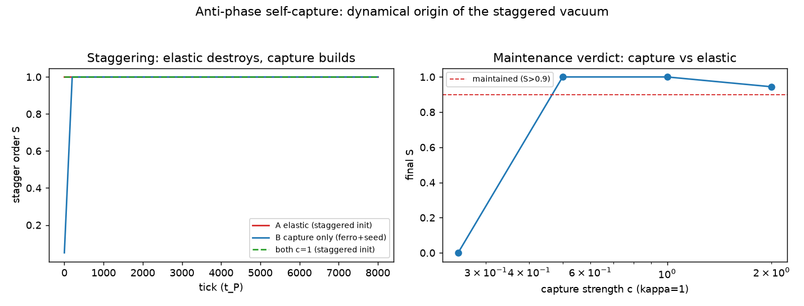

# 注记-基态光子的反相自囚禁：晶格的自构筑机制与交错序的动力学起源

- **日期**：2026-09-06
- **层级**：内部草稿/（未确认的新内容，确认后固化）
- **定位**：作者表述（2026-09-06）的理论落档与数值判决。三件新内容：其一，三个基态光子的法线轴两两正交构成立方晶胞（立方晶格与各向同性的生成理由）；其二，反相自囚禁——自由基态光子必然无限直飞留下窟窿，稳定晶格来自邻居光子的反相捕获（跃迁一个 $l_P$ 迎头相撞、各自回返、循环往复），晶格是光子互相囚禁的自构筑产物；其三，一次碰撞事件 = 相位满周闭合 = 最小时间周期 $t_P$，时间由螺旋阶梯几何自我生成而非外部参数。判决实验确认：交错序由碰撞动力学组织——纯弹性既不能生成（铁磁 + 种子无进展路径）也不能维持（交错态为零力驻点、微扰即塌向铁磁），碰撞捕获从铁磁自组织出满交错（$S \to 1.000$）并在弹性拖拽并存下维持（阈值 $c \approx 0.5$）。交错序难题（物理真空为交错序、弹性弛豫下却不稳定的旧观测）就此闭合：**交错真空不是弹性极小，是碰撞网络的组织态**
- **关联**：[[注记-扇区约束动力学：两种绕数的裁决与T4T5判定|注记-扇区约束动力学]]（[D1] 交错背景弹性不稳定观测，本案前身）；术语提案（键弹性的螺旋读法：反相属于碰撞事件，弹性只管法线轴高度差）；[[碰撞写入标架几何：引力场的碰撞写入与费米子的转换波运动|碰撞写入标架几何]]接口二（时空 = 背景振荡晶格、碰撞之墙）；钉扎身份验证（反相泡核心同相区候选）；三元组哈密顿量（三个相位组分与三正交光子族的共振）；SU(3) 三圆纠缠；螺旋阶梯几何基准（心物双螺旋）；[[文小刚体系与天行新学逐点对照]]§2.5（太极渊源）；P1-33
- **脚本**：`验证脚本/minimal_verification_antiphase_capture.py`（确定性、无随机数，N = 64 周期环，结果打印终端 + 一图 `images/minimal_verification_antiphase_capture.png`，见 §四 图 1）
- **状态**：判决完成。反相自囚禁在 1D 捕获模型下成立；三维二部性、捕获踢的微观形式与强度 $c$ 的体系身份为遗留

---

## 一、来源与命题

作者表述（2026-09-06）的完整主张分四件。**其一（晶格的生成）**：三个基态光子的法线轴两两正交构成立方晶胞；晶格不是外部给定的舞台，是光子互相囚禁的自构筑产物，三个互相正交的基态光子即生成三维晶格并必定各向同性。**其二（囚禁的机制）**：自由基态光子必然以光速无限直飞，直飞留下窟窿、稳定晶格不可能；被邻居光子的**反相**所束缚——跃迁一个 $l_P$ 后与迎面而来的基态光子迎头相撞、各自回返、再撞下一个迎面而来的光子，如此循环，每个基态光子被严格束缚在 $l_P$ 立方晶胞内。**其三（时间的自我生成）**：一次碰撞事件 = 相位满周闭合 = 最小时间周期 $t_P$；钟摆式往返是宇宙最根本的计时基准，不是外部参数；宇宙自己生成时间，再用这个离散时间丈量与传播物理相位的连续演化。**其四（客观性）**：离散普朗克时空晶格是复平面单位圆相位旋转的必然几何特性，非计算方便；相位圆属本体层数学空间（天圆），立方晶胞属物理空间（地方），天圆地方互补；背景的普朗克频率与能量无梯度处处均匀，与引力分属不同层面（引力是标架记录，见碰撞写入）。

## 二、与既有定案的对接

**法线轴裁定**（键弹性原始形式 = 法线轴高度差，cos 降级为角度投影）为反相命题腾出了逻辑空间：弹性只管高度差，角度序（反相）的来源必须另找——本注记的答案是由碰撞动力学供给。**接口二（碰撞之墙）**早已登记"时空 = 背景振荡晶格，物质调制其度量，不凭空生成时空"，反相自囚禁给出背景振荡自身的发生学。**三元组共振**：三元组哈密顿量的三个相位组分 $\varphi^a$ 与三正交光子族的三个法线轴是否同一个三，与 SU(3) 三圆纠缠的三圆是否同源，登记为对照问题。**心物双螺旋**：螺旋阶梯几何基准登记的双螺旋结构，其动力学实现即相向光子对的反相互绕。**天圆地方**：本体层数学空间（圆）与物理空间（方）的互补分层与本体/现象二分同构。**判据性对接**：钉扎身份验证曾把"反相泡核心同相区"列为强钉扎候选，反相自囚禁为反相结构在真空背景中的地位提供了机制语境。

## 三、两处精确化

**反相的层位**：法线轴裁定下逐键一层的背景在角度投影上处处同相（铁磁读法），与"反相"字面存在表面张力。精确化：**反相属于碰撞事件本身**（迎头相撞的两个光子在碰撞时刻反相对齐、各自满周回返），静态邻居构型的角度部分是投影层自由度，由碰撞动力学的系综行为输出（见第四节，输出恰为交错序）。**计时基准的单元**：一次碰撞事件（单程满周）= $t_P$；一次钟摆式完整往返 = 两个 $t_P$。作为计时基准时基准单元取单程满周，往返为摆的全周期，避免量纲歧义。

## 四、判决实验

模型：N = 64 周期环（N 偶保证反相自洽），站点相位 $\theta_n$（每腿 $2\pi$ 自由旋转对全体相同已约去）。三种动力学对照：

| 对照 | 动力学 | 初值 | 结果 |
|---|---|---|---|
| A0 | 纯弹性 | 精确交错 | S = 1.000 不动：交错态为弹性**零力驻点**（每键坐 $\sin(\pm\pi) = 0$），E = 128 = 弹性最大值 |
| A1 | 纯弹性 + 0.1 微扰 | 精确交错 | S $\to$ 0.000、E $\to$ 0：对称破缺后弹性把交错态拖向铁磁，复现扇区实验 [D1] |
| B | 纯碰撞捕获（二部调度：偶步偶键、奇步奇键，忠实于每边界每 $2t_P$ 一次碰撞、奇偶交替的几何） | 铁磁 + 交错种子 0.05 | S：0.050 $\to$ 1.000：**反相捕获从铁磁自组织出满 Neel 序** |
| C | 弹性 + 捕获并存（弹性持续拉铁磁，捕获仅碰撞事件起作用） | 铁磁 + 种子 | $c = 0.25$：S $\to$ 0（弹性获胜）；$c = 0.5, 1.0$：S $\to$ 1.000（交错序被碰撞维持）；$c = 2.0$：S = 0.944（强捕获过冲） |

交错初值在并存动力学（$c = 1$）下 S = 1.000 保持：交错序在弹性拖拽下被捕获维持。

**结论**：反相自囚禁成立。弹性单独既不能生成交错序（铁磁侧无进展路径）也不能维持它（交错态是零力驻点、微扰即塌）；碰撞捕获在二部网络上从铁磁自组织出满交错，并在弹性拖拽并存下维持（阈值 $c/\kappa \approx 0.5$）。**交错真空是碰撞网络的组织态**：一个被碰撞时钟维持的非平衡自组织态——体系把它维持在弹性景观的顶点上。旧谜题（物理真空为交错序、弹性弛豫下却不稳定）就此闭合：交错序的来源与稳定性都在碰撞动力学里，弹性的角色只是法线轴高度差（裁定文本字面一致）。

## 五、最小作用量的测地线锚点（纲领层）

作者主张最小作用量原理是公理的推论。现成的数学锚点：圆柱面 $S^1 \times \mathbb{R}$ 上的测地线恰好是螺旋线——自由光子的无限直飞 = 覆盖层测地线，钟摆 = 带反射的测地线段，"沿螺旋走"即最小作用量的几何形态。路径积分 = 对螺旋形变的加权和，驻定相位落在经典螺旋上。此段为纲领层，尚未形式化。

## 六、边界与遗留

其一，1D 环模型；三维立方格同为二部图（反相自洽条件 $N$ 偶在三维为每方向偶数），三维自组织未做。其二，捕获踢的形式 $\sin(\Delta)$ 为代理（反相捕获的微观相互作用形式未建模，其强度 $c$ 的体系身份——与写入幅度、阻尼系数、$8\pi Gm$ 的关系——未定）。其三，阈值 $c/\kappa \approx 0.5$ 为模型内数值，物理对应待弹性身份基准化后重标。其四，三正交光子族与三元组、SU(3) 三圆的对照未做。其五，本注记为作者表述的落档与判决，未确认前不入理论总纲；反相自囚禁若经确认，将补全时空起源链条的最后一环（晶格的发生学）。
