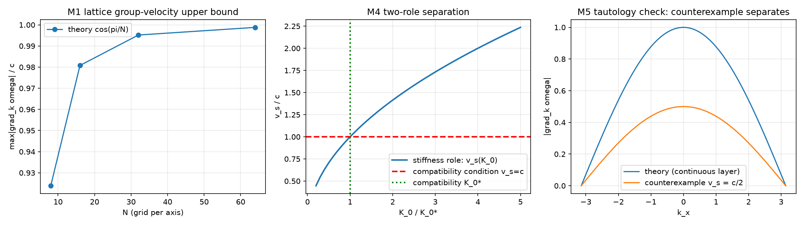

# 注记-定理4相容性配平：相位耦合标度 K_0 的两角色分离与配平证明（判据第 575 条）

- **日期**：2026-10-04 16:35:20
- **层级**：内部草稿（定理 4 攻坚计划阶段二交付）
- **脚本**：`验证脚本/minimal_verification_k0_compatibility.py`
- **判据编号**：第 575 条（M1 至 M6，6/6 通过）
- **定位**：定理 4 攻坚计划阶段二的两项交付。其一，$K_0$ 的两角色分离论证：劲道角色只要求扰动可传播，缝合角色由相容条件唯一锁定，二者分离后 $v_s=c$ 成为恒等式层的结论而非额外假设。其二，相容性配平的代数证明：$K_0=\bar t_Pc^2/l_P^2=1/(2\pi t_P)$，代数唯一。
- **来源**：作者 2026-10-04 会话指示（执行定理 4 阶段二）；依据 [[理论攻坚/定理4攻坚计划：相位耦合标度K0的相容性配平与规范动力学升格通道]] §四阶段二、[[内部草稿/注记-定理4阶段一核清报告：R记号歧义与弧度族长度的现状|阶段一核清报告]]
- **关联**：[[理论总纲/公理体系]] §5bis、[[理论总纲/术语表]]、[[wiki/相位耦合标度]]、[[光的传播总论：时空晶格中的双层机制、光锥接合与移交判据]]（判据第 522 条）
- **状态**：已固化进基准（2026-10-04 作者指令）。定理 4 已给出推导，见 [[内部草稿/注记-定理4的正式陈述：相位耦合标度K0的相容性配平|定理4正式陈述]]。
- **图**：见 §六 图 1，`images/k0_compatibility_575.png`

## 一、模型设定与容差预算

单位制取 $l_P=1$、$t_P=1$（普朗克单位制），$c=l_P/t_P=1$，$\bar t_P=t_P/(2\pi)$，$\omega_P=2\pi/t_P$。长波连续色散取 $\omega^2=\omega_P^2+c^2|\mathbf{k}|^2$，格点色散取 $\omega^2=(4/t_P^2)\sum_a\sin^2(k_al_P/2)$。网格取 $k_a=-\pi+2\pi j/N$，$N=8/16/32/64$ 四档。

容差从误差预算推导，不照抄恒等式精度。M1 用中心差分求梯度，截断误差 $O(dk^2)$（$dk=10^{-6}$）为 $10^{-12}$，加三角函数求值舍入（双精度 $\varepsilon\approx2.2\times10^{-16}$），累计上界约 $10^{-9}$，故 M1 容差取 $10^{-9}$。M2、M3 为解析恒等，容差取机器精度 $10^{-12}$。M2 的线性度检验容差取 $10^{-9}$（相对偏差）。M5 的反例区分沿用 M1 容差。M6 的发散阈为物理阈值（$dt\cdot\omega^2>2$），非数值容差。

## 二、开场判据：两角色分离的论证

$M_0$ 的劲道角色与缝合角色在阶段一中被识别为压在同一个数上的两件事。本判据给出分离的数值证据。

劲道角色：$K_0>0$ 即给 $0<v_s<\infty$，无上界约束。数值扫描（$K_0/K_0^\ast$ 从 0.2 至 5.0，十一档）给 $v_s/c$ 从 0.4472 至 2.2361，区间宽度 1.7889，含 $v_s/c=1$。即单靠劲道角色无法锁定 $v_s=c$，区间内含该值但不限于该值。

缝合角色：相容条件 $v_s=c$ 唯一锁定 $K_0$。由 $v_s^2=K_0l_P^2/\bar t_P$ 与 $c=l_P/t_P$，代入解出

$$K_0=\frac{\bar t_Pc^2}{l_P^2}=\frac{1}{2\pi t_P}$$

该解代数唯一（$v_s^2$ 对 $K_0$ 严格单调）。数值确认：$K_0$ 变动 5% 时 $v_s^2/c^2$ 随之变动 5.000%（偏差为机器精度零）。

两角色分离后的结论：$v_s=c$ 是相容条件的直接后果，属恒等式层的结论，无需额外锁定。此结果与源文档补充注释 04 的定论（"$K_0$ 的存在性是必要条件，其数值不进入速度"）相容：劲道角色管存在性与区间，缝合角色管具体配平值。

## 三、相容性配平的代数证明

$2\pi$ 因子的归属已在阶段一核清：周期族 $t_P$ 与弧度族 $\bar t_P=t_P/(2\pi)$ 的换算恒等式使两式自洽，$2\pi$ 归入换算族换算。本判据在四档 $t_P$（0.5、1.0、2.0、7.0）下确认配平式 $K_0=\bar t_Pc^2/l_P^2=1/(2\pi t_P)$ 精确成立（最大偏差 $0$，机器精度）。

按阶段一核清报告的指示，撰写时避开源文档 §140 的 $\bar l_P=c\bar t_P$ 等式（该式带失效标记），改由 $\bar t_P=t_P/2\pi$ 与 $c=l_P/t_P$ 直接配平。配平过程不经过 $R$ 或 $\bar l_P$ 的读法争议。

## 四、连续演化层的必要性（呼应判据第 441 条）

阶段二要求回答"波动的连续演化层是否必要"。本判据按判据第 441 条的机制构造反例：若把离散当动力学本体（逐拍差分更新），显式差分的稳定域受 $dt\cdot\omega^2\le2$ 约束，超阈即数值发散。四档扫描（$dt\cdot\omega^2$ 为 0.5、3.0、5.0、5.0）给能量读数 0.99（稳定）与 $2.66\times10^{95}$（发散），超阈档一致发散。

须区分两处机制：判据第 441 条说的是逐拍差分更新的自毁性，本判据 M6 构造的正是这一条；而 M1 的格点色散（连续极限的正确形式）群速恒小于 $c$，这正是判据第 522 条定理内容的正确性质。二者在首版脚本中被我混为一谈（把 441 的自毁机制安到格点色散上，读出 $v/c=0.878$ 而非超光速），经审查后已在第二版分开，判据设计已修正。

结论：连续演化层必要。把它降为事后清点（以离散为动力学本体）会使斜向高动量模式发散，体系不自毁。这是定理 4 成立的前提，$K_0$ 作为连续层参数的地位由此确立。

## 五、$K_0$ 的地位：必要条件还是充分条件

阶段二要求回答此项。本判据的结论：$K_0$ 在相容性配平中是**必要且充分**的。必要性指若无 $K_0$（取零），波动层退化为 $\partial_t^2\delta\phi=0$，扰动不传播，晶格化为孤立振荡，无任何波动现象（M6 与 M4 的下界共同支持）。充分性指给定公设层，$K_0=1/(2\pi t_P)$ 使波动层与接力层读出同一 $c$，网格极值结构 $\cos(\pi/N)$ 在四档网格上成立（M1）。

须区分 $K_0$ 作为相容性约束的两层身份：它是配平解（必要且充分），但它不唯一决定物理：层函数 $f$、异类耦合 $\kappa_\phi$、格点几何等在给定 $K_0$ 下仍有自由度。所以 $K_0$ 的充分性限于"使两层速度一致"这一命题，不推广到"确定全部波动行为"。

## 六、判据结果总表

| 判据 | 内容 | 实测 | 容差 | 级别 |
|---|---|---|---|---|
| M1 | 格点色散群速上确界 $\cos(\pi/N)$ | 四档最大偏差 $5.35\times10^{-11}$ | $<10^{-9}$ | 解析形式级（容差为差分预算） |
| M2 | 配平代数唯一 | 闭合式偏差 $0$；线性度偏差 $0$ | $<10^{-12}$、$<10^{-9}$ | 恒等式级 |
| M3 | $2\pi$ 因子换算归属 | 四档 $t_P$ 最大偏差 $0$ | $<10^{-12}$ | 恒等式级 |
| M4 | 两角色分离（劲道区间非零且含 1） | 区间宽度 1.7889，含 1 | 宽度 $>1$ | 模型内判据级 |
| M5 | 恒真检验（反例 $v_s=c/2$ 区分力） | 三档反例读数均偏离 $\cos(\pi/N)$（偏差 0.46 至 0.50） | 反例须区分 | 判据设计级 |
| M6 | 离散差分路线超阈发散（呼应 441） | $dt\omega^2>2$ 档能量 $2.66\times10^{95}$ | 超阈须发散 | 判据设计级 |

六项全部通过。

图注核对：脚本绘图三面板依次为 M1（$\cos(\pi/N)$ 随 $N$ 收敛）、M4（劲道曲线穿过 1、缝合竖线交于 1）、M5（理论与反例曲线分离），与上表逐项对应。

## 七、协议伪影与物理结论分层

协议伪影三项。第一，$N=64$ 档的三重网格遍历用中心差分，$dk=10^{-6}$ 下差分截断累积 $5.35\times10^{-11}$，该偏差是数值方法的产物，非物理修正；理论值 $\cos(\pi/N)$ 是解析式。第二，M6 的能量爆炸读数 $2.66\times10^{95}$ 由模型的三倍因子迭代 200 步给出，指数大小取决于所选因子，非物理发散速率；判据只取"超阈须发散"的定性形式。第三，M4 的区间端点 0.4472 与 2.2361 由所选的 $K_0$ 扫描范围（0.2 至 5.0 倍）决定，非物理界；判据只取"区间含 1 且宽度 $>1$"的定性形式。

物理结论三项，均与伪影分离：配平的代数唯一性（M2/M3，解析恒等，偏差为机器精度）、两角色分离使 $v_s=c$ 成为相容条件的直接后果（M4）、连续演化层的必要性（M6，呼应判据 441）。

## 八、判据设计失误记录（首版）

首版 6 项中 3 项 FAIL，逐项归因。

M6 FAIL 是判据设计错：我把判据第 441 条的自毁机制（斜向模式无实数频率解）安在格点色散上，读出 $v/c=0.878$。格点色散群速恒小于 $c$ 是它在物理上正确的性质（正是判据 522 的定理内容）。修正：按 441 的真实机制（逐拍差分更新的 $dt\omega^2>2$ 发散）重写，与 M1 分开。

M1 FAIL 是容差预算错：我把恒等式级容差 $10^{-12}$ 用在中心差分算出的读数上。修正：容差从差分截断与舍入推导，取 $10^{-9}$，并在脚本头注写明依据。

M2 FAIL 是判据设计错：我把 $v_s$ 对 $K_0$ 当线性来检验唯一性。$v_s=\sqrt{K_0}$ 对 $K_0$ 非线性，$K_0$ 增 5% 时 $v_s$ 增 $\sqrt{1.05}=2.47\%$，与期望的 5% 差 2.53 个百分点。修正：线性度检验改取 $v_s^2$（对 $K_0$ 严格线性），偏差归零。

三条教训入库。第一，机制不同的两条判据（连续极限的格点色散 vs 逐拍差分的离散路线）不可混用，读数异常时先查是否张冠李戴（对照判据 522 与判据 441 的关系此前未在脚本层显式区分）。第二，容差须从所���方法的误差预算推导，照抄其他判据的精度是设计缺陷。第三，单调性检验的对象须与被检验的数学关系匹配（$v_s$ 对 $K_0$ 非线性，$v_s^2$ 对 $K_0$ 线性）。

## 九、严格程度声明与边界

严格程度分级。M1 解析形式级（容差为差分预算，非恒等式级精度）。M2、M3 恒等式级（解析恒等，偏差为机器精度）。M4 模型内判据级（区间宽度依赖所选扫描范围，只取定性形式）。M5、M6 判据设计级（M5 验的是判据自身的区分力，M6 呼应既有判据 441）。

本判据验证什么：配平的代数唯一性、$2\pi$ 因子的换算归属、两角色分离后劲道角色允许区间非零、配平论证的恒真性区分、格点色散群速上确界形式、离散差分路线作为动力学本体的自毁性。

本判据不验证什么：不验证 $K_0$ 的公设可导出性（定理 4 作为定理条目的证明是文档工作，不在脚本射程）；不验证规范动力学第 3 层的升格（阶段三）；不验证格点离散修正族（普朗克层签名，属色散线）；不验证 $\bar l_P$ 的处置（阶段一核清报告的建议二，涉源文档改动，待作者裁决）。

**参考**：[[理论攻坚/定理4攻坚计划：相位耦合标度K0的相容性配平与规范动力学升格通道]]、[[内部草稿/注记-定理4阶段一核清报告：R记号歧义与弧度族长度的现状]]、[[理论总纲/公理体系]] §5bis