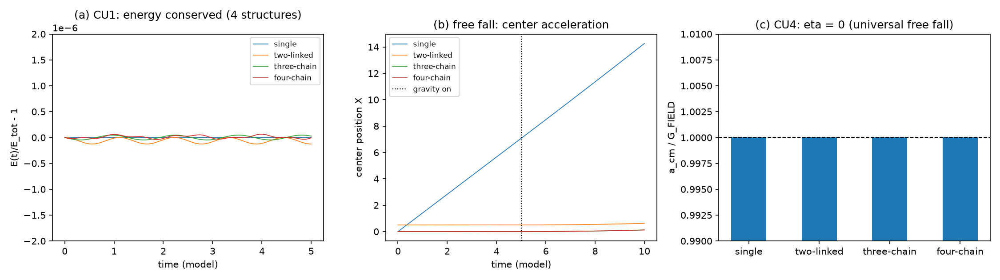
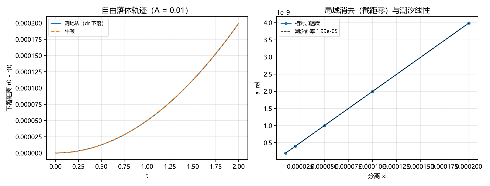
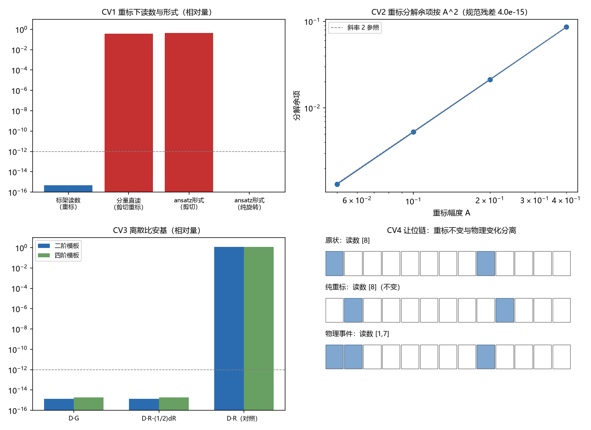

# 注记-广义相对论两公设定理化：等效原理与广义协变性的完整推导过程

- **类型**：注记（推导过程成文，不含新科学断言；把 [[内部草稿/材料-等效原理的定理化（WEP）：定理陈述、前提清单与两个裁决点|WEP 材料]]、[[内部草稿/材料-EEP合成：局域自由落体等效的定理陈述与前提清单|EEP 材料]]、[[内部草稿/材料-广义协变性定理化：定理陈述、前提清单与判定项|广义协变性材料]] 三份组织性材料展开为逐步推导，补入模型设定、读数、判别对照与过程记录）
- **日期**：2026-10-02 16:52:35
- **来源**：三份材料（2026-09-27）；[[验证脚本/注记-作用量转录的最小验证：通道二机制句的份额核验判据与伽马增强产出（判据TA1至TA5）|作用量转录注记]]（第 457 条 TA1 至 TA5）；[[验证脚本/注记-组成普适判据的最小验证：多形态缺陷的自由下落与eta为零（判据CU1至CU4）|组成普适注记]]（第 459 条）；[[验证脚本/注记-EEP合成（第468条）：自由落体等于测地线、局域消去与潮汐|EEP 合成注记]]（第 468 条 EE1 至 EE3）；[[验证脚本/注记-广义协变性（第469条）：坐标重标下的标量性、规范同型与离散比安基|广义协变性注记]]（第 469 条 CV1 至 CV4）；[[内部草稿/注记-等效原理的推导：双折算系数为一与弱等效原理（第459条候选）|等效原理推导注记]]；[[理论总纲/元相子理论的时空观：体系对时空的完整认识]] §六与§七
- **关联**：[[理论总纲/子理论索引]]；[[内部草稿/开放问题档案/开放问题-P1-5-爱因斯坦场方程的完整导出]]
- **图**：见 §2.6 图 1（`images/composition_universality.png`）、§3.2 图 2（`images/eep_synthesis.png`）、§4.2 至 §4.5 图 3（`images/general_covariance_checks.png`）
- **状态**：待作者确认（三条推导链的级别已在 2026-09-27 逐条裁定，本注记不改级别，只补推导细节）
- **可逆性等级**：全链判据稳健（第 457、438、440、459、468、469 条均为解析恒等式、代数恒等式或带收敛阶核对的读数，不依赖调参）

## 一、对象、范围与两条公设的分层

广义相对论有两条公设，本注记覆盖它们的定理化全过程。等效原理（EP）分三层强度：弱等效原理（WEP，引力质量与惯性质量之比为普适常数）、爱因斯坦等效原理（EEP，WEP 加局域洛伦兹不变性与局域位置不变性）、强等效原理（SEP，再加引力自能物体同等参与）。广义协变性（GC）断言物理描述的形式不随坐标重标改变。

两条公设的定理化在体系内的定级已逐条裁定（2026-09-27）：WEP 与 EEP 为条件性定理级，广义协变性为条件性定理级（表述层推论）。SEP 未动，归黑洞线强场。本注记不重新裁定，只回答"每一步怎么算出来的"。

定理化的共同结构是四环：前提清单（每条标性质）、推导步骤（每步给出模型与读数）、判定项（每项注判据编号与结果）、边界移交（未关闭的前提归何处）。四公设加惯性的总盘点见 [[内部草稿/材料-狭义相对论与广义相对论的公设定理化盘点：四公设加惯性的现状、级别与路线]]。

## 二、WEP 的推导：双折算系数相除

### 2.1 定理陈述与前提清单

**WEP 定理（体系内，条件性）**：在前提 A1、A2、P1 至 P5 下，任意自由下落的缺陷系统（任意内部结构、任意能量分配、任意速度）的引力荷与惯性荷之比等于普适常数，归一化后两者相等；自由落体质心加速度与内部结构无关。

前提清单（性质照材料）：A1 每拍节律（全局同步的相位推进，公理层）；A2 作用量量子（每拍一份、单位圆几何给出 $\hbar$，公理层）；P1 作用量份额定义（写入幅度等于当拍作用量份额 $Et_P/\hbar$，转录增益为一，定义层，2026-09-27 裁决取甲）；P2 变率继承（惯性即方向变率的持久性，作者采纳 2026-09-26）；P3 二阶唯一性（完美弹性禁耗散、Ostrogradsky 禁高阶，结构论证）；P4 能量单一性（引力耦合与惯性抵抗读出同一份缺陷能量 $E$，机制陈述）；P5 简并的最深层登记方式（份额层"体系内只有一种荷"，定义层，裁决取乙）。

### 2.2 第一步：引力半边（作用量转录，增益为一）

碰撞写入机制给出：有质量粒子不改变摆程、不变速、不动格点，只在每次全局普朗克碰撞事件向波性侧法线场写入标架倾角

$$\delta\theta = \frac{m}{m_P}.$$

作用量转录判据（第 457 条 TA1 至 TA5，共 10/10；原拟 448，与磁铁机制撞号后按落盘先后顺延）把这一幅度改写为当拍作用量积累相对 $\hbar$ 的份额：

$$\delta\theta = \frac{E\,t_P}{\hbar}.$$

两种写法相等即 $m/m_P = E\,t_P/\hbar$，配合 $m_P = \sqrt{\hbar c/G}$ 与 $c = l_P/t_P$ 回到 $E$ 的关系，这一步给出引力耦合 $m_g \propto E\,t_P/\hbar$。关键读数：TA1 给份额与幅值的锁定（增益恒一，四档质量扫描散布零）；TA2 给 $\gamma$ 缩放精确（$\beta = 0.9$ 时读数 $2.294$，恰等于该档的 $\gamma$）。

本步的物理内容：进入引力耦合的量是缺陷的**总能量** $E$（绑定能与动理部分），没有任何物种特异的参数进入折算。TA3 另给登记侧只读（十拍写入作用量速率漂移零），保证份额一经写入不被二次改写。

### 2.3 第二步：惯性半边（变率继承，折算为一）

惯性微观来源由变率继承提案定案（2026-09-26 作者采纳）：校正事件在摆程边界改写方向变率，实轴方向由它逐摆程累加给出；变率的持久性即惯性的机制内容。二阶时间结构是唯一稳定形式（完美弹性禁耗散、Ostrogradsky 定理禁高阶），二阶动力学的惯性系数折算固定为一（每拍抄写一次、瞬时无损）。判据支撑为第 438 条（三判据：二阶性、惯性系数不可观测、两侧同源，3/3）与第 440 条（轴向偏折两路线判决，3/3）。

惯性质量的读出：缺陷总能量 $E$ 对变率变化的抵抗，

$$m_i = \frac{E}{c^2}.$$

与引力半边同构：进入惯性的量也是总能量 $E$，无物种特异参数。

### 2.4 第三步：双一相除

两半读出同一份 $E$，相除：

$$\frac{m_g}{m_i} = \frac{E\,t_P/\hbar}{E/c^2} = \frac{c^2 t_P}{\hbar} = \frac{1}{m_P}.$$

中间等号用的是恒等式 $c^2 t_P/\hbar = 1/m_P$（配合 $c = l_P/t_P$ 与 $m_P = \sqrt{\hbar c/G}$ 可直接验证），故比值是普适常数、零自由参数，按惯例归一化后 $m_g = m_i$。**$E$ 相消是推导的核心**：引力耦合与惯性抵抗共享同一个能量量，任何能量形态的变化（动能、结合能、内部激发）在两半同步出现，比值不动。

### 2.5 第四步：速度无关（$\gamma$ 双重角色）

写入幅度的 $\gamma$ 增强（TA2）与相对论动力学的 $\gamma$ 为同一个 $\gamma$（经第 471 条洛伦兹群与第 472 条多观测者协议定级）。相除后速度依赖严格相消：动能参与引力与动能抵抗加速同步发生。这是速度无关性的机制来源，无需附加假设。

### 2.6 第五步：组成普适（升级为普适定律）

前三步对单一形态的缺陷成立。组成普适判据（第 459 条 CU1 至 CU4，共 7/7）把结论从"特例成立"升级为"普适定律"：多形态系统（单质点、两质点互连、三质点链、四质点链，同总能量 $E$）在均匀重力场中自由下落，质心加速度结构无关（相对散布 $3.55\times10^{-10}$，浮点差分噪声级），Eötvös 参数 $\eta = 3.16\times10^{-10}$。

组成无关的机制解释：$E$ 是唯一进位量，缺陷内部结构不进入任何换算率，故 $\eta$ 在模型精度下为零。第 459 条的定位是把 WEP 从"双折算系数为一时特例成立"升级为"对任意内部结构普适"。

### 2.7 WEP 的边界

内力成对抵消是解析恒等（牛顿第三定律在质点网络层），数值验证的是其离散实现。精确化依赖三维复合位错完整动力学（C1 线），模型级闭环里三个质量（响应质量 0.094、形状范数 0.0888、窗口有效质量 0.099）的 5% 散布待 C1 收窄。SEP（引力自能）不在本射程。写入算符的量子模型为共同前置。

## 三、EEP 的推导：三前提合成与几何基石

### 3.1 定理陈述与前提清单

**EEP 定理（体系内，条件性）**：在弱场与局域条件（尺度 $\xi$ 远小于记录场曲率半径）下，任意局域自由落体参考系内，非引力物理的规律与平直时空中的洛伦兹不变规律相同，至潮汐阶 $O(\xi^2)$。

前提清单：Q1 WEP（$m_g/m_i = c^2 t_P/\hbar = 1/m_P$，条件性定理）；Q2 局域洛伦兹不变性 LLI（低能洛伦兹涌现，色散 $\omega(k) = \frac{2}{t_P}|\sin(k l_P/2)|$，长波光速 $c = l_P/t_P$ 无自由参数，定理级）；Q3 局域位置不变性 LPI（写入平移不变 DB2 加节律全局同步，判据级加公理）；Q4 几何基石（自由落体即测地线、局域一阶消去、残余潮汐，判据级第 468 条）。

### 3.2 几何基石的判据（第 468 条，3/3）

模型为一维径向弱场：$\theta(r) = A/r$（体系静倾角刻度），度量 $ds^2 = -f\,dt^2 + h\,dr^2$，$f = 1-2\theta$、$h = 1+2\theta$（与 $h_{00} = 2\theta$ 同幅约定一致）。测地线从静止释放，满足 $E = f(r_0)$、$\dot t = E/f$、$\ddot r = (\theta'/h)(\dot t^2 - \dot r^2)$；牛顿对照为 $\ddot r = \theta'(r)$。积分用 RK4（$dt = 10^{-4}$）。

**EE1（自由落体等于测地线）**：$A = 0.01$ 时最大相对偏差 $3.992\times10^{-8}$（偏差$/A^2 = 3.99\times10^{-4}$），$A = 0.005$ 时 $9.990\times10^{-9}$（$/A^2 = 4.00\times10^{-4}$），两档比 $3.996$。一阶（牛顿层）完全一致，差异从 $O(A^2)$ 开始。这条比预期更强：牛顿方程已是首阶，测地线与其的差异必然从二阶起，判据据此把预期从"偏差 $\propto A$"修正为"偏差$/A^2$ 为常数"。

**EE2（局域消去与潮汐）**：相对加速度 $a_{\rm rel}(\xi) = \ddot r(r_0+\xi) - \ddot r(r_0)$ 的潮汐斜率 $1.994015959\times10^{-5}$，精确解析 $\frac{d}{dr}[\theta'/h] = 1.994015960\times10^{-5}$，偏差 $4.6\times10^{-10}$（弱场一阶 $\theta'' = 2.000000000\times10^{-5}$）；截距 $1.259\times10^{-19}$，相对线性项 $3.2\times10^{-11}$。

读法：自由落体系内均匀引力被消去，只剩与分离成正比的潮汐项。

**EE3（弱场标度）**：一阶加速度读数比 $2.0000$（$A$ 减半），线性标度。

### 3.3 三步合成逻辑

**第一步（自由落体系可定义）**：由 Q1，自由落体轨迹与组成无关，局域自由落体系作为等价类有定义。

**第二步（一阶消去）**：由 Q4，在自由落体系内度规的一阶（引力加速度）消去，残余为潮汐二阶项；几何层面回到准平直，等效原理的"局域"内容成立。

**第三步（不变性继承）**：在准平直局域系内，非引力物理的规律由 Q2（洛伦兹结构）与 Q3（位置不变性）承担，与全局引力场无关。三步合成给出 EEP。

### 3.4 EEP 的边界

SEP 归强场（黑洞线）。几何基石的模型是一维径向弱场，不含自旋、多极与含时场。

LLI 与 LPI 的"继承"原为引用性对接（Q2 与 Q3 引用既有线上已判成立的结论，未在自由落体系内做独立新数值），该遗留已于 2026-10-03 由判据第 556 条关闭：LL 侧三项（LI1 至 LI3）与 LP 侧两项（LP1 至 LP2）加 EP5 反例两项共 7 项全过。

LLI 的独立继承给出光速读数在四档 boost 下的系间散布恒为零、频率按多普勒因子变换（偏差 $1.1\times10^{-16}$）；LPI 的独立继承给出四档引力梯度下对称位置读数偏差不超过 $1.1\times10^{-15}$（见 [[验证脚本/注记-EEP合成判据（第556条）：自由落体系内LLI与LPI的独立继承|第 556 条注记]]）。

## 四、广义协变性的推导：三件支撑件与乘积格离散比安基

### 4.1 定理陈述与前提清单

**广义协变性定理（体系内，条件性，表述层推论）**：在弱场线性层与前提 P1 至 P4 下，记录场描述在任意坐标重标下形式不变：其一，物理读数（标架投影的潮汐与曲率）不随重标改变，变化的只是分量表述；其二，重标生成的表述自由度即场空间规范变换 $h_{\mu\nu}\to h_{\mu\nu}+\partial_\mu\xi_\nu+\partial_\nu\xi_\mu$，线性化曲率组合 $G^{(1)}$ 对其不变；其三，乘积格上离散缩并比安基恒等式 $D^{\mu}G_{\mu\nu}=0$ 精确成立，格点不破坏守恒结构。

前提清单：P1 记录场标量性（记录是碰撞事件的读数，坐标无关，$\theta$ 为标量，定义层）；P2 乘积格与一致对易差分（格距刚性，每轴取一个一致差分算子，定义层）；P3 让位链瞬时重标与规范变换同型（纯描述操作、瞬时全局、无传播，定义层，2026-09-04 裁决）；P4 弱场线性层（度规扰动与重标参数同阶截断，二阶及以上归 G1b 线，层级条件）；P5 缝合假设（注入-扩散平衡与守恒结构的对应，框架假设，保留未关闭）。

### 4.2 第一步：读数层（标架读数在重标下不变）

模型 CV1 用解析记录场 $\theta(x) = \exp(-|x|^2)$（三维静态），潮汐张量 $E_{ij} = \partial_i\partial_j\theta$；重标取"旋转加二次剪切"非线性映射，Jacobi 矩阵逐点解析。读数取推前标架分量。

- **CV1a** 推前标架读数在重标下偏差 $4.53\times10^{-16}$：标架分量在重标下不变。
- **CV1b** 同数据若把坐标分量直接当读数，漂移 $0.364$（对照量，说明判据有判别力）。
- **CV1c** 纯旋转下读数偏差 $2.27\times10^{-16}$、各向同性形式保持。
- **CV1d** 剪切重标下各向同性形式破缺 $0.454$（对照量）。
- **CV1e** 离散二阶差分 Hessian 偏差 $6.12\times10^{-2}$（步长 $h$）与 $1.55\times10^{-2}$（$h/2$），比值 $3.938$，二阶收敛。

### 4.3 第二步：表述层（规范同型）

模型 CV2 用四维格点（$N=16$，周期边界，低频谱随机度规扰动），差分取每轴一致两点或四点中心差分，各轴算子对易。

- **CV2a** 表述项 $h_{\mu\nu}\to h_{\mu\nu}+\partial_\mu\xi_\nu+\partial_\nu\xi_\mu$ 的线性化爱因斯坦张量为零，相对 $3.98\times10^{-15}$（机器精度）：重标在表述层的纯规范部分不改变曲率组合。
- **CV2b** 重标诱导变化按一阶拆成表述项与输运项，余项按幅度 $A$ 与 $A/2$ 为 $8.588\times10^{-2}$ 与 $2.123\times10^{-2}$，比值 $4.045$：一阶分解恒等式成立，余项从二阶开始。

### 4.4 第三步：守恒层（乘积格离散比安基）

模型 CV3 同 CV2 的四维格点，但改用四阶模板复验。

- **CV3** 二阶模板：$D^{\mu}G_{\mu\nu}$ 相对 $1.34\times10^{-15}$，$D^{\mu}R_{\mu\nu} - \frac12 D_\nu R$ 相对 $1.33\times10^{-15}$；四阶模板分别为 $1.90\times10^{-15}$ 与 $1.84\times10^{-15}$。对照量 $R$ 单独散度为 $1.18$（二阶）与 $1.16$（四阶）：格点不破坏比安基，且判据有判别力。这一条已写入基准（术语表「离散比安基（乘积格）」）。

### 4.5 第四步：让位链核对（纯描述与物理事件可分离）

模型 CV4 用格链：缺陷位置与相邻缺陷间格数即读数。CV4a 序保持置换加边缘外扩（纯重标，逆映射复原）读数 $[8]$ 不变；CV4b 新缺陷落位（物理事件）读数 $[1,7]$、缺陷位移读数 $[9]$ 变化一格。两类操作在读出层可分离：纯重标不改读数，物理事件改读数。

### 4.6 广义协变性的边界

P5 缝合假设（注入-扩散平衡与守恒结构的对应，非线性层）仍为框架假设，本轮不关闭；源侧守恒（"$G$ 无散推源守恒"）的物理侧归张量桥 (d)。二阶与非线性完成式归 G1b 线。强场与 SEP 归黑洞线。让位链的动力学（让位额度与落位位置的选择机制）不在射程，CV4 只核对操作在读出层的同型性质。CV1 的标量性为设定层前提（记录即碰撞事件读数、坐标无关），判据核对的是由此构造的读数的不变性。

## 五、两条公设的连接与总览

两条公设在体系内的连接点有三处。

其一，WEP 的惯性半边与惯性公设同源（变率继承，第 438、440 条），而惯性本身在总盘点中定级为"结构论证级加判据级"，其定量来源（折算系数恰为一的更深依据）仍开放；这是 WEP 链条上唯一的软肋，且不在本注记射程内。其二，EEP 的 Q2（LLI）由低能洛伦兹涌现承担，属狭义相对论定理化线（光速不变三源、P11 分层定理）；两条公设在此交汇：等效原理的"局域"内容依赖狭义相对论的"无优选系"内容。其三，广义协变性的 P3（让位链瞬时重标）与光速不变的第二源（接力几何）同源，重标操作的"纯描述、瞬时全局、无传播"性质与接力几何的"每拍传一格"性质是同一套格点读数层的两种表述。

四公设加惯性的定级汇总（2026-09-27 逐条裁定）：光速不变为几何恒等式级（三源）；狭义相对性原理为条件性定理级（P11 分层定理）；WEP 与 EEP 为条件性定理级（第 457、459、468 条与第 438、440、447 条）；广义协变性为条件性定理级（表述层推论，第 469 条 11/11）；惯性为结构论证级加判据级。SEP 未动，归黑洞线强场。

## 六、过程记录（判据设计的教训）

三条判据的初版都出现过设计错误，教训已写入各自注记，此处汇总以便复用。

其一，**收敛阶检验必须固定随机实现，只缩放被检验参数**（第 469 条 CV2b）。初版漏掉 Lie 导数中 $h$ 的两项 $E^{T}h + hE$，且不同幅度用不同随机抽样，比值失真（两次判负 $2.45$ 与 $7.65$）；修正为同一抽样、仅缩放幅度后余项按 $A^2$（比值 $4.045$）。

其二，**本征式展开的斜率必须用高阶拟合或区间外推，直接线性拟合会被下一阶污染**（第 468 条 EE2）。初版一次拟合偏差 $2.6\times10^{-4}$；改用二次拟合（区间收窄至 $2\times10^{-4}$）后降到 $4.6\times10^{-10}$。同条另一处初版把 $\theta/h$ 当成 $\theta'/h$（漏一次求导），斜率符号与量级均错。

其三，**判据预期应从理论推出，凭直觉定预期会判错**（第 468 条 EE1）。初版预期偏差与 $A$ 线性（比值 $2$），实测 $3.996$；定位为正确物理（牛顿方程已是首阶，差异从二阶起），判据改为"偏差$/A^2$ 常数"，结论比预期更强。

其四，**判据须核推前读数，拿坐标分量当判据会判错**（第 469 条 CV1c）。初版把"纯旋转下坐标分量不变"当判据，实测偏差 $0.261$ 判负；定位为判据设计错误（分量在旋转下按张量法则转动属正常），应核"推前标架读数不变"与"各向同性形式保持"，修正后读数为 $2.27\times10^{-16}$ 与零。

其五，**被差分对象须核对**（第 469 条 CV1e）。初版把解析 Hessian 的采样场当作被差分对象（应差分 $\theta$ 本身），实测误差 $13$、比值 $0.97$ 判负；修正对象后二阶收敛复现（比值 $3.938$）。

## 七、严格程度汇总与剩余边界

| 环节 | 内容 | 判据 | 结果 | 定级 |
| --- | --- | --- | --- | --- |
| WEP 引力半边 | 份额锁定、增益恒一、$\gamma$ 精确 | 第 457 条 TA1 至 TA5 | 10/10 | 条件性（前提 P1 定义层） |
| WEP 惯性半边 | 变率继承、二阶唯一 | 第 438、440 条 | 3/3 + 3/3 | 结构论证加判据 |
| WEP 合成 | $c^2 t_P/\hbar = 1/m_P$ | 解析恒等 | 零参数 | 条件性定理级 |
| WEP 组成普适 | 多形态自由下落、$\eta$ 为零 | 第 459 条 CU1 至 CU4 | 7/7 | 判据级 |
| EEP 几何基石 | 测地线、局域消去、潮汐 | 第 468 条 EE1 至 EE3 | 3/3 | 判据级 |
| EEP 的 LLI 侧 | 自由落体系内的旋转不变、光速读数系间恒等、方向比保持 | 第 556 条 LI1 至 LI3 | 3/3 | 解析恒等式级 |
| EEP 的 LPI 侧 | 对称位置平移不变、潮汐读数协变 | 第 556 条 LP1 至 LP2 | 2/2 | 判据级（稀疏解舍入） |
| GC 读数层 | 标架读数重标不变 | 第 469 条 CV1a 至 CV1e | 5/5 | 条件性（前提 P1 至 P3 定义层） |
| GC 表述层 | 规范同型、分解恒等 | 第 469 条 CV2a 至 CV2b | 2/2 | 条件性 |
| GC 守恒层 | 乘积格离散比安基 | 第 469 条 CV3 | 2/2 | 条件性（已入基准） |
| GC 让位链 | 纯重标与物理事件可分离 | 第 469 条 CV4a 至 CV4b | 2/2 | 条件性（前提 P3） |

剩余边界按紧迫度：SEP（引力自能天体，归黑洞线，最缺）；广义协变性的 P5 缝合假设（框架层）；惯性定量来源（WEP 上游，长期项）；C1 线收窄模型级 5% 散布。（LLI 与 LPI 的独立判据轮已于 2026-10-03 由第 556 条关闭。）

## 八、修订记录

- **2026-10-02 初稿**（作者指令"写一篇广义相对论两公设定理化的注记，详细描述整个推导过程"）
    - 把三份组织性材料（WEP、EEP、广义协变性）展开为逐步推导，补入模型设定、读数、判别对照与过程记录
    - WEP 五步（引力半边、惯性半边、双一相除、速度无关、组成普适）、EEP 三步合成加几何基石三判据、广义协变性四步（读数层、表述层、守恒层、让位链核对）
    - 汇总五条判据设计教训（收敛阶检验固定随机实现、斜率用高阶拟合、判据预期从理论推出、核推前读数、核对被差分对象）
    - 判据编号按 README 实际登记订正（作用量转录为第 457 条，原拟 448 撞号后顺延）
    - 三条推导链的级别已在 2026-09-27 逐条裁定，本注记不改级别，只补推导细节