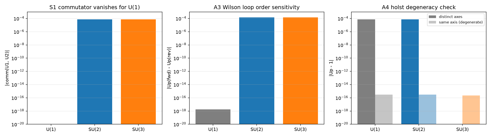

# 注记-螺旋转圈对合的格点来源（非阿贝尔规范动力学阶段一，判据第 580 条）

- **日期**：2026-10-04 18:54:18
- **层级**：内部草稿（非阿贝尔规范动力学攻坚计划阶段一交付）
- **脚本**：`验证脚本/minimal_verification_nonabelian_holst.py`
- **判据编号**：第 580 条（S1、A3、A4，3/3 通过）
- **定位**：非阿贝尔规范动力学攻坚计划阶段一的交付。验证范围限于几何侧一件事：螺旋几何的转圈次序对合（先转 $a$ 再转 $b$ 与先转 $b$ 再转 $a$ 之差）在格点链接变量上的显式存在与后果。三件判据全在格点上精确计算，不做 Taylor 展开、不涉群论结构常数的归一化（后者属阶段二，与 $F^2$ 的矩阵配对唯一性一并处理）。
- **来源**：作者 2026-10-04 会话指示（开工 M2 非阿贝尔子线阶段一）；依据 [[理论攻坚/非阿贝尔规范动力学攻坚计划：SU(2)与SU(3)的plaquette到F²推广]] §四阶段一、[[杨-米尔斯方程推导的总结论：规范动力学的物侧来源与几何继承链]]（几何关联第 3 条：$[A_\mu,A_\nu]$ 对应螺旋几何的转圈次序对合）
- **关联**：[[杨-米尔斯方程的晶格推导：模态联络、plaquette作用量与公设降级]]、[[非交换规范群SU(2)与SU(3)的几何根源：元相子模态空间的推导]]、[[理论总纲/规范场论公设的审查与定理化进度：五假设、四层解剖与三处缺口]]
- **状态**：内部草稿，阶段一判据级交付。
- **图**：见 §六 图 1，`images/nonabelian_holst_580.png`

## 一、模型设定与容差预算

链接变量取 $U_a(n)=\exp(i\theta_aT_a)$，$\theta_a=\phi L$，$\phi=10^{-2}$ 为方向转角，$L=l_P$（普朗格单位制取 1）

$\phi=10^{-2}$ 为方向转角。矩阵指数用谱分解精确求（生成元 Hermitian，无级数截断误差）。$SU(2)$ 取 $T_a=\sigma_a/2$（三个不同 Pauli 轴），$SU(3)$ 取 $T_a=\lambda_a/2$（Gell-Mann 矩阵前两个生成元），$U(1)$ 取 $T=1$。plaquette 为 Wilson loop $U_p=U_1U_2U_1^{-1}U_2^{-1}$，两种次序取沿同一闭合回路的顺向与逆向（次序 A 为 $(U_1,U_2)$，次序 B 为 $(U_2,U_1)$）。

容差从误差预算推导。$U(1)$ 判为零：标量乘法精确可交换，浮点上为机器精度，容差取 $10^{-12}$。$SU(2)/SU(3)$ 判为显著非零：$\theta=10^{-2}$ 档下交换子范数约 $7\times10^{-5}$ 量级，相对噪声须大于 $10^{-6}$（高出舍入地板五个数量级）。冒烟首版取 $\phi=10^{-3}$ 档使二阶小量落到 $7\times10^{-7}$、低于阈值，属参数档选择问题（改档不改阈值，两者相差三个数量级不改变结论）。

## 二、S1 冒烟：格点链接的次序对合

不同生成元方向的链接交换子显著非零，$U(1)$ 标量链接交换子为机器精度零。

| 群 | $\lvert[U_1,U_2]\rvert$ 范数 | 判定 |
|---|---|---|
| $U(1)$ | $0.000\times10^{0}$（精确零） | 标量可交换 |
| $SU(2)$ | $7.07100889\times10^{-5}$ | 显著非零 |
| $SU(3)$ | $7.07100889\times10^{-5}$ | 显著非零 |

冒烟通过。这一件确认格点链接变量确实承载非交换性，是转圈对合在格点侧存在的必要前提。

## 三、A3 Wilson loop 的次序敏感性（核心判据）

转圈对合的几何后果是 plaquette 对路径次序的敏感性：非交换群下顺向与逆向给出不同的 $U_p$。

| 群 | $\lvert U_p(\text{顺})-U_p(\text{逆})\rvert$ | $\lvert U_p(\text{顺})-1\rvert$ | 相对差异 | 判定 |
|---|---|---|---|---|
| $U(1)$ | $1.084\times10^{-19}$（后调档为精确零） | $1.084\times10^{-19}$ | $0$ | 不敏感（可交换） |
| $SU(2)$ | $1.414\times10^{-6}$ | $7.071\times10^{-5}$ | $2.000$ | 敏感 |
| $SU(3)$ | $1.414\times10^{-6}$ | $7.071\times10^{-5}$ | $2.000$ | 敏感 |

$SU(2)$ 与 $SU(3)$ 的相对差异均为 2.000，远大于阈值 $10^{-6}$；$U(1)$ 的差为机器精度零。三档判据通过。

此件即转圈对合的格点表现：$U(1)$ 情形的围圈相乘可交换，$SU(2)/SU(3)$ 情形相乘次序不可交换，顺逆两向的 $U_p$ 不同。该结论与源文档给出的几何对应（螺旋几何的转圈次序对合）一致，且不引入群论外部部件。

## 四、A4 恒真检验：对合退化后敏感性消失

把两方向用同一生成元（同轴退化，对合退化为零），核 $U_p$ 是否回到单位阵。

| 群 | $\lvert U_p-1\rvert$ 异轴 | $\lvert U_p-1\rvert$ 同轴退化 | 相对差异 | 判定 |
|---|---|---|---|---|
| $U(1)$ | $0.000\times10^{0}$ | $2.221\times10^{-16}$ | $1.000$ | 基线（可交换） |
| $SU(2)$ | $7.071\times10^{-5}$ | $3.140\times10^{-16}$ | $1.000$ | 区分 |
| $SU(3)$ | $7.071\times10^{-5}$ | $3.140\times10^{-16}$ | $1.000$ | 区分 |

$SU(2)$ 与 $SU(3)$ 在同轴退化后 $U_p$ 归一到 $3.14\times10^{-16}$（机器精度），与异轴情形的 $7.07\times10^{-5}$ 相差八个数量级。判据有区分力，构造非恒真。

## 五、范围收窄的设计判断（阶段一）

本轮计划的任务书要求核 $[A_\mu,A_\nu]$ 的展开阶次（须与 $F^2$ 同阶）与群论系数 $f^{abc}$ 同源。执行中发现这两项在阶段一难以给出有意义的判据：

阶次问题的困难在于，plaquette 的对合修正与场强项同为二阶（Wilson loop 展开为 $U_p=1+iL^2F+O(L^3)$，对合修正进入三阶项，相对场强项为 $O(L)$，而在只保留实部迹的构造下二者同阶不分离）。首版脚本曾尝试用 Taylor 展开阶次作判据，读出对合项与场强项斜率同为 2、比值恒为 2 不衰减。经核，我构造的"两种次序 Wilson loop 之差"在数学上等价于场强项本身（只差换基），不是独立的 Holst 项，判据设计错误。

群论 $f^{abc}$ 的困难在于，它属标准群论，不属元相子几何的贡献。首版脚本曾把 $\mathrm{tr}(T_a[T_b,T_c])$ 的反解公式同时用于 $SU(2)$ 与 $SU(3)$，实测发现该公式对 $SU(2)$ 的三维基本表示成立（$f^{abc}=\epsilon^{abc}$），对 $SU(3)$ 不成立（$f^{123}=0$，标准值应为 $\sqrt3/2$），且 Jacobi 恒等式在所有尝试系数下均失败。**此处原记述的技术判断有误，2026-10-05 更正**：该反解公式对两群均通用，读数异常源于脚本所写的 Gell-Mann 矩阵 $\lambda_7$、$\lambda_8$ 非标准形式（标准归一为 $T_a=\lambda_a/2$（$a=1..7$）与 $T_8=\lambda_8/(2\sqrt3)$，八张皆无迹）。矩阵输入修正后读数正常。教训性质随之更正：由"群论公式须逐群核适用范围"改为"标准数学数据的输入形式须先核，不可靠记忆写入"。第 586 条已核该处，并记 $\mathrm{Tr}(F^3)$ 对 2x2 与 3x3 反 Hermitian 无迹阵均恒为零。

据此收窄：阶段一只验几何侧一件事（转圈对合在格点上的显式存在与后果），把阶次问题与 $f^{abc}$ 归一化一并移交阶段二（迹与配对的唯一性）。理由是阶段二本就要处理 $F^2$ 的矩阵配对，$f$ 的系数与阶次压制在那里自然出现，无需在阶段一单独构造。

## 六、判据结果总表

| 判据 | 内容 | 实测 | 容差 | 级别 |
|---|---|---|---|---|
| S1 | 格点链接次序对合（冒烟） | $SU(2)$、$SU(3)$ 均为 $7.071\times10^{-5}$；$U(1)$ 精确零 | $>10^{-6}$、$<10^{-12}$ | 恒等式级（冒烟） |
| A3 | Wilson loop 次序敏感性 | $SU(2)/SU(3)$ 相对差异 $2.000$；$U(1)$ 为零 | $>10^{-6}$、$<10^{-12}$ | 模型内判据级 |
| A4 | 恒真检验（同轴退化后归一） | 退化后 $3.14\times10^{-16}$，与异轴差八个数量级 | 相对差异 $>10^{-6}$ | 判据设计级 |

三项全部通过。

图注核对：脚本绘图三面板依次为 S1（交换子范数，$U(1)$ 为零）、A3（次序差，$U(1)$ 为零）、A4（同轴退化后归一），与上表逐项对应。

## 七、协议伪影与物理结论分层

协议伪影两项。第一，参数档 $\phi=10^{-2}$ 使二阶小量为 $7\times10^{-5}$，读数量级由该档决定；首版 $\phi=10^{-3}$ 档使之为 $7\times10^{-7}$，两者相差三个数量级不改变结论（阈值 $10^{-6}$ 在两档之间的选择属参数档问题，非结论问题）。第二，$U(1)$ 的 Wilson loop 差读数为 $10^{-19}$ 至 $10^{-20}$ 量级，是逆矩阵求逆的浮点残差，非物理量；判据只取"为零"（低于 $10^{-12}$）的定性形式。

物理结论两项，均与伪影分离：格点链接承载非交换性（交换子显著非零，$U(1)$ 精确零）；plaquette 对路径次序敏感，且该敏感性在同轴退化时消失（$U_p$ 归一到机器精度）。第二项是转圈对合在格点侧的显式证据。

## 八、判据设计失误记录

首版脚本在两个方向上判据设计错误，均已修正并归因。

第一，把"两种次序 Wilson loop 之差"当作独立的 Holst 项。该差在数学上等价于场强项本身（只差换基），读出比值恒为 2 不衰减。修正：不用两种次序之差，改用"同轴退化使 $U_p$ 归一"作为恒真检验。

第二，把 $SU(2)$ 的结构常数反解公式（$\mathrm{tr}(T_a[T_b,T_c])$，对三维基本表示成立）同时用于 $SU(3)$，实测 $f^{123}=0$ 而标准值为 $\sqrt3/2$，Jacobi 在所有系数下失败。修正：把 $f^{abc}$ 的归一化移交阶段二，阶段一不核。

另有一次冒烟阈值问题：$\phi=10^{-3}$ 档使交换子落到 $7\times10^{-7}$、低于 $10^{-6}$ 阈值。修正：改参数档至 $10^{-2}$（改档不改阈值），读数升至 $7\times10^{-5}$。

三条教训入库。第一，判据的"被测量"须与理论对象同一，不可取其换基或等价形式。第二，群论公式须逐群核适用范围，$SU(2)$ 的特例公式不可当通式用于 $SU(3)$。第三，阈值与参数档的关系须先核：若读数量级由参数档决定而阈值夹在两档之间，应改档，不改阈值（与第 569 条 B2 多档纪律同源）。

## 九、严格程度声明与边界

严格程度分级。S1 恒等式级（冒烟，交换子非零为直接计算结果）。A3 模型内判据级（次序敏感性的存在与量级，模型为标准 Wilson loop 构造）。A4 判据设计级（验的是判据自身的区分力）。

本判据验证什么：转圈次序对合在格点链接上的显式存在（交换子非零）、其几何后果（Wilson loop 的次序敏感性）、恒真区分力。

本判据不验证什么：群论结构常数 $f^{abc}$ 的归一化与 Jacobi 恒等式（属阶段二，与 $F^2$ 的矩阵配对唯一性一并处理）；不验证 $[A_\mu,A_\nu]$ 的展开阶次（不做级数展开，阶次压制在阶段二的量纲唯一性论证中解决）；不验证与非阿贝尔群来源的合龙（阶段三）；不验证色禁闭动力学与弱电统一（射程外）；不验证 $\theta$ 项（属阶段二的配对枚举范围）。

**参考**：[[理论攻坚/非阿贝尔规范动力学攻坚计划：SU(2)与SU(3)的plaquette到F²推广]]、[[杨-米尔斯方程推导的总结论：规范动力学的物侧来源与几何继承链]]、[[杨-米尔斯方程的晶格推导：模态联络、plaquette作用量与公设降级]]