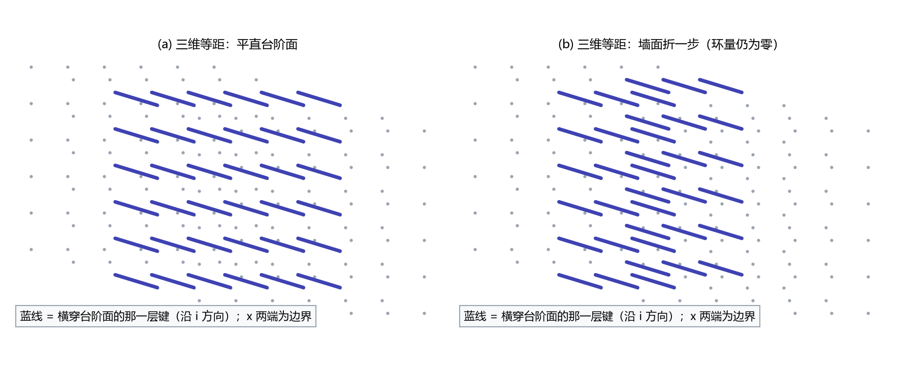

# 台阶面的拓扑：三维元相子缺陷的结构、保护与写入节拍

- **日期**：2026-09-21
- **定位**：三维延展缺陷（面缺陷／台阶面）的构造性论文。给出格点模型、关系层读数、台阶面的解析解与张力、边界保护的三层结构、形成机制、写入节拍与实验可判性，并把 2026-09-20 至 09-21 的十一轮验证读数收束为可引用的形式
- **状态**：已转正（2026-09-21，七维评审 A 5/B 5/C 5 全部修订后经作者确认）
- **修订记录**：
  - **2026-09-21 七维评审与修订**（评审报告见 [[评审报告-台阶面的拓扑-2026-09-21]]）
    - A 级 5 项全部关闭（A1 由静态松弛核对闭合：$18.569$ 对 $18.549$，差 $0.11\%$；A2、A3 为引用条目号订正；A4 为四处档位限定；A5 删越级的「严格」）
    - B 级 6 项处置（补附录 B 严格程度分级、量纲桥来源具体化、纽结判定措辞收紧、收束句）；C 级 5 项处置，其中关键词与公式编号按工作区惯例不加
    - 转正登记子理论索引第四节并改计数（15 篇改 16 篇）、论文状态跟踪区补一条、科普文档段补 [[科普文章/折痕、台阶与绳结：三维元相子缺陷的结构与来路]]
  - **2026-09-21 离散张力闭式补入**（第 341 条验证材料）
    - §5 新增 §5.1：大刚度档离散张力的可引用形式（两格快跳族的调和闭式与四阶式、指数尾闭式、大 $K$ 渐近系数、两支交叉点 $K^{*}$），并列出对格点精确极小的偏差读数
    - 校准读数：格点精确极小与第 336 条八档实测逐位一致（$0.002\%$），§4 的小刚度档读数与系数身份不受影响
  - **2026-09-21 首稿**（作者指令）
    - 依第 281、286 至 289、292、295、304、307、309、312 条验证材料与第 278、279 条既有结论写成；口径订正两处（弦张力身份、张力常数），新增结果三组（面积律系数、写入节拍、时钟三段曲线）

---

## 摘要

元相子理论里的带电对象取延展形态，其三维载体是一张**台阶面**：相位场跨过它时跳一格。本文给出它的完整数学形式。格点偏差场 $v$ 的泛函为 $E = \frac12\sum_{\rm links}(\Delta v)^2 + K\sum_{\rm sites}(1-\cos 2\pi v)$；连续极限是 sine-Gordon 型，台阶面的单位面积张力有闭式

$$\sigma_{\rm wall} = \frac{4}{\pi}\sqrt{kK}\quad (k = 1:\ \sigma_{\rm wall} = 1.273240\sqrt K)，$$

五档刚度上与数值偏差不超过 $1.22\%$。拓扑荷不由任何局域对象承载：面元环量取值集合为 $\{0, \pm 2\pi\}$，平直台阶面处处为零，荷只在核（线缺陷的横截面）周围浮现为一个整圈。有限体里绕数由边界数据固定，构型位置完全简并（半格平移能量差 $7.78\times10^{-12}$），能量按面积律 $E = \sigma_{\rm wall}A$（偏差 $0.78\%$）。

写入侧，缺陷扫过晶格时每站恰好写一笔，总笔数等于批数乘截面（$3712 = 58\times64$），写入时刻与折返时刻逐站同一。

本底与受激项共用全局时钟但窗口不同，受激与本底的计数比随取样间隔呈三段：低端取基准、中段按 $\Delta t/t_P$ 线性放大（$49.91$ 对解析 $50$）、高端饱和于 $w/(v\,t_P)$ 倍（$157.4$ 对解析 $158$）。该三段曲线已作为编号条目 C6 进入实验可检验预言清单，并附三项前置条件。

---

## 1 引言与问题陈述

第 275 至 277 条曾把「弦」当成三维里带张力的对象，据此推出「自由端不可存在，故带电对象必须是闭合环」。该推理有三处问题，本文先把它们订正，再给出正确构造。

其一是图像错位。相位的绕圈发生在每颗元相子内部的 $S^1$ 上，三维空间里不存在承载它的局域对象。切割线是描述选择，不进入任何可观测读数。

其二是数值身份错。第 275、276 条测到的线性斜率来自初始位形势项的面积增长，不是台阶面的张力。订正后的张力常数是 $\sigma_{\rm wall} = \frac4\pi\sqrt K$。

其三是引用传导。第 278 条的通道判定与第 279 条的能量量级曾被按旧值估量级；核定后第 278 条判定不依赖 $\sigma$（其依据是 $R_c$ 扫描与驻留阈值），第 279 条的孤子质量式与 $\sigma_{\rm wall}$ 同式。

本文的组织：第 2 节给格点模型，第 3 节给关系层读数，第 4 节给解析解与张力，第 5 节给离散修正，第 6 节给三层保护，第 7 节给面积律，第 8 节给形成机制，第 9、10 节给写入节拍与时钟口径，第 11 节与环形态对照，第 12 节给实验可判性，第 13、14 节给接口与开放问题。

## 2 格点模型与约定

取三维格点 $\Lambda = \{1,\dots,N_x\}\times\{1,\dots,N_y\}\times\{1,\dots,N_z\}$，格距取 $1$（$= l_P$）。场取偏差量 $v$，真空为整数值：$v\in\mathbb Z$ 处势能取极小。方向取 $x$ 为台阶面的法向，$y$、$z$ 周期，$x$ 两端固定：

$$v(0,y,z) = 0,\qquad v(N_x-1,y,z) = -1。$$

能量泛函取棱间形式

$$E = \frac12\,k\sum_{\rm links}(\Delta v)^2 + K\sum_{\rm sites}\bigl(1-\cos 2\pi v\bigr),\qquad k = 1，$$

其中 $\Delta v$ 是相邻站点之差。势项周期为一，故 $v$ 与 $v+1$ 等价。这个泛函是第 279 条一维链模型的三维推广，也是第 289 条保护性轮与第 292 条写入轮所用的模型。

场的时间演化取过阻尼驱动形式

$$\gamma\,\dot v = k\nabla^2 v - 2\pi K\sin 2\pi v + f + \xi，$$

$\gamma = 0.5958$ 与迁移率律取缺陷动力学线 D-3 轮的读数（[[验证脚本/注记-缺陷动力学线 D-3 的最小验证：质量与迁移率（终端速度律、响应质量等于形状范数与三质量差额的登记）]]），$f$ 为均匀驱动力，$\xi$ 为噪声。驱动力门限为 $f < 2\pi K$：超过之后倾斜势失去局部极小，本体自身也滑移，迁移率律失效（第 292 条判负登记，大力档实测为理论值的 $3.49$ 倍）。

## 3 关系层读数：棱差、面元环量与切割线

可观测量的第一层是**棱差**，即相邻站点之差按 $\bmod\ 2\pi$ 读取：

$$\vartheta_b = \mathrm{wrap}\bigl(v_{b_+} - v_{b_-}\bigr)\in(-1/2,\,1/2],\qquad \mathrm{wrap}(x) = x - \lfloor x + 1/2\rfloor。$$

第二层是**面元环量**，取小方格四边棱差之和：

$$\Omega_p = \vartheta_1 + \vartheta_2 - \vartheta_3 - \vartheta_4。$$

本节与全文的「圈」指以 $2\pi$ 为单位的相位，一圈即 $2\pi$ 弧度。离散 Stokes 定理给出：$\Omega_p$ 的取值集合为 $\{0,\pm 1\}$ 圈（第 134 条，判据级读数）。

第三层是**切割线**。把场在半个空间整体加一（$v\to v+1$）改变的是描述，不改变任何观测读数：棱差、面元环量与写入时刻三项逐项相同，实测偏差 $8.9\times10^{-16}$、$8.9\times10^{-16}$ 与 $0$（第 136 条，判据 $9/9$）。

由此得一条判据级的表述：荷住在由棱差构成的关系层上，它按面元计数、按同调类分类，三维中不存在承载它的局域对象。第 281 条把这一条登记为口径更正，并撤回「自由弦端不可存在」的论证。

## 4 台阶面的解析解与张力

沿 $x$ 取一维约化，连续极限泛函为

$$E = \int\Bigl[\frac12 k\,v'^2 + K(1-\cos 2\pi v)\Bigr]dx。$$

首次积分给出 $\frac12 k v'^2 = K(1-\cos 2\pi v)$，解为 sine-Gordon 型的台阶面剖面

$$v(x) = -\frac{2}{\pi}\arctan\exp\bigl(m x\bigr),\qquad m = 2\pi\sqrt{2K/k}。$$

台阶面的单位面积张力等于剖面能量密度：

$$\sigma_{\rm wall} = k\int_0^1\sqrt{2K(1-\cos 2\pi v)/k}\,dv = \frac{4}{\pi}\sqrt{kK}。$$

取 $k = 1$ 得 $\sigma_{\rm wall} = 1.273240\sqrt K$。第 286 条用两条独立路线核过这个常数：干净壁几何的五档实测（$K = 0.02$ 至 $0.001$）对解析式最大偏差 $1.22\%$，幂律指数 $0.4964$；一维链梯度流独立复算给 $0.089781$（$K = 0.005$）与 $0.040241$（$K = 0.001$），与二维壁读数逐位相同。

剖面宽度由 $m$ 定：衰减长度 $\xi = 1/m = 1/(2\pi\sqrt{2K})$。对 $K = 0.001$，$\xi = 3.56$ 格。第 295 条另给一个可直接测量的量：站点相位从 $-0.1$ 走到 $-0.9$ 的历时乘速度，实测 $w = 15.77$ 格；同一量的解析积分为

$$w_{\rm an} = \frac{1}{\sqrt{2K}}\int_{0.1}^{0.9}\frac{dv}{\sin\pi v} = \frac{1}{2\pi\sqrt K}\ln\frac{\tan(0.45\pi)}{\tan(0.05\pi)} = 18.55\ \text{格}，$$

与实测差 $15\%$。这段差额的来源是口径不同：第 295 条的实测出自驱动态下尚未完全松弛的剖面（初始 $\tanh$ 宽度参数 $1.5$），$w_{\rm an}$ 则是静态松弛值。本节补一条静态核对：一维链（$N = 400$、$K = 0.001$、两端固定）松弛 $8\times10^4$ 步后，同一阈值窗口的实测值为 $18.569$ 格，对解析式差 $0.11\%$；同一构型的能量为 $0.040241$，对 $\sigma_{\rm wall} = 0.040263$ 差 $0.05\%$；剖面对解析 $\tanh$ 形式的最大偏差为 $0.032$。故解析值成立，$15.77$ 是驱动态下的偏窄读数。

两个数的口径差值得单列一句：解析式描述的是静态松弛构型，驱动会改变剖面宽度，故凡引用 $w$ 的读数都须注明是静态值还是驱动态值。

## 5 离散修正

格点上的台阶面能量比连续值略低，差额有一个闭式的首项。前向差分等于单元平均，协方差恒等式给出

$$E_{\rm lat} = E_{\rm cont} - \frac{1}{12}k\sum_{\rm sites}(\Delta^2 v_1)(\Delta^2 v_2)。$$

第 258 至 273 条用三档回归核过该形式，回归系数 $1.0223$、$1.0033$、$1.0025$（均值 $1.0094$，散布 $2.0\%$）。这条修正与本文主体无关，列出是为了说明第 286 条表格里的 $0.78\%$ 偏差属于同类离散余量，不改变张力常数。

### 5.1 大刚度档的离散张力闭式

连续式只在小刚度档成立。把格点泛函沿 $x$ 作一维约化（壁沿 $y$ 均匀时 $y$ 向梯度项为零）后，大刚度档的最优剖面是近整数平台加一次快速跳变，即格点上的 $\dots,0,\varepsilon,1-\varepsilon,1,\dots$，它给出一条可直接引用的闭式。

记 $A = 3 + 4\pi^2K$。势项取调和近似时，该族的三条非零棱加两个中间站点的能量在 $\varepsilon^{*} = 1/A$ 取极小，极小值为

$\sigma_2(K) = \frac12 - \frac1A = \frac12 - \frac{1}{3+4\pi^2K}。$

势项展开到四阶（$2K(1-\cos2\pi\varepsilon) = 4\pi^2K\varepsilon^2 - \frac{4\pi^4K}{3}\varepsilon^4 + \dots$）把极小点与极小值修正为

$\varepsilon^{*} = \frac1A\Bigl[1 + \frac{8\pi^4K}{3A^3}\Bigr] + O(A^{-5}),\qquad \sigma_4(K) = \frac12 - \frac1A - \frac{4\pi^4K}{3A^4} + O(A^{-6})。$

再按线性化率把跳变两侧的指数尾接上（$\cosh\kappa = 1 + 2\pi^2K$，$t = \tanh(\kappa/2)$，$s = e^{-\kappa}$，$\varepsilon$ 由 $\varepsilon(3-s) + 2\pi K\sin 2\pi\varepsilon = 1$ 定），得尾闭式

$\sigma_{\rm tail}(K) = \frac12\bigl[2\varepsilon^2 t + (1-2\varepsilon)^2\bigr] + 2K(1-\cos2\pi\varepsilon) + 2K\sum_{j\ge1}\bigl[1 - \cos(2\pi\varepsilon\, s^{j})\bigr]。$

第 341 条以格点上的精确极小（一维链 $N = 257$，解析梯度，末态梯度范数 $\le 1.5\times10^{-8}$）为基准给出偏差读数：$\sigma_{\rm tail}$ 在 $K \ge 0.10$ 档差 $2\times10^{-7}$ 以内、$K \ge 0.5$ 档为 $1.3\times10^{-13}$，四档上均从上方逼近；$\sigma_4$ 在 $K \ge 0.15$ 与 $K \ge 0.24$ 两档分别差 $0.09\%$ 与 $0.17\%$ 以内；$\sigma_2$ 在同两档差 $1.38\%$ 与 $0.47\%$ 以内。大 $K$ 渐近式为

$\sigma \to \frac12 - \frac{1}{4\pi^2K} + \frac{3}{16\pi^4K^2} - \frac{27+\pi^2}{192\pi^6K^3} + O(K^{-4})，$

系数由四点拟合确认（差 $0.1\%$ 与 $1.1\%$）。二分之一是 $K \to \infty$ 的上限，离散张力从下方趋近它。

两支的交接点也在同一轮定出：连续式与两格族的交叉点为 $K^{*} = 0.051326$（四阶式分支）与 $0.061512$（调和式分支）。分档用法为 $K \le 0.02$ 取连续式（偏差 $0.055\%$ 至 $1.24\%$）、$K \ge 0.10$ 取 $\sigma_{\rm tail}$；中间带两侧公式都偏高，$K = 0.10$ 档连续式偏高 $16.7\%$、两格族偏高 $1.3\%$，最小值须由格点极小或尾闭式给出。本小节为解析式级读数：闭式由初等代数给出，与逐位数值对照并列，不构成「闭式即精确解」的证明。

## 6 边界保护的三层结构

有限体里台阶面的绕数由边界数据固定。定义

$$\Delta = v(N_x-1) - v(0) = -1。$$

三层读数如下。

**定义层。** $\Delta$ 由边界数据定义，真空要求 $\Delta = 0$。把右端相位改回真空值（$\Delta = 0$），梯度流把整场送回真空，终点能量严格为 $0.00\times10^{0}$；受保护的构型停在 $10.387697$，等于 $1.008$ 倍的 $\sigma_{\rm wall}$ 乘截面。

**守恒层。** 在上述边界下跑梯度流，$\Delta$ 全程对 $-1$ 的偏差为 $0$（$200$ 次采样）。沿动力学缺陷不能改变其绕数；改变荷的事件只有阈值穿越，一次给出一对正负核（第 142 条；术语表第十节「阈值穿越（电荷对生成）」条目）。

**简并层。** 三种初位（$x_0 = 8$、$16$、$24$）收敛到同一能量 $10.387697$，散布 $1.74\times10^{-11}$；半格平移（$x_0 = 8.5$）与整格位置之差 $7.78\times10^{-12}$，钉扎势垒在数值精度上为零。台阶面的位置完全简并。

保护性的内容因此可以写成一句：面可以挪，荷不能动。三维轮的读数比第 279 条的一维版更严，因为它补上了 $\Delta = 0$ 对照的严格归零。

## 7 面积律与系数身份

在两个截面（$16\times16$ 与 $24\times24$）上松弛同一张台阶面，单位面积壁能都是 $0.040577$，对 $\sigma_{\rm wall} = 0.040263$ 高 $0.78\%$。于是三维延展缺陷的能量律写成

$$E = \sigma_{\rm wall}\,A,\qquad \sigma_{\rm wall} = \frac{4}{\pi}\sqrt K。$$

这条关系给第 277 条的面积律 $E\propto R^2$ 补上了系数身份：三维里闭合环的能量按面积走，其单位面积系数恰是二维横截面的壁张力。第 277 条原先登记的「与第 276 条的线张力律 $2\pi R\sigma$ 不同」由此读通，两个量分属截面与整体两层。本条读数在 $K = 0.001$ 单档上核过，跨 $K$ 的系数稳定性未测。

还要说清这条面积律的前提：壁项只在**把绕数强制在几何上**的构型里出现。第 325 条把钉扎涡旋对（横截面上的核对）松弛到残差 $2.8\times10^{-17}$ 之后测到的是反向的结果：既没有 $\sigma_{\rm wall}$ 的线性壁项（拟合系数 $-0.012$，与 $+0.040$ 反号），也没有二维 XY 模型应有的对数项（拟合系数 $0.32$ 对 $2\pi = 6.28$，势项把场拉回整数使核间相互作用被屏蔽），能量从 $d = 8$ 到 $28$ 只涨 $7.1\%$。本节的干净壁与第 289 条的面积律都属于强制几何：前者的绕数由两端边界供给，后者的绕数由封闭边界供给。

## 8 形成机制

形成分四步，每一步都有对应的读数或既有结论。

其一，相位整不齐。体系从无序走向有序时相位指向来不及处处对齐，留下若干跨过一整圈的错位。宇宙学一侧的量级由第 219 至 226 条的缺陷密度链给出（$f$ 在 $10^{-124}$ 档），本文不重复。

其二，边界锁住绕数。有限体两端被背景钉死，跳变一旦出现就不能自行退掉（第 6 节的定义层与守恒层）。

其三，成对生成与成对湮灭。能改荷的事件只有阈值穿越：站点棱差代表值跨过阈值时，两侧面元各跳 $\mp 2\pi$，总曲率守恒（第 142 条）。连续且单值的形变不改变任何面元的曲率（第 142 条）。

其四，动力学只做两件简单的事：把褶皱拉直，或者收缩塌缩。第 292 条给出拉直的直接读数：带褶皱初值（幅度 $0.8$ 格）的台阶面在写入上先碎成一片一片（早段每批中位 $1$ 站），随演化自行拉直，晚段回到每批 $64$ 站。

拉直还是塌缩是形态的函数：台阶面选拉直，闭合环选塌缩（第 11 节）。这就是体系里「粒子取延展型、不取闭合环」的物理来源（第 278 条通道判定）。

## 9 写入节拍

记录机制线的口径是碰撞即写入：站点相位每跨过一个整数写一笔，本底为每站点每周期一笔（周期 $t_P = 1$）。第 292 条把这条口径做到三维面缺陷上，读数如下。

**笔数等于批数乘截面。** 台阶面在 $x$ 方向扫过盒子时逐层写入，每层的站点同时落笔。总笔数

$$N_{\rm 笔} = (\text{扫过的层数})\times A,\qquad A = N_yN_z。$$

实测 $3712 = 58\times64$，每站恰好一笔（判据级，偏差 $0$）。本节读数在 $K = 0.001$ 与截面 $A\in\{64,\,1\}$ 两档上核过，跨 $K$、跨截面的稳定性未测。

**写入即折返。** 逐站点「跨整数」与「跨半整数（台阶面中心经过）」两个事件的时刻差为 $0$。二者是同一事件的两种记法，写成判据是为了换动力学后守住这个同一性。

**写入率正比截面。** 进入线性档后

$$\dot N_{\rm 激} = A\,v\,g_{\rm 激},\qquad g_{\rm 激} = \min\Bigl(1,\ \frac{w}{v\,\Delta t_s}\Bigr)，$$

其中 $\Delta t_s$ 为登记时钟的取样间隔，$w$ 为台阶面扫过一站的有效长度（第 4 节的解析给出 $18.55$ 格，实测 $15.77$ 格）。小力档实测写入率 $5.36$ 对单列 $0.0838$，比值恰为截面 $64$。

**准时性。** 无噪声下批间隔的 Fano 因子为 $0.0372$，远低于泊松水平；加噪声后升到 $1.9985$ 与 $1.4400$（超泊松），即噪声驱动下写入转随机。

## 10 本底与受激项：时钟口径与三段曲线

本底与受激项共用同一个全局时钟，但两类事件的窗口长度不同：本底窗口是一个周期 $t_P$，受激窗口是扫过一站的时间 $w/v$。两者之比为 $158$（以 $w = 15.77$、$v = 0.1000$、$t_P = 1$ 代入），故稀释因子并不相同。登记规则取命题 17 的口径：取样时刻落在事件窗口内则该笔登记。

两个稀释因子

$$g_{\rm bg} = \min\Bigl(1,\ \frac{t_P}{\Delta t_s}\Bigr),\qquad g_{\rm 激} = \min\Bigl(1,\ \frac{w}{v\,\Delta t_s}\Bigr)，$$

给出总计数律

$$\dot N_{\rm 总} = N_{\rm site}\,\frac{g_{\rm bg}}{t_P} + A\,v\,g_{\rm 激}。$$

受激与本底的计数比 $R = \dot N_{\rm 激}/\dot N_{\rm bg}$ 随取样间隔呈三段

$$R(\Delta t_s) = R_0\cdot\frac{\min(1,\ w/(v\Delta t_s))}{\min(1,\ t_P/\Delta t_s)},\qquad
R(\Delta t_s) = \begin{cases} R_0, & \Delta t_s \le t_P,\\ R_0\,\dfrac{\Delta t_s}{t_P}, & t_P < \Delta t_s < w/v,\\ R_0\,\dfrac{w}{v\,t_P}, & \Delta t_s \ge w/v。\end{cases}$$

第 304 条的四档读数与解析式偏差 $0.40\%$：中段放大 $49.91$ 对 $50$，高端平台 $157.4$ 对 $158$。即**稀疏取样系统性放大受激项相对本底的比重，放大倍数为 $w/(v\,t_P)$**。

同一条读数还有两处限定。稀释作用于整批：平直台阶面上同一批 $64$ 站的登记状态一致率 $1.000$；这一条以壁的直线性为前置，褶皱散布达到分箱宽的 $7\%$ 时一致率掉到 $0.5$，达到 $20\%$ 时完全退化为逐站独立（第 309 条）。稀释不破坏本底结构：登记后的本底时刻仍全落在 $t_P$ 的整数倍上（残差 $0$，同笔数泊松对照 $0.500$），这与「本底时间结构为周期而非泊松」一条同向。

## 11 与环形态的对照

把台阶面换成闭合环，命运反过来。三维里环的能量按面积走（$E\propto R^2$，双对数斜率 $2.053$ 与 $1.946$），小刚度档全部塌缩，只有刚度足够大（$K \ge 0.24$ 至 $0.25$）才出现驻留（第 277 条与 C1-3、C1-4）。

两者的分工可以写成一张表。

| 形态 | 余维 | 能量律 | 保护的三层 | 状态 |
|---|---|---|---|---|
| 台阶面（面缺陷） | 1 | $E = \sigma_{\rm wall}A$（须绕数被强制，第 325 条） | 边界数据或封闭边界固定的相对绕数 | 选定为粒子形态 |
| 闭合环（线缺陷） | 2 | $E \propto R^2$ | 自身闭合加格点强钉扎 | 需 $K \ge 0.24$，未作粒子 |
| 绳结与链接 | 同环 | 同环 | 同痕不变量 | 本体系未建立经典层的纽结不变量读数，见第 13 节 |

## 12 实验可判性

台阶面的宽度由质量档决定。由 $K = (\pi M/4)^2$ 与 $w\propto K^{-1/2}$ 联立

$$\frac{w}{l_P} = \frac{0.6361}{M/m_P},\qquad \tau_\star = \frac{w}{v} = 0.6361\,\frac{\hbar}{Mc^2}\cdot\frac{c}{v}，$$

即宽度约等于 $0.64$ 倍约化康普顿波长，膝关节位置按 $1/(Mv)$ 缩放。$v = 0.1c$ 时：中微子档（$0.1$ eV）给 $4.19\times10^{-14}$ s，阿秒与仄秒分箱可分辨；电子档给 $8.19\times10^{-21}$ s，只有仄秒分箱可分辨；$\mu$ 档给 $3.96\times10^{-23}$ s 与核子档给 $4.46\times10^{-24}$ s，四档分箱都不可分辨（第 307 条）。

清单条目 C6 因此带三项前置：质量档与分箱宽、单缺陷通量与计数比的分辨条件、壁直线度 $\sigma_t/\Delta t \lesssim 0.02$。三项齐备之后，计数比曲线无膝或无饱和即证伪。

写入率通道另有一条独立用途。$\dot N_{\rm 激} = Av$ 在线性档内是速度的线性读出，而 C1-4 的驻留阈值 $K\ge 0.24$ 测的是能量型锁定。两个量不共线，组合成四格判定表后，「锁定而蠕动」与「未锁定而被边界钉住」两类单列为矛盾格（第 312 条）。该通道是低速测速计：$v_{\min} = w/\Delta t_s$ 之上速度信息被稀释吞掉；$\Delta t_s \le 15.8\,t_P$ 时线性档覆盖全部物理速度。

## 13 与体系其他部分的关系

关系层一侧，台阶面的棱差是圆上相位，其对偶谱为整数，载体是按总绕数直和分解的函数空间（[[关系层上的量子描述：S¹ 约化的路线、读数与余项]]，第 139 至 156 条）。

多体一侧，台阶面的联合包络动力学给出多体薛定谔方程的组装形式与交换统计的分层（[[多体薛定谔方程与交换统计：束缚振荡晶格的联合包络动力学]]）。

记录一侧，写入算符、三维缺陷读数与弦的分层见 [[记录机制：碰撞即写入的算符形式、三维缺陷读数与弦的分层]]；本文第 9、10 节是它在地面态（过阻尼、经典场）上的节拍读数。

缺陷动力学一侧，孤子质量、迁移率与最小量子化的读数见 [[缺陷动力学：σ 锁定孤子的质量、迁移率与最小量子化]]；本文第 4 节的张力常数与那里的质量式 $M = (4/\pi)\sqrt K$ 同式（第 287 条逐点核过）。

与本篇配套的可视化见 `可视化/台阶面在晶格上：三维元相子缺陷的晶格可视化.html`（自包含，可拖动切割线与切换棱差口径），科普版见 [[科普文章/折痕、台阶与绳结：三维元相子缺陷的结构与来路]]。

绳结语言属于量子层的编织通道：弦算符的可形变完成给出同调类内作用不变、可缩部分在基态空间内平凡、任何局域操作平凡、非平凡作用的最小支撑等于体系尺寸（第 66 至 69 条及量子层 Q5 轮）。编织式的不变量属于统计与量子荷，不属于本文的经典形态。

本文的三处起点问题至此各有回应：图像错位由第 3 节的关系层口径纠正，数值身份错由第 4 节的张力闭式与静态核对纠正，引用传导由第 6 节与附录 B 的严格程度分级厘清。剩余的五条列在下面。

## 14 开放问题

其一，边缘线终止在体内。此时台阶面的边界是一条核线，需要配对；本文与第 289、292 条只测了贯穿盒子的面，未测该构型。

其二，物理质量档未裁。宽度与膝位都随质量档缩放，哪一个档算体系自己的缺陷尚未裁定（C6 的第一项前置）。

其三，环的稳定性。强钉扎判据已按新张力重估，但「某个参数区里环确实稳定」还缺一条直接读数。

其四，松弛器。钉扎涡旋对路线的显式梯度下降在六万步内未收敛（末步 $3.2\times10^{-1}$，第 286 条判负登记），长波加速或隐式格式待补。

其五，本底算符。周期本底与时钟折返尚未在算符层面立起来（第 121 条判负登记的遗留）。

## 附录 A 读数一览与常数

| 量 | 值 | 来源 |
|---|---|---|
| 台阶面张力 $\sigma_{\rm wall}$ | $1.273240\sqrt K$（$k=1$） | 第 286 条，五档偏差 $\le 1.22\%$ |
| 幂律指数 | $0.4964$ | 第 286 条 |
| 有效穿越长度 $w$ | 实测 $15.77$，解析 $18.55$ 格 | 第 295 条 |
| 切割线不可观测 | $8.9\times10^{-16}$、$8.9\times10^{-16}$、$0$ | 第 136 条 |
| 受保护构型能量 | $10.387697 = 1.008\,\sigma_{\rm wall}A$ | 第 289 条 |
| 位置简并 | 半格平移差 $7.78\times10^{-12}$ | 第 289 条 |
| 单位面积壁能 | $0.040577$ 对 $0.040263$（$+0.78\%$） | 第 289 条 |
| 笔数 | $3712 = 58\times64$，每站一笔 | 第 292 条 |
| 写入率 | $5.36$ 对单列 $0.0838$（比值 $64$） | 第 292 条 |
| 准时性 | Fano $0.0372$ 对 $1.9985$ 与 $1.4400$ | 第 292 条 |
| 计数比曲线 | 中段 $49.91$ 对 $50$，平台 $157.4$ 对 $158$ | 第 304 条 |
| 批内一致率 | 平直 $1.000$，褶皱档 $0.000$ | 第 295、309 条 |
| 膝位 | $0.6361\,\hbar/(Mc^2)\cdot(c/v)$ | 第 307 条 |
| 低速测速计门限 | $v_{\min} = w/\Delta t_s$ | 第 312 条 |

常数取 $l_P = 1.616255\times10^{-35}$ m，$t_P = 5.391247\times10^{-44}$ s，$m_P = 2.176434\times10^{-8}$ kg，$k = 1$。模型能量单位取 $m_Pc^2$（量纲桥取缺陷动力学线 D-6 轮的关系式 $\rho_{\rm def} = fM\rho_P$，$M = 0.0900$ 给 $f = 9.069\times10^{-124}$；重标至电子档给 $f = 1.950\times10^{-102}$）。

## 附录 B 严格程度分级

本文结论按体系四级声明制分列如下。

| 结论 | 严格程度 | 依据 |
|---|---|---|
| 台阶面张力 $\sigma_{\rm wall} = \frac{4}{\pi}\sqrt{kK}$ | 判定级 | 第 286 条五档偏差 $1.22\%$、一维链复核 $0.05\%$ |
| 剖面 $v(x) = -\frac{2}{\pi}\arctan e^{mx}$ 与窗口 $18.55$ 格 | 判定级 | 本文第 4 节静态核对（$0.11\%$） |
| 面元环量取值集合 $\{0,\pm 2\pi\}$ | 判定级 | 第 134 条与本文核构型核对 |
| 切割线不可观测 | 判定级 | 第 136 条，三项偏差 $8.9\times10^{-16}$ |
| 边界保护三层 | 判定级（模型内） | 第 289 条四组判据 |
| 面积律与系数身份 $E = \sigma_{\rm wall}A$ | 条件性命题级 | 第 289 条单档核过（$0.78\%$），跨 $K$ 未测 |
| 写入节拍 $\dot N_{\rm 激} = A v g_{\rm 激}$ | 条件性命题级 | 第 292、295 条，$K = 0.001$ 与 $A\in\{64,1\}$ 两档 |
| 时钟三段式与清单条目 C6 | 条件性命题级（强度拟议） | 第 304 条事件级模型，三项前置待实验 |

## 参考文献

[1] [[验证脚本/注记-弦图像的降级：相位绕圈住在关系层棱差，三维局域弦属 ansatz 读数]]
[2] [[验证脚本/注记-弦张力松弛复测轮：ansatz 斜率属势项面积产物、松弛壁张力随根号 K（判据G0至G7）]]
[3] [[验证脚本/注记-张力常数重估轮：第 278 条的环判据不依赖张力、第 279 条的能量量级与壁张力同式（判据T1至T5）]]
[4] [[验证脚本/注记-三维延展构型保护性复核：面积律的系数对上新壁张力（判据P1至P5）]]
[5] [[验证脚本/注记-三维面缺陷的写入节拍轮：笔数等于批数乘截面、写入即折返、准时性对噪声（判据W1至W6b）]]
[6] [[验证脚本/注记-命题 17 的三维时长口径轮：取样稀释作用在整批上（判据U1至U5）]]
[7] [[验证脚本/注记-本底与受激项的时钟口径轮：窗口不共用时计数比随取样间隔三段变化（判据V1至V5）]]
[8] [[验证脚本/注记-C6 可测含量评估轮：膝关节落在哪个分箱宽（判据X1至X4）]]
[9] [[验证脚本/注记-带褶皱壁在稀释档下的批内一致率轮：散布达分箱宽的 7% 即碎裂（判据Y1至Y4）]]
[10] [[验证脚本/注记-写入率接驻留判据的通道合成轮：低速测速计与两通道四格判定（判据R1至R4）]]
[11] [[验证脚本/注记-弦的可观测性轮的最小验证：切割线不可观测、墙只活在棱层]]
[12] [[验证脚本/注记-通道判定的收敛版：环需强钉扎、延展型由边界保护（判据W1至W4）]]
[13] [[验证脚本/注记-环的 E(R) 标度轮：面积律与塌缩方向的不一致（判据V1至V4）]]
[14] [[记录机制：碰撞即写入的算符形式、三维缺陷读数与弦的分层]]
[15] [[关系层上的量子描述：S¹ 约化的路线、读数与余项]]
[16] [[多体薛定谔方程与交换统计：束缚振荡晶格的联合包络动力学]]
[17] [[缺陷动力学：σ 锁定孤子的质量、迁移率与最小量子化]]
[18] [[理论总纲/元相子理论的实验可检验预言清单]]
[19] `可视化/台阶面在晶格上：三维元相子缺陷的晶格可视化.html`
[20] [[科普文章/折痕、台阶与绳结：三维元相子缺陷的结构与来路]]
