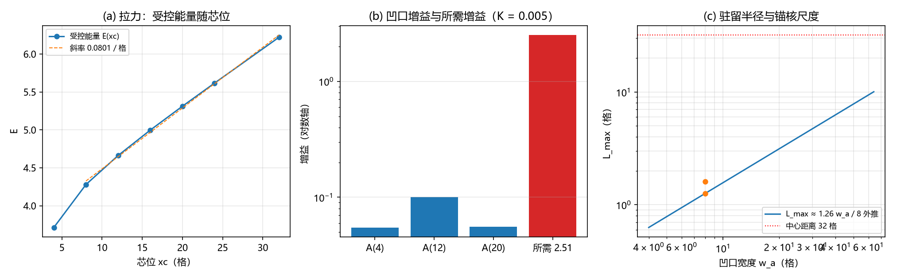

# 复合位错粒子的形态收束：宽度的波性侧承载、边界保护与锚核驻留判据

傅天行

（天行新学研究院）

## 摘要

复合位错粒子的三层解剖与两层分工定律已于 2026-09-06 给出，其三维形态的三个环节（宽度承载、保护的动力学实现、锚核驻留）一直未结项。本文收束这条支线：宽度等于波性侧软模的关联长度 $\xi = 1/(2\pi\sqrt{K})$，解析桥因子 $l^{*}/\xi = \pi/\sqrt{3}$，落窗与色散合成为 $K \le 1/48$ 与 $K \le 1/(16\pi^2)$ 两条窗口；保护实现为边界冻结，标签在动力学下精确守恒，同时给出"保护保标签不保位置"的读数；锚核的驻留能力量化为 $l_{\max} = A/\sigma$，局域锚核的内驻设计关闭为负结论。本文承接《从绕数困境到复合位错粒子：电荷载体问题的完整解决》与《从复合位错到爱因斯坦场方程：粒子机制现状综合与攻坚纲领》的三层解剖与分工定律，收束 C1 攻坚线（三维复合位错）的判据组，不引入新公设，为场方程完整形态（G1b）提供源侧形态学接口。

**关键词**：复合位错粒子；宽度窗口；绕数超选择；弦算符；锚核；壁张力；关联长度；驻留判据

## 1 引言

### 1.1 问题的提出

复合位错粒子是元相子理论的物质载体方案：粒子是均匀缠绕背景上的一道位错（kink），质量归锚核，电荷归电荷核，宽度与色散归包层 [1][2]。方案提出时留下三个与形态直接相关的未结项。

第一，宽度由谁承载。粒子要表现出正常的相对论运动学，需要一片不小于两格距的相干宽度；该窗口原挂在粒性侧的驻留态宽度上，而格点锁定与软体加局域凹口两条路线在三维判负（面积律），宽度需要新的承载者 [1]。

第二，保护如何动力学实现。绕数由波性侧的扇区结构守卫 [3][4]，结构层已有可搬用性判定；"真正把扇区冻住"的动力学一直未做。

第三，锚核能不能把粒子钉在体内。若保护只保标签、不保位置，位置稳定就由锚核单独承担，而锚核的能力边界此前没有量化。

本文收束这三个问题。

### 1.2 本文在体系中的位置

本文从心物波粒二象公理与两层分工定律（守卫归波、承载归粒、运动为两侧耦合）出发，承接《从绕数困境到复合位错粒子：电荷载体问题的完整解决》[1] 的三层解剖与《从复合位错到爱因斯坦场方程：粒子机制现状综合与攻坚纲领》[2] 的攻坚序列，收束其中的第一站（三维复合位错，代号 C1）。

本文不重复推导三层解剖、绕数超选择与弦算符结构 [3][4][5]、边缘通道的既有读数 [6]、一维链（FK 链）的 kink 解与色散验证、张量桥分段的既有内容 [7][8]，直接引用。本文使用的判据组分工（粒性侧 L 组、波性侧 W 组）来自 C1 攻坚计划。

### 1.3 结构预告

第 2 节给出模型、口径与判据框架。第 3 节收束宽度（W4）。第 4 节收束保护（W1、W2 与保护动力学）。第 5 节给出锚核驻留判据。第 6 节给出形态收束与对 G1b 的接口。第 7 节为严格程度声明与开放问题。第 8 节结论。

## 2 模型、口径与判据框架

### 2.1 复合位错的链模型

链模型取 FK 链：$ E = \sum \tfrac{1}{2}\kappa_e(\Delta u - 1)^2 + \sum K(1 - \cos 2\pi u)$。相邻格点相位差为一的均匀缠绕 $u_n = n$ 是背景（扇区极小），位错是局域多缠一层的 kink；包层弹性 $\kappa_e$ 与格点内锁定 $K$ 的比值决定宽度。

三层分工为：质量归锚核（$\kappa_{\varphi}$ 锁定，绑定能即质量），电荷归电荷核（绕数超选择守卫），宽度与色散归包层 [1]。本文全部宽度读数使用弹性超量密度 $\tfrac{1}{2}(\Delta u - 1)^2$ 的二阶矩宽 $l^{*} = 2\sqrt{r_2}$。

### 2.2 线扇区的横截面模型

线扇区（余维二）的横截面模型取 $u = u_0 + \theta/2\pi$，$u_0 = IX + IY$（均匀缠绕背景），$\theta = \operatorname{atan2}(y - y_0, x - x_0)$；绕数按 plaquette 环绕差之和定义（mod 1 口径），线缺陷即该二维涡旋沿 $z$ 向延伸。该模型与面壁（余维一）对照使用 [6]。

### 2.3 判据框架

每个环节先写判据与理论期望，再用确定性脚本求读数。判据分两组：粒性侧 L 组（载体、形态参数、锚核、基线），波性侧 W 组（扇区分解、弦形跨扇区算符、先验纠缠守卫、宽度承载）。保护动力学与锚核设计各成独立判据轮。全部结论按四级声明制标注（严格定理、条件性命题、纲领性主张、模型或方案）。

## 3 宽度归波

### 3.1 软模色散与关联长度

均匀缠绕背景上的相位涨落是这条线上的软模。线性化给出色散

$$$\omega^2(q) = \kappa_e \cdot 4\sin^2(q/2) + (2\pi)^2 K,$$$

最低一支带隙 $m = 2\pi\sqrt{K}$，关联长度 $\xi = 1/m = \sqrt{\kappa_e}/(2\pi\sqrt{K})$（取 $\kappa_e = 1$ 时 $\xi = 1/(2\pi\sqrt{K})$）。钉子越弱（$K$ 越小），软模的关联长度越大。数值核对：平面波谱逐点一致（$2.47\times10^{-14}$），有隙格林函数的衰减率与离散预测 $m_{\mathrm{d}} = 2\operatorname{asinh}(\pi\sqrt{K})$ 逐位一致。

### 3.2 三把尺子

同一个 $\xi$ 由三个独立读数确认：kink 尾部的指数衰减长度、平移零模的通量包络、带上最低一支波的波长。读数：尾部在七档 $K$（0.0005 至 0.02）上与 $\xi_{\mathrm{d}}$ 差在 $0.23\%$ 内；零模包络衰减率对预测差 $0.11\%$ 与 $0.01\%$；带边波长 $\lambda_{\mathrm{gap}} = 1/\sqrt{K} = 2\pi\xi$ 为恒等式。三把尺子合成一条读数：宽度即软模关联长度。

### 3.3 解析桥因子与窗口算术

把 kink 的解析剖面（sine-Gordon 孤子 [9]）代入二阶矩宽度，得解析桥因子

$$$\frac{l^{*}}{\xi} = \frac{\pi}{\sqrt{3}} = 1.8138.$$$

数值实测 $1.7845$ 至 $1.8121$（$K \le 0.02$），与解析值差在 $1.6\%$ 内（离散效应，随 $K$ 增大）；此前以"桥因子 1.803"登记的经验常量由此获得解析身份。$K = 0.05$ 档超出定义域（$l^{*}$ 饱和）。

窗口算术由此合成两句：落窗（$l^{*} \ge 2$，宽度不小于两格距）等价于

$$$K \le \frac{1}{48} = 0.02083;$$$

色散口径（关联长度本身不小于两格，$\xi \ge 2$，即洛伦兹窗口）等价于

$$$K \le \frac{1}{16\pi^2} = 0.00633.$$$

两条取交集，洛伦兹窗更紧（约 $3.3$ 倍），此时 $l^{*} \ge 3.63$（精确值 $l^{*} = \pi/\sqrt{3} \xi = 3.6276$）。交集非空且为一段连续区间，不需要精细调节。

### 3.4 三维维度无关性

三维格点上同一软模的带隙与一维相同（维度无关）；有隙格林函数的轴向与径向衰减率对一维预测差 $0.28\%$ 至 $0.43\%$。宽度机制在三维没有额外障碍。粒性侧此前在三维判负的是驻留路线的面积竞争，宽度读的是波谱，不参与面积竞争。

## 4 保护归边界

### 4.1 绕数是边界量

在三维线缺陷构型（横截面 $128^2$、$N_z = 8$）上逐切片核对：面积求和与边界回路求和一致（差 $\le 2.66\times10^{-15}$）；窗口测量按 C1-0 装置口径（横切平面、半格偏移、窗口不套两个交叉点）给出干净两档（含芯给 $1$、不含芯给 $0$）；$100$ 组三维球扰动与九档裕度扫描（球不触边界）标签精确不变；体内插入涡旋对让局部 plaquette 计数从 $1$ 升到 $5$，标签净零改变。扇区标签是逐切片可测的整数。

### 4.2 弦到边界

芯在内部任意路径上运动，标签恒为 $1$；四条路径（右、上、对角、折线）的标签跳变都发生在芯越过边界列 $x_0 = N = 128$ 的时刻，反向同位置跳回、无迟滞；只在 $z = 4$ 层越界时只有该层归零。三维里弦的作用范围决定改变的切片范围。

### 4.3 保护的动力学实现

保护的最小动力学实现取边界冻结：标签住在边界上（4.1），固定边界数据即固定标签，体内完全自由。四档对照（横截面 $N = 64$、$K_0 = 0.005$、梯度下降 20000 步）的读数：无保护时标签从 $1$ 衰减到 $0$（第 450 步，末能量 $0.0431$）；仅锚核同样衰减，钉芯救不了标签；仅保护时标签全程恒为 $1$（非一记录为零），能量从 $36.6532$ 收敛到 $5.2529$。

方法备注：首版实现取"全局硬否决"（每步试更新核对标签，改变则折半重试），梯度流滑到扇区边界后约 $98\%$ 的步被否决、近似停住（否决 $19582$ 次、折半 $489653$ 次）。该读数说明硬否决会把体内弛豫一并卡死；边界冻结实现与恒等式层面的一致（局部生成元与绕数对易）才是正确形态。

### 4.4 三项结构读数

其一，保护保标签、不保位置。仅保护运行时净荷滑到边界旁驻留（单格 $(1,32,+1)$，电荷质心从 $(32.5, 32.5)$ 滑到 $(1.00, 32.00)$）。原因是切割能：净荷的能量随芯到边界的距离单调上升（切割每长一格付出弦的张力 $\sigma_w$，见 §5.1），扇区极小因此贴着边界。

其二，锚核只保形状。保护加锚核的末态里，芯处留下 $(+1, -1)$ 偶极（冻结芯的失配结构），净 $+1$ 仍驻边界；体内剖面平坦（峰谷差 $0.042$ 与 $0.001$）。

其三，横截面模型内不存在内驻亚稳线缺陷。以上两条合起来给出：该模型内"体内稳稳停着的一条线缺陷"不出现；线扇区的宽度读数不成立，宽度归一维链（链的两端固定，本身即天然的保护）与第 3 节的 $\xi$。

## 5 锚核驻留判据

### 5.1 弦的张力

切割（弦）的能量密度由弛豫 kink 的总能量给出，与连续预测

$$$\sigma_w = \frac{4\sqrt{K}}{\pi}$$$

一致：$K$ 从 0.0005 到 0.05 的七档读数差不超过 $1.63\%$（其余档 $\le 0.6\%$）。$\sigma_w$ 是"把芯拉向边界"的定量尺度，与缺陷动力学线的孤子质量闭式同族 [10]。

分档口径（2026-09-21 补，第 341 条）：上式只在 $K \lesssim 0.02$ 档成立。C1 驻留窗口 $K \ge 0.24$ 落在大刚度档闭式区，那里连续式偏高 $49\%$ 至 $62\%$；该区改用四阶式 $\sigma_4 = \frac12 - \frac{1}{A} - \frac{4\pi^4K}{3A^4}$（$A = 3 + 4\pi^2K$，对格点精确极小偏差 $\le 0.17\%$）或与精确极小逐位重合的尾闭式。驻留判据 $l_{\max} = A/\sigma$ 里的 $\sigma$ 因此须按档取用。

口径限定（2026-09-21 再补，第 342 条）：$\sigma_w$ 在 §5.1 与 §5.3 里的身份是弦张力，而 §5.2 的拉力直接测量用的是 AN 构型（边界环按芯的解析相位冻结）。第 342 条判定该构型的拉力在刚度大档失效：三档实测拉力对同档张力闭式之比为 $0.88$、$2.56$、$3.01$，成因是边界环的相位随芯位漂移，其势能斜率在 $K = 0.24$ 与 $0.30$ 档占实测拉力 $84\%$ 与 $86\%$；把环改成不带漂移的取法后拉力趋零（$6.5\times10^{-4}$ 与 $2\times10^{-6}$），弦在该构型里不出现。故 §5.2 的 $0.0801$ 与 §5.3 的 $l_{\max} = A/\sigma$ 只在小刚度档作近似参考，C1 窗口的 $l_{\max}$ 须用强制净跳变的条带几何重测。

### 5.2 拉力与增益的直接测量

受控弛豫（芯盘与边界环同时冻结）给出能量随芯位的曲线：近似线性上升，斜率 $0.0801$ 每格，与 $\sigma_w$ 连续预测 $0.0900$ 同量级（差 $11\%$，来源为受控末态为边界净荷加锚核偶极的离散与结构效应，见 4.4）。凹口锚核 $K_{xy} = K_0[1 - d\exp(-r^2/w_a^2)]$（$d = 0.9$、$w_a = 8$）的增益为：芯在凹口中心 $A(12) = 0.1007$；芯在近边界 $A(4) = 0.0549$；芯在远处 $A(20) = 0.0556$。

### 5.3 判据与判别力检验

驻留判据定义为 $l_{\max} = A/\sigma$：芯距边界超过 $l_{\max}$ 即逃逸。实测 $l_{\max} = 1.26$ 格；把芯从近边界拉到中心所需增益 $ E(32) - E(4) = 2.51$，可及凹口差 $25$ 倍。

（2026-09-21 限定，第 342 条）：本条判据量在刚度大档的分母未经直接测量，窗口档的 $l_{\max}$ 待用条带几何重测后引用，见 §5.1 的口径限定。

标度对照：$K$ 从 0.005 到 0.02，拉力与增益按 $\sqrt{K}$ 等比放大（$0.080 \to 0.175$、$0.101 \to 0.282$），$l_{\max}$ 近似不变（$1.26 \to 1.61$），判据量由锚核的空间尺度决定。判别力检验：自由芯两档（逃逸距离约 $10$ 与约 $3$）都逃逸到边界，与 $l_{\max}$ 远小于两距离的预期一致。

### 5.4 设计结论

把芯停在中心（逃逸距离 $32$）按 $l_{\max} \approx 0.16\,w_a$ 外推需要 $w_a \gtrsim 47$，即凹口宽度接近全盒（$N = 64$）；该线性外推属假设（单档 $w_a$ 实测），多档直接测量列为后续判据。局域锚核内驻不可达；该开放项结项。

## 6 形态收束与接口

### 6.1 三层分工的修订表述

收束后的分工为：守卫归波（标签由边界数据承载，动力学实现取边界冻结）；宽度归波（宽度等于软模关联长度，粒性侧只给载体形态参数）；位置归锚核，但锚核的可驻留距离有上界（$l_{\max} = A/\sigma$）；承载归粒（能量、尺寸、形态）。原表述"包层供宽度"随之精确化：包层与锁定强度的比值定出关联长度，宽度读作该长度。

### 6.2 线扇区与面壁

在横截面模型内，余维二线扇区的内驻设计关闭为负结论；可稳定内驻的形态取余维一（面壁，边界钉扎承担绕数 [6]）与余维零（点，格点钉扎，K 阈值型；读数见 C1 攻坚计划，来源说明）读数。线扇区的宽度与驻留归其对应的低维读数：一维链的窗口与第 3 节的 $\xi$。

### 6.3 对 G1b 的接口

场方程完整形态（G1b）的源侧需要粒子形态给出质量密度、动量流与应力的粗粒化 [2][9]。本文的读数给出该接口的现状：源的一维形态与面壁形态已备（静质量密度与应力形态的读数见既有轮次），线扇区不提供内驻形态；G1b 的源侧以一维链与面壁口径为准。宽度与保护已收束，源侧不再有形态学未结项。

## 7 讨论

### 7.1 严格程度声明

| 结论 | 严格程度 | 依据与缺口 |
|---|---|---|
| 宽度 = 软模关联长度（三读数一致） | 条件性命题 | 条件为 FK 链模型与线性谱口径 |
| 解析桥因子 $\pi/\sqrt{3}$ | 条件性命题 | 连续 sech 剖面二阶矩；离散偏差 $\le 1.6\%$ |
| 窗口 $K \le 1/48$ 与 $K \le 1/(16\pi^2)$ | 条件性命题 | 取桥因子与两格距约定；交集非空 |
| 绕数边界性与弦越界（4.1、4.2） | 恒等式级加数值事实 | 离散恒等式到机器精度；扰动组确定性 |
| 保护 = 边界冻结（标签守恒） | 恒等式层面加模型层动力学 | 边界数据固定则标签不变 |
| 三项结构读数（4.4） | 模型层读数 | 横截面模型（$N = 64$），协议写在脚本内 |
| 壁张力（小刚度档 $4\sqrt{K}/\pi$，大刚度档闭式） | 条件性命题加解析式级 | 连续式只在 $K \lesssim 0.02$ 档与读数一致（差 $\le 1.63\%$）；大刚度档由第 341 条的调和式、四阶式与尾闭式给出（四阶式偏差 $\le 0.17\%$，尾闭式与格点精确极小逐位重合），两支交接点 $K^{*} = 0.051326$；C1 窗口 $K \ge 0.24$ 的连续式估计偏高 $49\%$ 至 $62\%$ |
| 驻留判据与负结论（5.3、5.4） | 模型层读数加设计推论 | 凹口锚核族；外推口径 $\approx 0.16\,w_a$；2026-09-21 限定（第 342 条）：拉力口径在刚度大档失效，窗口档的 $l_{\max}$ 与所需 $w_a$ 待用条带几何重测 |

### 7.2 局限与开放问题

其一，全部读数在最小模型（FK 链、横截面 $64^2$ 或 $128^2$）内成立，参数区间为体系窗口，格点尺度效应已按离散偏差登记。

其二，规范层（toric code 层）的荷是否携带同类切割能未判；若规范层的荷结构不携带切割能，则"锚核内驻不可达"的结论范围缩到标量相位模型。

其三，锚核族限于局域凹口；深阱、复合设计与场侧校准的锚核未测。

其四，线扇区的跨扇区通道振幅（量子层）引用既有读数 [3][4]，本文不重复。

其五，三维形态的唯一性（为何取面壁与点而不取线）仍为形态学问题；本文只给出线扇区的负读数。

## 8 结论

本文收束了复合位错粒子形态的三个未结项。宽度归波：宽度等于软模关联长度 $\xi = 1/(2\pi\sqrt{K})$，解析桥因子 $\pi/\sqrt{3}$，两条窗口合成为 $K \le 1/48$ 与 $K \le 1/(16\pi^2)$，交集非空。保护归边界：绕数是边界量，保护的动力学实现取边界冻结，标签精确守恒；保护保标签不保位置，锚核只保形状，横截面模型内不存在内驻亚稳线缺陷。锚核驻留判据：$l_{\max} = A/\sigma$，局域锚核的可驻留距离约一格，内驻设计关闭为负结论。三层分工的修订表述与对 G1b 的源侧接口随附给出。

**参考文献**

[1] 傅天行. (2026). 从绕数困境到复合位错粒子：电荷载体问题的完整解决. 天行新学研究院预印本.

[2] 傅天行. (2026). 从复合位错到爱因斯坦场方程：粒子机制现状综合与攻坚纲领. 天行新学研究院预印本.

[3] 傅天行. (2026). 绕数超选择：先验纠缠作为电荷保护层. 天行新学研究院预印本.

[4] 傅天行. (2026). 绕数承载层：电荷保护的波性侧归宿与粒子复合结构. 天行新学研究院预印本.

[5] 傅天行. (2026). 扇区约束动力学：两种绕数的裁决与场内局域载体不可能性. 天行新学研究院预印本.

[6] 傅天行. (2026). 边缘通道的封口与代价标尺. 天行新学研究院预印本.

[7] 傅天行. (2026). 自旋2的涌现：记录场的约束结构、螺旋度正负2与引力子运动学. 天行新学研究院预印本.

[8] 傅天行. (2026). 爱因斯坦场方程的微观根基：从碰撞写入法线场到连续时空几何. 天行新学研究院预印本.

[9] Rajaraman, R. (1982). Solitons and Instantons: An Introduction to Solitons and Instantons in Quantum Field Theory. North-Holland.

[10] 傅天行. (2026). 缺陷动力学：σ 锁定孤子的质量、迁移率与最小量子化. 天行新学研究院预印本.

**来源说明**

本文的判据、读数与脚本：宽度轮（W4）、保护结构三维版（W1/W2）、保护动力学轮（P）、形态参数表轮（L2）、锚核内驻设计轮（AN），五份验证注记与脚本存 `验证脚本/`，索引见 `验证脚本/README.md` 第 259、261、264、265、267 条；C1 攻坚计划见 `理论攻坚/三维复合位错攻坚计划：形态、驻留与宽度窗口.md`。通俗版见《地毯上的一道褶子：元相子理论中的位错》（科普文章）与 `wiki/复合位错粒子.md`。

**修订记录**
- **2026-09-21 驻留判据口径限定**（第 342 条验证材料）
    - §5.1 补口径限定段：AN 构型的拉力在刚度大档不是弦张力（比值 $2.56$ 与 $3.01$，成因是边界相位漂移占 $84\%$ 至 $86\%$，去掉漂移后弦不出现），$l_{\max}$ 在窗口档待条带几何重测
    - §5.3 补限定句、§7.1 严格程度表驻留判据一行补限定

- **2026-09-21 壁张力分档改口**（第 341 条验证材料）
    - §5.1 补分档口径：连续式 $4\sqrt{K}/\pi$ 只在 $K \lesssim 0.02$ 档成立，C1 驻留窗口 $K \ge 0.24$ 改用大刚度档闭式
    - §7.1 严格程度表壁张力一行改写为分档陈述（含两支交接点与偏差读数）
- **2026-09-20 成稿与转正**（初版）
    - 收束 C1-6 判据组（L2、W1 至 W4、P、AN）的读数与结论
    - 七维评审 A/B/C 全部修订
