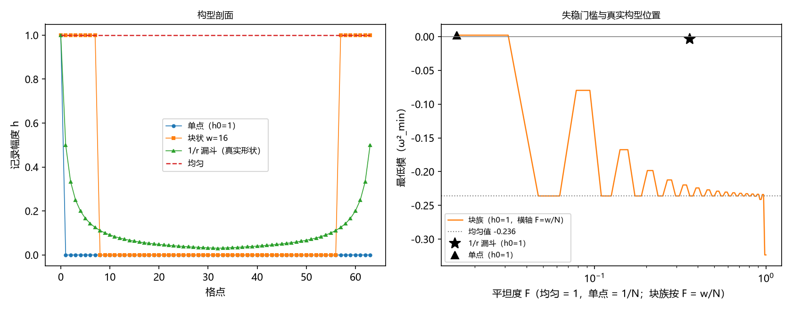

# 弱失稳与驻波门槛：记录与摆程耦合在真实记录构型下的量级

- **作者**：傅天行（天行新学研究院）
- **预印本**：傅天行. (2026). 弱失稳与驻波门槛：记录与摆程耦合在真实记录构型下的量级. 天行新学研究院预印本.
- **关键词**：耦合重开；交错链；二聚化失稳；记录场构型；最小失稳宽；奇偶分档；黑洞终态判别
- **修订记录**：
  - **2026-09-17 初版**（作者指示：总结本轮攻坚成果）
    - 综合弱版方向一的执行（脚本、验证注记、图）与其判别点背景
    - 数值与读数均引自验证材料；判据修正两处按过程记录如实呈现

---

## 摘要

黑洞终态候选在先行批次中由三收缩为二（饱和与耦合重开），留下判别点「耦合能否独立触发失稳」。此前的耦合验证在「记录处处均匀」的假设下确认了二阶失稳的存在；真实记录构型则是中心深、两侧浅的漏斗形。本文把均匀假设替换为一族真实构型（单点、块状、$1/r$ 衰减与平滑族），在一维交错链模型上以线性谱判据检验失稳的存在与量级。

**结果三项。** 其一，单点记录不失稳，成片记录（三格以上）即出现失稳；最小失稳宽为 $3$ 格，且不随记录幅度变化。其二，真实 $1/r$ 构型下失稳存在但弱：幅度为均匀情形的 $1.40\%$，线性增长率约慢 $8$ 至 $9$ 倍。其三，成片段的最强失稳对宽度呈现奇偶分档：最低模在对称半宽为奇数时锁定于与均匀相同的值，偶数半宽随宽度逐渐加深（精确形态待分析）。

结论：耦合路线未被排除，但以「弱失稳」形式参与与饱和的竞争，与饱和主导倾向方向一致。全文标注严格程度；三维定量留待强场工具。

---

## 1. 引言

### 1.1 背景与判别点

黑洞的强场终态原有三个候选（饱和、缠绕、耦合重开）。先行批次中，缠绕经「同一性」与「可观测性」两道闸门出局，候选收缩为二（[[内部草稿/注记-BH3-1与BH3-2执行：倾角与相位的定义关系、缠绕两道闸门的判定]]）；内部机制方案的触发判定倾向「饱和路线」主导，并把判别点「破坏是否必待满偏」交给强场工具（[[内部草稿/注记-BH3-5执行：终态图景与二候选的对应关系、绕数去向与留痕判据]]）。

耦合路线一侧的既有验证（下称弱版验证）读出如下结构：记录与摆程的耦合在交错背景上一阶力为零（零接触在弱场保持），二阶刚度调制非零且符号随交错子格交替；在「记录处处均匀」的假设下，摆程谱最低模转负，即交错队形失稳（[[验证脚本/注记-弱版耦合重开的最小验证：一阶零与二阶非零的结构]]）。

「均匀」是方便假设。真实记录场由碰撞写入导出，形状为中心深、两侧浅的漏斗（泊松解类）。于是留下两个问题：真实形状下失稳还发生吗；若发生，强度（即发展速度）是多少。这两问构成强场工具靶子清单的第二项（[[黑洞的形成与内部：支撑失效判据、终态候选收缩与格点退出机制]] §5.1）。

### 1.2 本文任务

本文把弱版验证的记录自由度从均匀假设替换为一族真实构型，测量失稳的存在、门槛与量级，并给出对判别点的回答。结论概览：失稳存在但弱（均匀幅度的 $1.40\%$）；最小失稳宽 $3$ 格且不随幅度变化；成片段存在奇偶分档的最低模结构。

### 1.3 方法特征

三项。其一，最小模型：一维交错链加记录调制，复杂效应先在最简结构上测量。其二，线性谱判据：以 Hessian 最低模的正负与大小为判据，读数确定、可复现。其三，修正留痕：原始预期被实测推翻时，修正判据并如实记录（见 §2.3 与 §5）。

## 2. 模型与方法

### 2.1 交错链与失稳判据

一维链、$N = 64$ 格点、周期边界。摆程相位 $\theta_n$ 的交错背景为 $\theta_n = \pi n$（相邻反相）。记录 $h_n$ 为法线场倾斜的代理（非负）。能量为

$$E = J\sum_n \cos(\theta_{n+1} - \theta_n) + \lambda \sum_n (1 - \cos\theta_n)\, h_n,$$

耦合形式 $(1 - \cos\theta)$ 取自体系统折弦的同族形式。交错背景下的 Hessian 为对角调制 $H_{nn} = 2J + \lambda(-1)^n h_n$ 与相邻项 $H_{n,n\pm1} = J$；全链取 $J = \lambda = 1$。（说明：由能量函数直接求导得到的非对角元为 $-J$；本文采用交错变换后的等价形式 $+J$，两者相差相似变换 $S = \mathrm{diag}((-1)^n)$，谱相同。）

失稳判据为线性谱判据：最低模 $\omega^2_{\min} < 0$ 即交错队形向另一种站法（两两成对，下文称二聚化方向）失稳。均匀记录下存在解析值 $\omega^2_{\min} = 2J - \sqrt{(2J)^2 + (\lambda h)^2}$（由 $k = 0$ 分支的两分量混合模式给出；$h = 1$ 时等于 $2 - \sqrt{5}$），用作对照。

### 2.2 构型族与平坦度

构型族四类。单点：一格有记录。块状（截断均匀）：以链中心为对称、宽 $w$ 格内记录为 $h_0$、其余为零，$w$ 从 $1$ 扫到 $N$。$1/r$ 衰减：$h_n = h_0/(1 + d_n)$，$d_n$ 为周期最近距离（三维泊松解在一维的衰减形状模拟，全链非零）。平滑族：$h_n = h_0/(1 + 2d_n/w)$，$w$ 从 $1$ 扫到 $256$，从窄峰到近平坦的连续过渡。

平坦度 $F = (\sum_n h_n)^2/(N\sum_n h_n^2)$（均匀 $= 1$，单点 $= 1/N$）用于横向比较构型的均匀程度。

### 2.3 判据设计

W5a 对照复现：均匀 $h = 1$ 的最低模与解析式一致（偏差 $\le 10^{-10}$）。W5b 两端复现：单点最低模为正、均匀最低模为负。W5c 最小失稳条件：块族存在最小失稳宽 $w^*$（$1 < w^* < N$），并报告非单调性。W5d 真实构型量级：原始预期为「$1/r$ 构型不失稳（最低模为正）」；实测给出小幅负值（$-0.0033$），预期被推翻，判据修正为「失稳幅度不超过均匀情形的 $5\%$」（该阈值为判据修正后的设定值，非物理门槛）。W5e 门槛对幅度的依赖（报告）。

## 3. 结果

### 3.1 对照与两端

W5a：均匀最低模数值 $-0.2360679775$，与解析 $2 - \sqrt{5}$ 逐位一致。W5b：单点 $+0.002135$（安全），均匀 $-0.236068$（失稳）。两端复现成立，模型与既有弱版读数一致。

### 3.2 最小失稳条件与奇偶分档

W5c：最小失稳宽 $w^* = 3$（对应平坦度 $F^* = 0.047$），对全部测试幅度成立（$h_0$ 从 $0.5$ 到 $5$ 均为 $3$，W5e）。块族最低模随块宽**非单调**：$w = 3, 4$ 给 $-0.2361$（与均匀同值）；$w = 5, 6$ 给 $-0.0796$；$w = 7, 8$ 回到 $-0.2361$；$w = 9, 10$ 给 $-0.1676$；此后每隔两档在 $-0.2361$ 与逐渐变深的其他值之间交替（更宽档样点：$w = 13$ 给 $-0.1984$、$w = 17$ 给 $-0.2123$）。

结构观察：块的两端是缺陷边界；最低模对半宽呈两类：奇数半宽锁定在与均匀相同的值（$-0.2361$），偶数半宽随宽度逐渐加深并趋近该值。这一奇偶分类的精确形态（模式与缺陷边界的匹配关系）待进一步分析。

### 3.3 真实构型的量级

W5d：$1/r$ 衰减构型（$h_0 = 1$）的最低模为 $-0.003300$，幅度为均匀情形的 $1.40\%$。线性增长率按 $\sqrt{|\omega^2|}$ 比，约为均匀情形的 $1/8.5$。失稳存在，发展慢近一个数量级。

对照读数：平滑族从窄峰到近平坦单调加深失稳（$w = 1$ 给 $+0.001272$；$w = 2$ 给 $-0.003300$，即 $1/r$ 形状的值；$w = 256$ 给 $-0.214374$，趋近均匀值）。「覆盖越宽、失稳越强」的大方向成立，与块族的锯齿叠加时不冲突：锯齿是同一覆盖下的对称类差异。

### 3.4 图与读数汇总

| 判据 | 读数 | 结果 |
|---|---|---|
| W5a 对照 | $-0.2360679775$ 对解析一致 | 通过 |
| W5b 两端 | 单点 $+0.002135$；均匀 $-0.236068$ | 通过 |
| W5c 最小失稳宽 | $w^* = 3$（$F^* = 0.047$）；非单调存在 | 通过 |
| W5d 真实构型量级 | $-0.003300$（均匀的 $1.40\%$） | 通过（修正版） |

## 4. 讨论

### 4.1 对判别点的回答

「耦合能否独立触发失稳」：能，但弱。真实 $1/r$ 构型的最低模为 $-0.0033$，线性增长率约为均匀情形的 $1/8.5$。耦合路线未被排除（失稳不消失），增长率较均匀假设慢近一个数量级。

与饱和路线的关系：两个触发器在竞争（饱和到满偏与耦合失稳）。以增长率比较，耦合触发的时间尺度劣势约一个数量级，与 BH3-5 的饱和主导倾向方向一致，形式为「弱失稳」（滑动存在、幅度小）。定量结论（三维构型与 $\lambda$ 的实际值）留待强场工具。

### 4.2 奇偶分类的来源与一维局限

最小失稳宽 $3$ 格与奇偶分档均为一维读数。它们来自缺陷边界与链上模式的匹配（驻波型匹配的精确形态待分析），属一维结构效应；球对称三维下是否保留未知。这一条提醒：一维链的「均匀度门槛」类指标不可直接外推，三维失稳谱需要以强场工具计算。

**覆盖与强度的关系。** 两处读数并置时容易生疑：最小失稳宽仅 $3$ 格，而覆盖全链的 $1/r$ 构型却呈弱失稳。统一的读法是：失稳强度由幅度分布与形状匹配共同决定，覆盖宽度只是必要条件，不作强度排序。$3$ 格块是满幅成片，落在最强分支（与均匀同值）；$1/r$ 构型的远场幅度按 $1/d$ 衰减，对最低模的贡献被大幅度压低。平坦度 $F$ 因此只作覆盖程度的辅助描述：$1/r$ 构型的 $F = 0.358$ 高于 $F^* = 0.047$，其失稳仍弱，$F$ 不能单独预测失稳。

### 4.3 接口与后续

本工作是强场工具靶子清单第二项的执行；靶子清单其余三项（破坏是否必待满偏、视界等值线自洽性、BH3-3 判据重设计）与其后的终态判别仍在工具建成后推进。本文结论作为工具的对照基线：三维模型应当复现「真实构型下失稳存在且弱于均匀」的定性结构，并可检验奇偶分档是否为一维特产。

## 5. 严格程度与边界

其一，模型为一维最小模型（$N = 64$、$J = \lambda = 1$、周期边界）；所有读数不外推三维。

其二，失稳判据为线性谱判据；非线性饱和、时间标定与 $\lambda$ 的实际值未进入。增长率比较只到 $\sqrt{|\omega^2|}$ 的相对量级。

其三，构型为选择（$1/r$ 的离散模拟与平滑族），并非从三维泊松解严格约化而来。

其四，过程留痕：W5d 原始预期（$1/r$ 构型不失稳）被实测推翻，判据修正为「弱失稳（$< 5\%$）」；教训为「局域化等于安全」的直觉在一维链上不成立，三格以上的对称调制组即可诱发弱失稳。

## 6. 结论

把记录场从均匀假设换成真实衰减构型之后，记录与摆程耦合的二阶失稳依然存在，但强度弱近一个数量级（均匀幅度的 $1.40\%$，增长率约慢 $8$ 至 $9$ 倍）；最小失稳宽为 $3$ 格且不随幅度变化；成片段的最低模呈奇偶分档。耦合路线以「弱失稳」形式保留为第二效应，为强场工具提供了对照基线与一条可检验的定性结构。

## 参考文献

说明：编号供索引；正文引用以内链给出，条目与正文的对应以链接目标为准。

[1] 傅天行. (2026). [[验证脚本/注记-弱版方向一的最小验证：真实记录构型下的失稳量级与驻波门槛]]. 天行新学研究院工作文档（验证脚本/）.（脚本 `验证脚本/minimal_verification_reopen_realfield.py`）
[2] 傅天行. (2026). [[验证脚本/注记-弱版耦合重开的最小验证：一阶零与二阶非零的结构]]. 天行新学研究院工作文档（验证脚本/）.
[3] 傅天行. (2026). [[黑洞的形成与内部：支撑失效判据、终态候选收缩与格点退出机制]]. 天行新学研究院预印本.
[4] 傅天行. (2026). [[内部草稿/注记-BH3-5执行：终态图景与二候选的对应关系、绕数去向与留痕判据]]. 天行新学研究院工作文档（内部草稿）.
[5] 傅天行. (2026). [[内部草稿/注记-BH3-1与BH3-2执行：倾角与相位的定义关系、缠绕两道闸门的判定]]. 天行新学研究院工作文档（内部草稿）.
[6] 傅天行. (2026). [[内部草稿/总结报告-黑洞线阶段总结：先行批次收官与裁决点全景：2026-09-16]]. 天行新学研究院工作文档（内部草稿）.
[7] 傅天行. (2026). [[理论攻坚/黑洞线攻坚计划：坍缩机制重定位与强场终态]]. 天行新学研究院工作文档（理论攻坚/）.
[8] 傅天行. (2026). [[内部草稿/开放问题总览：元相子理论待解决问题清单]]. 天行新学研究院工作文档（内部草稿）.
