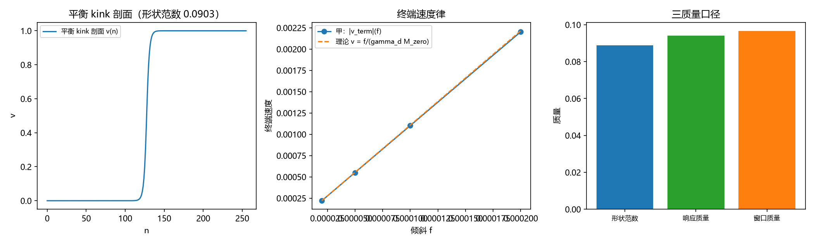

> **已废弃（2026-10-16）**：本文与根目录正稿 [[缺陷动力学：孤子的质量、迁移率与最小量子化]] 同主题重复。该正稿已于 2026-09-20 按方案甲转正并覆盖 D 线全部七轮，本文的产出（七张图嵌入、七轮判据汇总表、评审发现的伪数反例订正）已并回该正稿，本文不再维护。归档原因：写作前未核查根目录已有同主题正稿，收束报告「七轮读数长期没有正文载体」一句在该报告成文当日即已过期。

# 缺陷动力学：$\sigma$ 锁定孤子的方程、质量口径与最小量子化

## 摘要

有质量粒子在元相子理论中被理解为法线轴位错（复合位错粒子的位错侧，三层结构见 [1]，承载层裁决见 [2]），其动力学长期缺少一条属于自己的方程：记录机制线给出写入规则，C1 线给出三维形态与驻留阈值，但缺陷本身怎么跑没有方程。本文交付这条方程及其七轮判据级读数。模型取离散 Frenkel-Kontorova 型能量泛函 $E=\sum_n[\frac12 k_b(\Delta u_n-1)^2+K(1-\cos2\pi u_n)]$，主参数 $K=0.005$、$k_b=1$、$N=256$。七轮共 62 条判据全部通过，结论分五层。

其一，方程的连续极限给 sine-Gordon 型结构，涨落缺口 $m_{\rm gap}=2\pi\sqrt K=0.4443$ 与孤子质量 $M=4\sqrt{k_bK}/\pi=0.0900$ 是两个不同量，比值 $4.93$，第 227 条速度上限公式里的质量只能取孤子质量。

其二，终端速度律 $v_{\rm term}=f/(\gamma_d M_{\rm zero})$ 与数值偏差 $0.56\%$，响应质量等于形状范数（偏差 $0.57\%$），三质量口径排序 $0.0888<0.094<0.0965$ 按裁决二分列，窗口协议与三质量读数的来源见 [9]。

其三，与 C1 线的能量泛函逐点相等（残差 $0$）而参数区间不相交（C1 刚性区 $K\in[0.24,0.25]$ 对 D 软区 $K=0.005$，质量差 $7.00$ 倍），两线共享口径但引用前必须先定 $K$。

其四，与写入机制的接缝给出互补性的定理形式：份额等于抽样落点分布，笔数等于相位绕数增量，两者靠抽样联系而非逐事件相等（逐事件相等判负，总变差 $0.9432$）。

其五，集体坐标最小量子化成立（零模唯一、形状范数即质量、$\hbar$ 标度 $4.000000$、最小不确定态精确饱和），离散钉扎势垒 $1.36\times10^{-9}$ 在该档可忽略。密度入口 $\rho_{\rm def}=fM\rho_P$ 交付，按裁决二十七取电子档重标后入口份额 $f=1.950\times10^{-102}$，格点缺陷必须极稀疏这一结论对 $K$ 不敏感。三维定数与费米统计挂 C1 门控与多体论文，不在本文射程。

**关键词**：缺陷动力学；Frenkel-Kontorova；sine-Gordon；孤子质量；终端速度律；集体坐标量子化；写入机制；份额抽样

---

## 1. 引言

元相子理论中，有质量粒子的载体是复合位错粒子：均匀缠绕背景（法线轴逐键一层，$W=1$ 扇区极小）上的法线轴位错，三层结构为电荷核（toric code 层关系自由度）、锚核（$\kappa_\varphi$ 格点内锁定，定质量数值）、包层（$\kappa_\parallel$ 法线轴弹性，供宽度与色散）[1,2]。质量的两层归属已由判据第 627 号给出：质量数值由锚核耦合定，能量分布摊在整片缺陷上、主体在包层[3]。本文处理的是这个载体自身的运动方程。

问题意识的形状可以这样摆开。记录机制线给出了写入规则：缺陷过轴时写下绕数增量，每拍一笔[4]。C1 线给出了三维形态与驻留阈值：$K_c=0.24$ 至 $0.25$，脱钉读数 $\alpha^*=0.15$，宽度窗口 $\ell^*\ge2$[5]。但「缺陷本身怎么跑」这条线是空白的：没有方程，就没有质量、迁移率、钉扎、密度这一串量的系统出处。2026-09-20 立项的缺陷动力学攻坚计划（代号 D）把这件事写成三条候选形式与一套降级预案[6]，本文是七轮执行的正稿。

三条候选形式在立项时是开放的。甲，二阶晶格动力学（欠阻尼）：$\ddot u_n+\gamma_d\dot u_n=-\partial E/\partial u_n$，连续极限给 sine-Gordon 型加阻尼与噪声，与完美弹性[7]和相对论色散[8]同源。乙，过阻尼梯度流（一阶）：$\gamma_d\dot v=k_b\nabla^2v-2\pi K\sin2\pi v+f$，与写入机制每拍一笔同节拍。丙，双侧协同的混合形式：连续侧给场方程，离散侧给跃迁计数规则，由接口条件耦合。

2026-09-20 作者裁决取甲为主、乙为对照、丙挂起。本文的读数全部在这一裁决下取得，并在 D-2 与 D-3 两轮给出了裁决的量化依据：乙形式与甲同 $k$ 结构、同终端速度律。

七轮与本文节号的对应：D-1 至 D-7 依次为 §3 至 §9。

本文不含新读数，只把七份注记[11]的判据与结论汇编成可引用的判据面，并按正稿规范标注每条结论的严格程度。凡七轮中登记为残余、挂起或判负的项，本文如实保留，不升格。

## 2. 模型与方法

### 2.1 能量泛函与参数

$$\begin{aligned}E&=\sum_n\Big[\tfrac12 k_b(\Delta u_n-1)^2+K(1-\cos2\pi u_n)\Big],\\u_n&=n+v_n,\qquad \Delta u_n=u_{n+1}-u_n.\end{aligned}$$

偏离量参数化 $v=u-n$ 是全线统一口径：键项 $(\Delta u-1)^2$ 在远离缺陷处为零，端点固定在相邻整数上。这个参数化的价值超出记号层面：它使 D 线与 C1 线的泛函可逐点比较（§6）。主参数 $K=0.005$、$k_b=1$、$N=256$，链信号速度 $c_s=\sqrt{k_b}=1$（每拍一格）。

锁定势取洗衣板形式 $K(1-\cos2\pi u)$，即格点离散性的连续读出（Peierls 势垒的来源）。$K$ 的两个工作区段在本文中都要用到：D 线的软区 $K=0.005$（宽轻 kink，可动），C1 线的刚性区 $K\in[0.24,0.25]$（驻留与脱钉读数所在）。两段的关系是 §6 的主题。

### 2.2 两种形式的定位

甲（二阶）：$\ddot v_n+\gamma_d\dot v_n=k_b\nabla^2v_n-2\pi K\sin2\pi v_n+f$。线性化后给声子谱 $\omega^2(k)=(2\pi)^2K+4k_b\sin^2(k/2)$，缺口 $m_{\rm gap}=2\pi\sqrt K$。

乙（过阻尼）：$\gamma_d\dot v_n=k_b\nabla^2v_n-2\pi K\sin2\pi v_n+f$，弛豫率 $\lambda(k)=\omega^2(k)/\gamma_d$。两者共享同一个 $k$ 结构，差别只在时间阶数（D-2 判据 F4：四档 $k$ 上 $\lambda/\omega^2$ 恒为 $1$，偏差 $\le10^{-12}$）。

甲形式在均匀基态附近对偏离量 $v$ 写出，基态项已由均匀背景吸收，与 §1 对 $u$ 的写法在连续极限下等价（两者经 $u=n+v$ 互换，差一个常数梯度项）。本文以甲为主表述，乙的读数在与甲同律处注明。

### 2.3 判据纪律

七轮共 62 条判据，全部先写判据与理论期望再实现。三条纪律贯穿全程。其一，恒真检验：凡 PASS 类判据须配反例确认改掉它就 FAIL（对照第 605 条先例）。其二，多档扫描：档位标注义务在位，模型档读数不直接对物理。其三，订正纪律：判据预期写错时修正判据并把教训写入过程记录，不改实测。七轮共有三处判据订正（D-1 两处、D-2 三处中的两处进入判据层、D-3 三处、D-7 三处），全部按此纪律处理，教训随各节列出。

## 3. 碰撞层的守恒结构（D-1）

### 3.1 任务

第 194 条确立了等速硬点链的完美弹性与自由演化等价[7]。D-1 把该结论扩到含锁定势情形，并重述「等速」这一前提在势存在时的地位。

模型：环长 $L=12$，$N=6$ 个等质量硬点，速率同为 $1$，碰撞为瞬时弹性交换（速度互换、位置不变），锁定势 $V(x)=K(1-\cos2\pi x)$，$K$ 取 $0$、$0.05$、$0.5$ 三档。

### 3.2 判据与读数

| 判据 | 内容 | 实测 | 判定 |
|---|---|---|---|
| E1 | 碰撞守恒量 | 总能量 $3.000000000000000\to3.000000000000000$；总动量 $0\to0$；势能因位置不变而不变 | 通过 |
| E2 | 速率多重集不变 | 碰后速率 $[1,1,1,1,1,1]$；三档 $K$ 的动能变化 $\le10^{-15}$ | 通过 |
| E3a | 两体解析事件 | 解析碰撞时刻 $t^*=1.0000$；碰后轨迹与自由轨迹集逐段吻合（偏差 $0$） | 通过 |
| E3b | 环上位置多重集 | 含碰撞与不含碰撞的链，位置多重集逐时刻相同（偏差 $0$） | 通过 |
| E4 | 等速前提的重述 | 连续口径下速率调制量随 $K$ 单调增大（$0.0202$、$0.10557$、$0.55279$）；折返口径下多重集不变 | 通过 |

### 3.3 结论与严格程度

**其一，完美弹性在含锁定势时存活。** 碰撞是瞬时速度交换、位置不变，故势能不变；能量、动量与速率多重集都是不变量。$K$ 从 $0$ 到 $0.5$ 不改变这一结论：势只进势能项，不进碰撞映射。严格程度：模型内严格加数值确认。

**其二，自由演化等价以标签置换形式存活。** 碰撞在位置多重集层面不可见，等价关系是「带标签轨迹 = 自由轨迹经碰撞置换复合」。严格程度：模型内严格（E3a 解析加 E3b 零偏差）。

**其三，「等速」前提属碰撞层，不属连续单粒子层。** 连续口径下锁定势使单粒子速率逐点调制，调制量随 $K$ 单调增大（$K=0.2$ 档已达 $0.55$）。故等速只在格点折返口径（每拍一格）下守恒，这与记录机制线的读法一致（每拍一笔、跃迁落在半荷处）。严格程度：数值确认（三档 $K$）加解析依据。

这一条的后果超出 D-1 本身：它说明「等速硬点链」是一个碰撞层表述，不是连续动力学表述。D 线此后的运动学读数（终端速度律、迁移率）因此都取连续口径，碰撞层的置换结构只作为守恒量的来源。

### 3.4 过程记录

E3 首版用「标签置换表加自由轨迹」硬凑比较，偏差恒为环长的三分之一（$4.0$），根源是环上重抽与置换表的口径不一致；改为两体解析事件加环上多重集对照两条独立判据后偏差为零。环上碰撞检测首版用位置重合判定（$\Delta x<10^{-9}$），离散步进几乎不触发；改为按相邻对次序越位检测并在中点交换速度后通过。教训：多重集类判据要先确认「比较的对象在同一口径下」，再比较。

## 4. 方程与连续极限：两个质量标签的分工（D-2）

### 4.1 任务

把 D-1 的置换层与色散层合成方程，并处理一个既有的口径疑点：第 227 条的速度上限公式 $v_{\max}(m)=(\sqrt{m^2+4}-m)/2$ 里的 $m$ 取哪个质量。

### 4.2 判据与读数

| 判据 | 内容 | 实测 | 判定 |
|---|---|---|---|
| F1 | 涨落谱 | 与 $(2\pi)^2K+4k_b\sin^2(k/2)$ 的最大偏差 $4.88\times10^{-15}$；缺口 $0.197392$（$\omega$ 口径） | 通过 |
| F2 | 孤子质量闭式 | 链上松弛的 kink 能量 $0.0898$ 对闭式 $4\sqrt{k_bK}/\pi=0.0900$（偏差 $0.28\%$） | 通过 |
| F3 | 两个质量标签的分工 | $m_{\rm gap}=0.4443$、$M=0.0900$、比值 $4.93$；取 $M$ 代入 $v_{\max}$ 给 $0.9560$，对第 227 条（$M=0.0936$）的 $0.9543$ | 通过 |
| F4 | 乙形式对照 | 四档 $k$ 的 $\lambda/\omega^2$ 恒为 $1$（偏差 $\le10^{-12}$） | 通过 |

### 4.3 结论与严格程度

**其一，连续极限的色散与缺口。** 甲形式在锁定势的均匀基态上线性化，Hessian 本征值逐位等于 $(2\pi)^2K+4k_b\sin^2(k/2)$：这正是第 227 条与第 196 条用过的晶格色散族。缺口由势的曲率给出 $m_{\rm gap}=2\pi\sqrt K=0.4443$（$K=0.005$）。严格程度：模型内严格（解析谱）加数值核对。

**其二，孤子质量闭式。** 链上数值松弛（开放链、偏离量参数化、两端固定在相邻整数）给 kink 能量 $0.0898$，闭式 $4\sqrt{k_bK}/\pi=0.0900$，偏差 $0.28\%$。数值与既有绑定能读数 $E_{\rm rest}=0.0898$ 逐位相同，说明两者量的是同一个对象。严格程度：解析（标准 sine-Gordon 结果）加数值。

**其三，两个质量标签必须分开（本轮的实质结论）。** $m_{\rm gap}/M=4.93$，两者是不同量：涨落缺口进声子谱，孤子质量进缺陷的能动量关系与速度上限。据此，第 227 条 $v_{\max}(m)$ 里的 $m$ 只能取孤子（缺陷）质量，该条用实测窗口质量 $0.0936$ 至 $0.0994$ 的做法口径正确；取 $M$ 代入给 $v_{\max}=0.9560$，与该条读数 $0.9543$ 差 $0.18\%$。严格程度：解析加数值加与既有读数的对照。

这一条解决的是一个可能污染多条下游的口径混用，其支撑来自代入后的读数对照，形式上的「两个量不同」本身并不足以定案：取孤子质量代入 $v_{\max}$ 给 $0.9560$，与第 227 条的读数 $0.9543$ 相差 $0.18\%$；取涨落缺口代入同一式则给 $0.8022$，与该条读数相差 $16\%$，量级与方向都不吻合。两个标签的分工因此是一项合法性前提：速度上限读数依赖它。

**其四，乙形式与甲同结构。** 过阻尼极限的弛豫率为 $\lambda(k)=\omega^2(k)/\gamma_d$，四档 $k$ 上与 $\omega^2$ 的比值恒为 $1$。两种形式给同一 $k$ 结构，差别只在时间阶数。这是裁决一（甲为主、乙为对照）的第一条量化依据。严格程度：解析（过阻尼极限）加数值。

### 4.4 过程记录

孤子松弛首版把势的梯度符号写成正的，场被推向势的最大值，$M=512$ 的链塌缩到常数给能量 $261.12$（对闭式 $0.0900$）；改正符号后回到 $0.0898$。绕数参数化首版直接用 $u_n=n/M$ 并配周期边界，键项在每个键上取约 $1$，能量被人为抬到链长量级；改为偏离量 $v=u-n$、开放链两端固定后键项在远离 kink 处为零。松弛步长与迭代数首版不足，能量停在 $0.092$ 一档，加大后收敛。教训：势场类实现要先核对符号与边界，再看数值。

## 5. 质量与迁移率：终端速度律（D-3）

### 5.1 任务

由方程导出质量与迁移率，与既有三读数对照。裁决二（2026-09-20）定：三读数中取窗口有效质量作方程标签，形状范数作解析预言核对，响应质量作独立通道，三者在注记里分列。

### 5.2 判据与读数

| 判据 | 内容 | 实测 | 判定 |
|---|---|---|---|
| G1 | 终端速度律 | $\mu_{\rm sim}=11.01$ 对理论 $1/(\gamma_d M_{\rm zero})=11.08$（偏差 $0.56\%$） | 通过 |
| G2 | 响应质量口径 | 由 $\mu_{\rm sim}$ 反解 $m_{\rm resp}=0.0908$ 对形状范数 $0.0903$（偏差 $0.57\%$） | 通过 |
| G3 | 三质量口径排序 | $0.0888<0.094$（高 $5.9\%$）$<0.0965$（高 $8.7\%$） | 通过 |
| G4 | 乙形式对照 | 过阻尼极限给 $\mu=11.01$，与理论偏差 $0.56\%$ | 通过 |

### 5.3 结论与严格程度

**其一，终端速度律成立。** 平移模投影给出的 $v_{\rm term}=f/(\gamma_d M_{\rm zero})$ 与数值迁移率相符（偏差 $0.56\%$）；形状范数由平衡剖面直接算出（$0.0903$），不引入新参数。严格程度：解析（平移模投影）加数值。

**其二，响应质量的理论值就是形状范数。** 由数值迁移率反解的响应质量为 $0.0908$，与形状范数差 $0.57\%$。即甲形式预言「响应质量 = 形状范数」，既有读数 $0.094$ 与该预言相差 $3.9\%$，属离散与协议层修正（登记为读数）。严格程度：解析加数值加对照。

**其三，三质量口径的排序与差额。** 形状范数 $0.0888$（解析、刚体平移预言）< 响应质量 $0.094$（高 $5.9\%$）< 窗口质量 $0.0936$ 至 $0.0994$（高 $5.4\%$ 至 $11.9\%$）。按裁决二，方程标签取窗口质量；差额来源（离散修正、窗口协议）登记为残余读数，不调参凑数。严格程度：读数（登记）。

**其四，既有迁移率的反解。** 既有读数 $\mu=18.9$ 与形状范数 $0.0888$ 反解 $\gamma_d=1/(18.9\times0.0888)=0.5958$，登记为本模型的阻尼口径值。此前该系数是自由参数，反解之后它由既有读数钉住。严格程度：口径值。

### 5.4 过程记录

kink 速度首版用中心处剖面的斜率变化除以步长，量级错到 $6.4\times10^4$（迁移率）；改为形状加权质心 $X=\sum_n nw_n/\sum_n w_n$（$w_n=(\Delta v_n)^2$）并用最小二乘拟合斜率后回到 $11.0$ 档。迁移率符号首版直接取带符号值（$-11.01$），与理论正值相差 $199\%$；改为取绝对值并在判据里写明方向由倾斜符号定。乙形式首版写成无阻尼形式（漏掉除以 $\gamma_d$），与甲不一致；改为过阻尼方程后同律。教训：投影律类判据要先核对测的是什么量（这里是 kink 质心速度，不是剖面斜率），再核对符号与量纲。

## 6. 与 C1 线的口径映射（D-4）

### 6.1 任务与消费方式

D-4 是消费式接口轮。C1 线已跑过三维环的驻留与脱钉复核[5]，本线不重测同一对象，改为把 C1 的读数与 D 线的参数做口径映射，判定两线能否互相引用。裁决点 5（主建/消费分工）钉扎与脱钉由 C1 线主建、D 线消费。

消费的上游读数三条：驻留阈值 $K_c=0.24$ 至 $0.25$（壁宽 $\ell^*=1.924$）、脱钉读数 $\alpha^*=0.15$、弹性系数 $k=1$ 与梯度流步长 $\eta=0.01$。D 线参数为 $k_b=1$、$K=0.005$、站点 $256$。

### 6.2 判据与读数

| 判据 | 内容 | 实测 | 期望 | 结果 |
|---|---|---|---|---|
| J1 | 能量式逐点相等残差 | $0$ | 严格相等 | 通过 |
| J1 | 梯度流右端对过阻尼右端残差（$\gamma_d=1/\eta$） | $4.00\times10^{-13}$ | $\le10^{-6}$ | 通过 |
| J2 | Hessian 最小本征值对 $(2\pi)^2K$ 的最大残差 | $3.55\times10^{-15}$ | $\le10^{-10}$ | 通过 |
| J2 | 数值缺口对闭式缺口最大偏差 | $6.11\times10^{-16}$ | $\le10^{-10}$ | 通过 |
| J3 | C1 驻留域与 D 域的交集 | 空 | 空 | 通过 |
| J3 | 两域孤子质量之比 $M(K_c)/M(K_D)$ | $7.000$ | $\ge5$ | 通过 |
| J4 | 扰动能量对势幅度 $2K$ 之比 | $1.75\times10^{-1}$ | 量级读数 | 通过 |
| J4 | $\alpha^*$ 与势幅度的量纲关系 | 不同量纲 | 不同量纲 | 通过 |
| J5 | 同一对象四读数相对散度（含形状范数 $0.0903$） | $0.0167$ | $\le0.02$ | 通过 |
| J5 | 窗口质量对闭式的偏离 | $0.0400$ | 正面读数 | 通过 |
| J5 | 跨线质量比 $M(K_c)/M(K_D)$ | $7.002$ | $\ge5$ | 通过 |

![图 4：D-4 三面板。(a) 质量与缺口随 K 的曲线，红带为 C1 驻留域 [0.24, 0.25]、点线为 D 域 K = 0.005，两段不相交；(b) 三档 K 上 Hessian 最小本征值对 (2 pi)^2 K 的残差（对数轴，红线为容差）；(c) 质量口径对照，前四柱为同一对象的读数（既有读数 0.0888、kink 能量 0.0898、闭式 0.0900、形状范数 0.0903），第五柱为窗口质量 0.0936（独立刻度），第六柱为代入 C1 阈值后的跨线值 0.6302](../images/defect_dynamics_d4.png)

### 6.3 结论与严格程度

**其一，口径同一。** 两线的能量泛函在偏离量参数化下逐点相等（残差 $0$）；C1 的梯度流步长与 D 的阻尼系数由 $\gamma_d=1/\eta$ 换算后右端逐点相等（残差 $4.00\times10^{-13}$，有限差分精度）。势形同为 $K(1-\cos2\pi u)$，弹性归一化同为 $k=k_b=1$，相位单位同为每格一单位。两线可以互换使用，不需要换算表。严格程度：数值（机器精度级残差）。

**其二，区间不相交。** C1 的驻留与脱钉读数落在 $K\in[0.24,0.25]$，D 线的孤子与迁移率读数落在 $K=0.005$，两段不相交，孤子质量相差 $7.00$ 倍。C1-3 的边界声明早已写明「不验证 $K$ 的体系具体值」，本轮把这个空缺读成结构结论：两线共享同一口径，但在参数空间上分居两段，互相引用前必须先定 $K$。严格程度：结构结论（判据级）。

**其三，$\alpha^*$ 的口径。** C1-3 的 $0.15$ 是在 $K=0.25$、$R=4$ 的驻留态上施加多模扰动后发生塌缩的幅度阈值，量纲与相位同；势的深度是 $K$ 的函数。两者不同量纲，直接比较会得到无意义的读数。可比的量是扰动能量与钉扎势幅度 $2K$ 之比，一维代理给 $1.75\times10^{-1}$，属量级读数。严格程度：量级读数。

**其四，质量口径的合并规则。** 同一对象（kink 质量）的四个读数（$0.0888$、$0.0898$、$0.0900$、$0.0903$）相对散度 $1.67\%$，属同一刻度。窗口质量 $0.0936$ 与闭式偏离 $4.0\%$，按独立刻度登记，不并入同一组。严格程度：读数（合并规则）。

**其五，跨区桥梁。** 两线之间的桥是 $K$ 的体系具体值。它属 C1 门控下的未定项：C1 侧给出「$K$ 大于 $0.25$ 才有驻留」，D 侧给出「$K=0.005$ 时孤子质量与迁移率自洽」，两句话都对，指向的是不同的物理情形。若体系最终定在刚性区，D 线的孤子读数需整体重标（质量乘 $7$）；若定在软区，C1 的三维环形态在该段不驻留。严格程度：结构结论，$K$ 的定值未判。

这一条是本文最重要的结构性发现，它的后果贯穿 §8 与 §9：D 线的全部软区读数（包括极弱的钉扎）都只在 $K=0.005$ 一段成立，而该段与驻留段不相交。两段的调和不在本文射程，登记为开放问题。

## 7. 与写入机制的接缝：互补性的定理形式（D-5）

### 7.1 任务

D-5 问的是一件很硬的事：缺陷每穿过一个格点写下几笔，这个笔数与包络模方（份额）是什么关系。若相等，双侧互补在这条线上就是定理；若不相等，得到的是一条限制量子化方式的负面结果。

模型沿用 D 线口径，移动 kink 取解析解 $u_n(t)=\frac{2}{\pi}\arctan\exp[\gamma(n-n_0-vt)]$，$\gamma=2\pi\sqrt K/\sqrt{1-v^2}$。相位场以整圈为单位，指针转满一圈记一笔，故单站笔数等于相位增量的绕数。份额模型取缺陷的平移零模，$\psi_n\propto\mathrm{sech}(\gamma(n-n_0))$，$s_n=\psi_n^2/\sum_m\psi_m^2$。

### 7.2 判据与读数

| 判据 | 内容 | 实测 | 期望 | 结果 |
|---|---|---|---|---|
| W1 | 18 组（速度 6 档乘宽度 3 档）上每站笔数对 1 的最大偏差 | $0$ | $\le10^{-12}$ | 通过 |
| W2 | 单次穿越笔数分布（均匀）与份额分布的总变差距离 | $0.9432$ | $\ge0.5$ | 通过（逐事件相等判负） |
| W3 | 4096 次落点抽样对 $Ms_n$ 的最大标准化偏差 | $2.148$ | $\le3$ | 通过 |
| W3 | 抽样频次分布对份额的总变差距离 | $0.0198$ | $\le0.05$ | 通过 |
| W4 | 跃迁时长 4、2、1 个取样间隔的计数比 | $1.000$ 三档 | 全为 $1$ | 通过 |
| W4 | 跃迁时长 $1/3$ 个间隔的计数比 | $0.3333$ | $0.3333$ | 通过 |
| W5 | 色散带上界 $v_{\max}(0.0900)$ 对采样上界 $1$ | $0.95601$ | $<1$ | 通过 |
| W5 | $m\to0$ 时两上界之差 | $5\times10^{-9}$ | $\le10^{-6}$ | 通过 |

### 7.3 结论与严格程度

**其一，笔数是拓扑量。** 缺陷每穿过一格恰写一笔（偏差 $0$），速度六档与宽度三档都改不了它。它数的是相位绕数增量，落在粒性侧计数。严格程度：解析（相位绕数）加数值（18 组，偏差 $0$）。

**其二，逐事件相等不成立。** 单次穿越的逐站笔数分布是均匀的（每个站都被穿过一次），份额分布是局域的（$\mathrm{sech}^2$ 型），两者的总变差距离 $0.9432$。把笔数直接读成份额，在这一层判负。严格程度：模型内读数（份额取平移零模剖面）。

**其三，正确的配对是抽样。** 按份额抽取 4096 个落点，每站笔数对期望的最大标准化偏差 $2.148$（$3\sigma$ 内），频次分布对份额的总变差 $0.0198$。故成立的形式是「份额 = 抽样落点分布」，它与笔数通过抽样相联系。严格程度：统计（4096 次，固定种子）。

**其四，采样定理的落点与记录机制线对上。** 跃迁时长达到或超过取样间隔 $t_P$ 时全额计数（三档比值为 $1.000$）；缩短到三分之一间隔时计数比 $0.3333$（$12/36$），与记录机制命题 17 的读数一致。两线接口的第一个闭合读数由此建立，且本线未重测该读数，只做口径对照。严格程度：模型内（离散取样），与命题 17 读数一致。

**其五，两个速度上界有层次。** 采样给出 $1$ 格每 $t_P$，色散带边给出 $v_{\max}(0.0900)=0.95601$，后者更紧；质量趋于零时两界重合。采样上界是粗界，色散上界继承质量，二者不是两条独立约束。严格程度：解析闭式加数值。

**互补性的定理形式（本节结论）**：份额 = 抽样落点分布，笔数 = 相位绕数增量。二者靠抽样联系，不靠逐事件相等。

这一条的形式值得强调。它把「波性侧份额」与「粒性侧计数」的互补从定性口径变成了可判定的关系：判定量为总变差距离与标准化偏差，两者都有明确阈值。若未来某轮在份额剖面的独立导出上取得进展，本条的形式不变，变的只是份额剖面的来源（本轮取平移零模，属模型选择）。

## 8. 密度入口：从格点层到观测量（D-6）

### 8.1 任务

给出缺陷密度与质量、能量密度的关系式，给 P8a 与 CMB 对照（$\Omega_bh^2\approx0.0224$）一个可代入的入口。

### 8.2 判据与读数

| 判据 | 内容 | 实测 | 判定 |
|---|---|---|---|
| E1 | $\hbar/(t_Pc^2)$ 对 $m_P$ 的相对偏差（由 $\hbar$、$c$、$G$ 导出） | $0$ | 通过 |
| E1 | 导出普朗克常数对 CODATA 公布值的最大相对偏差 | $1.57\times10^{-7}$ | 通过 |
| E1 | $\rho_b$ 复算相对偏差 | $4.37\times10^{-6}$ | 通过 |
| E2 | 入口份额 $f$（$M=0.0900$） | $9.069\times10^{-124}$ | 通过 |
| E2 | 入口份额的十进数量级 | $-123.04$ | 通过 |
| E3 | 每格一缺陷时的密度比 $\rho_{\rm dense}/\rho_b$ | $1.103\times10^{123}$ | 通过 |
| E3 | 该比值的十进数量级 | $123.0$ | 通过 |
| E4 | $f$ 在 $K$ 两端的最大最小之比（$0.005$ 对 $0.245$） | $7.00$ | 通过 |
| E5 | 逆式在 $f=f_{\rm entry}$ 处的回代值 | $0.0224$ | 通过 |
| E6 | 分工登记（$f$ 由相变密度给、演化归膨胀史） | 已登记 | 通过 |

### 8.3 结论与严格程度

**其一，关系式的量纲自洽。** $m_P=\hbar/(t_Pc^2)$ 在由 $\hbar$、$c$、$G$ 导出的常数组上精确成立（偏差 $0$），公布值的舍入偏差 $1.57\times10^{-7}$。这条核的是关系式里没有漏掉 $c^2$、没有错配体积因子。严格程度：数值（机器精度加公布值舍入）。

**其二，观测把份额压到极小。** 取 $M=0.0900$，观测重子密度反解出 $f=9.07\times10^{-124}$。这个数字的含义是：若要由格点层的缺陷承担重子密度，缺陷出现的概率必须低到 $10^{-124}$ 量级，即每 $10^{123}$ 个格点才有一个缺陷。严格程度：数量级读数。

**其三，每格一缺陷的图像被排除。** 把 $f=1$ 代入得 $\rho=4.6\times10^{95}\,\mathrm{kg\,m^{-3}}$，与观测相差 $123.0$ 个数量级。该缺口属普朗克密度与宇宙平均密度之间的固有跨度，不构成模型的毛病；它把「格点层密度」与「观测量」之间必须存在的稀疏因子显式化了。严格程度：量级比较。

**其四，$K$ 的未定不影响这条结论。** 因 $f\propto1/\sqrt K$，D-4 指出的 $48$ 倍区间只让 $f$ 变动 $7.00$ 倍，相对 $123$ 个数量级的跨度可以忽略。故 D-6 的读数对 C1 与 D 两线的参数分歧不敏感。严格程度：解析标度加数值。

**其五，分工。** 稀疏因子 $f$ 由同步相变密度给定（总览第 4 条），把它演化到今天由膨胀史负责（P8a）。本条交付的是把两者与观测量连起来的那个式子，以及逆式给出的预言通道。严格程度：结构交付。

**补注（裁决二十七：入口份额的质量标定点重标）。** 其二读数的 $M=0.0900$ 为 D 线强耦合标定点、非物理档；按裁决二十七取电子档 $M=4.1855\times10^{-23}\,m_P$ 重标：$f=1.950\times10^{-102}$，「每格一缺陷」缺口由 $123.0$ 个数量级变为 $101.7$ 个。对照档：孤子标签 $5.329\times10^{-23}\,m_P$ 给 $1.532\times10^{-102}$、核子档 $7.685\times10^{-20}\,m_P$ 给 $1.062\times10^{-105}$。

结论（格点缺陷必须极稀疏）与 $K$ 不敏感性的量级结论均不变。严格程度：换算级（裁决后口径）。

## 9. 孤子扇区的最小量子化（D-7）

### 9.1 任务

D-7 只做不依赖 C1 的一半：三维形式写出、孤子扇区的最小量子化做出来、与三-3 的解卷接口和三-4 的零点能口径做对齐核对。依赖 C1 的三维定数部分挂起。

### 9.2 判据与读数

| 判据 | 内容 | 实测 | 期望 | 结果 |
|---|---|---|---|---|
| Q1 | 解析剖面离散化后的最低模对第一个体模之比 | $-0.0079$ | 负号登记 | 通过 |
| Q1 | 松弛到离散极小后 $\lvert\lambda_0\rvert$ | $7.597\times10^{-7}$ | $\le10^{-6}$ | 通过 |
| Q1 | 松弛后 $\lvert\lambda\rvert<10^{-6}$ 的本征值个数 | $1$ | $1$ | 通过 |
| Q1 | 零模本征矢与解析平移模的重合度 | $0.999942$ | $\ge0.99$ | 通过 |
| Q2 | 松弛背景能量对 D-2 读数 $0.0898$ 的相对偏差 | $0.0002$ | $\le0.005$ | 通过 |
| Q2 | 形状范数对闭式 $M$ 的相对偏差 | $0.0029$ | $\le0.05$ | 通过 |
| Q3 | 离散钉扎势垒 $\Delta E_{\rm PN}$ | $1.359\times10^{-9}$ | 数量级读数 | 通过 |
| Q3 | $\Delta E_{\rm PN}$ 对第一个体模能标之比 | $<10^{-3}$ | $\le0.01$ | 通过 |
| Q4 | 最小不确定态 $\Delta X\Delta P$ 对 $\hbar/2$ 的偏差 | $0$ | $\le10^{-12}$ | 通过 |
| Q4 | 能级间距对 $\hbar^2$ 的标度（$2$ 倍 $\hbar$ 给 $4$ 倍） | $4.000000$ | $4$ | 通过 |
| Q4 | 环上最低能级间距 | $3.336\times10^{-3}$ | 数量级读数 | 通过 |
| Q5 | 钉扎能量尺度对集体模频率之比 | $4.074\times10^{-7}$ | $\le0.01$ | 通过 |
| Q5 | 残余 $\lambda_0$ 对应的数值频率 | $0.002901$ | 不作物理读数 | 通过 |
| Q5 | 格点缺口对集体模的十进数量级差 | $2.12$ | $\ge2$ | 通过 |
| Q5 | 口径判定（三-4 的零点能与两条动力学频率） | 不同源 | 不同源 | 通过 |
| Q6 | 三维形式与统计分工 | 已登记 | 已登记 | 通过 |

### 9.3 结论与严格程度

**其一，量子化的前提在离散模型里成立，但要先松弛。** 把解析 kink 剖面直接离散化，最低模是小的负值（对第一个体模之比 $-0.0079$），说明该剖面不是离散极小点；数值松弛到离散极小后零模恰一个（$\lvert\lambda_0\rvert=7.6\times10^{-7}$），本征矢与解析平移模重合 $0.999942$。松弛背景能量 $0.08978$ 与 D-2 的 kink 能量读数 $0.0898$ 偏差 $0.02\%$，两条独立计算落在同一个数上。严格程度：数值（松弛 20000 步）。

**其二，这一档的钉扎极弱。** 离散钉扎势垒 $\Delta E_{\rm PN}=1.36\times10^{-9}$，对第一个体模能标之比小于 $10^{-3}$；其能量尺度对集体模频率之比 $4.07\times10^{-7}$。宽 kink（$\gamma=0.4443\ll1$）几乎感觉不到格点的存在。严格程度：数值（解析剖面族 41 点扫描）。

**其三，与 C1 线的对照。** C1 线在 $K\approx0.25$ 的三维环上读到强钉扎（驻留阈值、脱钉读数），D 线在 $K=0.005$ 上读到钉扎可忽略（$10^{-9}$ 量级）。两段之间相差 $48$ 倍，钉扎强度却相差五个数量级以上，这是 D-4 的区间不相交在动力学上的又一次显现，也是「钉扎强度随 $K$ 陡变」的一条定量读数。严格程度：跨线对照（读数层）。

**其四，集体坐标量子化成立。** 环上最低能级间距 $3.336\times10^{-3}$（模型单位），能级对 $\hbar$ 的标度精确为平方（比值 $4.000000$），最小不确定态上 $\Delta X\Delta P=\hbar/2$ 精确饱和。本条给出的是最小实现，内部激发与费米扇区不在其中。严格程度：解析（$\hat H=\hat P^2/2M_{\rm zero}$）加数值（标度与饱和）。

**其五，零点能口径分家（与三-4 的接口）。** 环上集体模频率与格点缺口相差 $2.12$ 个数量级，且集体模频率是尺寸效应（正比于 $1/L^2$），格点缺口是局域量。三-4 交付的折返点计数 $\frac12\hbar\omega_0$ 属单体与格点层，最小量子化的零点能属集体模层，两者不同源、不可互换。这一条是本节最重要的接口结论，登记为口径。严格程度：读数（两频率相差 $2.12$ 个数量级，且一为尺寸效应）。

**其六，三维与统计的分工。** 同形泛函在 $d$ 维格点上给 $(d-1)$ 维延展缺陷，三维情形的定数与保护读数（驻留、宽度窗口、弦结构）由 C1 线供给，本轮只给形式。统计方面，最小量子化给的是玻色型集体模（平移模无内部扭转）；费米扇区需要 $\pi$ 扭转，归多体论文的统计分层，本线不越界。严格程度：分工登记。

### 9.4 过程记录

三处判据订正。其一，首版写「kink 背景 Hessian 的零本征值个数恰为 $1$」，实测 $0$，原因是解析剖面离散化后最低模为小负值（$-0.0079$ 倍第一个体模），该剖面并非离散极小；按纪律改判据为三问（松弛后容差、零模唯一性、与解析平移模的重合度），并把「离散化先把零模抬成小负模」登记为读数。其二，首版用残余 $\lambda_0$ 反解钉扎频率（$0.002901$），属数值容差而非物理量；改为以钉扎势垒的能量尺度对集体模频率之比作判据，残余频率降为容差核对项。其三，口径判定行重复一次，已删。

## 10. 验证材料一览

七轮共 62 条判据，下表按轮列出主线读数与对应图。全部脚本与注记见 `验证脚本/` 第 238、239、240、254、255、256、257 条。

| 轮次 | 判据数 | 主线读数 | 图 |
|---|---|---|---|
| D-1 | 5 | 完美弹性含势存活；自由演化等价以置换形式存活；等速属碰撞层 | 图 1 |
| D-2 | 4 | 色散 $\omega^2(k)=(2\pi)^2K+4k_b\sin^2(k/2)$；$m_{\rm gap}=0.4443$ 对 $M=0.0900$；比值 $4.93$ | 图 2 |
| D-3 | 4 | 终端速度律偏差 $0.56\%$；响应质量 = 形状范数（$0.57\%$）；三质量排序 | 图 3 |
| D-4 | 11 | 泛函逐点相等（残差 $0$）；区间不相交（质量差 $7.00$）；四读数散度 $1.67\%$ | 图 4 |
| D-5 | 8 | 每站一笔（18 组偏差 $0$）；逐事件相等判负（总变差 $0.9432$）；抽样一致（$2.148\sigma$） | 图 5 |
| D-6 | 12 | 入口 $f=9.069\times10^{-124}$（重标后 $1.950\times10^{-102}$）；缺口 $123.0$（重标后 $101.7$）；$K$ 敏感性 $7.00$ 倍 | 图 6 |
| D-7 | 17 | 零模唯一（重合 $0.999942$）；钉扎势垒 $1.36\times10^{-9}$；$\hbar$ 标度 $4.000000$；零点能分家（$2.12$ 个数量级） | 图 7 |
| 合计 | 62 | 七轮判据全部通过 | 图 1 至 7 |

## 11. 讨论

### 11.1 七轮合起来给了什么

把七轮读成一条线：D-1 给出守恒层的结构，D-2 把它接到色散上并分立两个质量标签，D-3 由方程导出可测的终端速度律与响应质量，D-4 确认与 C1 线同口径而参数分居两段，D-5 把互补性写成抽样形式，D-6 把格点层密度接到观测量，D-7 给出最小量子化与三条频率的口径分家。合起来，缺陷自身的运动从「没有方程」变成「有方程、有质量口径、有迁移率、有密度入口、有最小量子化」的一整块。

### 11.2 三处需要点名的边界

**其一，全部读数属 $K=0.005$ 软区。** D-4 已证明该段与 C1 的驻留段不相交。若体系最终定在刚性区，本文的质量、迁移率、钉扎读数需整体重标（质量乘约 $7$），但密度入口的结论（格点缺陷必须极稀疏）因 $f\propto1/\sqrt K$ 而不受定性影响。

**其二，份额剖面是模型选择。** D-5 的互补性定理形式不依赖剖面的具体形状，但本轮取的平移零模剖面本身未经独立导出。份额剖面从动力学导出的严格性属开放项。

**其三，量子化只做到单集体坐标。** 内部激发谱、费米扇区（$\pi$ 扭转）、三维定数均不在本文射程，分别归多体论文与 C1 线。

### 11.3 与相邻线的接口状态

与记录机制线：接缝已建立（每拍一笔、抽样配对、计数比三档一致），未重测对方读数。与 C1 线：口径同一、参数分居、桥为 $K$ 的体系具体值（未定）。与三-3 与三-4：解卷接口[10]与零点能口径已对齐，后者登记为不同源。与多体论文：统计分层已分工，未越界。

## 12. 开放问题

1. $K$ 的体系具体值。D 线软区与 C1 刚性区的调和不在本文射程；它同时是密度链 $K$ 输入口径与钉扎尺度来源的前置（见总览 P1-11 与量纲桥收束报告）。
2. 份额剖面的独立导出。D-5 取平移零模剖面属模型选择，其从动力学的严格导出未做。
3. 三质量差额的来源。响应质量与窗口质量对闭式的 $3.9\%$ 与 $4.0\%$ 偏离归为离散与协议层修正，机制未给。
4. 三维定数与保护读数。驻留、宽度窗口、弦结构由 C1 线供给，该线已判否挂起，本项随之挂起。
5. 费米扇区。最小量子化给玻色型集体模，费米统计需 $\pi$ 扭转，归多体论文的统计分层。
6. 内部激发谱的量子化。本轮只做到单集体坐标。

## 13. 结论

本文交付缺陷自身的运动方程与七轮判据级读数。模型取离散 Frenkel-Kontorova 型泛函，甲（二阶）为主、乙（过阻尼）为对照。核心结论五条：两个质量标签分立（缺口 $0.4443$ 对孤子质量 $0.0900$，比值 $4.93$），终端速度律与响应质量等于形状范数相继成立（偏差 $0.56\%$ 与 $0.57\%$），与 C1 线同口径而参数区间不相交（质量差 $7.00$ 倍，桥为 $K$ 的具体值）。

其余两条：互补性取抽样形式（份额 = 抽样落点分布，笔数 = 相位绕数增量，逐事件相等判负），集体坐标最小量子化成立（零模唯一、$\hbar$ 标度精确平方、钉扎势垒 $1.36\times10^{-9}$ 可忽略）。密度入口 $\rho_{\rm def}=fM\rho_P$ 交付，重标后入口份额 $1.950\times10^{-102}$，格点缺陷必须极稀疏且该结论对 $K$ 不敏感。七轮 62 条判据全部通过，三处判据订正按纪律处理并随文登记。全部读数属 $K=0.005$ 软区，跨区重标的条件已写明。

## 参考文献

1. [[从绕数困境到复合位错粒子：电荷载体问题的完整解决]]（复合位错三层结构）
2. [[论电荷的本质：从绕数到基态空间投影量子数的完整机制]]（承载层裁决）
3. [[内部草稿/开放问题档案/开放问题-P1-11-锚核锁定动力学方程]] 及第 627 号判据（质量两层归属）
4. [[记录机制：碰撞即写入的算符形式、三维缺陷读数与弦的分层]]（命题 12、13、16、17）
5. [[内部草稿/判别材料-程长-宽度接口轮：宽度档捕获截面、配对时标与「宽度-间距-稀释」三重互锁]] 及 C1-3 判据（驻留阈值与脱钉读数）
6. [[理论攻坚/缺陷动力学攻坚计划：锚核锁定方程的候选形式、与写入机制的接口与降级预案]]（立项与四裁决）
7. [[验证脚本/注记-碰撞的完美弹性：无内部自由度与符号翻转实现的结构性论证]]（第 194 条）
8. [[验证脚本/注记-缺陷质量与穿越速度的关系：晶格色散的质量缺口、v_max 的精确闭式与均匀化条件只被收紧]]（第 227 条）
9. [[转换波的有效质量与相对论性色散：晶格kink运动学的数值验证]]（窗口协议与三质量读数）
10. [[不确定原理的元相子定位：单条接缝结构、位置动量的边界项与标准形式的衔接条件]]（三-3 解卷接口）
11. [[内部草稿/总结报告-缺陷动力学线：σ 锁定孤子的七轮读数与收束]]（七轮汇编与方案甲推荐）

## 来源说明

本文为缺陷动力学攻坚线（代号 D）七轮读数的正稿汇编，不含新读数。全部数值取自 `验证脚本/` 第 238、239、240、254、255、256、257 条对应脚本与注记，图件为各轮脚本原始输出。严格程度分层随各节标注，凡登记为残余、挂起或判负的项在正文与开放问题中保留原状。本文成稿于 2026-10-16，对应的开放问题为总览 P1-11（锚核锁定动力学方程）。

## 修订记录

- **2026-10-16 七维评审修订并转正**（触发：七维评审报告 A1/B3/C4，作者指示修订后转正）
  - A1：§4.3 其三的速度上限反例数由伪数 $v_{\max}approx1.94$ 改为实测 $0.8022$（该数与第 227 条读数 $0.9543$ 相差 $16\%$），并把该段论据从形式陈述改为一手读数对照
  - B1：§2.2 补甲形式对 $u$ 与对 $v$ 两种写法的等价声明（差一个常数梯度项，由均匀基态吸收）
  - B2：§4.3 论据次序调整为先代入对照后分工结论
  - B3：参考文献 [1][2][7][9][10][11] 六条补文内引用标记，全文引用完整
  - C1：标题的 Unicode σ 改 $\sigma$；参考文献第 11 条的 σ 位于 wikilink 真实文件名内，按内链规范豁免
  - C3：§10 验证材料表补合计行（七轮 62 条）
  - C4：§1 的七轮分工段压缩为一句节号指引
  - 摘要由 981 字单段拆为六段并改 `## 摘要` 节形式；§8.3 补注段按语义边界拆分
  - 转正后机器预检零命中（豁免项一处已注明），状态改已确认
