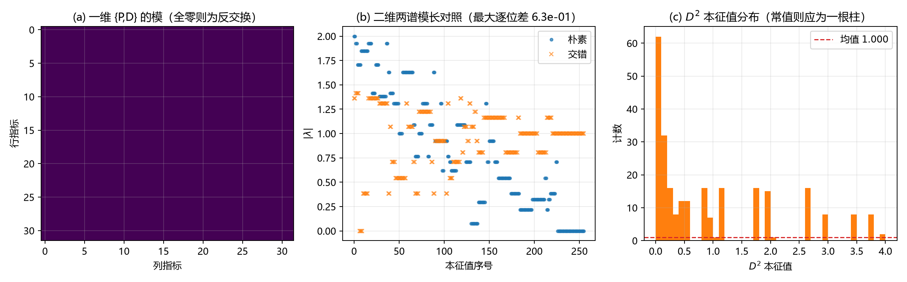
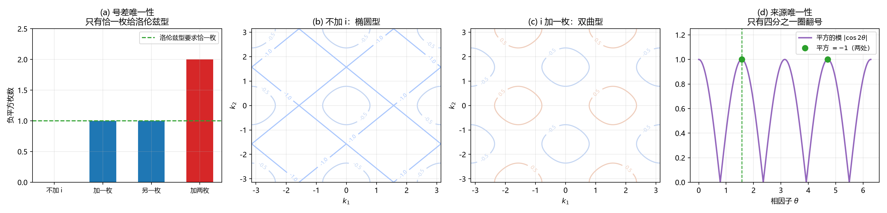
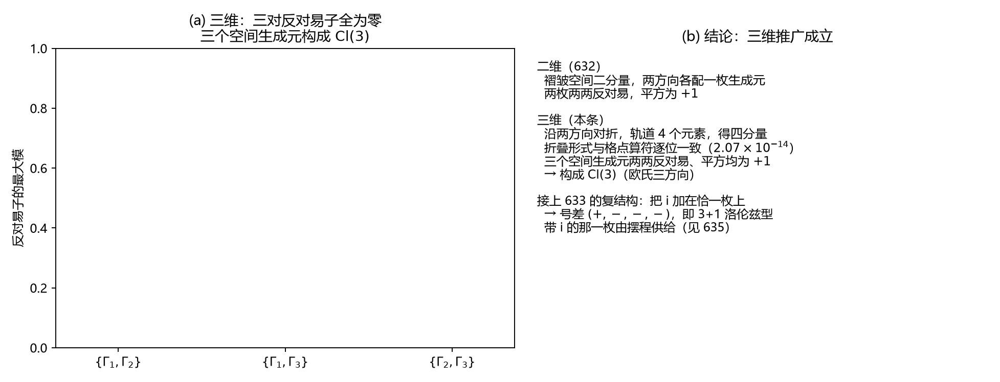
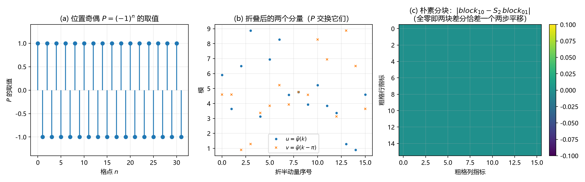
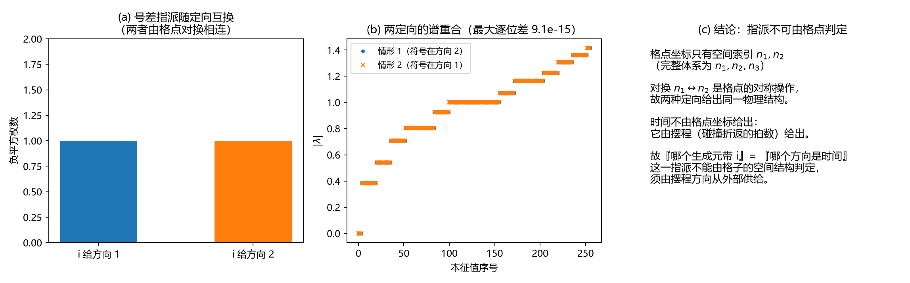
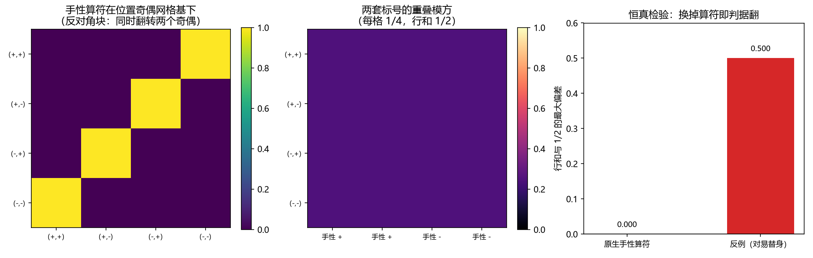
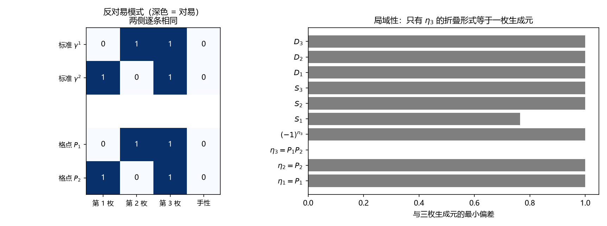
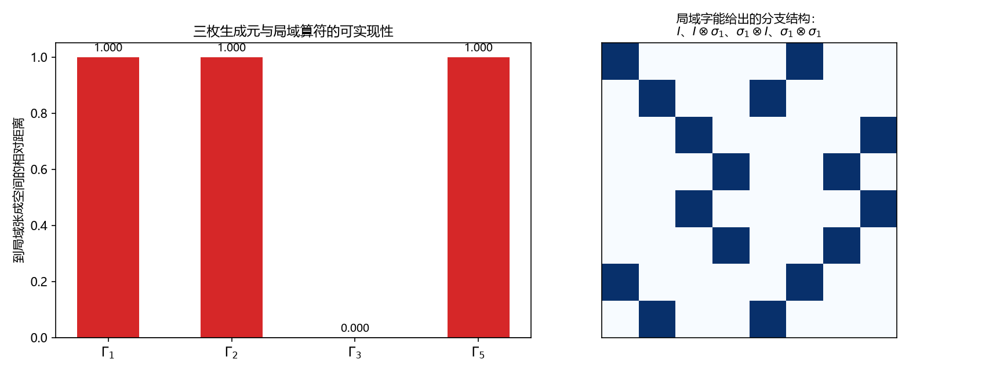

# 狄拉克代数的元相子几何来源：反交换供给、常值平方生成元与号差

**摘要**：体系此前对狄拉克方程的工作停在复现层：把标准 $\gamma$ 表示写在格点上，逐条验证其自洽，并注明"从元相子几何自动导出"仍属开放。本文把那一层推进一格，给出一个只由体系原语构造的格点费米算符，并把它与标准 $\gamma$ 代数之间的关系说清。

构造由三块拼图组成。反交换的出借方是格点的位置奇偶：$P_a=(-1)^{n_a}$ 与方向差 $D_a$ 严格反交换（$\{P_a,D_a\}=0$，判据第 631 号），而朴素中心差分没有这个性质。

常值平方的生成元由动量按奇偶对折后涌现：对折把单分量交错算符化为褶皱空间上的二乘二矩阵 $M(k)=\mathrm{i}\sin k_1\sigma_3+\mathrm{i}\sin k_2\sigma_1$，$M^2=-(\sin^2k_1+\sin^2k_2)I$ 在整个布里渊区上精确成立（残差 $2.220\times10^{-16}$，判据第 632 号），生成元 $\gamma_1=\sigma_3$、$\gamma_2=\sigma_1$ 平方为 $+1$ 且严格反对易。

恰一枚负平方由相位圆的复结构 $\mathrm{i}$ 供给：$\mathrm{i}$ 是中心元，加在一枚生成元上不破坏反对易，却把号差从欧氏型翻成洛伦兹型（判据第 633 号）。三维下对折给出四分量，三个空间生成元构成 $\mathrm{Cl}(3)$；三维加一时间的洛伦兹号差 $(+,-,-,-)$ 是就四枚生成元而言，第四枚（时间那枚）由质量项与摆程供给，判据第 636 号读到的是其中的三枚空间生成元（见 §2.5）。

与此配套，本文给出各狄拉克对象的体系原语对照表，并把三处限定分节说清。手性算符的格点原生表达式为 $\Gamma_5=\mathrm{i}\Gamma_1\Gamma_2\Gamma_3$，它与三枚生成元对易（奇维体积元），故四枚不成 $\mathrm{Cl}(4)$；局域性穷举判否「三枚生成元对应自旋空间的三枚」，该对象只能读作褶皱空间的分量指标代数里的体积元（判据第 637 至 639 号）。

分量在格点上带标号而无位置（位置奇偶的本征值），且格点原生标号与标准物理的手性标号最大不相容；时间方向的指派不能由格点判定，须由摆程从外部供给；关系同型是必要条件，不构成充分条件；代数层判不出「是不是自旋」，能判的是局域性。单手征与弱荷单分支不在本文射程。

**关键词**：元相子、狄拉克代数、交错算符、位置奇偶、复结构、洛伦兹号差

---

## 一、问题：复现与导出的分界

体系对狄拉克方程已有一层交付。在 $S^1\times\mathbb{R}$ 上取两分量实现，把 $\pi$ 扭转写成反周期边界条件，逐条验证离散谱、连续极限、正负两支与 $g=2$（[[验证脚本/注记-电子算符Dirac骨架（第489条）：S¹×ℝ反周期谱结构、D2连续极限与D1甲乙首测|第 489 号]]、[[验证脚本/注记-小动量极限与D3的磁矩因子（第499条）：3+1维平行自旋给出g=2精确|第 499 号]]）。这一层说明的是"体系装得下这支方程"，其构造输入是标准的四维 Dirac 基。

本文处理的是下一层的问题：那套 $\gamma$ 矩阵的反对易代数能否由格点自身的结构给出。两者的性质不同，须用一条界线分开，本文取三条验收标准。

**标准甲（输入封闭）**：构造只输入体系原语，标准 $\gamma$ 表示不得作为输入。

**标准乙（谱一致）**：连续极限下给出相对论色散、正负两支与 $g=2$。

**标准丙（对应物唯一且在库）**：每个对象在体系内有唯一的几何对应物，且该对应物在库内已有独立定义。

只有乙而没有甲的构造判为复现。本文的结论是：甲与乙达标，丙部分达标。

**乙的达标须分层标注。** 乙的三项里，色散与正负两支由本文构造直接给出（$M^2=-(\sin^2k_1+\sin^2k_2)I$ 给两支，低 $k$ 给相对论色散）；$g=2$ 一项的读数取自复现层的构造（第 499 号；其前身第 496 号因八重简并稀释自旋投影而判负）。这一分层有构造上的原因：第 639 号判否「三枚生成元对应自旋空间的三枚」之后，体系原生构造里没有内禀自旋算符，$g=2$ 在原生算符上没有对象可测。

## 二、构造：三块拼图

### 2.1 设定

在 $d$ 维周期格点（$d=2,3$）上取单分量场 $\psi(n)$，格距取 $1$（无量纲化约定，物理格距为 $l_P$，下同）。方向差与位置奇偶定义为

$$(D_a\psi)(n)=\tfrac12\big[\psi(n+\hat a)-\psi(n-\hat a)\big],\qquad P_a=(-1)^{n_a}.$$

交错算符取

$$D_{\text{stag}}=\sum_a\eta_aD_a,\qquad \eta_1=1,\quad \eta_2=P_1,\quad \eta_3=P_1P_2,$$

对照的朴素算符为 $D_{\text{naive}}=\sum_aD_a$。在动量空间，方向差是乘以 $\mathrm{i}\sin k_a$，位置奇偶把 $k_a$ 平移 $\pi$。三样对象（方向差、位置奇偶、它们的组合）都取自格点自身，不含任何标准 $\gamma$ 表示。

### 2.2 第一块：反交换供给

第一块是反交换的来源。移位取循环移位 $S_a$，方向差 $D_a=(S_a-S_a^\dagger)/2$，位置奇偶 $P_a=(-1)^{n_a}$。两者反交换：

$$(P_aS_a\psi)(n)=(-1)^{n_a}\psi(n-1),\qquad (S_aP_a\psi)(n)=(-1)^{n_a-1}\psi(n-1)=-(-1)^{n_a}\psi(n-1),$$

故 $\{P_a,S_a\}=0$，同样 $\{P_a,S_a^\dagger\}=0$，于是 $\{P_a,D_a\}=0$；而 $P_a$ 与 $D_b$（$b\ne a$）对易。这条反交换是逐点的，不依赖边界约定。

读数（[[验证脚本/注记-格点奇偶供给的反交换与生成元资格（判据第631号）|第 631 号]]）：一维下 $\{P,D\}$ 精确为零；二维下按方向分辨成立，$\{P_x,D_x\}=0$ 与 $\{P_y,D_y\}=0$，而 $\{P_x,D_{\text{naive}}\}=1.000$（因 $P_x$ 与 $D_y$ 对易，反对易子拾到剩余项）。同一轮还读到：交错写法把二维零模由 $30$ 个切为 $4$ 个孤立点，即奇偶符号真的改变了零模结构。

### 2.3 第二块：常值平方的生成元

第一块只给出一对反交换的算符，其中方向差是格点导数，其平方随动量变（第 631 号读出 $D^2$ 本征值散布 $4.000$），故它不满足生成元"平方为常值"的要求。

第二块是补上这一步的办法：把动量按奇偶对折。交错符号 $\eta_2=P_1=\mathrm{e}^{\mathrm{i}\pi n_1}$ 在动量空间把 $k_1$ 平移 $\pi$，故 $D_{\text{stag}}$ 只耦合 $k$ 与 $k-\pi\hat1$。把 $k_1$ 限制在半个布里渊区 $[0,\pi)$，取二分量为

$$(u,v)(k)=\big(\tilde\psi(k_1,k_2),\ \tilde\psi(k_1-\pi,k_2)\big),$$

则 $D_{\text{stag}}$ 的作法是

$$D_{\text{stag}}u=\mathrm{i}\sin k_1\,u+\mathrm{i}\sin k_2\,v,\qquad D_{\text{stag}}v=\mathrm{i}\sin k_2\,u-\mathrm{i}\sin k_1\,v,$$

即 $D_{\text{stag}}$ 在褶皱空间上是

$$M(k)=\mathrm{i}\sin k_1\,\sigma_3+\mathrm{i}\sin k_2\,\sigma_1 .$$

生成元 $\gamma_1=\sigma_3$、$\gamma_2=\sigma_1$ 满足 $\gamma_a^2=I$、$\{\gamma_1,\gamma_2\}=0$，于是

$$M^2=-\big(\sin^2k_1+\sin^2k_2\big)I .$$

**这一步是"平方为常值"的充要条件所在。** $M=\mathrm{i}\sum_a\sin k_a\gamma_a$ 的平方里，交叉项 $\mathrm{i}^2\sin k_1\sin k_2(\gamma_1\gamma_2+\gamma_2\gamma_1)$ 只在 $\{\gamma_1,\gamma_2\}=0$ 时消失；交叉项不消失，$M^2$ 就随动量散布，生成元资格随之丧失。反交换（第一块）与常值平方（第二块）由此接上：对折把反交换的一对组合成 Clifford 生成元。

读数（[[验证脚本/注记-粗格涌现构造：常值平方生成元的提取与号差读数（判据第632号）|第 632 号]]）：对折形式与格点算符逐位一致（$1.913\times10^{-14}$，量级为 FFT 舍入）；$M^2+(\sin^2k_1+\sin^2k_2)I$ 的最大模为 $2.220\times10^{-16}$，即平方在整个布里渊区上为常数乘单位阵，不限于低 $k$ 附近；$\gamma_1^2$ 与 $\gamma_2^2$ 精确为 $+1$、反对易子精确为零。

反例为去掉奇偶符号的朴素算符，其平方与"常数乘单位阵"差出 $6$（解析值 $2(\sin^2k_1+\sin k_1\sin k_2+\sin^2k_2)$ 的最大值 $6.000000$，与实测逐位一致）。

### 2.4 第三块：号差

第二块给出的生成元平方同为 $+1$，是欧氏型；洛伦兹方程要的是"恰一枚反号"。

第三块是负平方的来源。体系的相位圆带复结构 $\mathrm{i}$（$\mathrm{i}^2=-1$），它是中心元，故把 $\mathrm{i}$ 乘在一枚生成元上不破坏反对易：

$$\{\mathrm{i}\gamma_1,\gamma_2\}=\mathrm{i}\{\gamma_1,\gamma_2\}=0 .$$

读数（[[验证脚本/注记-号差来源接入：复结构落在一枚生成元上（判据第633号）|第 633 号]]）：四档对照（不加、加一枚、另一枚、加两枚）的反对易子全为零；负平方枚数的全部取值为 $\{0,1,2\}$，洛伦兹型要求的"恰一枚"恰在"只把 $\mathrm{i}$ 加在一枚上"时出现，加两枚回到同号；色散随号差联动，不加 $\mathrm{i}$ 或加两枚为椭圆型、加一枚为双曲型（$k_1^2-k_2^2$）；相位扫描下使平方为 $-1$ 的相因子仅 $\theta=\pi/2$ 与 $3\pi/2$；反例为把 $\mathrm{i}$ 换成实数 $1$，号差回到同号。

### 2.5 三维推广

把上述构造推广到三个空间方向。交错符号有两个独立的半圈平移，折叠轨道有四个元素，褶皱空间成为四分量。读数（[[验证脚本/注记-三维推广成立：四分量与Cl3（判据第636号）|第 636 号]]）：四分量折叠形式与格点算符逐位一致（$2.072\times10^{-14}$）；三个空间生成元

$$\Gamma_1=I\otimes\sigma_3,\qquad \Gamma_2=\sigma_3\otimes\sigma_1,\qquad \Gamma_3=\sigma_1\otimes\sigma_1$$

两两反对易（三对反对易子全为零）、平方均为 $+1$，构成 $\mathrm{Cl}(3)$（欧氏型）。三枚连乘给出体积元 $\Gamma_5=\mathrm{i}\Gamma_1\Gamma_2\Gamma_3=-(\sigma_2\otimes\sigma_3)$（见 §五）。

**号差这一步的计数须写明。** 第 633 号的机制是「$N$ 枚生成元、恰一枚加 $\mathrm{i}$，色散由椭圆型变双曲型」：二维 $N=2$ 给 $(1,1)$。三维这一轮读到的是三枚空间生成元，三枚加一枚翻号给的是 $(2,1)$，只覆盖三枚的号差。

三维加一时间的洛伦兹号差 $(+,-,-,-)$ 是就四枚生成元而言的，第四枚（时间那枚）不在折叠的输出里：它在体系里由质量项供给（取 $\gamma^0m$ 形式，第 501 号，形式不唯一），时间方向的指派由摆程供给（第 635 号）。故本轮的读数是三枚空间生成元，四枚的号差是接上第四枚之后的事；记号取 mostly-minus，整体符号属约定。**第四枚的选择属输入项**：判据第 645 号读到代数相容只给一维对合族、只用三枚生成元搭出来的条件无从收窄、族成员到局域张成空间的相对距离全体 $1.000000$，故它不能由格点给出，与时间方向同格。

## 三、几何意义对照表

下表给每个狄拉克对象的体系对应物，并标证据等级。表中"落位"指该对象在体系三因子划分（相位、模态、时空）中的位置。

| 狄拉克对象 | 体系对应物 | 落位 | 证据等级 |
| --- | --- | --- | --- |
| 旋量（$2\pi$ 变号） | $\pi$ 扭转；$\mathrm{SO}(3)$ 双覆盖的 $\mathbb{Z}_2$ | 相位（反周期边界） | 判据级（第 489 号） |
| 四分量结构 | 位置奇偶的本征值（褶皱空间的分量） | 时空（褶皱） | 判据级（第 632、634、636 号） |
| 生成元代数 | 方向差加奇偶对折，号差由相位圆复结构给 | 时空（褶皱） | 判据级（第 631、632、633、636 号） |
| 手性 $\Gamma_5$ | $\mathrm{i}\Gamma_1\Gamma_2\Gamma_3$；与三枚对易，故四枚不成 $\mathrm{Cl}(4)$；与位置奇偶标号最大不相容 | 时空（褶皱） | 算符层表达式判据级（第 637、638 号）；「三枚生成元对应自旋空间 $\alpha_i$」经局域性穷举判否（第 639 号），本行对象只能读作褶皱空间的体积元；来源层与载体层仍纲领性；物理手性未判，见 §五 |
| 质量项 | 缺陷相对真空（基态）的绑定能 | 时空（取 $\gamma^0m$ 形式） | 结构可判；形式不唯一且属输入项（第 501 号判负；第 645 号判其选择不能由体系给出） |
| 正负两支 | 能量符号（$\{\Gamma_5,H\}=2\Gamma_5\alpha\cdot p$，第 500 条；$p=0$ 时反对易子为零，故静止系下 $\Gamma_5$ 互换 $\pm E$ 两支；第 494 条的零读数另用 Dirac 算子形式 $m\gamma^0+\gamma\cdot p$） | 时空 | 判据级（第 489、494、495、500 号） |
| 电荷共轭 | 绕数符号反转 $w\mapsto-w$；$\pm w$ 谱逐位恒等 | 相位 | 判据级（第 489 号） |
| 时间方向 | 摆程（碰撞折返的拍数），不在格点坐标内 | 输入项 | 判据级（第 635 号） |
| 单手征 | 弱荷 $SU(2)_L$ 单分支 | 模态 | 未闭合，见 §九 其三 |

## 四、分量身份与时间方向

两处须单独说明，因为它们的结论是限定性的。

**分量身份。** 位置奇偶在折叠空间里的作用恰好是交换两个分量，其本征值为 $\pm1$，故分量的几何身份可写作位置奇偶的本征态（[[验证脚本/注记-旋量分量的几何身份：位置奇偶的本征值（判据第634号）|第 634 号]]）。

同一轮排除了一个更强的说法：朴素实空间分块下两块差分算符并不相同（差 $1.000000$），且恰差一个两步平移（偏差精确为零），故"分量分居不同子格"不成立。**分量被位置奇偶标号，与分量被位置分开，是两件事。** 须写明分寸：标准物理里分量是同一点上的内部状态，而位置奇偶是位置性的量（随格点交替），到连续极限才退为内部指标。这正是标准丙只判部分达标的原因：缺的是"分量住在哪里"的对应物。

**时间方向。** 两种定向（奇偶符号加在方向 2 上或方向 1 上）的折叠形式均以机精度成立且生成元与方向的配对互换，而两者的谱逐位相同（$9.104\times10^{-15}$），故"哪个生成元带 $\mathrm{i}$"这一指派不能由格点判定（[[验证脚本/注记-时间方向归属：指派不可由格点判定（判据第635号）|第 635 号]]）。对换 $n_1\leftrightarrow n_2$ 是格点的对称操作，故两种定向给出同一物理结构。

时间在体系里由摆程给出，不在格点坐标内，故摆程是一个合格的承接者。措辞须相应：可以说体系有一个合格的承接者，不能说体系推出了哪个方向是时间，也不能说摆程是唯一的候选，层数通道与相位通道等外部候选未逐一排除。

## 五、手性的算符层位置

手性算符是本文构造里最需要说清分寸的对象。它有一个由格点材料拼出的表达式，但它读出来的东西不是标准物理的手性。

**原生表达式。** 把三枚空间生成元连乘、再乘上相位圆的复结构，得

$$\Gamma_5=\mathrm{i}\Gamma_1\Gamma_2\Gamma_3 .$$

它是一个厄米、平方为 $+1$ 的对合，谱为 $\pm1$ 各二重（[[验证脚本/注记-手性算符的格点原生表达式与两套标号的相容性（判据第637号）|第 637 号]]）。它把四分量劈成两半。

**它与三枚生成元对易，故四枚不成 $\mathrm{Cl}(4)$。** 三维里三枚生成元连乘给出的体积元与每枚生成元对易（奇维体积元是中心元），故 $\{\Gamma_5,\Gamma_i\}=2\Gamma_5\Gamma_i$。这一点与标准物理一致：$\gamma_5=\mathrm{i}\alpha_1\alpha_2\alpha_3$ 与每枚 $\alpha_i$ 对易（$[\gamma_5,\alpha_i]=0$）。若照四维 $\gamma_5$ 与 $\gamma^\mu$ 反对易的记法去预期，就会把这一条写反（第 637 号的过程记录里有一处同型自纠）。

**位置奇偶给出格点原生标号，两套标号最大不相容。** 位置奇偶在折叠空间里的作用是交换两个分量，两个方向上各有一个这样的交换，于是四个分量拿到一张 $2\times2$ 的标号格子（位置上奇、偶各两种）。$\Gamma_5$ 与两个位置奇偶交换都反对易，故在位置标号已定的态上，手性的平均读数恒为零：重叠每格 $1/4$、每行在两个手性支上各一半。这是最大程度的不相容：任何一枚分量在两套标号下都对不齐。恒真检验把开关换成与位置奇偶对易的那一枚，重叠立刻从半对半变成完全重合（偏差 $0.500$）。

**这一枚符号不是自旋。** 关系层对得上还不足以断定格点这三枚就是自旋空间那三枚。代数本身判不出来：两侧的反对易模式逐条相同，而本文这一对具体三元组之间确实存在酉变换（交织空间维数为 $2$、酉解残差 $1.026\times10^{-7}$），故代数层对这一对没有判别力（[[验证脚本/注记-手性口径对表的算符层核对（判据第638号）|第 638 号]]）。能分辨的是局域性，而格点这三枚并不平权：其中一枚恰是格点上一个简单局域算符 $\eta_3=P_1P_2$ 的折叠形式（偏差 $0$），另两枚在格点算符的清单里找不到这样的对应。

顺着这条线索穷举单站点局域字（字长 $\le3$ 的 $820$ 枚），它们能长出的分量结构只张成 $4$ 维，而三枚生成元里有两枚根本不在其中（[[验证脚本/注记-格点三枚生成元是否对应自旋空间的三枚（判据第639号）|第 639 号]]）。故「三枚生成元对应自旋空间的 $\alpha_i$」判否，$\Gamma_5=\mathrm{i}\Gamma_1\Gamma_2\Gamma_3$ 只能读作褶皱空间的分量指标代数里的体积元。

**物理手性的家在别处。** 库内手性口径分三层：本文给的是算符层表达式；来源层（$\gamma_5$ 与模态空间 $S^3$ 的固有复结构 $J$ 的对应）与载体层（$\pi$ 扭转奇偶的 $\mathrm{SO}(3)$ 双覆盖）仍纲领性。手性开关分出的两枚支在弱相互作用里如何加载，属阶段 4 接口，未闭合（见 §九）。

## 六、构造的地位：唯一性与盲区

上一节的一处判否须单独成节，因为它改变"对应物唯一"这句话的读法。

**关系同型是必要条件，不充分。** 第 638 号把格点侧与标准侧的反对易模式逐条对照，两侧的图案矩阵逐位相同。这一同型对本文这一对不含判别力：第 638 号读到交织空间维数为 $2$，且存在把格点侧送到标准侧的酉变换（残差 $1.026\times10^{-7}$）。故"关系对得上"不能作为"对象是同一物"的证据。

**须防一处过度推广。** 一般地，「任何两组 $\mathrm{Cl}(3)$ 三元组都酉等价」不成立。$\mathrm{Cl}(3)$ 在 $\mathbb{C}$ 上同构于 $M_2(\mathbb{C})\oplus M_2(\mathbb{C})$，四维表示按两不可约分量的重数 $(n_1,n_2)$ 分三类。

取体积元 $\omega=\gamma_1\gamma_2\gamma_3$ 即可判别：$(2,0)$ 型给 $\omega=\mathrm{i}I_4$，$(1,1)$ 型给 $\omega=\mathrm{i}\,\mathrm{diag}(1,1,-1,-1)$，酉变换保谱，两类不等价。本文两侧恰属同一类，故同型无判别力这一结论所依据的是这一对的具体读数。

**能判别的是局域性。** 判别量取"该算符能否由格点上零位移的局域字给出"。第 639 号穷举字长 $\le3$ 的局域字 $820$ 枚，其中折叠形式与轨道无关者 $106$ 枚；单站点局域字的折叠形式在分支空间上只张成 $4$ 维。三枚生成元到该空间的相对距离为 $\Gamma_1=\Gamma_2=\Gamma_5=1.000000$、$\Gamma_3=0.000000$。格点三枚不平权，$\Gamma_3$ 恰是 $\eta_3=P_1P_2$ 的折叠形式。

**这条判别改变标准丙的读法。** "对应物唯一"须读作"在局域性判据下的唯一"，代数唯一并不成立。缺的那一步是：要把 $\Gamma_1$、$\Gamma_2$ 与自旋空间的两枚 $\alpha$ 对上，需要格点上一个零位移的局域算符，而库内没有这样的算符。分量在格点上带的是标号（位置奇偶的本征值），"分量住在哪里"这件事在格点上没有对应物。这正是标准丙只判部分达标的原因。

**时间方向的指派同样不能由格点判定。** 第 635 号的两定向读数（谱逐位相同）给出同一结论的另一面：格点坐标只有空间索引，凡是靠坐标才能区分的量，格点都判不了。故本文的构造是一个"到局域载体为止"的构造：代数骨架与载体对应由格点给出，超出这一步的指派（哪一枚是时间、分量住在哪里）须由格点之外的结构供给。

## 七、与标准物理的关系

在恰一枚生成元上乘复结构以取得洛伦兹号差，与标准物理的 Wick 转动同型；同型之处只在「用 $\mathrm{i}$ 换号差」这一步，Wick 转动是时间坐标的解析延拓，此处是代数元上的乘法，两者机制不同。这一技巧不属本文的贡献。本文的贡献在指认体系内那个"四分之一圈"的出处：相位圆的复结构。标准物理里这一步通常是一个可以随手做的手续，体系这边它有一个几何主人。

另一处关系须说明。本文的构造与格点费米子的既有做法（交错型，Kogut 与 Susskind 提出）同族：位置奇偶 $\eta_a$ 就是交错符号，按奇偶对折得到味道空间是标准手法，单站点局域字拼不出自旋类矩阵也是该表述的既有事实。本文不宣称在格点技术上更优，其贡献是把这些格点对象的体系出身指认出来：反交换的出借方是位置奇偶，号差的出借方是相位圆的复结构。

"分量被位置奇偶标号"与标准物理的纤维图像不同，前者到连续极限才退为内部指标。这一点与格点费米子构造的既有做法一致，本文不宣称更优。

## 八、验证材料

本文的判据读数一览。全部脚本在 `验证脚本/`，注记同目录，索引见 `验证脚本/README.md` 第 631 至 639 号；各轮的数值图已随节嵌入（图 1 至图 9）。表头两列为期望与实测，容差取机精度或精确零，逐条注明口径。

| 判据 | 内容 | 期望 | 实测 |
| --- | --- | --- | --- |
| 631 S1 | 一维 $\{P,D\}$ | $0$ | $0.000\times10^{0}$ |
| 631 S4 | 二维 $D^2$ 本征值散布 | 非常值 | $4.000\times10^{0}$ |
| 631 附 | 二维零模计数（朴素对交错） | 读数 | $30$ 对 $4$ |
| 632 T1 | 对折形式与格点算符逐位差 | 机精度 | $1.913\times10^{-14}$ |
| 632 T2 | $M^2+(s_1^2+s_2^2)I$ 最大模 | $0$ | $2.220\times10^{-16}$ |
| 632 T3 | $\gamma_a^2-I$ 与 $\{\gamma_1,\gamma_2\}$ | $0$ | $0.000\times10^{0}$ |
| 632 T4 | 生成元平方的本征值 | 读数 | $[1,1]$ 与 $[1,1]$（欧氏型） |
| 632 T5 | 反例：朴素算子与常数单位阵之差 | 非零 | $6.000\times10^{0}$ |
| 633 U2 | 负平方枚数取值 | 含恰一枚 | $\{0,1,2\}$，恰一枚可达 |
| 633 U3 | 色散类型 | 读数 | 椭圆型与双曲型（随号差联动） |
| 633 U4 | 使平方为 $-1$ 的相因子 | 仅两处 | $\pi/2$、$3\pi/2$ |
| 634 V1 | $P$ 在折叠空间的交换偏差 | $0$ | $0.000\times10^{0}$ |
| 634 V3b | 朴素分块两块差分之差 | $0$ | $0.000\times10^{0}$ |
| 635 W1 | 两定向折叠形式偏差 | 机精度 | $1.913\times10^{-14}$、$1.882\times10^{-14}$ |
| 635 W2 | 两定向谱模长最大逐位差 | 读数 | $9.104\times10^{-15}$（相同） |
| 636 X1 | 三维折叠形式偏差 | 机精度 | $2.072\times10^{-14}$ |
| 636 X2 | 三对反对易子 | 全为零 | $0.000000$ |
| 636 X3 | 三个生成元平方偏差 | $0$ | 三者均为 $0.0$ |
| 637 Y1 | $\Gamma_5$ 厄米性、平方、谱 | 厄米、平方 $I$、谱 $\pm1$ 各二重 | 偏差 $0$、$0$；谱 $[-1,-1,1,1]$ |
| 637 Y2 | 与三枚生成元的反对易子 | 非零（即对易，$\{\Gamma_5,\Gamma_i\}=2\Gamma_5\Gamma_i$） | 三对均为 $2.000$，对易子均为 $0$ |
| 637 Y4 | 两套标号的重叠行和与手性期望 | $1/2$、为零 | $2.220\times10^{-16}$；子空间随机矢 $5.551\times10^{-17}$ |
| 637 Y6 | 与格点折叠矩阵的对易子 | $0$ | $3.331\times10^{-16}$ |
| 638 Z5 | 交织空间维数、酉解残差 | 判盲区 | 维数 $2$、残差 $1.026\times10^{-7}$ |
| 638 Z6 | $\eta_3$ 与 $\Gamma_3$ 的偏差 | $0$ | $1.110\times10^{-16}$ |
| 639 | 单站点局域字折叠形式的张成维数 | $4$ | $4$；$\Gamma_1$、$\Gamma_2$、$\Gamma_5$ 距离 $1.000000$ |

## 九、开放问题与边界

**未闭合之处（本文唯一清单位置）。** 其一，标准丙维持部分达标（2026-10-16 裁定）。手性对象在算符层的对应物已定位（褶皱空间的体积元），其物理对应物属来源层（模态复结构 $J$），两层对应仍纲领性；「点」的口径不再影响本条判定，因为第 639 号已把相关断言写成与口径无关的形式（分量在格点上带标号而无位置）。

其二，物理手性未判：手性算符分出的两枚支在弱相互作用里如何加载，属阶段 4 接口。其三，单手征与弱荷单分支属阶段 4 接口，本文不涉，且 Nielsen-Ninomiya 定理把该处的候选空间限死（2026-10-16 阶段 4 首轮与判据第 650 号：四候选独立者三条，体系自有入口经闸门判否，结论落到采纳标准处方并登记手征破缺代价；方案选定属 D-e）。其四，本文的构造在动量空间给出，实空间的完整写法（含相位约定的显式形式）未展开。摘要、对照表与各节的未闭合表述均以本节为准。

**耦合层的补充读数（2026-10-16，判据第 652 号）。** 把守恒绕数接到费米算符的电荷通道上后，整数绕数的 Aharonov–Bohm 相位恰为 $2\pi$ 的整数倍，缺陷对费米子透明：三档绕数下谱与自由逐位一致（偏差 $10^{-15}$）。手工放进非平凡背景可改变零模计数，但零模手征恒成对，净手征性为零。故单手征亦不能从守恒荷取得，见 [[验证脚本/注记-绕数对费米子透明：缺陷与费米耦合首轮（判据第652号）]]。

**质量通道的补充读数（2026-10-16，判据第 653 号）。** 另一条候选通道（缺陷相对真空的绑定能，在体系里是不带绕数的标量，故其手征选择只能走复结构符号的符号翻转）已判：畴壁零模存在且落在壁位，但 $\gamma_5$ 在零模子空间上的谱恒为 $[-1,+1]$，手征分辨全档 $1$ 对 $1$，净手征性因味加倍为零。两条通道至此穷尽，见 [[验证脚本/注记-质量通道首轮：畴壁零模的手征成对与净手征性为零（判据第653号）]]。

**边界声明。** 本文以工作区文档与判据号为引用单位，不列外部文献（§七 提及的交错型格点费米子与 Nielsen-Ninomiya 定理属标准结果）。本文不主张"体系已导出狄拉克方程"这一总命题的完整形态：达标的是代数来源（甲、乙）与部分几何意义（丙），成文所依据的判据均为模型内读数。本文不宣称四分之一圈取号差为体系独有。本文不改动 `理论总纲/` 基准；转正与子理论索引登记须作者裁决后执行。

**过程记录（两条方法教训）。** 本文所依据的九轮判据中，有五轮在首版出现约定类错误（第 632 号的呈现画法、第 635 号的生成元与动量配对、第 636 号的生成元符号、第 637 号的期望记法与奇偶本征基、第 638 号的向量化序与复 SVD 共轭），且第 636 号那一处连带手推的结论也错、差一点作为结论落盘。各处均由「与格点算符逐位对照」或读数与预期不符抓出。据此立一条纪律：**构造的约定不得先于逐位对照落盘。**

第二条来自本文 2026-10-16 的完善版评审。§2.5 三个生成元的 $\Gamma_1$ 在正文里写成 $\sigma_3\otimes I$，而 636 脚本与 638 注记均为 $I\otimes\sigma_3$；按正文所写矩阵，「两两反对易」不成立。这处转写错误在初版即存在，历经第 636 号读数核对、七维评审与转正三轮未被抓出，原因是每轮核的都是读数与期望是否相符，而定义式只在正文出现一次、没有对照物。据此立第二条纪律：**正文里的定义式须与脚本里的定义式逐字对表。**

## 参考文献

本文以工作区文档与判据编号为引用单位，验证材料随判据号索引于 `验证脚本/README.md`。

- [[验证脚本/README]]（第 631 至 639 号，本文判据的索引）
- 本文判据九份：[[验证脚本/注记-格点奇偶供给的反交换与生成元资格（判据第631号）]]、[[验证脚本/注记-粗格涌现构造：常值平方生成元的提取与号差读数（判据第632号）]]、[[验证脚本/注记-号差来源接入：复结构落在一枚生成元上（判据第633号）]]、[[验证脚本/注记-旋量分量的几何身份：位置奇偶的本征值（判据第634号）]]、[[验证脚本/注记-时间方向归属：指派不可由格点判定（判据第635号）]]、[[验证脚本/注记-三维推广成立：四分量与Cl3（判据第636号）]]、[[验证脚本/注记-手性算符的格点原生表达式与两套标号的相容性（判据第637号）]]、[[验证脚本/注记-手性口径对表的算符层核对（判据第638号）]]、[[验证脚本/注记-格点三枚生成元是否对应自旋空间的三枚（判据第639号）]]
- 清点与总览：[[内部草稿/裁决备忘-手性口径对表：三层口径、算符层对应与两处待判]]、[[内部草稿/总览注记-狄拉克线九轮数值验证：读数清单、强度分层与边界]]
- 复现层材料（第 489 至 501 号）见 `验证脚本/` 同目录注记，索引同上

## 修订记录

- **2026-10-15 初版落盘**（触发：狄拉克方程攻坚计划阶段 5 成文；阶段 1 至 3 已完成，判据第 631 至 636 号）
    - 给出三块拼图的构造与读数：反交换供给（位置奇偶与方向差反交换）、常值平方生成元（动量按奇偶对折）、号差（复结构落在恰一枚生成元上）
    - 三维推广成立，三个空间生成元构成 $\mathrm{Cl}(3)$，接复结构得洛伦兹号差
    - 几何意义对照表九行，逐行标证据等级
    - 验收标准甲、乙达标，丙部分达标；未闭合之处四项列明
    - 过程记录一条：约定类错误三次均由逐位对照抓出，纪律写死
- **2026-10-15 阶段 5 收束轮：判据第 637 号**（触发：验收标准丙的残口与几何意义表「手性 $\Gamma_5$ 未定」两处缺口）
    - 手性算符的格点原生表达式定为 $\Gamma_5=\mathrm{i}\Gamma_1\Gamma_2\Gamma_3=-(\sigma_2\otimes\sigma_3)$，厄米、平方 $+1$、谱 $\pm1$ 各二重；与三枚空间生成元对易（中心元），四枚不成 $\mathrm{Cl}(4)$
    - 位置奇偶给出格点原生标号，两套标号最大不相容（重叠行和 $1/2$、手性期望恒零）
    - 几何意义表「手性」行由读数级升为算符层表达式判据级（来源层与载体层仍纲领性，见 2026-10-16 附记）
    - 「正负两支」行的对易关系保留库内原式 $\{\Gamma_5,H\}=2\Gamma_5\alpha\cdot p$（第 500 条），补注 $p=0$ 时为零故静止系下互换两支
- **2026-10-16 手性口径对表后的两处回退**（触发：作者对第 637 号方案提出疑问，回源核对库内三层口径）
    - 回退一处错误订正：「正负两支」行的对易关系曾于 2026-10-15 改为 $\{\Gamma_5,H\}=0$，该式取自第 494 条的 Dirac 算子形式 $m\gamma^0+\gamma\cdot p$，与哈密顿量形式 $\alpha\cdot p+\beta m$ 分属两个算符。标准表示逐位核对：$[\gamma_5,\alpha_i]=0$（偏差 $0$）与 $\{\gamma_5,H\}=2\gamma_5\alpha\cdot p$（数值 $1.70$，逐位相符）为同一件事的两种写法
    - 「手性」行的证据等级收紧为算符层表达式，来源层与载体层未判
    - 附记见 [[验证脚本/注记-手性算符的格点原生表达式与两套标号的相容性（判据第637号）]] §八
- **2026-10-16 手性口径对表的算符层核对**（触发：对表轮判据第 638 号）
    - 关系同型（属必要条件，不充分）、位置奇偶对应单枚 $\gamma$、第四枚生成元缺位措辞收紧、局域性判别显示格点三枚不平权
    - 「手性」行证据等级再收紧为算符层表达式（第 637、638 号）
    - 清点与两处待判见 [[内部草稿/裁决备忘-手性口径对表：三层口径、算符层对应与两处待判]]
- **2026-10-16 对应判据：第 639 号**（触发：作者对第 638 号留下的第二处待判答「需要」）
    - 局域性穷举判否「三枚生成元对应自旋空间的 $\alpha_i$」：单站点局域字的折叠形式只张成 $4$ 维，$\Gamma_1$、$\Gamma_2$、$\Gamma_5$ 距离均为 $1.000000$，$\Gamma_3$ 在类内
    - 「手性」行的对象据此刻定为褶皱空间的体积元（分量指标上的标号代数），物理手性未判
- **2026-10-16 评审修订与三项裁定**（触发：七维评审 B/C 级问题；作者委托按最优判断裁定）
    - B1 乙的达标分层标注：色散与两支由本文构造给，$g=2$ 取自复现层（第 496、499 号），理由是第 639 号判否后原生构造里没有内禀自旋算符可测
    - B2 「唯一有资格的承接者」改为「一个合格的承接者」并注明其他外部候选未逐一排除
    - B3 「正负两支」行证据列补第 494 号；B4 未闭合清单归 §七 一处（现 §九），摘要与对照表以该节为准
    - C1 补关键词；C2 补参考文献；C3 「两式相同」改「两式中接缝符号相同」；C4 Wick 转动同型加限定；C5 表格单手征行改为指向 §七（现 §九）
    - 裁定一：标准丙维持部分达标（手性对象在算符层的对应物已定位，物理对应物属来源层；「点」的口径退出本条判定）
    - 裁定二：手性 $\Gamma_5$ 的定级取算符层口径（第 637 至 639 号），来源层与载体层仍纲领性
    - 验收标准丙的缺口性质改写；验证材料一览表补第 637 号四行
- **2026-10-16 论证完善与配图**（触发：作者要求把论证过程写得更清晰严谨并配上重要数值验证图）
    - 补 §2.1 设定：显式给出格点、方向差、位置奇偶、交错算符与动量空间约定，使构造自足
    - 补 §2.3 折叠推导：由 $D_{\text{stag}}u$、$D_{\text{stag}}v$ 两式给出 $M(k)$，并点明"交叉项只在反对易时消失"即常值平方与 Clifford 条件的等价
    - 补 §2.3 一处口径：$M^2$ 为常数乘单位阵在全布里渊区成立（残差 $2.220\times10^{-16}$），非低 $k$ 近似
    - 新增 §五「手性的算符层位置」：原生表达式、与三枚对易故不成 $\mathrm{Cl}(4)$、两套标号最大不相容、局域性判否三枚对应自旋、物理手性的家在别处；原对照表手性行相应收短并指向本节
    - 新增 §六「构造的地位：唯一性与盲区」：关系同型为必要条件、不充分（代数盲区）、局域性为唯一判别、标准丙须读作"局域性判据下的唯一"、时间方向指派同属不可由格点判定
    - 补 §七 与交错型格点费米子（Kogut-Susskind）的同族关系，并说明本文贡献在指认体系出身
    - 全文嵌入九张数值验证图（图 1 至图 9），随对应节放置；验证材料表补第 638、639 号读数三行
    - 未闭合清单、验收标准与各项结论不变，仍以 §九 为准
- **2026-10-16 完善版评审修订**（触发：作者要求对本轮完善版评审并修订；报告在 `评审报告/狄拉克代数的元相子几何来源评审报告（2026-10-16）.md`）
    - A1 §2.5 三个生成元的 $\Gamma_1$ 由 $\sigma_3\otimes I$ 改正为 $I\otimes\sigma_3$（原写致 $\{\Gamma_1,\Gamma_2\}=2I\otimes\sigma_1\ne0$，「两两反对易」不成立，且与自报的 $\Gamma_5=-(\sigma_2\otimes\sigma_3)$ 不相容；与 636 脚本、638 注记一致）；§2.5 补体积元显式锚
    - A2 §五、§六 的「任何两组 $\mathrm{Cl}(3)$ 三元组都酉等价」收窄为本文这一对的具体读数；§六 补「须防一处过度推广」段，给出 $\mathrm{Cl}(3)\cong M_2(\mathbb{C})\oplus M_2(\mathbb{C})$ 的重数分类与体积元判据
    - B1 §2.2 删去未定义的接缝符号 $\sigma$，显式给出循环移位与 $D_a=(S_a-S_a^\dagger)/2$，$(-1)^n$ 改 $(-1)^{n_a}$
    - B2 §一 的 $g=2$ 证据引第 496 号改为第 499 号（第 496 号 M3 判负，$g=-1.4907$）
    - B3 §2.1 补格距取 $1$ 为无量纲化约定；B4 §九 边界声明补引用体例说明；B5 §八 表 637 Y2 行期望列改写性质
    - C1 摘要「单独成节」改「分节说清」；C2 修订记录 B4/C5 两条的 §七 补注（现 §九）
- **2026-10-16 阶段 4 闸门判据**（触发：阶段 4 首轮推荐主选候选四；作者指示执行最优下一步）
    - 判据第 650 号：谷计数 $4$、谷被不守恒的格点标签分开、守恒荷对四谷同值、Wilson 后计数降为 $1$
    - §九 其三 补一句：四候选独立者三条，体系自有入口经闸门判否，结论落到采纳标准处方并登记代价
    - 作者同意后增补：§九 过程记录由一条方法教训扩为两条，补「正文里的定义式须与脚本里的定义式逐字对表」（证据为 §2.5 的 $\Gamma_1$ 转写错误历经读数核对、评审、转正三轮未出）
- **2026-10-16 号差计数裁决**（触发：作者授权按最优判断裁决「三枚生成元 + 恰一枚加 $\mathrm{i}$ → 3+1 号差」一步的计数）
    - 判定为计数缺口（非纯约定标注）：三枚生成元加一枚翻号只覆盖三枚的号差（$(2,1)$），三维加一时间的 $(+,-,-,-)$ 需第四枚生成元
    - §2.5 补「号差这一步的计数须写明」段：第四枚（时间那枚）由质量项（取 $\gamma^0m$ 形式，第 501 号）与摆程（第 635 号）供给，本轮读数为三枚空间生成元；记号取 mostly-minus，整体符号属约定
    - 摘要同处收口；[[验证脚本/注记-三维推广成立：四分量与Cl3（判据第636号）]] 与 [[理论攻坚/狄拉克方程攻坚计划：从元相子几何导出狄拉克方程与完整几何意义]] 同步（后者另修 $\Gamma_1$ 转写错误）
    - 结论、读数与未闭合清单不变

- **2026-10-16 耦合层补轮**（触发：第 650 号边界声明留的缺口）
    - 新增判据第 652 号（[[验证脚本/注记-绕数对费米子透明：缺陷与费米耦合首轮（判据第652号）]]）：守恒绕数在电荷通道上对费米子透明，非平凡背景下零模手征恒成对
    - §九 补一段「耦合层的补充读数」，未闭合清单的四条项不变

- **2026-10-16 质量通道补轮**（触发：第 652 号把手征来源收窄至质量通道）
    - 新增判据第 653 号（[[验证脚本/注记-质量通道首轮：畴壁零模的手征成对与净手征性为零（判据第653号）]]）：畴壁零模手征成对、净手征性因味加倍为零，两条通道穷尽
    - §九 补一段「质量通道的补充读数」，未闭合清单的四条项不变