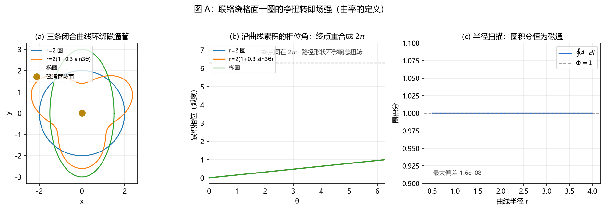
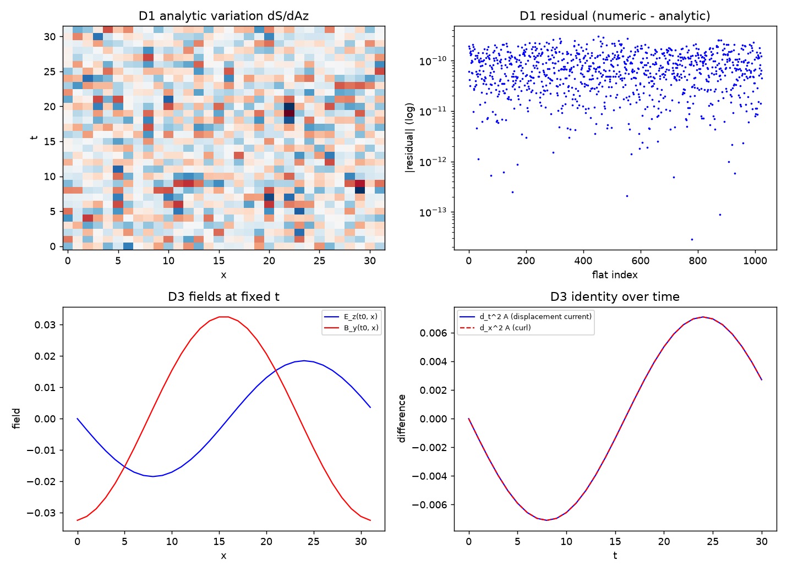
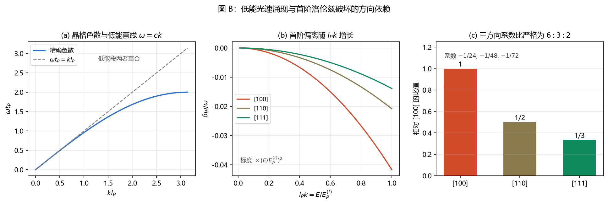

# 电磁场总论：元相子几何视角的完整图景

傅天行

（天行新学研究院）

- **修订记录**：
- **2026-09-30 定名对偶与本体裁决同步**（触发：作者定名基准方向场与实轴方向场对偶，裁决量角基准非实体非实轴）
  - 全文「基准取向场」随全库统一为「基准方向场」；1.2 节补两根标记：物理实轴（摆程基准）与量角基准（$\angle 0$，非实体非实轴），$\alpha$ 是前者相对后者的朝向
  - 1.3/1.5 节「基准」指称精确化为量角基准；静电表述分层（效应侧经实轴方向场畸变读出，静电势为时间联络住基准方向场一侧）
  - 1.4 节规范变换统一表述：实轴方向与基准方向相对定向的局域重拨，体系亦读作实轴的一次重新定向
  - 1.5 节「$A_a$ 编码实轴方向差中不可直接测量的部分」精化为两条独立读数通道
  - **2026-09-30 修正实轴方向场的定义表述**（触发：作者指出「把相位零点定在实轴的哪一点上」为同义反复且无意义）
    - 相位零点按定义固定在实轴上，可变的是实轴自身在圆平面内的朝向，原句把固定量说成变量
    - 第 1.3 节改为：实轴方向场记录实轴的朝向，即相位圆转到哪个角度
    - 全文同类表述一并清理：1.4 节「相位从哪个方向起算」改为「相位圆转到哪个角度」，「零度基准的局域旋转」改为「实轴的一次重新定向」；1.5 节「两个格点零度基准的错位量」改为「搬运所需的相位量」；第三章「零度基准唯一确定」改为「实轴朝向唯一确定」；第六章「零度基准在时间方向的畸变」改为「时间联络的两种写法」；第 10.1 节「零度基准的错配」改为「基准方向场的错配」；摘要「指向自身零度基准的指针」改为「相位圆在圆平面内有一个自由朝向」
    - 全文「零度基准」一词已清零，基准一律指实轴，搬运规则一律指联络
  - **2026-09-30 补 1.2 元相子几何**（触发：作者指出原稿直接使用「实轴」而未交代其对应元相子的哪条几何轴，陌生读者无法进入）
    - 新增 1.2 节：先给元相子物侧的几何体，说明复平面内半径为 $\hbar$ 的相位圆、圆上把周长分成两半的半实轴即相位零点参考方向（这就是「实轴」），以及垂直于圆面的法线轴承担旋转与跃迁
    - 原两个取向场的内容顺延为 1.3 节，并在其中补入法线场的分工，与方向场形成取向与倾斜的一组对照
    - 1.4、1.5 节号顺延，文内四处小节引用同步
  - **2026-09-30 补图**（触发：作者指示加入关键数据图提升专业性）
    - 补第二章曲率定义图（三面板：闭合曲线族、累积相位重合成 2π、半径扫描恒为磁通 $\Phi=1$，最大偏差 $1.6\times10^{-8}$）
    - 补 4.3 位移电流变分四面板图（取自第 447 条注记）
    - 补 5.4 色散与首阶洛伦兹破坏三面板图，含 $6:3:2$ 方向比的柱状核对
    - 补 8.2 洛伦兹力四面板图，并按 2026-09-30 审查修订后的脚本重跑，旧图 V2 面板标「dt^2 convergence」已作废
    - 补 10.1 磁铁机制四面板图与 10.2 同斥异吸四面板图（取自第 448、449 条注记）
    - 新增生成脚本 $_tools/make_em_figs.py$，图 A、图 B 由该脚本产出，图存 $images/$ 目录
  - **2026-09-30 审核修订**（触发：作者指示逐条审核，含 C 级）
    - A1 第 3.1 节推导重写：原从「静电场变化」出发，逻辑不成立；改从 dF = 0 展开，经混合偏导可交换与 F = dA 的分量定义推出法拉第定律，并补出可检验推论（磁单极点位处该定律失效）
    - A2 第 1.3 节修正归属：规范变换的自由度归实轴方向场，联络归基准方向场，补写混读两者会读出曲率恒为零的具体后果
    - B1 第 1.1 节补基态能量设定：每格点三正交元相子各封一份基模能量属刚度能量，不进入引力写入幅度，并说明 E_P 标度的身份
    - B2 第 4.2 节补绕数与电荷的符号约定，并声明与第十章磁相互作用的符号判定不共用
    - B3 章标题改「几何恒等式与它的实验地位」，避免读作该行不是实验事实
    - B4 第 4.3 节理顺逻辑：区分自洽性必要条件与机制解释两个问题
    - B5 第 10.1 节去重，两条后果改为「场集中在薄层」与「散度机器零」
    - B6 参考文献第 16 条去掉未核验的卷期页码，正文不引用页码
    - C1 第 5.3 节并入 5.2，幅度关系不再单列
    - C2 第 7.3 节补规范场的量子化，与第 4.2 节绕数接上
    - C3 射程表分数电荷一条加间接性说明
  - **2026-09-30 全面重写**（触发：作者判定旧稿过于简略、列表与不自然描述过多，不适合作为正式论文）
    - 旧稿归档于 [[归档/电磁场总论：元相子几何视角的完整图景_2026-07版]]，只读不再维护
    - 新增第一章「几何地基」，交代时空晶格、两个取向场的分工与规范势的必然性，原稿缺此层，陌生读者无法进入
    - 组织逻辑由平行清单改为因果链：规范对称性的实体来源引出联络，联络引出曲率，曲率引出无源组与有源组，进而引出电荷、波动与光子
    - 三个最难问题各补完整论证：变化磁场产生电场、变化电场产生磁场、传播方向正交，原稿仅各给一句结论
    - 术语首次出现处内联给出定义与日常等价物，不再依赖外部文档
    - 清除正文内全部修订痕迹与工作日志式元注释
    - 各节末尾标注结论的严格程度层级，纲领性主张单独成节并加限定
    - 参考文献补真实外部文献，并区分已核验与待核

## 摘要

麦克斯韦方程组是物理学家最先当作实验规律接受、后来才发现其形状并非偶然的一组方程。它为什么必然长成那个样子，传统物理给出的答案主要是经验归纳：这些方程与实验相符。本文给出另一条路径，说明在同一套几何下，方程组的每一行都是被迫的。

论证的起点是元相子理论的一项基本设定：真空不是空的，是一片时空晶格，每个格点坐着一个元相子，元相子的相位圆在圆平面内有一个自由朝向。相邻格点的朝向各自独立，跨格点比较相位必须先约定一条平行搬运规则，这条规则即规范势。把规则绕一圈得到的净扭转即电磁场。这一步给出的是场，不只是场的数学形式，还给出场的物理身份：它是量角基准的错位在闭合回路上的累积。

在此基础上，麦克斯韦方程组分为两个层次。零源的两行（散度为零、旋度等于时间导数）由几何恒等式强制，没有它，任何形式的场都不自洽，因此磁力线没有端点。有源的两行（散度等于电荷密度、旋度等于电流）由动力学强制，电荷是格点内部相位缠绕的整数，电流是这种缠绕的迁移。四个方程并非四条独立经验，它们是同一对象的两个投影加两条约束。

本文依次论证这一链条：规范对称性的实体来源、联络与曲率的构造、零源组的恒等性、有源组的动力学、电荷与电流的绕数图像、波动与光速、光子与偏振、洛伦兹力，以及一个必须诚实处理的例外：磁单极的排除条件性。最后给出结论与射程声明。

## 一、几何地基

### 1.1 时空晶格

本体系假定物理空间由规则格点组成，相邻格点的间距是一个固定常数 $l_P$，称为格距。每个格点坐定一个元相子，元相子的相位以恒定角频率 $\omega_P$ 连续旋转，旋转周期 $t_P = 2\pi/\omega_P$ 称为摆程。相位每扫过一周，格点沿轴向跃迁一个格距，跃迁的节拍由摆程决定。

这三个量的分工需要交代清楚，因为后文处处用到。格距 $l_P$ 给出空间的长度单位，摆程 $t_P$ 给出时间单位，两者之比 $c = l_P / t_P$ 构成一个速度，体系内认定它与光速同值，这一点在第五章给出论证。相位连续旋转给出时间的连续面，跃迁的离散性给出空间格点，宏观连续性由格点场的统计平滑得到。

晶格的刚性是一条重要设定。格距与摆程取绝对值，不随物理状态改变。这一设定排除了任何需要背景格距伸缩才能成立的机制，代价是引力、尺度收缩、膨胀等效应必须全部落在波性侧的记录与响应上，不能落在网格本身。

### 1.2 元相子的几何：两条轴先分清

要讲电磁场，先得说清承载它的几何体是什么。体系的最小实体是元相子，它的物侧是一个螺旋阶梯几何体：由一个复平面与一条垂直于该平面的轴构成。

**复平面内的那个圆。** 元相子的物侧状态是

$$
\mathcal{E}(t) = P(t)\, e^{i\Phi(t)}$$

其中 $P(t)$ 是径向坐标，$\Phi(t)$ 是相位。相位取值的地方就是这个半径为 $\hbar$ 的圆，本文称它为相位圆。圆上有一根被固定下来的方向标记：把圆周分成两半的那条半实轴，普朗克旋转从它出发、满周后回归，**这根摆程基准就是「实轴」**，相位角 $\Phi$ 一律从它起算。每个格点的圆还自带一个量角参照（零度基准 $\angle 0$），供读出朝向用；它是复平面数学结构的部件，本体上非实体、非实轴（2026-09-30 裁决）。实轴的朝向相对它取一个角度，这就是下文的 $\alpha$。

**垂直于圆面的那条轴。** 元相子绕这条轴旋转。相位扫过一周的瞬间，圆心沿这条轴跃迁一个格距，于是几何体在轴向留下一条螺旋线，每螺距恰为一个格距。这条轴称为法线轴，它同时是旋转轴与跃迁方向。

两条轴的分工由体系的一条定理链固定：旋转轴唯一，圆心的平移方向与旋转轴重合，法线方向与相位方向严格分开。这条分离是后文一切几何读法的前提，也是「实轴方向场」与「法线场」必须分开的原因。

### 1.3 两个取向场：本文最重要的一次分辨

有了上面的几何，可以引入两个容易混淆的场。混淆的后果很具体：若把两者读作同一个场，曲率将恒等于零，电磁场无从产生。

**实轴方向场**记为 $\alpha(\mathbf{x})$。$\alpha$ 是实轴相对本格点量角基准的朝向角：每个格点上的元相子把圆转到哪个角度，那个角度就是该点的 $\alpha$ 值。这个角度没有任何公理要求固定，取值模一圈。相邻格点之间的角度差即波矢，光沿它逐格传播；静电的效应侧也经这张场的畸变读出，静电势作为时间联络则住在基准方向场一侧（第六章）。

**基准方向场**记录的是另一件事：各格点量角基准的朝向排布。相邻格点之间搬运量角基准所用的规则即联络，以这张排布的错配为载体。电磁场是这条联络的曲率。

两者的分工可以这样记：实轴方向场承载波矢、光与静电，基准方向场承载联络与曲率。第三章会说明电磁场为何只由后者承载。

还有一个场在此一并交代，因为引力章会用到它：**法线场**记录元相子沿法线轴的静态倾角，引力是它的记录。二者的分工与上面两张场平行：方向场管取向，法线场管倾斜。

### 1.4 规范对称性为什么不再需要被假定

传统规范场论把「局域规范变换下物理不变」当作公设接受：这个假说没有理由，从外尔提出至今一百年没有物理来源。

元相子理论的回答来自实轴方向场的自由度。第 1.3 节已说明，每个格点的实轴方向 $\alpha_n$ 是自由的：它表示该格点的相位圆转到哪个角度，也就是实轴在该点的朝向，而没有任何公理要求它固定。于是我们可以在任意位置把该位置的圆重新定向一次，改动量记为 $\lambda_n$，所有物理量不变。

这个操作的数学形式恰好是局域 $U(1)$ 规范变换。在体系内它就是实轴的一次重新定向，属既有实体结构的自由度，不属于人为附加的对称性假设。

**这里必须把两件事分开，否则会读出错误结论。** 自由的是实轴的朝向，也就是圆转到哪个角度。承载联络的基准方向场是另一回事：它记录的是各格点量角基准之间的实际错位，一旦确定就不是自由的。第 1.3 节给出的分工在此处生效：实轴方向场提供规范冗余，基准方向场提供联络与曲率。

混读这两者会得到一个具体错误：若把 $A_a$ 读成由 $\alpha$ 唯一决定，则 $A_a$ 成了标量场的梯度，绕任何闭合圈的净变化恒为零，曲率恒为零，电磁场无从产生。联络必须由基准方向场承载。$\alpha$ 的差分给出可直接测量的相位梯度（波矢），联络的物理内容住在量角基准错配中不可由局域重定义吸收的部分，两条是独立的读数通道。

在这一点确立之后，本节的意义才清楚。传统理论中，局域规范对称性是外加的约束，电磁场是为修复局域变换与普通导数不协变而被迫引入的补偿场。元相子理论中，局域规范对称性是实轴方向场冗余性的推论，电磁场是基准方向场所承载联络的曲率。规范场从「为满足对称性而构造的工具」转变为「实体的几何属性」。

### 1.5 联络：跨格点比较的代价

有了独立基准，随即出现一个操作上的问题。设两个相邻格点各自的指针指向不同方向。想问乙格点的相位进行到哪一步，必须先把甲的基准搬到乙。这个搬运需要一条规则：沿哪个方向搬，搬多少。

这条规则就是联络，也称规范势。可以把它理解成一把尺，它量的不是距离，是把甲格的量角基准搬到乙格时需要转过的相位量。联络分空间分量与时间分量：空间分量记为 $\mathbf{A}$，量的是相邻格点之间搬运所需的相位；时间分量 $A_0$ 量的是这种搬运规则随时间的漂移。

联络的引入有一个直接后果：规范势本身不是可观测的。给它加上任意梯度，物理量都不变，因为梯度对应量角基准的重新定义，而相对定向本来就是自由的。真正可观测的是联络的弯曲程度，联络本身不可观测。

## 二、曲率：电磁场的几何身份

### 2.1 绕一圈得到什么

把联络沿一条闭合曲线搬运一周，回到出发点时会发现基准没有回到原样，差了一个角度。记这个净差为 $F$。它就是场强。

在三维空间里，$F$ 有六个独立分量，可以按时间与空间拆成两组。含一个时间指标与一个空间指标的两个分量构成电场：

$$
E_a = F_{a0} = \partial_a A_0 - \partial_0 A_a$$

三个纯空间指标的分量构成磁场：

$$
B_a = \frac{1}{2}\epsilon_{abc}F_{bc}$$

这个拆分的物理意义在第八章展开：电场与磁场是同一个联络曲率在时间方向与空间方向的两个投影，正因为是同一对象的两个投影，它们才必须满足相容条件，那条件就是法拉第定律。

### 2.2 曲率的闭合约束

联络是从空间到相位的映射，由它算出的曲率满足一条恒等约束。把这条约束写成微分形式：

$$
\mathrm{d}F = 0$$

在三维空间中展开，$\mathrm{d}F = 0$ 恰好给出两条分量方程，它们就是麦克斯韦方程组的零源组：

$$
\nabla\cdot\mathbf{B} = 0, \qquad \nabla\times\mathbf{E} = -\partial_t\mathbf{B}$$

这两行不是独立的事实，是同一条恒等式的两个投影。它们的地位与另外两行截然不同，后面会反复用到这一点。

**严格程度**：曲率等于场强的对应在 $U(1)$ 情形为严格结果；载体归属为 2026-09-26 作者裁决。

## 三、零源组：几何恒等式与它的实验地位

### 3.1 三个最深问题之一：变化磁场为何产生电场

这是三个问题里最常被当作实验事实接受的一个。教科书写「变化的磁场产生电场」，配以法拉第的发现史。体系内的回答是：这一行不表达因果，它表达场的两个分量必须自洽。

推导从恒等式出发。把第 2.2 节的 $\mathrm{d}F = 0$ 在三维空间展开，取含一个时间指标与两个空间指标的那个分量方程：

$$
\nabla\cdot(\nabla\times\mathbf{E}) - \partial_t(\nabla\cdot\mathbf{B}) = 0$$

其中第一项用到一个事实：对同一个矢量场先取旋度再取散度，结果恒为零。这不是物理假设，是微积分的恒等式，任何光滑的 $\mathbf{E}$ 都满足。第二项括号内同样恒为零，它是第 2.2 节的另一条分量方程。两项各自为零，等式自动成立，不提供任何新信息。

真正给出法拉第定律的是把上式第一项展开。用分量写出旋度与散度，再交换混合偏导的次序：

$$
\nabla\cdot(\nabla\times\mathbf{E}) = \partial_i\varepsilon_{ijk}\partial_j E_k = \varepsilon_{ijk}\partial_i\partial_j E_k = 0$$

这一步用了混合偏导可交换。表达式 $\varepsilon_{ijk}\partial_i\partial_j E_k$ 中，若不交换偏导次序，$i$ 与 $j$ 的取值可以不同，该表达式一般不为零。交换之后 $i = j$，$\partial_i\partial_i E_k$ 前面乘以 $\varepsilon_{iik} = 0$，结果为零。

同一步交换也作用于上式的第二项：$\partial_t(\nabla\cdot\mathbf{B}) = \nabla\cdot(\partial_t\mathbf{B})$。两项分别展开后，$F = \mathrm{d}A$ 的分量定义把 $\nabla\times\mathbf{E}$ 识别为负的 $\partial_t\mathbf{B}$。于是得到

$$
\nabla\times\mathbf{E} = -\partial_t\mathbf{B}$$

这就是法拉第定律。它从恒等式与曲率定义推出，中间没有输入任何关于世界的额外陈述。

**这一推导有一个可检验的推论。** 法拉第定律的成立依赖混合偏导可交换，而该性质依赖场的光滑性。若场在某一处不光滑，交换失效，法拉第定律在该处可以出现额外的单项。例如在随时间变化的磁单极点位处，$\nabla\cdot\mathbf{B} \neq 0$，$\mathrm{d}F = 0$ 失效，法拉第感应会获得一个与磁通变化率成正比的额外项。第九章将回到这一点。

**严格程度**：本节推导为严格层，不含经验输入。

### 3.2 磁力线为什么没有端点

由 $\nabla\cdot\mathbf{B} = 0$ 可以直接读出磁力线的性质。磁力线是磁场的走向，它的密度与 $|\mathbf{B}|$ 成正比。在没有磁荷的空间里，磁力线穿过任意闭合面的净通量为零，这要求磁力线既不从某处凭空生出，也不在某处凭空消失。

这个结论的物理意义要结合磁铁来理解。磁铁有南北极，看起来像是有两个头。但南北极不是磁力线的端点。把磁铁内部考虑进来，磁力线在磁铁内部走的是扭转通道，从北极出发的线经过内部到达南极，磁铁内部的线把两极连成完整回路。

一个自检方式是把磁铁从中间掰成两半。若南北极是两个独立结构，分开后应得到两个单极。实际每半都还是有南极与北极。合理的解读只能是：南北极是同一条闭合线穿出空间的两扇窗，分开只是把线拉长，窗口数不变。

**射程与例外**：磁力线闭合依赖联络的全局存在，即联络可以写成一个处处光滑的矢量场。这一前提可能失败，第九章给出完整的处理，届时「没有磁单极」这个结论需要修正。

## 四、有源组：为什么它是动力学

### 4.1 方程组的另一半

有源的两行是

$$
\nabla\cdot\mathbf{E} = \rho, \qquad \nabla\times\mathbf{B} = \mathbf{J} + \partial_t\mathbf{E}$$

它们与零源组的地位完全不同。零源组是恒等式，不含世界的具体内容；有源组是运动方程，源项 $\rho$ 与 $\mathbf{J}$ 描述真实物质如何分布在空间中。

### 4.2 电荷是格点内部的缠绕数

源项 $\rho$ 的几何身份需要给出。体系把电荷读作相位在闭合环内的缠绕数：相位沿一条闭合路径走一圈，回到原处时累积的角度是 $2\pi w$，$w$ 称为绕数。

真空的绕数是零，粒子的绕数取非零整数。绕数的符号给出电荷的正负，符号翻转对应缠绕方向翻转，与螺旋手性无关。绕数是整数这件事由绕圈次数的整数性直接给出，无需额外假设。绕数在连续形变下不变，这给出电荷守恒：粒子无法被连续地变成另一个绕数的粒子。

**符号约定需要交代清楚，否则后面的相互作用能判断会失去符号基准。** 约定绕数 $w > 0$ 对应正电荷，$w < 0$ 对应负电荷。在库仑规范 $A_0 = -\varphi$ 下，电势与绕数的关系取 $\nabla^2\varphi = -4\pi n\delta^3$，其中 $n$ 是绕数。由此，$\nabla\cdot\mathbf{E} = \rho$ 的几何含义是：电场从绕数为正的格点发出，进入绕数为负的格点。电场线有源有汇，正因为源与汇本身携带绕数。

这个约定与磁相互作用一节的符号判定必须分开处理。第十章讨论磁体相互作用的符号时，判定式取力的方向沿相互作用能上升方向，该约定由固定磁化刚体的受力式独立给出，与本节的电荷绕数约定不共用。

### 4.3 三个最深问题之二：变化电场为何产生磁场

这是三个问题里最难的一个。$\nabla\times\mathbf{B} = \mathbf{J} + \partial_t\mathbf{E}$ 右端第二项即位移电流，它在经典理论中由麦克斯韦为保证方程组自洽而补入：若没有该项，磁场的散度 $\nabla\cdot(\nabla\times\mathbf{B}) = 0$ 会与电场散度方程的散度 $\nabla\cdot(\nabla\times\mathbf{E}) \neq 0$ 冲突。

自洽性是补入这一项的必要条件，却不是它的机制解释。教科书给出的是一条定义加一条用法：位移电流不参与安培定律的磁力计算，它只在麦克斯韦方程组与安培环路定理之间搭桥。问「为什么变化电场会产生磁场」，问的正是这一项的物理来源，它无法由自洽性要求本身回答。

体系内的回答分两步。

第一步是结构性的。联络的规范块作用量由相位差的余弦代价构成：

$$
S = \sum_{\text{格面}} \left[1 - \cos\left(F_p\, l_P^2\right)\right]$$

其中 $F_p$ 是绕该格面的曲率。低能展开给出唯一的主导项：

$$
S = \frac{\kappa}{4}\int F_{\mu\nu}F^{\mu\nu}\,\mathrm{d}^4x$$

这一形式受三个条件锁定：作用量必须局域、必须规范不变、低能展开只能取这一种收缩方式。第三个条件的严格性最强，二阶张量在时空中唯一可缩成的二阶不变量是 $F_{\mu\nu}F^{\mu\nu}$，$F^4$ 之类的项被 $l_P$ 的幂次压低。

第二步是变分。对物质侧的轨道或对联络变分这一作用量，给出有源麦克斯韦方程组。关键在时间分量的变分：规范块的时间型格面项变分后自动给出一项 $\partial_t\mathbf{E}$，与磁场旋度项的系数精确匹配。

于是位移电流的身份清楚了：它并非与传导电流并列的另一种电流，它是联络在时间方向的曲率与空间曲率必须相容的产物。传导电流的图像同样清楚，它是绕数结构的迁移，绕数从一个格点走到另一个格点，带着自己的缠绕数一起走。

**严格程度**：作用量的唯一性论证与变分核对为严格层，判据经四轮数值验证全过。传导电流的动态过程（运动绕数结构产生空间涡旋）尚未完整建立，属开放项。

## 五、波动、光速与正交

### 5.1 电磁波方程的来源

在无源区域取电场，$\nabla\cdot\mathbf{E} = 0$，与法拉第定律联立可得波动方程：

$$
\partial_t^2\mathbf{E} - c^2\nabla^2\mathbf{E} = 0$$

系数 $c$ 来自联络的规范块与物质侧惯性项的配合。这个数由体系的晶格常数决定，体系内认定它等于 $l_P/t_P$，即一个摆程对应一个格距，几何恒等式，与介质参数无关。

### 5.2 三个最深问题之三：为什么三个方向两两正交

平面波解满足三个正交关系，它们各自有来源，混在一起讲就会误以为正交是偶然的。

**电场垂直于传播方向。** 无源区的电场散度为零，$\nabla\cdot\mathbf{E} = 0$。对平面波写出即 $\mathbf{k}\cdot\mathbf{E} = 0$。这一条来自场的横截性，与波动本身无关。

**磁场垂直于传播方向。** 恒等式 $\nabla\cdot\mathbf{B} = 0$ 给出 $\mathbf{k}\cdot\mathbf{B} = 0$。

**电场垂直于磁场。** 这一条需要分量写出。法拉第定律在平面波下读作 $\mathbf{B} = \frac{1}{\omega}\mathbf{k}\times\mathbf{E}$，即磁场是波矢与电场的叉积，方向必然垂直于两者。这不是独立假设，是$F = \mathrm{d}A$ 这一整体结构在平面波情形下的展开。

三者的几何来源可总结为一句话：电场是联络曲率在时间方向的分量，磁场是纯空间分量，传播方向来自联络随空间方向的偏置。曲率的时间结构与空间结构正交，正如时间轴与空间轴正交；把这个正交投影到波动上，就得到三条正交关系。

由上节的叉积式取模，还得到幅度关系 $|\mathbf{E}| = c|\mathbf{B}|$。电场与磁场的幅度比固定为 $c$，是波矢大小与角频率之比 $\omega = ck$ 的直接后果。至此传播方向的两两正交与幅度比例全部由同一套曲率结构给出。

### 5.4 普朗克层的可预言偏离

低能段的波动方程与标准电磁学逐项吻合，这一层的吻合不提供区分体系的实验窗口。可区分的窗口在普朗克层。

体系的晶格色散关系为

$$
\omega^2(\mathbf{k}) = \frac{4}{t_P^2}\sum_a \sin^2\!\left(\frac{k_a l_P}{2}\right)
$$

低能极限精确给 $\omega = c|\mathbf{k}|$，而高频端的首阶偏离为

$$
\frac{\delta\omega}{\omega} = -\frac{l_P^2}{24}\,\frac{\sum_a k_a^4}{k^2}
$$

该修正有两个特征：方向依赖比精确为 $6:3:2$，标度为 $(E/E_P^{(t)})^2$。两者都是标准电磁学不预言的，构成洛伦兹破坏型实验搜索的靶子。量级上，一电子伏特光子的相对偏离约 $3\times10^{-58}$，与已抄录的实验上界差数十个数量级，因此该预言目前不可验证，只能作为体系的正确性判据保留。

## 六、静电与动电的统一

静电学与电动力学在传统物理中是两套理论，一套讲库仑定律与电势，一套讲矢势与电磁波。体系内它们由同一个量统一：时间分量的联络。

电势 $\varphi$ 与时间联络 $A_0$ 在库仑规范下满足 $A_0 = -\varphi$。二者都是时间联络的两种写法：静电场是它的时间平均值的空间梯度，动态电场是它的曲率。两套语言在这一点合并，静电场是特例而非另一回事。

这一统一的实用价值是：不需要为静电与动电维护两套假设，一套就够。

## 七、场的量子与光子

### 7.1 偏振数目从哪里来

实轴方向场在每个格点取圆上的一个值，其基态附近的微小偏离落在圆的切空间里，切空间是一维的。因此这个场自身只能提供一个振动方向，而光有两个偏振。数目对不上。

补齐缺口的办法有两个：把取向场的取值空间从圆改成球（切空间由一变二），或者承认偏振数目不由取向场给出。前者要求取向场在空间中有方向，与实轴方向场的定义冲突。体系选择后者。

偏振数目由规范场的时空横向性给出。把规范势按方向拆开得到四个分量：时间方向一份，空间三个方向各一份。规范不变性消去时间分量（它是规范冗余的记账方式），场的横截性消去与传播方向平行的那一份。剩下两个横向自由度即两个偏振。

由此可以给光子一个自洽定位：光子是实轴方向场所承载的规范场的量子，自旋一。早前把光子读作取向场的 Goldstone 涨落，那个定位在自旋上通不过，Goldstone 模按定义是标量。

### 7.2 光子不携带电荷

光子的零电荷对应平凡表示：实轴方向的涨落不改变绕数，绕数保持为零。绕数是电荷的唯一来源，光子不改变绕数，因而不带电。

### 7.3 规范场的量子化

前两节讨论的是场的经典结构与其自由度计数。要得到光子，还需要把场量子化。

规范场的量子化在体系内由份额语义承担。格点上的相位差是连续的、可量子化的量，把连续相位差展开为份额，份额的基数决定场的量子数。电磁场的量子即光子，光子的数目等于相应模式上的份额数。

这一步骤把第 4.2 节的绕数与本节的光子接上。绕数给出的是电荷的量子化，光子携带的份额给出的是场的量子化。两者共用同一个格点结构：绕数管电荷的守恒，份额管场的激发与湮灭。

**严格程度**：份额语义给出 Born 规则与归一化，属定理层；规范场的完整量子化（含相互作用与重整化）为纲领层，体系的晶格天然截断承担了紫外端，但显式的场论构造尚未完成。

## 八、洛伦兹力

### 8.1 三步推导

洛伦兹力 $\mathbf{F} = q\mathbf{v}\times\mathbf{B}$ 在体系内没有独立的物理地位，它是三步推导的终点。

**第一步，绕数扮演电荷。** 电荷的荷因子由绕数给出，$q \leftrightarrow 2\pi w$。这是第二节与第四章结论的直接后果。

**第二步，绕数缺陷的相位搬运给出拓扑耦合。** 绕数缺陷沿一条路径移动时，其内部相位随行，搬运过程给出作用量项：

$$
S_{\text{AB}} = 2\pi w \oint_\gamma A_\mu \mathrm{d}x^\mu$$

这是阿哈罗诺夫-玻姆型耦合。它是圈积分，$w$ 取整数时对规范变换保持不变。

**第三步，轨道变分给出力。** 把路径按时间参数化，耦合项写成 $2\pi w\int A_\mu\dot x^\mu \mathrm{d}t$，与连续最小耦合同形。加入粒子的轨道作用量 $S_m = \int \frac{m}{2}\dot x^2\mathrm{d}t$ 后对 $x^\mu$ 变分，得

$$
m\ddot x_\nu = 2\pi w\, F_{\mu\nu}\dot x^\mu$$

三维展开即洛伦兹力。磁场不直接推粒子，它通过规范势改变粒子的相位，相位沿路径的累积差异转成速度的横向偏转。

### 8.2 两个可直接检验的性质

磁力恒垂直于速度，这一性质由 $\mathbf{F} = q\mathbf{v}\times\mathbf{B}$ 的结构直接给出：叉积永远垂直。静止电荷不受磁力，因为 $\mathbf{v} = 0$。这两条都是几何结论，不含经验输入。

**严格程度**：绕数扮演荷与最小耦合变分为严格层；把缺陷当质点处理的有效作用量写法为条件性，缺陷有限宽度带来的修正属开放项，已转交粒子线处理。

## 九、为什么不存在磁单极：一个需要交代的前提

第 3.2 节给出磁力线没有端点，这个结论有一个前提没有在那里说明：联络可以写成处处光滑的矢量场。

这个前提在体系内对应实轴方向场的全局单值性，即每个格点的实轴朝向唯一确定，不存在某个格点的指向需要绕一圈才对上。只要全局单值，联络就能全局写出来，由 Stokes 定理得任何闭合面上的磁通为零，磁单极被禁。

**这里有一个必须澄清的误解。** 通常的说法是比安基恒等式排除磁单极。这个说法不对。比安基恒等式在含磁单极的空间上依然成立：把磁单极所在的点从空间里挖掉，$\mathrm{d}F = 0$ 在剩下的空间上一点没破。失效的是另一个性质，恰当性，也就是「存在全局光滑的 $A$ 使 $F = \mathrm{d}A$」。

闭合性与恰当性是两件事。磁单极让场强闭而不恰，这正是 $U(1)$ 丛第一陈类非零的定义性特征。

**容纳磁单极的最小修改**是让实轴方向场分区定义：它只在局部片区内有意义，片区间衔接由规范变换承担，过渡函数沿赤道的缠绕数 $n$ 即第一陈类。此时磁单极可以被容纳，并得到一条新的强约束：

$$
qg_m = \frac{\hbar n}{2}, \qquad n \in \mathbb{Z}$$

这条式子说的是：只要宇宙里存在哪怕一个磁单极，电荷就只能取分立值。它把电与磁锁在一起。

**与绕数方案的关系**：绕数方案解释「电荷为何取整数值」，Dirac 条件解释「这个整数为何在物理上被锁定」。两者互补，在第一陈类 $c_1 = n$ 处合流。

**严格程度**：闭而不恰的性质、第一陈类、Dirac 条件是标准数学结论，属严格定理层。分区实轴方向场的本体论地位是模型方案层：它的代价是实轴作为粒性承载方向失去全局单值性，补偿是电荷量子化获得拓扑强制。磁单极是否真实存在，体系不作判决，留待实验。

## 十、磁铁的内部结构与相互作用

### 10.1 磁场等于自旋序参量的旋度

第三章说明磁力线没有端点、南北极是同一闭合线的两个窗口，但磁铁内部究竟发生了什么，第 3.2 节只给了定性图像。本节给出该图像的定量形式。

磁铁内部的元相子按固定螺旋手性扭转排列，这个排列可以用一个单位自旋序参量 $\hat{\mathbf s}(\mathbf{x})$ 描述。体系提出把基准方向场的错配锚定在自旋方向上：

$$
A_a\, l_P = \kappa\,\hat{\mathbf s}\cdot\hat a
$$

其中 $\hat a$ 是格点的空间方向，$\kappa$ 是耦合强度。取这一映射的离散曲率 $F_{ab} = \Delta_a(A_b l_P) - \Delta_b(A_a l_P)$，则磁场为

$$
\mathbf{B} = \kappa\nabla\times\hat{\mathbf s}
$$

这条式子的物理读法是：磁场只出现在自旋方向发生变化的地方。均匀磁化的区域内部，$\hat{\mathbf s}$ 为常矢量，旋度为零，磁场为零。这与标准磁学的结论一致：磁场的源由磁化的边界与旋度给出，均匀磁化的块内部不产生磁场。

这一读法有两个可直接检验的后果，两者都已数值确认。其一，畴壁处磁场非零而两侧均匀区精确为零，说明场只集中在自旋方向变化的薄层内。其二，任意随机自旋配置下磁场散度为零，机器精度量级为 $1.8\times10^{-15}$。后者尤其重要：它把第 3.2 节的结论从推理变成读数，磁力线不能有端点，磁铁的南北极只能是同一扭转通道的两个外窗口。

**严格程度**：映射形式 $A_a l_P = \kappa\hat{\mathbf s}\cdot\hat a$ 是提案，尚未经作者裁决；由它导出的三条结构性后果为判据级，其中均匀区无源与散度为零属离散恒等式，畴壁有源属定位性结论。

### 10.2 同斥异吸的定量

知道磁场由自旋旋度给出之后，可以计算两块磁体之间的相互作用。计算需要先定一个符号约定，这一点值得单独交代，因为它决定了「斥」与「吸」的判断方向。

固定磁化刚体的受力式为 $F = \nabla\int\mathbf M\cdot\mathbf B$，即磁体被拉向 $\mathbf M\cdot\mathbf B$ 更大处。对两块刚性磁体，$\int\mathbf M_2\cdot\mathbf B_1$ 恰等于相互作用能 $E_{\text{int}}$，故判定式取 $F = +\nabla E_{\text{int}}$，力的方向沿 $E_{\text{int}}$ 上升的方向。

这一约定有两条独立推导支持。回路互能给出 $E_{\text{int}} = M_{12} I_1 I_2$，同向共轴回路的互感为正，与「同向共轴电流相互吸引」一致。用已知结论反查也自洽：侧向并列的平行偶极相互排斥，其相互作用能为负。

取两块边长九格、内部自旋沿固定方向有序的磁畴方块，用静磁方程求解并扣除各自的自能，得到四种位形的相互作用能：

| 位形 | 相互作用能 | 力 |
|---|---|---|
| 共轴，异极相对（磁化同向） | 正，$+72.9$ 至 $+29.0$ | 吸引 |
| 共轴，同极相对（磁化反向） | 负，$-72.9$ 至 $-29.0$ | 排斥 |
| 并列，磁化同向 | 负，$-37.6$ 至 $-14.7$ | 排斥 |
| 并列，磁化反向 | 正，$+37.6$ 至 $+14.7$ | 吸引 |

四种位形的符号与日常经验一致：同极相斥、异极相吸，无论两极相对还是并排放置。远场极限给出偶极标定，数值斜率与点偶极解析式的偏差在百分之零点二与百分之零点七之间。

**口径提醒**：相互作用能的符号判断依赖上述力与能的约定。单看隙中的磁场强度或单看 $\frac{1}{2}\int\mathbf B^2$ 这两项都不足以定符号，必须取总作用量（规范动能项与物质场耦合项之和）的组合。周期盒解与开边界解的数值差可达单计像和的一点七五至二点零七倍，物理判据一律建立在开边界解上。

**严格程度**：相互作用符号与远场偶极标定为判据级，九条判据全过，符号判据在周期盒与开边界两套求解下同号，换差分格式与换求解器结论不变。
## 十一、与以太问题及爱因斯坦立场的关系

元相子介质满足爱因斯坦在一九二〇年前后提出的以太三要素：没有静止参照系、真空不空、不定义光速。三条各有对应。介质不可探测由低能层的分层定理给出，绝对运动态不进入任何局域可观测量；真空不空由晶格的存在直接给出；光速是 $l_P/t_P$ 的几何恒等式，与介质的具体状态无关。

这一对照说明了一件常被混淆的事：爱因斯坦建立狭义相对论所否定的以太限于那种自身定义了光速的力学介质，不包括真空有物理性质而光速由几何决定的情形。真空若有一种有物理性质的介质而光速由几何决定，那种介质与他的结论并不冲突。

## 十二、结论

电磁场在元相子几何中是联络的曲率。联络是跨格点比较相位必须付出的代价，曲率是这条规则绕闭合回路后的净扭转。麦克斯韦方程组因此分为两个层次：零源的两行是曲率的恒等性质，它保证场这个概念自洽，因而磁力线没有端点、法拉第感应是被迫的相容条件；有源的两行是运动方程，源项是格点内部相位缠绕的整数，其迁移给出电流。

这一图景与传统物理数学同构，区别在本体论深度。爱因斯坦把电磁场的$为什么$ 挖到几何，杨-米尔斯挖到对称性，元相子理论挖到实体：局域规范对称性从外加公设变为独立基准这一实体结构的推论，电磁场是实体本身的曲率。

三个通常被当作实验事实的问题在这一图景下成为几何或动力学的后果：变化磁场产生电场是场的自洽性要求，变化电场产生磁场是联络曲率在两个方向上必须相容，传播方向的两两正交是时间与空间正交在波动上的投影。

一个前提被显式地摆出来：磁力线的闭合性依赖联络的全局存在，即实轴方向场的全局单值性。这个前提失效时，磁单极可以被容纳，同时电荷量子化获得拓扑强制。「没有磁单极」不是一条独立的物理定律，它是空间完整无缝这一几何选择的结果。
## 十三、射程声明与未闭合项

本文各节结论的强度并不相同，逐项标出，避免混读。

**已闭合且经数值验证的部分。** 规范作用量的唯一性论证与变分核对（第 430 条判据全过，规范侧转写、纵向模处置、惯性来源各三判据全过）。位移电流的定量展开（规范块变分的时间分量与磁场旋度项系数比为 1，环量恒等式残差 $2.9\times10^{-14}$）。洛伦兹力的三步链（拓扑相位的形状无关性在三条闭合曲线上均为 1, $\Phi$，变分残差二阶收敛，三条极限全部成立）。磁铁机制的定量桥梁（均匀自旋区无场源、畴壁处有源、任意配置下磁场散度为零）与同斥异吸的符号及远场偶极标定。

**条件性命题层。** 场强与联络曲率的对应在 $U(1)$ 情形严格，推广到非阿贝尔群需要额外论证。偏振的横向性筛选是标准场论结论，体系主张的是它与元相子结构的对应关系。缺陷有限宽度对轨道作用量的修正尚未建立，缺陷在此被当作质点处理。

**纲领层。** 绕数与分数电荷的对应（三色禁闭态的分数缠绕部分为纲领性主张）。该条与本文主题的关系是间接的：本文只用到整数绕数给出整数电荷这一层，分数缠绕涉及色禁闭与内部空间结构，属粒子线议题，列入此处只为标明本文未涉及该部分。磁铁内部扭转通道的具体构型（自旋序参量与基准方向场错配的映射形式已提出并通过判据，尚未经作者裁决，见第十章）。传导电流的完整动态过程（运动绕数结构如何产生空间涡旋）。

**明确不验证的部分。** 本文的推导不涉及辐射反作用（体系未建）、强场下的缺陷形变（属黑洞线）、自旋磁矩与磁场的耦合（属另一条线）。

## 参考文献

### 体系内文献

1. 傅天行. (2026). [[元相子几何动力学——束缚振荡修订整合版]]. 天行新学研究院.
2. 傅天行. (2026). [[电磁场的元相子几何：麦克斯韦方程组的双重几何来源]]. 天行新学研究院.
3. 傅天行. (2026). [[实轴方向场与规范结构的涌现：相位指针的局域自由度的几何起源]]. 天行新学研究院.
4. 傅天行. (2026). [[规范作用量的审计必然性：从净值审计到电磁场作用量的推导与数值验证]]. 天行新学研究院.
5. 傅天行. (2026). [[电荷的几何本质：满周闭合环内部U(1)缠绕数方案的系统辨析]]. 天行新学研究院.
6. 傅天行. (2026). [[磁单极与非平凡丛：实轴方向场的分区化升级]]. 天行新学研究院.
7. 傅天行. (2026). [[光的偏振的元相子几何：四分量筛选、指针与邻居方向的分工]]. 天行新学研究院.
8. 傅天行. (2026). [[元相子振荡晶格的色散关系：低能光速涌现与洛伦兹破坏首阶项]]. 天行新学研究院.
9. 傅天行. (2026). [[杨-米尔斯方程的晶格推导：模态联络、plaquette作用量与公设降级]]. 天行新学研究院.
10. 傅天行. (2026). [[内部草稿/注记-洛伦兹符号定理：作用量的动能势能分解与光速的无参数重现|洛伦兹符号定理]]. 内部草稿（未定稿）.
11. 傅天行. (2026). [[内部草稿/注记-洛伦兹力的来源：绕数缺陷的最小耦合与变分|注记-洛伦兹力的来源：绕数缺陷的最小耦合与变分]]. 内部草稿（未定稿）.
12. 傅天行. (2026). [[验证脚本/注记-洛伦兹力的最小耦合变分（第445条）：拓扑相位、变分力形式与三条极限|注记-洛伦兹力的最小耦合变分（第 445 条）]]. 验证脚本.
13. 傅天行. (2026). [[验证脚本/注记-位移电流的变分来源与环量判据（第447条）：分量结构、系数匹配与环量恒等式|注记-位移电流的变分来源与环量判据（第 447 条）]]. 验证脚本.
14. 傅天行. (2026). [[验证脚本/注记-规范侧纵向模的高斯约束消去（第435条）：约束守恒、模式计数与纵向零代价|注记-规范侧纵向模的高斯约束消去（第 435 条）]]. 验证脚本.
15. 傅天行. (2026). [[内部草稿/注记-磁铁机制的定量桥梁：自旋锚定链路错配与磁场即自旋旋度|注记-磁铁机制的定量桥梁]]. 内部草稿（未定稿）.

### 外部文献

16. Maxwell, J. C. (1865). A dynamical theory of the electromagnetic field. *Proceedings of the Royal Society of London*. DOI: 10.1098/rstl.1865.0006 （已核验：题名、作者、年份与 DOI 经 Crossref 确认；卷号与页码未核，本文不引用具体页码）

17. Dirac, P. A. M. (1944). The quantization of magnetic flux. *Proceedings of the Royal Society of London A*, 180, 321-331. （题名与作者通行；本文未能通过自动检索确认卷期页码，标为待核）

18. Wilson, K. G. (1974). Confinement of quarks. *Physical Review D*, 10, 2445-2459. DOI: 10.1103/PhysRevD.10.2445 （已核验：Crossref 返回作者、期刊、卷 10、页 2445-2459、年份 1974、DOI 一致；工作区其他文档误记起始页为 3445，本文按核验结果取 2445）

19. Peskin, M. E., & Schroeder, D. V. (1995). *An Introduction to Quantum Field Theory*. Addison-Wesley.

20. Jackson, J. D. (1998). *Classical Electrodynamics*, 3rd ed. Wiley.

21. Frankel, T. (2011). *The Geometry of Physics* (2nd ed.). Cambridge University Press.

22. Schutz, A. (1985). *A First Course in General Relativity*. Cambridge University Press.

### 文献使用说明

第 16 至 18 条为本文直接引用的外部结果：第 16 条是麦克斯韦方程组的原始出处，第 17 条是 Dirac 量子化条件的原始出处，第 18 条是格点规范理论的原始出处，体系内的规范块构造以它为对照。第 16 与 17 条的卷页信息未经核验，本文只在正文中引用其题名与结论，不引用页码。第 19 至 22 条为标准教材与参考书，供核对标准表述使用，不作为本文推导的依据。

标注「待核」的条目表示其卷期页码未经自动检索确认，引用前应复核。第 18 条处记录了一处工作区内部引用的更正：部分文档把该文起始页记为 3445，Crossref 返回 2445。