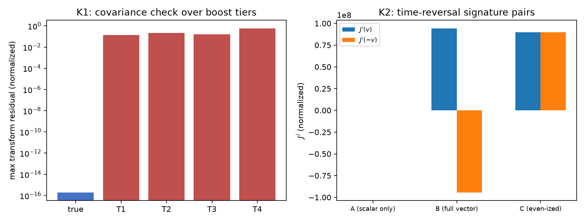

# 矢量写入定理：碰撞写入的协变完备化与拖曳奇性

傅天行

（天行新学研究院）

**摘要**：碰撞写入机制中，有质量粒子的标量写入份额已由定理 6 钉死（每拍 $\delta\theta=m/m_P$）；本定理 7 解决其矢量完备化：在四条前提下，碰撞写入的洛伦兹协变源唯一为四维流 $J^\mu=(m/m_P)u^\mu$（$u^\mu=\gamma(c,\vec v)$ 为四速度），即标量份额乘四速度，低速极限回到 $(m/m_P)(c,\vec v)$。

定理的第二半处理参考系拖曳的奇性要求：拖曳读数 $h_{0i}$ 对时间反演为奇，而标量幅度为偶，故拖曳的奇性源只能来自矢量空间分量。三种写规则的时间反演签名两两可分（仅标量恒零、矢量完备正负成对、偶化形式不变号），唯一满足奇性要求者为矢量完备写法。强度与标量分量共用单一入口 $l_P/m_P=G/c^2$，拖曳恒为标准广义相对论级。定理为条件性定理级，判据第 605 条 5/5 支撑。

**关键词**：碰撞写入；矢量完备化；洛伦兹协变；参考系拖曳；时间反演；单一入口

- **修订记录**
  - **2026-10-12 三笔：转正**（触发：作者指令转正与子理论索引登记）
    - 经2026-10-12 七维评审 A1B2C2 修复并经作者指令转正；登记 [[理论总纲/子理论索引]] 引力量子化组（16 篇）
- **2026-10-12 二笔：评审修复**（触发：[[评审报告/矢量写入定理评审报告（2026-10-12）|七维评审报告]] A1B2C2）
    - A1 T3 排除理由更正（静止极限归零、死于速度依赖标度破坏份额线性结构），前提 3 角色新增为构造空间边界条件说明；B1 有界化论证补体系内依据；B2 比值 2 来历补句；脚本注释同款错误随 A1 更正（纯渲染层，重跑读数不变）
- **2026-10-12 初稿（正稿化）**（触发：作者确认定理 7 草案并指令正稿化与评审；文本移自 [[内部草稿/注记-矢量写入定理：证明整合与三裁决（2026-10-12）|定理 7 证明整合与三裁决]]，背景与对照表新写）

## 一、背景：从标量份额到拖曳缺口

碰撞写入机制里，有质量粒子（复合位错）每拍写入的标量份额已由定理 6 钉死：$\delta\theta=m/m_P$，写入映射一比一，判定项 J1 至 J6 全部闭合。标量写入给出 $h_{00}=2\theta$ 的时间几何与牛顿引力，但引力源还有另一半：**运动的质量**。旋转的质量分布会拖着周围时空微转（参考系拖曳，Lense-Thirring 效应），Gravity Probe B 卫星实测的正是这一成分。

体系在这个半边上有一段修补史。最初的写规则只写标量幅度，对时间反演为偶，写不出任何拖曳：GPB 的框架拖曳岁差预言为零，与实测差 $5.17\sigma$，而同一实验的测地岁差对上（偏差 $0.30\%$），缺口因此被钉在矢量块而非整体度规。修补由动量读数项完成：逐拍写入的洛伦兹协变完备化 $J^\mu=(m/m_P)(c,\vec v)$，判据 Z1 至 Z4 给出静止极限严格归零、单一入口强度 1（拖曳回到标准广义相对论级），GPB 张力在方向上解除。

修补之后留下的定理化问题与定理 6 完全同构：**为什么是这一项、为什么没有别的写法**。动量读数项的必要性有结构论证（判据 Z 系），但"源矢量的唯一性"与"奇性源的唯一锁定"作为定理未被证明。本文明确定理化这两件事（定理 7），判定项 K1 至 K6 编排，证明轮代数变换面由判据第 605 条交付（5/5），三处裁决同日记入（协变唯一性以结构引理进证明、编号授予定理 7、旋转源全案不进首轮）。

## 二、定理陈述

**定理 7（矢量写入定理）**。在第三节四条前提下，碰撞写入的洛伦兹协变完备化唯一为四维流

$$J^\mu = \frac{m}{m_P}\,u^\mu = \frac{m}{m_P}\,\gamma\,(c, \vec v)$$

其中 $u^\mu=\gamma(c,\vec v)$ 是粒子的四速度，$\gamma=1/\sqrt{1-v^2/c^2}$ 为洛伦兹因子；低速极限回到 $(m/m_P)(c,\vec v)$。其空间分量对时间反演为奇，是参考系拖曳（$h_{0i}$）的唯一奇性源；强度与标量分量共用单一入口 $l_P/m_P=G/c^2$，拖曳恒为标准广义相对论级。

陈述两半。**协变完备化半**：源矢量唯一，一阶洛伦兹矢量的构造无第二候选。**奇偶结构半**：拖曳要求的奇性源恰好且只能是空间分量。两半的对手各自明确：前者的对手是"也许还差一个修正项或另一个矢量构造"，后者的对手是"也许奇性可以由别的成分承载"。

跨层声明：本定理在写入侧源形式射程内陈述；运动方程与岁差读数归响应侧（第 603 号线已交付，响应系数钉死 1），两侧在拖曳读数处衔接但不互相代替。

## 三、前提

**前提 1（标量份额，定理 6）**：碰撞写入的标量份额每拍一份 $\delta\theta=m/m_P$，写入映射一比一。来源为定理 6（已转正，条件性定理级）。矢量完备化的时间分量内容由此给定：矢量源是标量份额的协变载体，不引入新的标量自由度。

**前提 2（洛伦兹协变）**：写入记录在低能层按洛伦兹结构变换。来源为分层定理 P11（晶格优选系低能不可探测）加洛伦兹结构的定理化。这是完备化半的封顶前提：源矢量必须按四矢量变换，冒牌构造在换系下穿帮。

**前提 3（静止极限连续性）**：$\vec v\to0$ 时矢量块连续归零，与静态源零拖曳相容。来源为判据 V 与 Z1（静态写规则的零拖曳读数与静止极限核验）。它独立排除一切"静止时也带空间分量"的构造（如二阶形式）。

**前提 4（单一入口）**：矢量与标量分量共用同一强度入口 $l_P/m_P=G/c^2$，不引入新耦合常数。来源为判据 Z2（恒等式偏差 $1.21\times10^{-16}$）。它把拖曳强度钉在标准广义相对论级：拖曳与牛顿引力是同一份写入刚度的两个投影。

## 四、证明

### 4.1 协变完备化半：变换枚举无第二候选

构造空间的有界化：粒子自身属性给定的洛伦兹矢量只有四速度 $u^\mu$（世界线切矢）；标量份额 $s=m/m_P$ 是唯一可乘的标量内容（Q1）。一阶构造若存在第二候选，其矢量部分必须另找一个方向，而体系中不存在这样的内置方向：写入只依赖粒子自身世界线与晶格锚定结构，各向同性由完美弹性与交错基态承重，外部方向无定义来源，故第二候选只能从 $u^\mu$ 的非线性函数造出，后者在换系下不再按四矢量变换。

数值枚举把这个论证落到变换性质检验：真候选 $s\cdot u^\mu$ 在三档 boost（$\beta=0.1,0.3,0.5$）下变换到源共动系的残差为 $1.99\times10^{-16}$（机器精度）；四个替身全显著：T1 裸低速形式 $s(c,\vec v)$（缺 $\gamma$，非四矢量）残差 0.134、T2 伪非线性修正 $s(c,\vec v(1+\beta^2))$ 残差 0.206、T3 速度标度形式 $s\,u^\mu(u^0/c)$（标度含速度依赖 $s\gamma$，破坏前提 1 的份额线性结构；其静止极限归零，死于变换律而非静止极限）残差 0.155、T4 仅标量旧写规则（空间分量恒零）残差 0.577。

恒真防护：把变换换成伽利略变换，真候选残差 $8.7\times10^{7}$（归一前）显著非零：判据测的是洛伦兹协变这一特定结构，泛变换一致不构成通过。
静止极限（前提 3，$Z1$ 在案 $\beta=10^{-8}$ 归零）在本枚举中的角色是构造空间的边界条件：一切候选须满足，T3 满足它而死于变换律；静止非零类的构造则被它直接排除。

### 4.2 奇偶结构半：签名唯一锁定

拖曳读数 $h_{0i}$ 对时间反演为奇：把记录旋转质量的电影倒放，时空被拖曳的方向必须反过来。三种写规则的空间分量在 $v\to-v$ 下的签名两两可分：甲仅标量为 $(0,0)$（拖曳恒零）；乙矢量完备为 $(+,-)$（奇）；丙偶化形式（空间分量取 $|\vec v|$）为 $(+,+)$（偶）。满足奇性要求的唯一为乙。

历史锚把这一半钉进经验：甲写法正是体系的旧版实现，其零拖曳读数与 GPB 实测差 $5.17\sigma$；判据 W 进一步确认质量流源通道的结构（奇性、偶极 $1/r^2$ 且系数对上解析式、转轴为零赤道最大）。签名可分性与强度正交：改响应系数只改幅度不改符号结构，强度归前提 4 的单一入口。

### 4.3 强度与层结构

强度由单一入口恒等式承重：$l_P/m_P=G/c^2$ 的数值偏差 $1.11\times10^{-16}$（K3，与 Z2 同级），全案读数 $h_{0i}/(h_{00}v_i)=2$ 的偏差 $4.4\times10^{-16}$；比值中的 2 来自时间分量写入 $h_{00}=2\theta$ 的同一系数，标量与矢量共用刻度是其直接后果。证明分层：代数变换层（boost 枚举、签名表、单一入口恒等式）判据稳健；经验排除层（GPB $5.17\sigma$）为历史锚。定理的强度不提升导入读数的层级。

### 4.4 关键读数对照（验证材料）

| 判据 | 读数项 | 实测 | 期望/门槛 |
|---|---|---|---|
| 第 605 条 K1 | 真候选 boost 残差 | $1.99\times10^{-16}$ | 机器精度 |
| 第 605 条 K1 | T1 替身残差 | $0.134$ | 显著非零（缺 $\gamma$） |
| 第 605 条 K1 | T2 替身残差 | $0.206$ | 显著非零（伪修正） |
| 第 605 条 K1 | T3 替身残差 | $0.155$ | 显著非零（违反静止极限） |
| 第 605 条 K1 | T4 替身残差 | $0.577$ | 显著非零（旧写规则） |
| 第 605 条 K1 反例 | 伽利略变换残差 | $8.7\times10^{7}$ | 显著非零（钉靶洛伦兹） |
| 第 605 条 K2 | 三签名 | $(0,0)$ / $(+,-)$ / $(+,+)$ | 两两可分 |
| 第 605 条 K3 | 单一入口恒等式 | $1.11\times10^{-16}$ | 恒等式 |
| 第 605 条 K4 | 静止极限 | $10^{-8}$（$\beta=10^{-8}$） | 归零 |
| Z1 至 Z2（引用） | 静止极限与单一入口 | $0$ 与 $1.21\times10^{-16}$ | 在案资产 |

## 五、映射声明与严格程度

跨层按公理体系 §5bis 纪律：本定理在写入侧源形式层陈述，与定理 6 共享前提 1（标量份额），矢量完备化不改变标量内容、只补全其协变与奇偶结构；响应侧（粒子如何沿场运动）归第 603 号线，两侧在拖曳读数处衔接。

**严格程度**：条件性定理级。前提显式；两半判据级支撑（第 605 条 5/5）；导入读数（静止极限、GPB、拖曳读数）的层级如实标明，定理强度不提升输入层级。定理不引入新常数：矢量与标量共用 $l_P/m_P=G/c^2$ 入口。

## 六、边界与开放项

本定理只覆盖写入侧源形式。场分配细节（每个写事件在相邻链接上的分配）与静态情形同源、属继承性步骤；旋转源全案演化与多档线性性复核（K5）归独立轮（裁决点三）；GPB 终值后的定量复核与 K5 同轮候选。响应侧的运动方程与岁差读数归第 603 号线。

## 七、结论

碰撞写入的矢量半边已定理化：洛伦兹协变完备化唯一为 $J^\mu=(m/m_P)u^\mu$，拖曳的奇性源唯一锁定于其空间分量，强度无新旋钮。与定理 6 合并，引力源的标量与矢量两块形式都有定理级文本：标量份额管"写多少"，矢量流管"动的质量多写了什么"，两者共用单一入口、无自由参数。剩余为场分配细节与旋转源全案的独立轮、GPB 终值定量复核，以及响应侧的机制推导（第 603 号线阶段二）。

## 参考文献与验证材料

**体系基准与正稿**：[[公理体系]]（§5bis 映射声明纪律与定理编号消歧规则）、[[写入份额定理：碰撞写入幅度的唯一性与线性映射|写入份额定理（定理 6）]]、[[爱因斯坦场方程的微观根基：从碰撞写入法线场到连续时空几何|爱因斯坦场方程的微观根基]]（写入机制）、[[元相子几何动力学——束缚振荡修订整合版|元相子几何动力学]] 补充注释 03（碰撞接力逐拍结构）。

**定理化材料**：[[内部草稿/材料-矢量块定理化：定理陈述、前提清单与判定项（2026-10-12）|矢量块定理化材料]]、[[内部草稿/注记-矢量写入定理：证明整合与三裁决（2026-10-12）|定理 7 证明整合与三裁决]]。

**验证注记**：判据第 605 条（[[验证脚本/注记-矢量块定理化证明轮：协变唯一性变换枚举与奇偶签名完备性（判据第605条，K1K2代数变换面）|协变唯一性变换枚举与奇偶签名完备性]]）；Z1 至 Z4（[[验证脚本/注记-动量读数项的第一原理：逐拍写入的协变完备化与拖曳强度（判据Z1至Z4）|动量读数项的第一原理]]）。

**场方程与响应侧**：G3/G5/GV6（[[验证脚本/注记-动态写入协变形式与阻尼观测量级（G3与判据C合轮）：判据D1至D7|动态写入协变形式]]、[[验证脚本/注记-G5GV6：拖曳通道的微观来源与强度归一（判据N1至N3）|拖曳通道强度归一]]）；判据 V/W 与 GPB 缺口（[[内部草稿/注记-自旋2从哪来：源锁定、各向同性封装与守恒保护|自旋 2 来源注记]]）；第 603 号（[[验证脚本/注记-响应侧锁定规则判据轮：每拍对齐必然性反例判据组（第603号）|响应侧锁定规则]]）。判据编号索引见 [[验证脚本/README|验证脚本 README]]。
