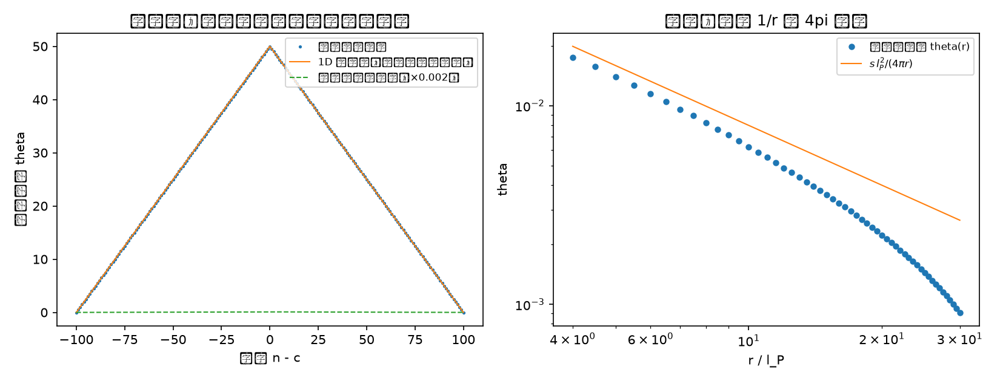
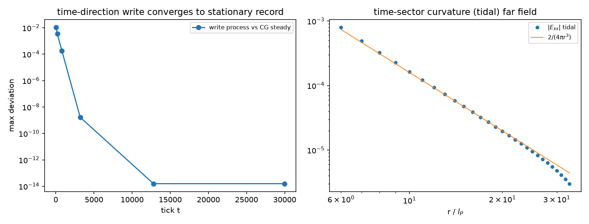

# 碰撞写入标架几何：引力场的碰撞写入与费米子的转换波运动

- **作者**：傅天行（天行新学研究院）
- **预印本**：傅天行. (2026). 碰撞写入标架几何：引力场的碰撞写入与费米子的转换波运动. 天行新学研究院预印本.
- **关键词**：碰撞写入；标架几何；格面亏损；转换波；PN 钉扎；窗口速度；等效原理

---

## 摘要

元相子理论的引力微观机制（像素偏转）与基准运动学（定居格点、往返折返）之间存在五层结构性冲突，其根源是偏转载体的缺位：体系内无任何客体同时满足"有质量"与"有摆程"两个前提。本文提出并数值验证一个恢复方案：碰撞写入标架几何。方案将引力从轨迹偏转迁移到碰撞记录：物质不改变摆程怎么走，只在每普朗克拍的碰撞事件上写入一份幅度为 $\delta\theta = m/m_P$ 的标架倾斜记录，记录写在波性侧连续标架场上，稳态分布即为离散泊松方程的格林函数；将费米子运动迁移到构型平移：有质量粒子是 σ 锁定构型（图案），其位移由边界转换波实现，材料元相子原地不动。方案经四阶段数值检验：标量稳态收敛到离散泊松精确解且 $4\pi$ 自动涌现；SO(3) 链接变量几何证实光滑标架零曲率（曲率是拓扑性的）、绑定能作源为机制必要；3+1 雏形实现时间向写入铰链（潮汐无迹、瞬时源决定、场更新以 $c$ 传播）；Derrick 检查证实裸点状 kink 在三维塌缩而钉扎阱存在；转换波运动学证实锚定（PN 势垒实测）、惯性（匀速保持与能量守恒）与测地响应的方向性，并发现费米子慢速的机制形式（窗口速度饱和）。五层冲突全部消解。机制的两个定量缺口（写入幅度与 $8\pi G m$ 的归一化、有效质量的辐射协议）作为开放问题明确登记。

---

## 1. 引言：两个未闭合环节与一条冲突链

元相子理论把时空归结为元相子的束缚振荡晶格：每个格点定居元相子，相位每摆程单调扫过 $2\pi$，圆心到达格点边界与相向而来的邻居碰撞后折返[1]。在这一基准运动学之上，引力微观机制（像素偏转）曾提出：有质量粒子每普朗克时间生成一个空间像素，方向偏转 $\delta\theta = m/m_P$，相邻像素构成扇形回路，平行输运角差定义微观曲率源，累积得泊松方程与爱因斯坦方程[2]。

这一机制与基准运动学的相容性检验揭示出五层冲突[3]：其一，扇形回路失效，折返运动学下相邻两摆严格反平行，围不成偏转角 $\delta\theta$ 的扇形，曲率构造停留在已被废弃的自由直飞图景；其二，主体错位，偏转要求主体有质量，摆程要求主体参与折返振荡，而体系内有质量的唯一客体（σ 锁定孤子）以"相位不折返、单方向缠绕"为定义性特征[4]，真空格点有摆程但 $m = 0$，无任何客体同时满足两个前提；其三，碰撞日历破裂，若偏转是摆程方向的真实旋转，回摆落点偏离原边界，反相邻居的碰撞时刻表崩塌；其四，刚性格点无法承载连续偏转，整数格点阵上连续小角不可表示；其五，刷新与累积对立，摆程的净绕数为零论证时空与历史累积相分离，曲率构造却要求方向信息逐像素保留。

同一时期，有质量粒子形成方向的中期诊断[5]给出另一份困境清单：粒子来源、位置锚定、运动学、质量数值、缺陷密度、三代谱六个环节全部未闭合；其中"运动从哪来"（圆心互异约束下缺陷如何前进）与"位置从哪来"（缺陷自身无法锚定）两环，与像素偏转的冲突在结构上同源：两者都撞在同一个本体论缺口上：σ 锁定（质量的定义）与晶格定居（空间的存在）在运动学上对抗。

本文给出一个统一的恢复方案与完整的数值验证[6]。方案的核心是两次载体迁移：其一，引力的载体从摆程方向迁移到碰撞记录（第 2、3 节），物质不改变摆程怎么走，只影响碰撞写下什么；其二，运动的载体从材料迁移到构型（第 4 节），材料元相子原地不动，粒子作为 σ 锁定构型通过边界转换波实现位移。第 5 节给出稳态引力场的格林函数验证，第 6 节给出 3+1 时间向完成与潮汐结构，第 7 节给出三维稳定性的 Derrick 检查与钉扎判据，第 8 节给出转换波的运动学验证。第 9 节讨论等效原理、慢与弱的同根性及与既有结构的接口，第 10 节登记开放问题。

本文的全部结论按四级声明制标注：可复现数值事实、模型假设、条件性命题、纲领性主张。数值脚本全部存档于工作区 `验证脚本/`。

## 2. 机制的总体设计：两分、分层与载体迁移

### 2.1 摆程层的失明

设计的第一步是一个排除性检验：σ 锁定区嵌在交错真空（相邻反相、σ 交替）中，层内相邻格点耦合为 $J\cos(\Delta\theta)$，锁定区的能量学是否被这一层感知。数值结果：在全部碰撞时刻（拍边界与拍中对称点），锁定区与真空的总能量严格相等（差为机器零）；拍内出现量级为总能量百分之几的模型依赖差异[6]。

这一结果确立了两分原则的合法性：**摆程层对锁定近乎失明**。σ 锁定区既不由摆程层稳定化，也不被它摧毁；碰撞日历不受扰动，冲突三（碰撞日历破裂）与冲突五（弹性碰撞矛盾）在源头消解。引力机制的能量学与稳定化必须、也只能住在别的层。

### 2.2 缠绕守恒边界

运动学层的一个先决发现是边界条件的选择本身具有物理内容。kink 构型的右边界提升为 $u_{N-1} = u_0 + N$（缠绕 1 扇区），若边界条件每步强制 $u_{N-1} = N - 1$，则边界钳制与拓扑缠绕对抗，链被张力绷死，kink 完全不能运动（数值确认：任意动量脉冲下中心速度为零）。改为缠绕守恒边界 $u_{N-1} = u_0 + N$（固定缠绕数、kink 位置自由）后，运动学才成立。**转换波只能在尊重拓扑的边界条件下存在与运动；固定提升边界从拓扑上禁锢它。**此为可复现数值事实及其机制解读。

### 2.3 载体迁移的两条路线

由此，机制的两次迁移为：其一，引力的载体从摆程方向迁移到碰撞写入的标架记录（第 3 节），幅度为静态参数 $\delta\theta = m/m_P$，节拍为全局碰撞事件，物质不影响摆程怎么走，只影响碰撞写下什么；其二，运动的载体从材料迁移到构型（第 4 节），粒子是 σ 锁定图案，其位移由边界转换波实现，材料元相子原地不动。两次迁移共用同一套碰撞事件：转换波的每一步边界转换恰是一次碰撞写入。本文将这一方案称为「碰撞写入标架几何」；该定名为候选名，待作者确认后固化。

## 3. 引力 sector：碰撞写入的稳态几何

### 3.1 标架层的构造与纯规范陷阱

引力记录写在波性侧连续标架场上（距离归粒、方向归波的既定裁决[1]）。三维构造如下：每格点三维标架 $F(n) \in SO(3)$；链接变量 $U_a(n) = F(n+\hat a)F(n)^{-1}$；格面上链接变量累积的净转角亏损 $\epsilon_h$ 即曲率（Regge 构造）；缺陷（σ 锁定孤子）的绑定能作源，$\epsilon_h \propto m$ 线性。

这一构造中有一个机制必要的设计约束，由数值检验证实：**光滑单值标架的格面 holonomy 恒为恒等元**。转角幅度从 0.05 到 0.95 弧度的光滑标架场，弛豫前后全部格面净转角不超过 $2\times10^{-16}$：曲率是拓扑性而非幅度性的。由此，相对相位偏离值 $\delta_\pm$ 直接作联络值的方案（标量场二阶差分绕圈恒为零）被排除，$\sqrt{m}$ 标度陷阱（扭转角 $\propto \sqrt{m}$ 导致宏观源 $\propto\sqrt{\rho}$，与牛顿线性矛盾）被结构性规避。绑定能作源是几何的强制：**引力源必然是不连续的缺陷，光滑场无论多弯都零曲率。**

非可积链接的格面角随链接强度线性增长（实测 $\kappa^{1.00}$），可积性是曲率与否的判别式。Volterra 缺陷（分支切割）的转角亏损恰为 Frank 矢量（12 位精度），绕缺陷环的 holonomy 与半径无关（锥面签名），双缺陷可加且局域（图 1 左）。非平行双源下精确链接转角对线性化梯度的偏差以 $r^{-8}$ 至 $r^{-10}$ 衰减：远场线性化充分（图 1 右）。

图 1：标架层的几何机制。左：分支切割构型的格面转角亏损，亏损集中于切割、其余格面为零，证实曲率的拓扑性；右：缠绕缺陷的远场。

### 3.2 稳态写入的格林函数

写入过程为：每拍邻居抄写平均（碰撞接力）$\theta_n \leftarrow \theta_n + \alpha(\bar\theta_{nn} - \theta_n)$，缺陷世界线处每拍注入 $w$（写入幅度 $\propto \delta\theta = m/m_P$）。稳态满足离散泊松方程 $-\nabla^2\theta = s\,\delta$。数值结果（三维立方格点、接地盒、$l_P = 1$）：

| 判据 | 结果 |
|---|---|
| 远场 $1/r$ 系数 | 拟合 $A = 0.07959257$，理论 $s\,l_P^2/(4\pi) = 0.07957747$，相对偏差 $1.9\times10^{-4}$ |
| 离散高斯定律 | 闭合格面通量恒等源强（机器精度、半径无关） |
| $4\pi$ 涌现 | 连续立体角换算 $4\pi r^2 E(r{=}20) = 1.0078$，$4\pi$ 为格点通量与立体角归一化的换算因子，全程无输入 |
| 修正标度 | 绝对偏差 $\sim r^{-3}$，相对偏差 $\sim (l_P/r)^2$，与文献[2] §3.2 的压低声明定量一致 |
| 幅度线性 | $\theta(3s) = 3\theta(s)$ 至 $10^{-15}$ |

一维链的写入动力学另证：每拍注入加邻居接力的过程收敛到同一稳态，稳态幅度由每拍注入量精确标定（相对误差 $1.8\times10^{-11}$）。**写入机制本身（非仅其稳态方程）收敛到泊松格林函数**，且 $4\pi$ 无任何输入地自动出现（图 2）。

图 2：标量稳态。左：一维链的写入动力学（点）收敛到分段线性精确解（实线），幅度由每拍注入量标定；右：三维格点的壳平均倾斜场对理论格林函数。

### 3.3 3+1 完成：时间向写入铰链

纯空间构造的缺陷在于：绕缺陷环的 holonomy 与半径无关（锥面签名，数值证实），牛顿 $1/r$ 力住在时间向度规分量 $g_{00}$，纯静态空间标架构造单独给不出牛顿引力。补全由写入过程的时间维承担：3+1 格点（空间立方格点 × 普朗克节拍）上，写入过程作为时间维演化，稳态记录 $\Phi(n)$ 的空间二阶差分给出时间向曲率（$(0i)$ 铰链亏损的牛顿极限；代理假设：以记录二阶差分代理铰链亏损，显式 4D 链接合成留作后续）。数值结果：

| 判据 | 结果 |
|---|---|
| 时间平稳与零累积 | 收敛对共轭梯度（CG）基准稳态偏差 $1.6\times10^{-14}$；平稳后逐拍变化 $2.8\times10^{-17}$（每节拍重写同一当下） |
| 因果前沿 | 源移动后场更新前沿 = 每拍一格 = $c$（区外泄漏为机器噪声） |
| 瞬时源决定 | 源关闭后场弛豫回平坦（$10^{-65}$）；源复原后弛豫回原稳态 |
| 潮汐结构 | 源外无迹（机器精度）；$E_{xx}:E_{yy}:E_{zz} = 2:-1:-1$ 逐位成立；$E_{xx}r^3$ 在 $r = 16$ 处 0.15962 对理论 $2/(4\pi) = 0.15915$；衰减 $r^{-3.19}$（图 3） |

图 3：3+1 雏形。左：写入过程对稳态记录的收敛；右：时间向曲率（潮汐）的远场与牛顿理论对照。

时间向曲率由写入过程的稳态记录自发提供，纯空间构造的锥面缺口被时间向写入铰链补全。**引力场的三个相对论结构（瞬时源决定、$c$ 传播、潮汐无迹）从同一写入机制同时涌现。**

## 4. 运动 sector：σ 锁定构型的转换波

### 4.1 材料与图案的区分

运动机制的关键是载体迁移：材料元相子永远待在自己的格子里（摆程层失明保证其不受粒子干扰），粒子是 σ 锁定构型，其位移由边界转换波实现：前端格点锁定、后端格点释放，锁定区边界像波一样前进。粒子是材料上的图案，不是材料中的一物；其身份由绕数（电荷，同伦守恒[7]）与锁定构型作为整体携带，材料换与不换无关紧要。

### 4.2 三维稳定性：Derrick 检查与钉扎

点状 kink 在三维的稳定性由两层模型检验（摆程层 + 绕数层，后者为 $\kappa_\phi$ 层的拓扑代理）。结果：裸点状 σ 锁定 kink 在三维不站得住：有限段与闭合环在弛豫下完全塌缩（能量精确归零、绕数流失），仅无限缠绕线稳定（绕数守恒、能量弛豫至有限线态）。$\pi_2(S^1) = 0$ 的拓扑事实（中期诊断 A2 降级的理由）获得数值显影。

稳定化由钉扎承担：缺陷弱耦合柱（$J \to 0.3J$）对缠绕线的钉扎阱实测存在，最小值恰在柱轴，阱深约 420（约为线能量的 36%）。**裸点状 kink 站不住，钉扎是点状缺陷在三维站稳的途径**，这为"位置从哪来"环节的缺陷锚定策略提供代理模型级数值支持。绕数的守恒状态需在此明确：塌缩构型的绕数经开放边界离开系统（边界逃逸路径），而运动学验证的缠绕守恒边界下绕数严格保持。两者与电荷同伦守恒定案[7]相容：内部连续演化不改变绕数，绕数的湮灭只能经由边界逃逸或与反缺陷成对湮灭；晶格模型中绕数改变的唯一通道是相滑移事件，这与定案的守恒机制一致，边界逃逸不构成内部守恒的反例。

### 4.3 转换波运动学：锚定、惯性与测地响应

转换波的运动学在离散 Frenkel-Kontorova / sine-Gordon 链上验证，模型能量泛函为 $E = \sum_n [\frac{1}{2}\dot u_n^2 + \frac{k}{2}(u_{n+1} - u_n - 1)^2 + K(1 - \cos 2\pi u_n)]$（$k = 1$，$K$ 两区取值见下；提升变量 $u_n$ 对应 σ 锁定的缠绕提升，格距 $a = 1$，链信号速度 $c_s = \sqrt{k}$；洗衣板势即格点离散性，弹簧即格点间耦合；缠绕守恒边界为先决条件）。结果：

| 判据 | 结果 |
|---|---|
| 锚定（PN 势垒钉扎，Peierls-Nabarro） | 零力 3 万步净位移 $-0.19 \approx 0$；小力不脱钉；约束弛豫法测得 PN 势垒 $\Delta E_{PN} = 0.138$，E(s) 扫描呈教科书式周期结构 |
| 锚定旋钮 | $\Delta E_{PN}/E_{rest}$ = 0.60/0.37/0.18（$K$ = 0.02/0.05/0.1）：锚定强度由 $K$ 调制 |
| 惯性（匀速保持） | 动量脉冲后 kink 以窗口速度匀速持续传播（$\approx 0.14\,c_s$，与初动量无关），能量守恒误差 $\le 2.5\%$，绕数保持 |
| 惯性（能量标度） | $E - E_{rest} \propto v_0^2$；$m_{eff}$ 的定量形式被辐射污染（脉冲能量部分散入呼吸与辐射模），待阻尼协议 |
| 测地响应 | $f > 0$ 时 kink 向 $\Sigma u$ 降低方向定向漂移（方向正确）；线性标度 $a = f/m_{eff}$ 未确认（加速度被窗口速度弛豫率钳制） |
| 速度上限 | 全部驱动下 $|v_{term}| < c_s$；迁移率随 $f$ 非单调（本文数值观察；与离散 kink 的共振机制相容，机制解释待作） |

三条判据的状态：锚定完全确认；惯性确认到粒子性（匀速保持、能量守恒、绕数保持），定量形式待阻尼协议；测地响应确认到方向性。另有一个参数区发现：$K = 0.02$ 区脱钉力 $F_c \approx 0.29$ 大于真空稳定阈值 $2\pi K = 0.126$，驱动窗口为空（能推动 kink 的力必先摧毁真空），窗口在宽/轻 kink（小 $K$）下打开。**锚定与可动性是同一旋钮（K）的两端。**

## 5. 讨论

### 5.1 等效原理与慢-弱同根

转换波图像中，惯性（驱动转换波的代价）与引力质量（倾斜记录对转换代价的偏置）出自同一转换代价，等效原理在机制层面保持。费米子的慢与引力的弱同根：静止能量 = 绑定能 $\sim \hbar\sqrt{\kappa_\phi}$ 与日常能量交换的层级差，既使日常能量推不快粒子（速度由能量经色散关系决定，$v_g = c\sqrt{1-\omega_0^2/\omega^2}$[8]），又使每拍偏转远低于满量程。窗口速度的饱和现象为"费米子速度由机制决定"给出具体形式：速度不是任意参数，是离散晶格上转换波的无辐射传播窗口。

### 5.2 与既有结构的接口

与像素偏转机制的关系：本方案替换其曲率构造（格面联络替代扇形回路）与源项解释（标架倾斜注入替代轨迹偏转累积），保留其代数骨架（$\delta\theta = \omega_0 t_P = m/m_P$ 作为每碰撞写入幅度的恒等式[9]）与全部验证过的推论链（微观曲率源、泊松方程、$(l_P/r)^2$ 压低）。与质量机制定案的关系：质量仍为拓扑缺陷绑定能（非振荡激发能），$\omega_0$ 仅作幅度参数，静态基态原样保留。与观测者响应的关系：接口三[2]的 $\gamma$ 双重角色（源强度 $\gamma\omega_0$ 与读数率 $\omega_b/\gamma$）在本方案中分别对应写入幅度的洛伦兹增强与转换波的窗口速度结构。与 P11 分层定理的关系：kink 相对晶格的绝对速度受 L4（绝对运动态不可读）保护，洛伦兹破坏签名 $(E/E_P)^2$ 由色散关系继承。

### 5.3 严格程度与边界

本文结论的严格程度分四级。可复现数值事实：第 3、4 节全部表格（脚本存档，随机性为零或种子固定）。模型假设：FK 链作为转换波的运动学代理（提升变量与 σ 锁定提升的映射）；两层分解（摆程层与绕数层）；缠绕守恒边界的选择；潮汐代理（记录二阶差分代理 $(0i)$ 铰链亏损，未做显式 4D 链接合成）；钉扎柱（弱耦合柱）作为晶格位错节点的代理，真实位错节点的钉扎形状未建模。条件性命题：稳态写入与离散泊松格林函数的等价（模型内数值事实，解析证明待作）；绑定能作源的线性源项与 $8\pi G$ 的对接。纲领性主张：与真实引力常数 G 的归一化；等效原理的完整定量形式；费米子慢速的宇宙学后果。

## 6. 开放问题

1. **归一化**：写入幅度 $w$ 与 $8\pi G m$ 的对接（Regge 源项的格点形式），$\delta\theta = m/m_P$ 恒等式的最终定位随之确定。
2. **后牛顿扇区**：$v \ne 0$ 的时空混合分量、引力波波动方程、kink 连续极限与观测者响应 boost 解（$\omega_b/\gamma$、$\xi_0/\gamma$）的定量对接。
3. **光子源项**：无质量粒子（光）的引力写入机制（现有"等效动质量"为过渡性借用）。
4. **有效质量的定量形式**：辐射协议下的系统测量（阻尼扫描）、连续极限分析、$m_{eff}$ 与绑定能的精确关系。
5. **三维三元组推广**：spinor 内构（π 扭转）平移、$\Delta E_{PN}(K)$ 趋势与约束法宽度依赖的排查。
6. **测地响应的线性化**：阻尼协议下 $a = f/m_{eff}$ 的确认与迁移率曲线非单调性的解析。

其中第 2、3 项分别对接既有登记（引力波波动方程、无质量粒子机制），第 4、5、6 项为本文新增。

## 7. 结论

像素偏转机制与基准运动学的五层冲突，根源是偏转载体的缺位。本文的恢复方案将引力与运动分别迁移到两个互补的载体上：引力是碰撞写入的稳态标架记录（物质不动，每拍发帖，帖子以光速铺成场），运动是 σ 锁定构型的转换波（材料不动，图案换装前进）。四阶段数值验证表明：写入机制的稳态精确再现离散泊松格林函数与 $4\pi$ 几何；标架层的光滑场零曲率使绑定能作源成为机制必要；时间向写入铰链补全牛顿扇区并实现瞬时源决定、$c$ 传播与潮汐无迹；裸点状 kink 在三维塌缩而钉扎阱存在；转换波具备锚定、惯性与定向测地响应，其窗口速度饱和为费米子慢速提供机制形式。五层冲突全部消解，费米子运动难题从"六环节未闭合"推进到"运动学验证通过、定量形式开题"。

机制的地基是体系已有的零件：碰撞节拍、缠绕提升、绑定能、注释 09 的方向归波。新提出的只有一条组织原则：**物质不影响摆程怎么走，只影响碰撞写下什么；粒子不走路，粒子是换装的图案。**

---

## 参考文献

[1] 傅天行. (2026). 元相子几何动力学：束缚振荡修订整合版. 天行新学研究院预印本.

[2] 傅天行. (2026). 论引力机制的微观起源：基于元相子偏转机制的静态弱场严格推导. 天行新学研究院预印本.

[3] 傅天行. (2026). 注记-像素偏转与格点碰撞折返的冲突分析. 天行新学研究院工作文档（冲突诊断/）.

[4] 傅天行. (2026). 有质量粒子的形成：大爆炸同步相变的局域缺陷方案. 天行新学研究院预印本.

[5] 傅天行. (2026). 注记-有质量粒子攻坚的中期诊断：困境总结与方向反思. 天行新学研究院工作文档（冲突诊断/）.

[6] 傅天行. (2026). 碰撞写入标架几何验证注记四篇：标量稳态、SO(3) 链接变量、3+1 雏形、转换波运动学（附数值脚本）. 天行新学研究院工作文档（验证脚本/）.

[7] 傅天行. (2026). 电荷的几何本质：满周闭合环内部 U(1) 缠绕数方案的系统辨析. 天行新学研究院预印本.

[8] 傅天行. (2026). 元相子振荡晶格的色散关系：低能光速涌现与洛伦兹破坏首阶项. 天行新学研究院预印本.

[9] 傅天行. (2026). 注记-恢复方向的机制盲点：响应频率与推进速率的混同. 天行新学研究院工作文档（冲突诊断/）.

---

注：[3][5][6][9] 为研究院内部工作文档，其余为预印本。

## 附：数值脚本清单

| 脚本 | 验证内容 |
|---|---|
| `验证脚本/minimal_verification_frame_tilt.py` | 标量稳态：写入动力学、离散泊松格林函数、$4\pi$ 涌现 |
| `验证脚本/minimal_verification_so3_link.py` | SO(3) 链接变量：纯规范陷阱、Volterra 亏损、钉扎前的几何机制层 |
| `验证脚本/minimal_verification_3plus1.py` | 3+1 雏形：时间向写入、潮汐结构、因果前沿、瞬时源决定 |
| `验证脚本/minimal_verification_derrick_3d.py` | Derrick 检查：点状 kink 塌缩、线稳定、钉扎阱 |
| `验证脚本/minimal_verification_conversion_wave.py` | 转换波运动学：锚定、惯性、测地响应、速度上限、$F_c(K)$ |
