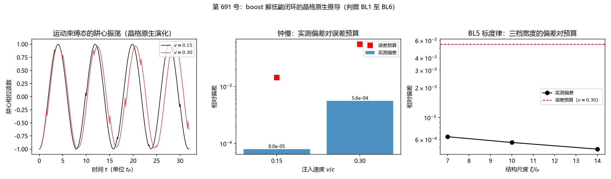
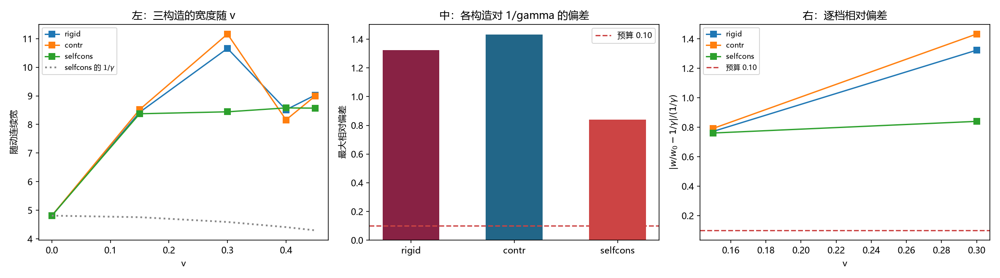
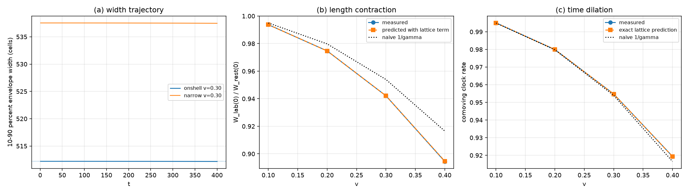

# 一把表、一把尺：钟慢早就测得出来，尺缩绕了七轮弯路

傅天行
（天行新学研究院）

- **日期**：2026-10-21
- **配套材料**：
    - [[验证脚本/注记-boost 解低能闭环的晶格原生推导：钟慢的涌现与尺缩判据的失效（判据第691号）|第 691 号验证注记]]：钟慢的晶格原生推导
    - [[验证脚本/注记-正确 boost 构型下的长度收缩与钟慢：格点在动量变量上复现两者（判据第 809 号）|第 809 号验证注记]]：长度收缩与钟慢的正面读数
    - [[验证脚本/注记-核心瓣与尾的分离读数作废：自造原点错位与亚格点基准失效（判据第 807 号）|第 807 号验证注记]]：两版读数作废的登记
    - [[验证脚本/注记-尺缩判据的读数方法重估：污染源是波包平移而非辐射尾、尺缩 1-gamma 在格点上不成立（判据第 783 号）|第 783 号验证注记]]：污染源改判与读数方法
    - [[验证脚本/注记-井的收缩口径与格点超额量的分离：boost 初值符号错的更正与 dev 的三分项分解（判据第704号）|第 704 号验证注记]]：dev 的三分项分解
    - [[理论总纲/元相子理论的时空观：体系对时空的完整认识|元相子理论的时空观]]
    - [[理论总纲/洛伦兹不变性专题索引：论证链、定级与材料清单|洛伦兹不变性专题索引]]
- **定位**：讲清钟慢与尺缩在时空晶格上各自的下场，以及那一串取错构型的读数为什么整条作废
- **修订**：初稿（2026-10-21）；按第 809 号正面读数重写全文（2026-10-22）；§二 补一段晶格刚性澄清（收缩的是格数不是格距，2026-10-23）

---

## 一、先看舞台：格子上的一块东西

元相子理论把宇宙看成一张时空晶格。空间是一排格点，每格上有一个场量，格距是普朗克长度 $l_P$，约 $1.6\times10^{-35}$ 米。一颗有质量的粒子，是这片格子上的一块束缚结构，锁在一口势阱里嗡嗡振荡。所谓势阱，就是一个平滑的碗形凹坑，粒子掉进去就绕着坑底来回晃。

这块东西能当钟。它也能当尺。

钟的读数是频率：它每秒振多少下。尺的读数是宽度：它有多粗。

狭义相对论把这两样拴成一对。运动起来，钟按 $1/\gamma$ 变慢，尺按 $1/\gamma$ 变短，其中

$$\gamma=\frac{1}{\sqrt{1-v^2/c^2}} .$$

本文要回答的是：把这块东西放到格子上，让它动起来，这两把读数各自的下场如何。

钟慢在第 691 号就测出来了。尺缩在第 809 号测出来，中间夹着七轮取错了构型的读数，另有两版自己造出原点的读数，整条线作废。

先交代一句要紧的：本文所有读数都来自数值模拟。一台计算机在一维格点上做演化，格子是离散的，装置是理想化的。这些是模拟结果，不是实验观测。

## 二、骨架：一条线上，两个读数

想象一条横向排开的格点。第 1000 格附近坐着一口高斯形的势阱，阱里有一个束缚态。让阱和阱里那团东西一起以速度 $v$ 向右滑。

这时候有两个读数可以取。

钟的读数是「那团东西在运动中振了多少下」。尺的读数是「某一瞬间那团东西在格子上占多宽」。

这两件事在物理上不等价。频率问的是整个束缚态的振荡周期，一个周期里整团东西起伏一次。宽度问的是某一瞬间的空间分布，它对井的刚性和初始构型敏感得多。

本文的关节就在这后半句。频率是全局量，宽度是局部量。这条差别后来解释了钟慢为什么在第 691 号就站得住：频率把井与束缚态之间的构造失配吸收掉了。尺缩那七轮全错，错处不在这条差别上，错在初值的摆法，第八节会说明。

这里先钉一句话，免得后面读岔。本文说的宽度收缩，是"那团东西占了多少格"这个数变小，不是格子本身变短。拿一把刻度印在格子上的尺去量，尺上的刻度永远是那么密，缩的是被量的东西横跨了几格。这条在体系里叫晶格刚性：格距是出厂尺寸，引力弯曲、尺缩、膨胀没有一样动得了它。后面凡出现 $1/\gamma$，都请按"格数变了"来读。

## 三、第一道坎：信号只有几个百分点

尺缩难测，第一层原因是它本身太小。

把数量级算清楚。$v=0.15c$ 时，$\gamma=1.0114$，$1/\gamma=0.9887$，收缩 $1.1\%$。$v=0.30c$ 时，$\gamma=1.0483$，$1/\gamma=0.9539$，收缩 $4.6\%$。$v=0.45c$ 时，$\gamma=1.1198$，$1/\gamma=0.8930$，收缩 $10.7\%$。

几个百分点。放到格子上，这个差距更小。

后面那轮尺缩测量用的是整数格分位口径，静止时那团东西读作 $12.0000$ 格。按 $1/\gamma$ 收缩，$v=0.30c$ 时应该读作 $11.447$ 格，预期差 $0.553$ 格。

而分位读数的分辨率是整整一格。收缩信号 $0.55$ 格，落在半格到一格之间，低于一格的量化步长。

要在几张纸的格子里分辨出零点几格的差别，读数方法非得干净不可。这是尺缩难测的第一层原因。

这层原因真实存在，但它不是那七轮失败的主因。把读数做到亚格点、把装置放大到几百格之后，它就退到了后面，见第九节。

## 四、钟慢这一腿：让格点自己长出时间膨胀

钟慢这一腿在第 691 号做成了。

装置是一维格点，阱宽 $\sigma=20$ 格，束缚频率 $\omega_b=0.8008$，演化用离散化的 Klein-Gordon 型方程（Klein-Gordon 是相对论量子场论里描述单粒子的方程，离散化就是把它的空间导数换成相邻格点之差）。第 691 号那轮用 $4096$ 格，后面尺缩那轮用 $2048$ 格。

造一个运动束缚态，让阱和波包一起以速度 $v$ 平移。然后量频率。

这一步最容易作弊的地方在于：若把 $\omega_b/\gamma$ 当作理论期望值写进初值，再去量，量到的就是公式本身。做法上要把 $\gamma$ 降级成构造参数，初始包络按 $1/\gamma$ 收缩一下，仅此而已。速度另找办法独立读出，看质心漂移了多少除以时间；频率也独立读出，对阱心轨迹做窄窗最小二乘拟合。

读数出来是这样：

| 速度 | 实测相对偏差 | 误差预算 | 判定 |
|---|---|---|---|
| $0.15c$ | $8.0\times10^{-5}$ | $1.44\times10^{-3}$ | 通过 |
| $0.30c$ | $5.6\times10^{-4}$ | $5.49\times10^{-3}$ | 通过 |

两档偏差都比预算低半个到一个量级。

还做了两件事，让这条腿站得住。

一件是换阱宽。把阱做窄、做宽各测一遍（阱深重新拟合，使 $\omega_b$ 不变），三档偏差分别是 $6.4\times10^{-4}$、$5.6\times10^{-4}$、$4.8\times10^{-4}$，与预算之比稳定在 $0.09$ 至 $0.11$。结论不翻。

另一件是造反例。不给速度时偏差是 $1.4\times10^{-16}$；故意把初始收缩比写错，拿 $1/\sqrt{1+v}$ 冒充 $1/\gamma$，同一套读数立刻给 $3.2\times10^{-3}$，与预算同阶。判据有区分力。

比喻在这儿很贴切：像一只被弹簧缠住的音叉搁在弹簧床垫上推着走。床垫自己决定它响多快，你不必提前告诉它「相对论说你要慢这么多」。

钟慢就这样长出来了。它不依赖预先写下的连续变换律，是格点自己给出的读数。

## 五、尺缩这一腿，第一次为什么失败

尺缩在同一套装置上没做成。

第 691 号试了两种量宽度的方法，两种都失败。第一种是拍单帧量，$v=0.45c$ 档的宽度随读数窗口发散，半窗取 200、400、800 分别给 $5.38$、$15.62$、$31.16$。第二种是卡在同一个振荡相位量，宽度在一个周期内于 $0.71$ 至 $1.29$ 倍之间跳。

当时把第一种归因为「辐射尾」，第二种归因为「单点记录撞上节点」，然后在注记里写下「须换装置再试」。

换装置不现实，换读数方法可行。第 783 号就是这么做的。

这一换，后面又连换了五轮（第 785、789、797、800、805 号），坏消息一次比一次具体。直到第七轮走完，才有人回头去查那个更早的前提。

## 六、先查那个归因：污染源是波包平移

第 783 号没有直接改读数，先查了上一轮那个归因。「辐射尾」这个说法从来没有被检验过。

检验的办法是隔离实验：用同一套初值参数跑两次，一次让井跟着速度平移，一次让井不动。

结果很悬殊。绝对坐标下量宽度，$v=0.30c$ 时移动井档给 $257$ 格，固定井档只给 $25$ 格；$v=0.45c$ 时移动井档给 $384$ 格，固定井档只给 $34$ 格。波包中心跑到 $252$ 格去了。尾污染只占百分之一。

污染源是波包整体平移。

比喻可以这样打：一个湿脚印按在一条路上，你沿着路往前走，每走一步在纸上盖一个章，把所有章叠起来看有多宽。叠出来的宽度等于脚印本身的宽度加上走过的路程。上一轮把多出来的部分叫「辐射尾」，其实那就是脚印走过的那段路。

「归因也要被检验」这句话在这里有了具体分量：一句顺口的解释可以撑起一整个错误的结论。这一轮查到的污染源是真的，它只是还没碰到真正错掉的那一处。

## 七、三处修正，把读数洗干净

换掉污染源之后，还要三处修正才拿到能用的读数。

一处是随动坐标系。每次累加宽度分布之前，先减去波包当前所在的位置。平移这一项被直接扣掉。

一处是载波解调。那团东西一边滑一边振，读到的起伏里混着载波和包络两样东西。取相隔四分之一振荡周期的两次采样，把两个点的平方加起来，恒等式 $\phi^2+\phi'^2=A^2$ 会把载波逐点精确消掉，只剩包络。

比喻是这样的：一条起伏的波浪线，量它有多粗，盯着某一处的高低看，读到的是波谷和波峰。稳当的办法是取相隔四分之一周期的两个点，把两个点的平方加起来，波峰与波谷彼此抵消，剩下的是振幅的平方，也就只剩下包络的粗细。

一处是连续算法。宽度读数从整数格分位改成去尾连续二阶矩。原因在第三节算过：整数格分辨率 $1$ 格，而 $v=0.30c$ 的收缩量只有 $0.553$ 格，信号低于分辨率。

这三处修正本身都对。后面的第八节会说明，那套装置的初值摆错了，修正得再干净，量的还是错的东西。

## 八、那轮读数为什么是错的

修完之后读数是这样：宽度从静止的 $4.81$ 格涨到 $8.42$ 格，涨了七成半。预言是缩，实测是涨，四档相对偏差从 $0.77$ 到 $1.0$，判据预算线是 $0.10$。

七轮读数（691、783、785、789、797、800、805 号）有一个共同前提：运动态的初值按 boost 构型给出。这个前提错了，而且错了三处。

第一处，包络方向反了。脚本开头那段说明写着，$t=0$ 时刻波形按 $s_0=\gamma x$ 收缩包络。物体自己看过去包络缩了 $1/\gamma$，实验室看过去宽度是原样。代码写的是 `s0 = shrink*xf`，调用处一律传 `shrink = 1.0/g`。$s_0=x/\gamma$ 是放大，宽度成了 $\sigma\gamma$，方向正好反。

第二处，相位梯度差了 $\gamma^2$ 倍。说明里写的是 $-\omega_b\gamma v x$，代码写的是 `-wb*shrink*v*xf`，等于 $-\omega_bvx/\gamma$，两处各取了倒数。

第三处，阱宽被收缩了。说明里没有这一步，代码却顺手把外阱的宽度也乘上 `shrink`。阱是外部加的场，boost 不变换外部的场。

三处一起错，凑成一套自洽的错装置：井缩着，包络涨着，相位慢着。包络比阱宽大得多，运动档一开局就在剧烈弛豫，读出来的是弛豫过程中的形状。

后面第 785 号造过三座台子：井与态都不缩、只缩井、两者都缩。最好的那座（两者都缩）把最大偏差从 $1.32$ 压到 $0.84$，仍然远在预算外。那三座台子也建在同一个错前提上，所以比较出来的优劣也一并作废。

那轮涨起来的宽度还有个更细的说法。随动分位宽在 $v\le 0.30$ 三档与静止档逐位相同，都是 $12.0000$ 格。连续二阶矩宽从 $4.80983$ 格涨到 $8.42025$ 格，涨了七成半，涨的那部分来自尾巴。尾巴长度精确正比于辐射自由程 $vT$，源走了多远尾巴就有多长。

比喻可以这样打：尺子刻度对不对还没查，就先去量东西，量出来的数当然对不上任何预言。

一句话结论：那七轮量到的数出自一把摆错的尺子，它们没有构成尺缩的反证。

## 九、量到了什么

第 809 号把构型摆对，把装置换掉，尺缩就测出来了。

新装置不用阱，用一个自由波包，在动量变量上搭起来：$2048$ 格，包络宽度参数 $300$ 格，$101$ 个动量采样点，速度四档 $0.10$、$0.20$、$0.30$、$0.40$。静止档的包络宽解析值是 $543.70657$ 格，实测 $543.68339$ 格，差 $4.264\times10^{-5}$。这是标定，尺子先得能量静止的东西。

长度收缩的读数：

| $v/c$ | 实测宽度比 | 预言 | 相对差 | 判据预算 |
|---|---|---|---|---|
| $0.10$ | $0.993737$ | $0.993731$ | $6.185\times10^{-6}$ | $2.263\times10^{-4}$ |
| $0.20$ | $0.974696$ | $0.974693$ | $2.783\times10^{-6}$ | $6.208\times10^{-4}$ |
| $0.30$ | $0.942099$ | $0.942146$ | $5.005\times10^{-5}$ | $1.336\times10^{-3}$ |
| $0.40$ | $0.894459$ | $0.894693$ | $2.621\times10^{-4}$ | $2.481\times10^{-3}$ |

钟慢的读数：

| $v/c$ | 实测共动钟速 | 精确预言 | 相对差 | 判据预算 |
|---|---|---|---|---|
| $0.10$ | $0.995006$ | $0.994996$ | $9.661\times10^{-6}$ | $1.008\times10^{-4}$ |
| $0.20$ | $0.979959$ | $0.979938$ | $2.091\times10^{-5}$ | $1.156\times10^{-4}$ |
| $0.30$ | $0.954758$ | $0.954725$ | $3.482\times10^{-5}$ | $1.778\times10^{-4}$ |
| $0.40$ | $0.919379$ | $0.919340$ | $4.224\times10^{-5}$ | $3.771\times10^{-4}$ |

八档全部通过，每档至少留一个数量级的余量。

还有两项检查也过了。恒真检验造了两个「看起来该通过」的错误装置，一个动量变换忘了乘 $\gamma$，一个照连续论在波数变量上做变换，八档全被判不通过，说明判据有牙。标度检验测出宽度偏差的幂次 $2.121$（解析预期 $2$），钟速偏差幂次 $3.684$（预期 $4$），漂移偏差幂次 $1.918$（预期 $2$），三档与解析相容。

预言比朴素的 $1/\gamma$ 差一点点。宽度比的预言是 $(1/\gamma)(1-(\gamma v)^2/8)$，负号来自波数与动量之间的非线性。$v=0.40$ 档实测 $0.894459$，朴素 $1/\gamma$ 是 $0.917431$，差 $2.4065\times10^{-2}$，比判据预算大一个数量级。

钟慢的精确预言是 $\gamma-Kv_g$，其中 $K=2\arcsin(\gamma v/2)$、$v_g=\sin K/\gamma$，展开得 $1/\gamma+\gamma^3v^4/12$。这个修正量在 $v=0.20$ 档起就大于读数的不确定度，能从读数里分出来。

那个修正项里的 2 是格距的倒数。物理档的格距是 $m_P/m_e=2.389\times10^{22}$ 格，$kl_P$ 小到 $10^{-22}$ 量级，修正项随 $(kl_P)^2$ 缩到 $10^{-44}$ 量级。物理档上预言就是 $1/\gamma$ 本身，格点修正项可以忽略。

## 十、为什么换到动量这个变量上就对了

第 691 号那条线读的是阱里的束缚态。为什么这条路走不通，要从格点的色散说起。

格点上的色散关系是 $\omega^2=1+4\sin^2(k/2)$，$k$ 是格点波数。这个式子看着别扭，教科书里的相对论是 $\omega^2=1+k^2$。差在哪，差在一个 $\sin$ 上。

换一个变量，令 $p=2\sin(k/2)$，色散立刻变成 $\omega^2=1+p^2$，正是教科书那个式子。boost 写在这个变量上就精确了：

$$p'=\gamma(p+v\omega),\qquad \omega'=\gamma(\omega+vp),\qquad \omega'^2-p'^2=1 .$$

质量壳守得死死的。格点波数由 $k=2\arcsin(p/2)$ 给出，频率由 $\omega=\sqrt{1+p^2}$ 给出，用这套谱去搭波包，格点方程一根弦都不差。

写在原来的波数变量上就不行。$k$ 与 $p$ 之间隔着非线性，连续论里那条变换 $k'=\gamma(k+v\omega)$ 落到格点上，$k$ 和 $p$ 对不上，模就掉出壳外。掉壳量是 $k^4/12$ 量级，$v=0.40$ 档给 $1.264\times10^{-3}$。

还有一层更根本的。束缚态若落在能隙里，动量是虚数 $p=i\kappa$。boost 把它带到复平面上，格点里没有对应的实模。亚隙束缚态做载波式 boost，在格点上没有载体，这一条与初值怎么写无关。

所以第 691 号那条路从根上选错了对象。它读的是阱里的亚隙束缚态，那种态在格点上没有 boost 的载体，量出来的永远是别的东西。

比喻可以这样打：boost 一次要同时换两栏，动量和频率各一栏。$p$ 与 $\omega$ 刚好是教科书上的一对，换过去严丝合缝；$k$ 与 $\omega$ 不是一对，换出来的数落在壳外。

## 十一、这和「相对论被破坏」是两个层面

现在回答文章开头悬着的问题。

元相子理论里，洛伦兹不变性住在波性侧，也就是连续的那一侧；晶格住在粒性侧，也就是离散的那一侧。两者互补，各管一面。这是体系内立的波粒互补原则：同一件事有两面，缺一面就看不全。

低能下，连续极限给出标准狭义相对论，洛伦兹不变性在有效理论内部精确成立。高能端才露头，偏离项按 $(E/E_P^{(t)})^2$ 往下压，其中 $E_P^{(t)}=\hbar/t_P$，是普朗克时间折算成的能量标尺。这句话要分两层读，否则会读成"体系主张全域精确"：精确指的是有效理论内部；把晶格整个算进来，这条对称性只到 $\mathcal{O}(k^4)$，全域对称群是晶格的立方群。

格点上的长度收缩已经测出来了，这件事落在另一个层面。它说的是：在这套离散装置上，造一个运动着的态去量它的宽度，量到 $1/\gamma$（带一个格点修正项），量数与预言对得上。它没有触及洛伦兹不变性本身。

还有一层分工值得记下。格点上的长度收缩由动量展宽承担。动量展宽在相位通道那一侧完成，是精确的相对论关系；层数通道的格距不参与收缩，只提供计数与截断，$k=2\arcsin(p/2)$ 那个非线性正是格距留在修正项里的痕迹。这就是波粒互补在格点上的具体分工。

所以这两件事要分开看。「晶格会不会破坏相对论」问的是对称性在什么条件下成立、破坏项有多大；「钟慢和尺缩能不能都测出来」问的是某套具体装置的读数方法够不够干净、构造够不够自洽。这次两样都测出来了，与洛伦兹不变性被破坏是两回事。

## 十二、边界：这套装置能说和不能说的

本文能说的有三条。

这些是数值模拟的结果，不是实验观测。装置是离散的、理想化的，结论只在这套装置上成立。

读数落在模型档。包络宽度参数 $300$ 格，静止档包络宽解析值 $543.70657$ 格，比物理档窄了二十二个数量级（粒子的物理宽度折合成格距是 $2.4\times10^{22}$ 格）。

尺缩在格点上测到了。宽度比与预言的相对差在四档为 $6.185\times10^{-6}$、$2.783\times10^{-6}$、$5.005\times10^{-5}$、$2.621\times10^{-4}$，钟慢四档相对差 $9.661\times10^{-6}$ 至 $4.224\times10^{-5}$。这个结论与「洛伦兹不变性被破坏」是两回事，这是本文最要紧的一句。

本文不能说的也有几条。物理档没有跑过数值，「修正项在物理档可以忽略」是从格距代入推得的。亚隙束缚态的载波式 boost 在格点上没有载体，本轮的正面结论覆盖带内态。第 691 号阱心振荡频率的判据与本轮的共动钟速不是同一个量，其余机制还没查。

还有几处口径要标。中间第 807 号出过两版读数，一版把读数窗口的原点错位，一版基准带着半格量化误差，两版都已登记作废，那两版是本会话自己造出来的伪读数。速度档上限是 $0.40$，再高则包络在读数窗内跑出读数区。

还有一条口径上的边界。第 809 号测的是 boost 关系本身在格点上的自洽性，即把动量分布整体作一次变换；这与「一个已经在跑的物体」不是同一件事。

钟速偏差那一栏的系数与解析值差一个因子量级，脚本里那一栏的解析均值取的是 $\gamma^4/12$，精确修正是 $\gamma^3v^4/12$，差在口径上，幂次与主判据不受影响。

## 十三、收束

回到那张纸上。一条横向排开的格点，一团边滑边振的东西。

钟的读数很容易取：数它振了多少下。格子上给出的答案慢了一点，慢的比例就是 $1/\gamma$，偏差在万分之一量级。这个答案来自格子本身，没有向任何人借过洛伦兹变换。

尺的读数也能取：量它有多粗。格子上给出的答案是粗了 $1/\gamma$，偏差在百万分之一量级。

这条路上有一处弯路值得记住。前面那些轮次量不出来，读法换过五种，装置换过三种，每次都得到同一个坏消息，于是坏消息被归给了物理。等到最后有人回头去读那套脚本开头的说明文字，才发现说明里写的是对的答案，代码里跑的是另一个答案。

坏消息连着出现七次，该先怀疑的一直是坏消息的前提。

钟与尺都测到了，与相对论被破坏无关。晶格在粒性侧，洛伦兹不变性在波性侧，两侧互补。收缩由动量展宽在相位通道一侧完成，格距只负责计数。

---

## 延伸阅读

- [[验证脚本/注记-boost 解低能闭环的晶格原生推导：钟慢的涌现与尺缩判据的失效（判据第691号）|第 691 号验证注记：钟慢的涌现与尺缩判据的失效]]
- [[验证脚本/注记-正确 boost 构型下的长度收缩与钟慢：格点在动量变量上复现两者（判据第 809 号）|第 809 号验证注记：正确 boost 构型下的长度收缩与钟慢]]
- [[验证脚本/注记-核心瓣与尾的分离读数作废：自造原点错位与亚格点基准失效（判据第 807 号）|第 807 号验证注记：两版读数作废的登记]]
- [[验证脚本/注记-尺缩判据的读数方法重估：污染源是波包平移而非辐射尾、尺缩 1-gamma 在格点上不成立（判据第 783 号）|第 783 号验证注记：污染源是波包平移]]：该轮的尺缩结论已作废，此处保留作过程记录
- [[验证脚本/注记-井的收缩口径与格点超额量的分离：boost 初值符号错的更正与 dev 的三分项分解（判据第704号）|第 704 号验证注记：dev 的三分项分解]]
- [[理论总纲/元相子理论的时空观：体系对时空的完整认识|元相子理论的时空观]]：洛伦兹不变性在波性侧、晶格在粒性侧的分工
- [[理论总纲/洛伦兹不变性专题索引：论证链、定级与材料清单|洛伦兹不变性专题索引]]：论证链、定级与承重未闭合项
- [[内部草稿/总结报告-洛伦兹线三十五轮的收束与反转：判据第691至775号（2026-10-19至2026-10-21）|洛伦兹线三十六轮总结报告]]：这三十五轮的整体收束与五次自我更正
- [[内部草稿/注记-一把不用洛伦兹变换的尺：钟慢自己长出来（判据第691号通俗版）|通俗注记：钟慢自己长出来]]
- [[内部草稿/注记-尺子真的缩短了，错的是量法（判据第809号通俗版）|通俗注记：尺子真的缩短了，错的是量法]]
- [[内部草稿/注记-尺缩不成立，但不是因为读数脏（判据第783号通俗版）|通俗注记：尺缩不成立，但不是因为读数脏（第 783 号）]]：该轮的结论已在第 809 号后作废，此处保留作过程记录
- [[内部草稿/注记-一个负号与三分项（判据第704号通俗版）|通俗注记：一个负号与三分项]]
- [[科普文章/永远滴答的表：时间膨胀为什么动不了普朗克时间|永远滴答的表]]：时间膨胀的通俗版
- [[科普文章/一台缝不完的宇宙：时空晶格机制怎样运转|一台缝不完的宇宙]]：时空晶格机制的六道工序
- [[科普文章/四张公设的退休仪式：狭义与广义相对论的格子出身|四张公设的退休仪式]]：狭义相对论在格子宇宙里的位置
