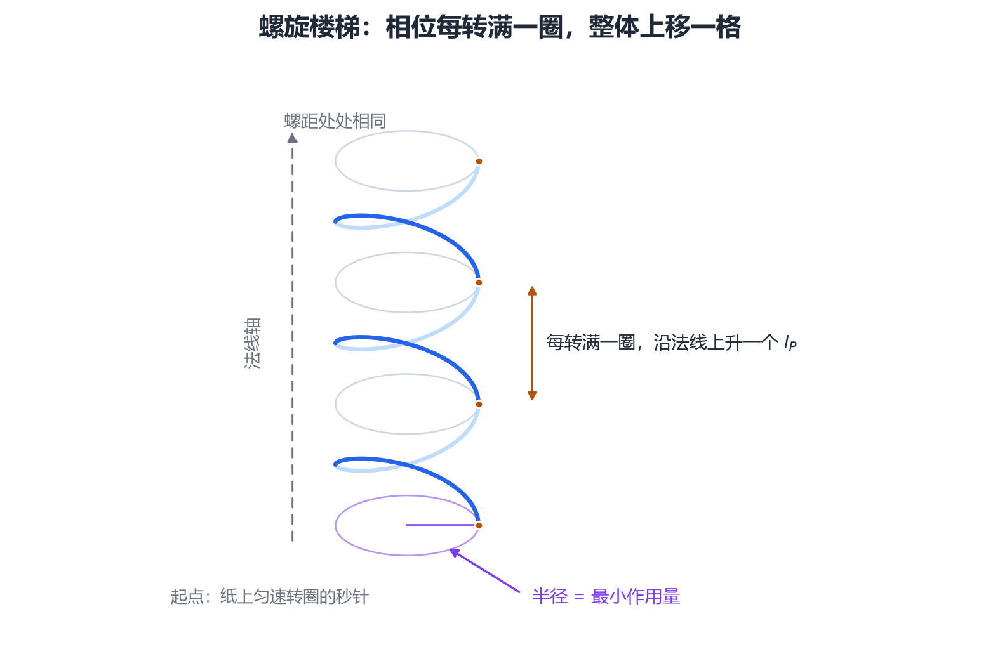
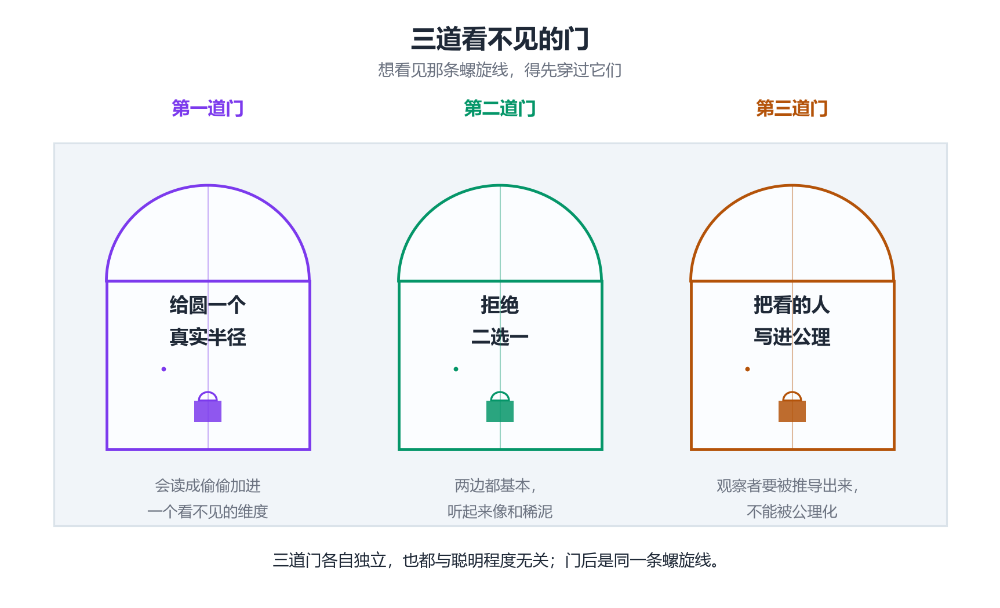

# 一条螺旋线等了几十年：最简单的骨架为什么最晚被发现

## 元相子理论骨架的通俗归因笔记

- **日期**：2026-10-13
- **配套材料**：[[内部草稿/注记-简单骨架何以缺席几十年：主流未想到螺旋阶梯几何的归因分析|归因分析（内部草稿）]]、[[理论总纲/螺旋阶梯几何|螺旋阶梯几何]]、[[元相子理论全骨架综述：从心物波粒二象到黑洞强场|骨架综述]]、[[论量子引力对立的消解]]、[[可视化/四理论连续与离散谱位对照_信息图|四理论谱位对照（可视化页）]]
- **定位**：把"简单骨架为何长期缺席"讲给非专业读者，分概念禁忌、搜索位置与制度三条线索展开，并保留一节克制的自省
- **修订**：2026-10-13 初版（由内部草稿归因分析改写，去掉公式化论证，保留自省一节）

---

先看骨架长什么样，后面的解释都要挂在这上面。

想象一只秒针。它在一张纸上匀速转圈，每转满一整圈，就沿着垂直于纸面的方向往前挪一小格。转得久了，它在空间里留下一道螺旋楼梯，每一级台阶的高度完全一样。

[[wiki/元相子|元相子]]理论把这个图像认作本体。那个圆有真实半径，等于最小作用量；每转满一圈，圆心沿法线方向跳一个普朗克长度，约 $1.6\times10^{-35}$ 米；圈数就是一个计数器。量子力学、光学、电磁场、规范场，都能在这条[[理论总纲/螺旋阶梯几何|螺旋线]]上重新搭起来。

这套骨架的数学轻得像小学几何，可它缺席了几十年。这篇写的就是这个。

## 一、三道看不见的门

三道门各自独立，也都与聪明程度无关。

**第一道，给那个圆一个真实半径。** 在物理学的行规里，波函数的相位圆只是复数的记号，绕了几圈只是一个整数标签。一旦给它半径和长度，读起来就像偷偷加进一个看不见的维度，而"隐藏维度"在物理学界是一句警报。跨过这一步，需要先有一套把内部空间与外部空间分开的说法，这套说法在主流里并不存在。

**第二道，拒绝在连续与离散之间站边。** 几十年的量子引力几乎都从一句二选一开始：要么时空是连续的，要么它是离散的，然后让另一方涌现出来。骨架把两者都当基本层，初看像和稀泥。要让这句话立住，需要一条能从连续内部自己长出离散的机制，缺了它，"两边都基本"就只是口号。

代价落在认识顺序上。出口必须先接受入口才看得见，它没法从主流的前提里推出来。

**第三道，把"看的人"写进公理。** 主流物理默认观察者要被推导出来，不能被当成公理。一条公理同时管住心与物，方案就落在物理学的自我定义之外，评审者还没看内容就先降权；再提到意识，在物理学界几乎等于自断评审通道。

## 二、所有人都去时空里找过

几十年里，量子引力的几何载体都在时空本身里找：时空泡沫、自旋网络、因果集，各占一方。螺旋线却住在状态空间，它与物理空间同源，却不是同一张网。找的位置偏了，答案再简单也会一直缺席。

路上还有一个隐蔽的坎。体系里有两条通道，一条管相位，一条管圈数；初看它们是同一件事的两种写法，像是重复点数。要证明这两条通道分别管"位置的标签"和"位置的份额"，需要的是一套精细的语言分层，不消耗算力。

## 三、学界也有自己的入场券

物理学界判断一个方案值不值得读，靠的是一串技术抓手：弦论的数学、自旋泡沫、Regge 微积分。一个用单位圆重建全部公设的方案抓不住这些抓手，于是拿不到被认真评价的资格，连判对判错都轮不上。终身教职、经费与期刊结构，也只奖励既定纲领内部的推进。

科学史家库恩有句常被引用的话：范式筛选的是问题，与智力高低无关。被筛掉的不必是错解，够不上格式才是常态。

## 四、一节自省：简单不等于正确

故事讲到这里，很容易被讲过。

有一部分"没想到"是正当的。简单不构成正确的证据，简单也可能来自可调空间偏大，或者来自对既有事实的过度解释自由。预言数量多、与既有标准物理相容，这些都是必要条件，并不充分；物理学史上不乏更简洁统一却最终错掉的方案。

共同体的怀疑因此有两副面孔，一半是科学的自我保护，另一半是惰性。把这两半分开看，答案才完整，也不会把"主流没看见"误当成"它对"。

## 五、为什么是现在

大模型把实现与验证的成本压了下来，一个人可以在两三个月里跑完本来要一个学派几十年的细节重构。骨架长期缺少的东西在算力之外，是一个落在范式筛选之外的观察位置。简单只有在范式之外才看得见。

## 尾声

历史上一批最重要的发现都曾是"重新描述"。答案摆出来之后就像本来就在那里，DNA 双螺旋、板块构造、时空弯曲都有这个特征。它们缺少的从来不是新证据，缺的是一个把已有事实换一套坐标去看的观察位置。

这条螺旋线的故事，落点也在这里。
