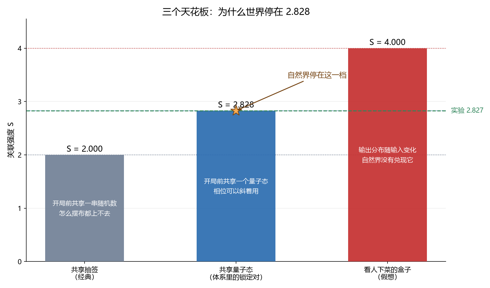

# 为什么停在 2.828：贝尔违反的第三个天花板

傅天行
（天行新学研究院）

注：本文是[[谁杀死了叠加态：一次排除了两个嫌疑人的数值追凶|谁杀死了叠加态]][[开关、骰子与读数：测量怎样从一条公设变成一台机器|开关、骰子与读数]][[凹痕与表针：给叠加态画一张像|凹痕与表针]][[答案条与表针：给贝尔违反画一张像|答案条与表针]]的第五篇，面向对量子力学感兴趣的普通读者。上一篇把贝尔违反的像画了出来：撑起超常关联的是表针相干；文末留下两个天花板，经典界 2 与量子界 $2\sqrt2$。这一篇回答剩下的那个问题：为什么世界停在 2.828，没有走到更高的 4。文末照例有一张对照表。

## 一、第三个天花板

物理学家为关联强度 $S$ 找到过两个天花板。经典界 2，量子界 $2\sqrt2 \approx 2.828$。其实还有第三个：4。

它来自一个叫 PR 盒的假想装置：两个盒子各按一下，输出的关联强到满分，信息传得比任何量子协议都多。实验室里测到的 2.827 与 2.828 贴得极紧，与 4 之间却空着一大段。这段空白就是本篇的主角。

有人会问：数学上既然允许 4，世界为什么不选它？这个问题有个正式名字，叫超量子关联为什么被排除。答案不止一个。下面讲体系内的三层：[[相位]]的形状、问法的角度、资源的身份。

## 二、把相位画成指针

上一篇的主角是表针。表针的样子很简单：每个粒子带一根长度为一的指针，指针的方向就是相位。

所谓"锁定"，是两根指针的相对角被整体定住。设这个相对角是 $\Delta\alpha$。两颗粒子分到宇宙两端，各问各的问题，量到的关联，全部来自这个角的统计。

如果把两根指针的相对角看成一根指针，那么有两个数字能刻住它：投影到水平方向的平均长度 $c$，与投影到竖直方向的平均长度 $s$。这两个数字加起来，就是全部可用的相关性。故事的关键，就藏在这两个数字的取值里。

## 三、点 (1,1) 在圆外

要凑出 4 那个天花板，需要什么？把公式拆开看，需要 $c$ 和 $s$ 同时取到最大值：水平投影处处为正，竖直投影也处处为正，两根指针永远同向，而且永远成直角。

这在几何上做不到。$c$ 与 $s$ 是同一根单位指针的两个投影，它们的平方和等于长度平方：$c^2 + s^2 \le 1$。两个都取 1，对应平面上那个点 $(1, 1)$，它的长度是 $\sqrt2$，站到了单位圆外。

单位圆外的点，指针够不着。于是 4 这个天花板，在体系里被单位圆提前关掉。多出来的那截差，可以算得很准：$4 - 2\sqrt2 = 1.172$。

## 四、三个奇异值

把上面的几何说得再具体一点。测量有两边，每边可以问三种方向的问题；把三种方向、两组结果的关联排成一张表，数学上叫相关矩阵。

这张表的"力气"由三个奇异值刻画，可以理解成三个方向上各自能承担多少关联。体系里算出来的三个数是：$1$、$|z|$、$|z|$。这里的 $|z|$ 就是那根单位指针的长度，绝不超过 1。

知道了三个奇异值，最佳问法能榨出的关联强度有现成公式：$S_{\max} = 2\sqrt{1 + |z|^2}$。指针满格时 $|z| = 1$，代进去就是 $2\sqrt2 \approx 2.828$。这正是量子界，也是本篇要解释的那个数字。

## 五、问法要跟象限对齐

上面的结论依赖一件事：问法要选对。三个方向要配合，倾斜角要摆正，任何一处错位，关联都会掉下来。

这件事在体系里能做得很具体，用的是只有两件原语的一条链：先给指针踢一个角度，再让两个分支重组合，读出层位。踢角转动，读数就跟着转，一层相位平面上的问法由此全在手上。

最优的一套角度是：两侧的踢角相对锁定轴摆成 45 度与 135 度那样的布置，换句话说，整张角表要跟锁定象限对齐。对齐的代价可以精确算：摆正时 $S = 2\sqrt2$ 满额；错开一点就掉，例如相对角取 $\pi/3$ 时掉到 1.414；取到 $\pi/2$ 时掉到 0，违反彻底消失。

## 六、三类资源，三条边界

还有一种问法更有意思：把 4 与 2.828 的差别，归结为"手里拿的是什么资源"。同样一局游戏，资源分三类，天花板分三档。

第一类是共享抽签：开局前双方共享一串随机数，各自按自己的数决定回答。这类资源撑到 $S = 2$ 就到顶，怎么摆布都上不去。第二类是共享量子态：开局前双方共享一个量子态，量子态里的相位可以斜着用，天花板抬到 2.828。第三类是"看人下菜的盒子"：盒子的输出分布随输入变化，这类资源能撑到 4。

分界线在于资源是不是一个"态"。态是开局前就摆好的，不随问题变化；盒子则允许"你问什么，我再决定怎么答"。体系里的资源属于第二类：纠缠锁定对是制备给定的态，不随测量方向变化。所以它的天花板就是 2.828。

## 七、消息就是一比特

还有一层解释从"传话"这边来。

上一篇讲过，体系里唯一能跨侧传递的东西是记录：一次跨层事件写下一位，最多一比特。设置是免费的（提问不需要记录），共享量是改不动也读不出的（[[扇区]]标签与锁定关系既不消耗记录，也不构成消息通道）。

于是"Alice 能告诉 Bob 多少"被记录数卡住：一条消息一比特，重复写入逐次计。这条思路和外部文献里的信息因果性撞在同一个数字上：允许上限算出来恰是 $\cos^2(\pi/8) = 0.8536$ 对应的 $S = 2\sqrt2$，与结构路线给的 2.828 逐位同数。

## 八、诚实的一处

要如实说清一件事：上面这条记录路线里，有一环在体系内没有被推导出来。记录数封顶能立，设置免费能立，共享量不构成通道也能立；可"Bob 最终拿到多少信息"这一条推不出来，被标为一条出发点，也就是公理级候选。

这不算遮掩。体系把哪一层是结论、哪一层是出发点写在明处：相位的形状给判据级来源，记录给机制级读数，剩下的一环标为出发点。顺带一提，外部那条信息因果性的技术形式也已被逐条核对过，它的判定是一个含参数 $n$ 的极限式，阈值同样落在 2.828。

## 九、所以 2.828 意味着什么

三句话收束。其一，2 是经典世界的天花板，共享抽签再多也翻不过去。其二，2.828 是量子世界的天花板，单位圆的长度限制与记录的比特限制从两头合围到同一个数。其三，4 是假想的更强非定域，自然界没有把它兑现；实验测到的 2.827 与 2.828 贴得极紧，测量误差解释不了它：这里就是真实的边界。

换句话说，自然界在非定域这条路上走到了量子力学的门口，就停住了。停在 2.828。

## 对照表：三条边界

| 资源 | 关联强度上界 | $S$ 的上界 | 体系内的对应 |
| --- | --- | --- | --- |
| 共享抽签（经典） | $1/2$ | 2.000 | 预存角读法（上一篇的答案条） |
| 共享量子态 | $1/\sqrt2$ | 2.828 | 锁定对（体系里的资源） |
| 输出看输入的盒子 | $1$ | 4.000 | 无对应物，被排除 |

## 来源

技术细节与验证材料：[[齐雷尔森界的体系内来源：单位相量结构、象限对齐与信息因果性判据]]（结构路线与象限对齐）、[[容量的体系内来源：记录单位、设置免费与提取预算的公理候选]]（记录单位与预算）、[[贝尔违反的场侧闸门：纠缠锁定对、经典圈对照与可见度阈]]（存在性闸门与锁定族剖面）。

判据与注记：[[注记-Y 象限的相位语言操作合成的最小验证：双原语链、第二次重组合与象限对齐角表]]（第五节）、[[注记-态化边界的最小验证：三条关联强度上界与合成缺口的两因子分解]]（第六节）、[[注记-信息因果性模型内定量判据的最小验证：协议类穷举、RAC 成功率与互信息和式]]（第七节）、图 `images/minimal_verification_y_quadrant_phase_protocol.png`。

本页示意图为自制，生成脚本 `_tools/make_three_bounds_figure.py`（输出 `images/three_bounds_schematic.png`，柱高 2.000000 与 2.828427 与 4.000000）。
