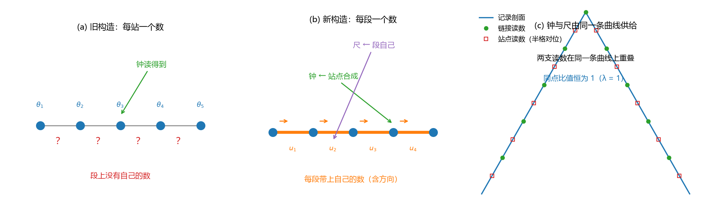
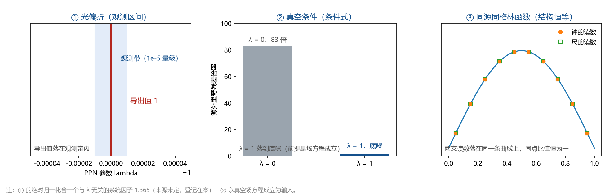

# 发布稿：钟与尺图文汇总

（天行新学研究院 · 引力线收束轮 · 2026-09-19）

## 一、发布信息（编辑栏，外发时删除）

- 主标题：钟与尺：引力的两个读数
- 备选标题：引力弯的不只是时间：这一轮，尺也有了自己的读数
- 摘要（约 130 字）：引力弯曲时空，同时改写钟的快慢与尺的长短，光偏折的两半正对应这两样东西。元相子理论过去只把钟的那一半做成了读数；这一轮把写入从格点改到格与格之间的段，让尺也有了独立读数，两条验证线给出同一个结果：$\lambda = 1$。
- 话题标签：理论物理、广义相对论、引力、时空、科普
- 篇幅：正文约 2500 字；配图 2 张；附可交互网页 1 个
- 配图清单：图 1 = images/clock_ruler_schematic.png；图 2 = images/anchor_triple_panel.png
- 可交互版：可视化/钟与尺_互动示意.html（单文件、无外部依赖，本地双击打开；页尾附三锚对照栏；外发时需部署或录屏）
- 同轮库内材料：[[科普文章/钟与尺：引力的两个读数]]、[[内部草稿/总结报告-引力线收束：GV0至GV8的终态、读数与剩余接口]]

## 二、正文（可直接复制）

### 一束星光拐了两个弯

1919 年的日食观测让世界知道：星光经过太阳会拐弯。拐多少？牛顿式算法的答案只有一半，广义相对论给出一倍。差的那一半从哪里来？引力弯曲的不只是时间，还有空间。时间那一半让光多走一程，空间那一半再让它多拐一点；两半相等，合起来正好是观测值。于是任何一个宣称能解释引力的机制，都躲不开一个追问：它能不能把这两半一起交出来？

### 钟的那一半，早就有了

在元相子理论里，引力住在记录场：有质量的粒子每一次碰撞，就往格点上写下一笔倾斜；倾斜累积成分布，分布就是引力场。这个分布第一眼就能读出一件事：钟的快慢。记录值 $\theta$ 越大，那一带的钟走得越慢（$h_{00} = 2\theta$），势阱越深。太阳系的观测与 GPS 卫星的校时，都在核对这一读数。

### 尺的那一半，过去是空缺

格点上的记录只有一个数 $\theta$。钟拿它读快慢，尺想拿它读长度，可尺量的是"一段路有多长"，那是两个格点之间的事。一个数被两样东西共用，两支读数就被同一个因子锁死，空间那一侧交不出独立的一半。旧构造的处境是：钟的一半清清楚楚，尺的一半写着"以后再补"。光的偏折不等人，它要两半都对；只答一半，就只答了观测值的一半。

### 这一轮做的事：给每一段路一个自己的数

既然尺要量"段"，那就让段自己带一个数。新的做法把写入从格点改到"段"（格与格之间的连接）上：每一段带两个读数，一个是它的取向，一个是它的长度因子；格点上的记录改为相邻段读数的平均。打个比方：旧做法是每个路口挂一块牌子，路本身不说话；新做法是每一段路都挂上自己的牌子，路口的牌子由相邻路段拼出来。

改动听着小，代价不小：格点上的更新规则要重写，记录与连接的关系要重建。所以这一轮先立了验收线，旧结论里任何一条不许动，然后逐道门去查。

### 三道门，一个结果

第一道门问稳态：把源写进段里之后，稳态仍是同一条"帐篷"形状的格林函数，通量与源精确平衡，远处的 $1/(4\pi)$ 依然从立体角里长出来。

第二道门问尺有没有自己的数据通道：把记录做一个"半格子"的交错改动，格点上的读数完全看不见它，段上的读数却看得一清二楚。也就是说，站点记录无法唯一决定段的内容，尺有自己读得到的通道。

第三道门问健康性：小扰动不会长起来；影响每次只传一格，正好是一支"每拍一格"的因果前沿；没有多出会传播的新模式；弹性张量的各向同性关系原样保持；张量扇区的传播支数仍是两支；参考系拖曳那条通道仍然关着（这一点下面再说）。

结果是一句话：离源远的地方，每一段的记录恰好等于它两端记录的中间值。

推论正是我们要的：钟的读数（$2\theta$）与尺的读数（$1+u$）在同一点上成严格的比例，比值是 $1$；把段上的数反过来喂给键能、让记录剖面扭曲两成三之后，比值纹丝不动。

用广义相对论的记号，这个读数就是 PPN 参数 $\lambda = 1$，它掌管光偏折里空间那一半的大小。三条独立的锚一起对上了：光偏折的观测区间、真空条件下的里奇张量归零、以及"钟与尺必须同源、同一条格林函数"这条结构要求。

### 这一句"1"，说了什么，没说什么

这个 $1$ 是"结构恒等"的读数。它证明两把尺子是同一根尺子的两个刻度，没有解释这根尺子的总刻度为什么是现在这个大小。用白话说：我们证明了钟和尺必须同步走，还没有证明钟和尺为什么走这个速度。

与之相关的几个问题仍开着：把记录换算成几何角的那个特殊角、光偏折里一个与 $\lambda$ 无关的系统因子（数值 1.365，来源未定），以及识别式那一层。

识别式是把记录值换算成度规读数的那条公式（$h_{00} = 2\theta$）。它现在按统计对应来读：记录值与黎曼几何之间是一层可算的对应关系，谈不上同一件事的两种刻法。

这层对应在数学层已经算清（判据第 715 号），为什么对应成立则是一项待攻题目。

### 一个还没解决的悬念

广义相对论里，旋转的地球会轻轻拖动周围的时空，让陀螺进动，这叫参考系拖曳，Gravity Probe B 卫星量出的值不为零。元相子理论现在的规则给出的却是零：写入只写倾斜的幅度，不写旋转。这是整个体系最扎眼的观测张力，差别约 $5\sigma$。

想救它，需要一条"会转"的新写入通道，强度必须与普朗克量级相当，"用一点高阶小修正带过去"的路线已经被算死。这一轮改造恰好给这条通道留了一个天然座位：段本身带方向。要不要坐上去，是一次取舍。

### 结论站得多稳

机器精度级（可复现）：稳态格林函数与通量守恒、两支读数比值恒为 $1$、$\lambda = 1$ 的导出值、因果前沿每拍一格。

判据级的关键交叉核对：三维健康性的六项、光偏折线性律、真空条件下的里奇归零（以场方程成立为输入）。

仍开着的：特殊角的进一步严格化、系统因子 1.365 的来源、拖曳通道的取舍。已结的：识别式那一层（记录与几何为什么对得上）不再是待攻项，2026-10-20 裁定它属于公理级设定的代价。

一行总结：引力改写钟与尺两样东西；这一轮把"尺"从一句假设做成了一个读数，也让"钟和尺必须同步"从要求变成了结论。

## 三、发布备注（编辑栏，外发时删除）

- 配图位置：图 1 放第四节末，图 2 放第五节末；两张图的图注已随图写在正文里，平台版可按需裁短。
- 可交互网页：可视化/钟与尺_互动示意.html 的四个控件依次是构造切换、探测点位置、交错扰动 $\eta$、键能反馈 $c$，求解器与验证脚本同源；外发时可部署到静态托管，或用一段录屏代替。
- 口径提醒：正文里"结构恒等"的边界、系统因子 1.365、拖曳通道的取舍三处与收束总结一致；若平台版需要删节，优先压缩第六、七节，保留第五节与结论分档。
- 知乎版：[[科普文章/知乎版：钟与尺，引力的两个读数]]（含发布设置、公式插入清单与检查清单）。
- 配套材料：示意图脚本在 _tools/plot_clock_ruler.py 与 _tools/plot_anchor_triple.py；关键读数见 [[验证脚本/README]] 下阶段 3、阶段 4 与 GV6、GV7 各注记；收束总结见 [[内部草稿/总结报告-引力线收束：GV0至GV8的终态、读数与剩余接口]]。
