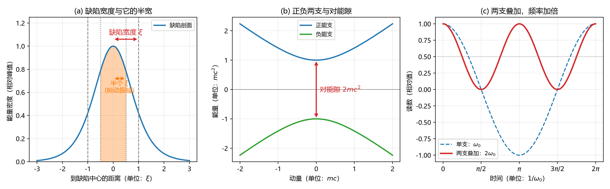
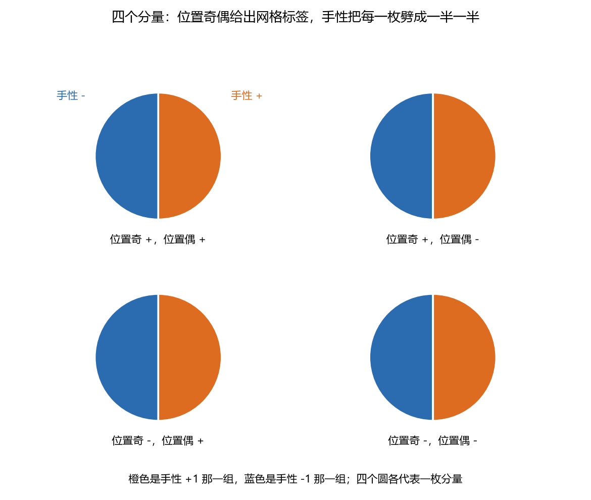

# 近看是格子，远看是方程：元相子理论里的狄拉克方程，以及那个多出来的 2

- **日期**：2026-10-15
- **配套材料**：[[验证脚本/注记-电子算符Dirac骨架（第489条）：S¹×ℝ反周期谱结构、D2连续极限与D1甲乙首测|第 489 号：格点狄拉克骨架]]（旋量、两支、连续极限）、[[验证脚本/注记-小动量极限与D3的磁矩因子（第499条）：3+1维平行自旋给出g=2精确|第 499 号：磁矩因子 $g=2$]]、[[验证脚本/注记-宇称变换行为与Wilson项（第490条）：2分量下宇称不存在与doubling抬升的处方权衡|第 490 号：宇称与 Wilson 项]]、[[验证脚本/注记-手性算符的格点原生表达式与两套标号的相容性（判据第637号）|第 637 号：手性算符与两套标号]]、[[验证脚本/注记-手性口径对表的算符层核对（判据第638号）|第 638 号：手性口径对表]]、[[验证脚本/注记-格点三枚生成元是否对应自旋空间的三枚（判据第639号）|第 639 号：局域性穷举]]、[[π扭转的层次分解：旋量结构与费米统计的边界]]（旋量成立到哪一层）、[[内部草稿/注记-康普顿波长、狄拉克方程与ZBW的三条边：宽度、两支与对能隙]]（第五节口径出处）
- **定位**：讲清元相子理论与狄拉克方程的关系（一致在哪、分歧在哪、缺口在哪），并介绍本轮关于颤动的新读数
- **修订记录**：
  - **2026-10-15 初版落盘**（触发：作者要求把三方关系的解释写成科普）
  - **2026-10-15 增补收尾节**（触发：狄拉克线阶段 5 收束轮判据第 637 号落盘）
    - 新增「分量身上贴的是什么标签」一节：手性算符的格点原生表达式、位置奇偶网格标号，以及两套标号的最大不相容
    - 「这篇不回答什么」末段按导出层进展更新（代数骨架已由格点自身给出）
  - **2026-10-16 通顺复检后润色**（触发：作者要求按新补的通顺复检工序过一遍）
    - 开篇「两处」与末节「三处」口径对齐；「三处得分性质」改写成正常句子
    - 「对合有一整条」改「有整整一族」；收尾节两句拆开并补引导句；末段判据号补至 639
    - 配套材料补第 638、639 号两篇注记

---

## 一支很成功的方程，和它要的三样东西

狄拉克方程写成现在的样子快一百年了。它有个特别之处：一支方程同时说中三件事，而这三件事看上去互不相干。

一件是电子"转两圈才回家"。把一个量转一整圈，波函数带回来一个负号，再转一圈才回到原样；带这种脾气的量，数学上叫旋量。另一件是正负两支，方程的解成对出现，能量有正有负，当年正是这一支"多出来"的解让狄拉克预言了正电子。还有一件是磁矩强度，方程算出来恰好是 $2$，与实验对得上，后来测到的那点零头由量子电动力学的辐射修正补上。

标准物理里，这三样是同一次落笔的意外收获。而元相子理论对这三样东西各有各的说法，所以问题很自然：两套说法打架吗？

答案可以先放在这里。低能段不打架，狄拉克方程在元相子理论里是长出来的，不是另写一支摆在那里。分歧只出现在普朗克尺度，那还是体系主动偏离。真正让人不放心的只有一处，剩下两处看着像分歧，各有各的来由，下文分开说。

## 把镜头拉远：格子退场，方程露面

体系里没有点状的电子。电子是晶格上的一处错位，形状像地板上鼓起来的一个包。这个包有宽度，就叫缺陷宽度；包心附近一格的范围，叫锚核。

现在做一个动作：把镜头拉远。近看是一片整齐的格子，一格一格，包只有很少几格宽，格子的细节全在眼前。远看，格子看不见了，剩下一个缓缓起伏的包，它的形状变化很慢，慢到可以当成连续的东西来处理。

物理上这一步叫取连续极限，只看波长比格距长得多的那些慢变成分。狄拉克方程描述的正是这个包的长波成分怎么动。这里有个顺口就会说错的地方：远看时消失的是格子，被描述的是那个包。格子像一块布，包是布上鼓起来的那一处。若把话说成布面在大尺度上的形状，主语就悄悄挪到布上去了，而布只是包住的那张底子。

## 三块拼图，各在哪儿

先说"转两圈才回家"这一块。这个包带着一个扭转：绕环一圈，截面上的标架转了半圈。写成条件就是波函数走完一圈回来带一个负号，也就是反周期边界。这一个负号把模的量子数挪了半格，从整数变成半整数，体系算出的偏差是 $8.88\times10^{-16}$，落在机器精度上。自旋二分之一的几何内容就这一条（[[验证脚本/注记-电子算符Dirac骨架（第489条）：S¹×ℝ反周期谱结构、D2连续极限与D1甲乙首测|第 489 号]]）。

再看正负两支。包的能谱关于能量零点严格对称，并且没有零模，正负两支成对出现、中间隔着一个能隙。体系读到的对称性偏差是 $3.18\times10^{-14}$，同一个出处（[[验证脚本/注记-电子算符Dirac骨架（第489条）：S¹×ℝ反周期谱结构、D2连续极限与D1甲乙首测|第 489 号]]）。图 1(b) 画的就是这两支。

剩下的一块最挑环境，也就是 $g=2$。它要求空间里有三个方向，还要求自旋取与动量平行的方向。当时那个二维的模型只有两个方向，判据一律判否、读数恒为零；换成三维之后，$g=2.000000$ 精确成立，换六档动量、五档参数都不动（[[验证脚本/注记-小动量极限与D3的磁矩因子（第499条）：3+1维平行自旋给出g=2精确|第 499 号]]）。

三块拼图都在，位置也说得清：旋量性来自环上那个半扭转，两支来自能谱的对称，$g=2$ 来自三个方向加平行自旋。

## 冲突在哪里：三处分开说

这三处的性质并不一样：一处是模型搭小了，一处是体系主动偏离，一处是真的没做完。

### 看着像冲突，其实是维数不够

有一轮判据说"宇称算符不存在"，另一轮说"手性在有限质量下不受保护"。单拎出来，这两句像是对着狄拉克方程说的。

查下去，成因是维数。当时用的是两个空间方向加时间，共三个方向。奇数的时空维里找不到一个与所有 $\gamma$ 矩阵都反对易的手性算符，这套代数就是这么长的。升到三个空间方向加时间，宇称算符存在而且唯一，就是 $\gamma^0$（[[验证脚本/注记-宇称变换行为与Wilson项（第490条）：2分量下宇称不存在与doubling抬升的处方权衡|第 490 号]]、[[验证脚本/注记-两因子张量积结构判据化（第491条）：宇称唯一性、Wilson相容与谱的因子化代价|第 491 号]]）。

体系的晶格本来就是三维的。所以这处障碍在完整体系里并不存在，它是模型搭小了的副产品。

### 真分歧，性质是预言

狄拉克方程有个前提：洛伦兹不变性，换一个匀速运动的参照系，物理规律一模一样。体系的晶格摆在那里，这一条在普朗克尺度上必然被破坏。

破坏有多大，体系给出了具体数字：$\delta\omega/\omega \sim (E/E_P)^2$，方向的依赖比是 $6:3:2$。低能下这个修正被重整化压到测不出来，所以"低能精确洛伦兹不变"在体系内是一个算出来的结果，不是硬塞的假设（[[元相子振荡晶格的色散关系：低能光速涌现与洛伦兹破坏首阶项]]、[[晶格何以不破坏洛伦兹不变性：元相子理论的时空机制与分层定理]]）。

这一处不叫矛盾，叫指纹。体系在这里愿意被实验挑错，反倒说明它不打算做狄拉克方程的复读机。

### 真的没闭合的那一处

最硬的问题在格点上。有一条定理（Nielsen-Ninomiya）说：在厄米、局域、平移不变的格点算符上（说白了：算符对称、每一步只跟近邻打交道、每一格都长得一样），放不下单个手征费米子。懂行的人看到这里会精神一振，因为体系的格点狄拉克算子确实自带加倍：中心差分每多一个方向就多一个谷，当时那个二维模型数出来是 4 个。

加倍可以劈开。加一项专门抬高多出来那几个谷的修正项（Wilson 项），它们被抬上去、与物理态分开，判据三条都过：与宇称相容、劈裂随参数 $r$ 单调增、低能连续极限不受损。代价是 Wilson 项本身破坏手征对称，而且 $r$ 取得越大加倍抬得越高、手征也破得越狠，找不到一个两头都好的取值，只能说是两个代价之间挑一点（[[验证脚本/注记-宇称变换行为与Wilson项（第490条）：2分量下宇称不存在与doubling抬升的处方权衡|第 490 号]]）。

这一条直接压到体系的一个核心诉求上：弱相互作用只加载一个手征分支，加倍的存在让这一步悬着。这是一处实打实的缺口，不是术语之争（[[内部草稿/裁决请求-阶段2判据优先级重排与fermion-doubling定性升级（依据第489条）]]）。

## 那个多出来的 2：本轮的新读数

前面几节讲的都是既有材料，这一段是这次新算出来的。

### 颤动是什么

标准物理里，自由电子的位置期望值并不安静地匀速前进，它带着一个来回的抖动，抖动的快慢由粒子的质量定，频率是 $2mc^2/\hbar$，正好是康普顿频率 $mc^2/\hbar$ 的两倍。这个抖动叫 Zitterbewegung，中文一般译作颤动。

抖动的来源很特别。狄拉克方程的解分成正负两支，两支的相位因子一个是 $e^{-iEt/\hbar}$，另一个是 $e^{+iEt/\hbar}$，一正一负对着转。位置算符里有一半专门连接这两支，它随时间演化，就成了两支的拍频，频率是 $2E/\hbar$；粒子静止时，这个频率就是 $2mc^2/\hbar$。图 1(c) 画的是同一件事的简化版：单支在一段时间里走完一个来回，两支叠起来走完两个。

它还有一个著名性质：把方程投影到只保留正能的那一半，也就是 Foldy-Wouthuysen 表示，这一项就消失了。所以颤动看不出是某一颗粒子的动作，它是"两支同时在场"这件事的读数。

### 体系这边的数

体系给缺陷的物质场相位定的速率是 $\omega_0 = mc^2/\hbar$。颤动的角频率是它的两倍，也就是 $2\omega_0$，这一步以前就记下过，一直是个"差一个 2"的悬案（[[内部草稿/注记-半扭转环上的两个读数：每拍相位推进与转两圈回原样，及ZBW因子2的三条候选口径]]）。

这次新算出来的是另一半。颤动的振幅在粒子静止时是 $\hbar/(2mc)$，而缺陷的宽度是 $\hbar/(mc)$。两式一比：颤动的振幅恰好是缺陷宽度的一半。图 1(a) 里那个橙色阴影区标的就是这半个宽度。

拿电子算一组数。缺陷宽度 $3.86\times10^{-13}$ 米，约是原子直径的二百六十分之一，也是质子半径的四百六十倍。颤动振幅是它的一半，$1.93\times10^{-13}$ 米。物质场相位速率 $7.76\times10^{20}$ 弧度每秒，只有普朗克节律（网格自身每摆一程的节奏）的约 $7\times10^{-24}$；颤动角频率是它的两倍，$1.55\times10^{21}$ 弧度每秒。

数字摆在一起，那个"多出来的 2"就散开了。它是同一个 2 换了两次装：振幅减半、频率加倍，乘起来不动。

$$(\xi/2)\times(2\omega_0) = \xi\omega_0 = c$$

缺陷宽度乘相位速率正好是光速，这是体系里早就有的恒等式。颤动读的正是它：半个宽度配两倍频率，乘积还是光速。换成画面说，颤动那几个来回的速度峰值恰好是光速，这一点与标准物理给的图像一致。

### 那个 2 到底打哪儿来

回到以前列过的三条候选。这次定下两件事。

自旋双覆盖那条可以排除。半扭转给的是"绕一圈变号、两圈复原"，它改的是模的量子数，给的是相反的倍数：按状态的基频去算，得到 $\omega_0/2$，即一半，而这里需要的是两倍。

剩下两条其实是同一条。对能隙说的是能量侧的那份 $2mc^2$（粒子加空穴，两支合起来的能量），两支拍频说的是时间侧 $e^{\mp iEt/\hbar}$ 的拍频；在标准推导里，两处本来就是同一个 $2E/\hbar$ 的两个来路，所以不必在两条里挑一条。

这一归并还顺手解开了一处卡住的地方。此前"两支拍频"这条候选需要一个前提：环上的两支得反向，而当时环的构造写在物与心的两条螺旋之间，按"当前推导不加入心侧"的要求没法核对。现在这两支由正负能提供，第 489 号的格点谱上已经读到，落在物侧，不必去碰心侧（[[内部草稿/注记-康普顿波长、狄拉克方程与ZBW的三条边：宽度、两支与对能隙]]）。

### 有一句话不能写

颤动是场层的读数，把方程投影到正能那一半就没有了。体系里单个缺陷对应其中的一支，它自己不会颤动。所以"缺陷在颤动"这句话不能写：那既与标准物理里颤动依赖表示的分寸相抵，也与 [[验证脚本/注记-缺陷质量落点轮：核区对包络的能量份额（判据第627号）|第 627 号]]"质量摊在包络、缺陷再无额外运动"的读数相抵。

## 分量身上贴的是什么标签

前面几节讲的是"三块拼图长出来了"。这一轮换一个更细的问法：狄拉克方程那四个分量，在格点里住在哪儿？

标准物理的答案是一个内禀空间，四个分量分成左右两组，这个分组叫手性。体系这次先问格点自己能给出什么。格点给的答案来自位置奇偶，也就是隔一格变号的那个符号。它在慢变包的分解里干的活恰好是把两半对调，两个方向上各有一个这样的符号，它们互不干扰，于是四个分量拿到一张 $2\times2$ 的标签格子：位置上奇、偶各两种。读数偏差 $1.110\times10^{-16}$，参照物就是机器精度本身，双精度浮点能分辨的极限。

手性算符也能用格点自己的材料拼出来：把三枚空间生成元连乘，再乘上相位圆那个 $\mathrm{i}$。它是个把四分量劈成两半的开关，特征值两个 $+1$、两个 $-1$。它跟三枚生成元的先后顺序无关，这种关系叫对易；先后顺序换过来会多一个负号，才叫反对易。这一条我一开始写反了，照教科书写成反对易，实测三对读数都是 $2.000$，也就是对易。翻过来的原因是这里用三枚生成元连乘，与教科书那套写法的矩阵不是同一种取法：同一个符号换一套基，先后顺序的关系就反了。

有意思的是两套标签合不到一起。手性开关与两个位置奇偶符号都反对易，所以在位置标签已经定下的态上，手性的平均读数恒为零：一半权重落在 $+1$ 那组、一半落在 $-1$ 那组，没有偏向。两套标签基的重叠每格 $1/4$、每行在两个手性支上各一半；把基随机换二十次，读数一动不动。反过来也验了：把开关换成与位置奇偶对易的那一枚，重叠立刻从半对半变成完全重合，偏差 $0.500$。

打个比方。四个人站成一排，一套标签按他们站在第几号位，另一套按左手还是右手。任何一个人在两套标签下都对不上号，永远是半对半，这就是最大程度的不相容。格点给的是前一套。

还剩一枚。教科书里与前三枚都反对易的那一枚住在质量项上，它在四分量的空间里确实存在，格点却不挑它：满足条件的对合有整整一族，而格点算符只用三枚生成元与复结构拼成，挑不出其中哪一个。这与上一轮"哪个方向是时间不能由格点判定、得由摆程从外面给"是同一件事。

于是原来记成"分量住在哪里没有对应物"的那条缺口，这一轮改写成了：分量在格点上带的是标号，位置这个词在这里没有对应物，而且格点自己的标号与教科书的手性标号最大程度地不相容。判据与读数见 [[验证脚本/注记-手性算符的格点原生表达式与两套标号的相容性（判据第637号）]]，通俗版见 [[内部草稿/注记-分量身上贴的是哪种标签（判据第637号通俗版）]]。

还有一步得说清楚。上面这套对应目前只核到关系层，关系对得上，还不足以断定格点这三枚就是自旋空间那三枚。代数本身判不出来，因为任何两组这样的三元组都能被一个变换互相换算；能分辨的只有局域性，而格点这三枚并不平权，其中一枚恰是格点上某个简单局域算符的折叠形式，另两枚在格点算符的清单里找不到这样的对应（[[验证脚本/注记-手性口径对表的算符层核对（判据第638号）]]）。

顺着这条线索往下问，答案就更硬了：格点这三枚若真是自旋空间的矩阵，就该由单个格点自己身上的算符做出来。把这类算符穷举一遍，它们能长出的分量结构只有四种，三枚里有两枚根本不在其中（[[验证脚本/注记-格点三枚生成元是否对应自旋空间的三枚（判据第639号）]]）。

所以手性的家还在模态侧与相位侧，格点这边手上拿的这枚符号只能算"褶皱空间里的体积元"，不是物理手性。

## 这篇不回答什么

本文只做两件事：说清体系与狄拉克方程在哪一致、在哪分歧，以及介绍那个新算出来的读数。体系到底对不对，由论文正稿与验证注记回答，不由科普回答。

还有两处得摆在明处。自旋的旋量性在体系内是一个译名，它把双覆盖这件事换成体系里的半扭转环说法，成立，却还不等于从元相子几何里把旋量理论推出来，这一步仍是开放项（[[π扭转的层次分解：旋量结构与费米统计的边界]]）。至于统计层，此前"旋量性直接给出费米统计"的说法已经降级，体系现在不主张这条。

摆到体系已有的成绩旁边看会更清楚。[[薛定谔方程的公设降级：束缚振荡晶格中的包络动力学与有效质量|薛定谔方程]]已经降级为定理，也就是从晶格上的慢变包络推了出来；麦克斯韦的场方程也有推导路径，缺的一环在感知与校正那一段。

狄拉克方程这一支，复现层早就完成了，代数骨架（反对易关系与洛伦兹号差）也已由格点自身给出（第 631 至 639 号）。还没闭合的是三处：旋量性在体系内仍属译名，手性开关分出的两半在弱相互作用里怎么加载没有答案，单手征与加倍那处缺口悬在那里（Nielsen-Ninomiya）。所以准确的说法是：体系在低能端与它一致，在更深的层次上给它一个几何底座，而底座的用法还没做完。

## 收尾的画面

一张格子布上鼓起来一个包。近看是格子，远看是包，包随时间怎么变，答案写在狄拉克方程里。包的宽度是康普顿波长，半个宽度正好是颤动的振幅，颤动的频率正好是相位速率的两倍，两个数乘起来还是光速。四个分量身上贴的是格点自己的标签（位置奇偶），这套标签与教科书的手性标签最大程度地不相容：任何一个分量在两套标签下都是半对半。三块拼图都在，一处真缺口留着，一处偏离被预言在普朗克尺度上等着实验。这个包还讲过别的故事，见 [[折痕、台阶与绳结：三维元相子缺陷的结构与来路]]；它为什么长成不同的大小，见 [[三只摆与冻住的角落：费米子为何有不同的内禀频率]]。
