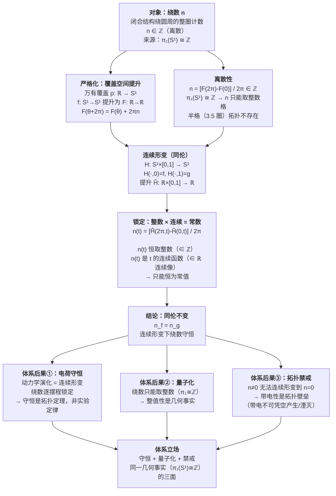

# 绕数：同伦不变性的几何论证

> 聚焦图：专门回答"**绕数为什么是同伦不变量，为什么连续形变下不变**"。
> 配套宽景图见[[体系通览图-一个圆周决定整值性]]（讲"一个圆周如何决定整值性"），本图是其核心命题的**论证细节**。

## Mermaid 论证图

## 论证三层

| 层 | 内容 | 对应数学/体系资产 |
| --- | --- | --- |
| 直觉层 | 绕数像数手指；3 圈无法连续变 4 圈（中间要经过违法的 3.5 圈） | 离散计数 |
| 严格层 | 覆盖空间提升 + 整数离散 × 连续形变 → 恒常值（拓扑锁定） | $\pi_1(S^1)\cong\mathbb{Z}$；万有覆盖 $p:\mathbb{R}\to S^1$ |
| 体系层 | 演化 = 相位连续旋转（摆程连缀）；撕裂/粘合 = 拓扑禁戒过程 | 束缚振荡框架；电荷定理 8 |

## 为什么"物理演化 = 连续形变"

体系比拓扑学多给了一层答案：

- **连续的是相位角 $\Phi$**（$e^{i\Phi}$ 在单位圆上滚动），**离散的是绕数 $n$**（整圈计数）。
- 演化是**逐摆程**推进（去程扫 $+2\pi$、回程扫 $-2\pi$），摆程连缀成连续相位流，绕数被逐摆程锁定。
- **撕裂/粘合**（剪断重接、退化为点再长出）对应**拓扑禁戒过程**，原理上不发生；带电粒子（$n\neq0$）无法连续形变到平凡态（$n=0$），带电性是拓扑隧穿不过去的壁垒。

## 核心命题

> **绕数只能取整数值（离散），而在连续形变参数下它是连续函数；一个既离散又连续的量只能恒为常值，因此被拓扑锁定。**

守恒（同伦不变）、量子化（整数性）、带电不可变性（拓扑禁戒），三件事压在同一几何事实 $\pi_1(S^1)\cong\mathbb{Z}$ 之上。

## 相关文献

| 线索 | 文献 |
| --- | --- |
| 绕数 = 电荷，同伦不变 | [[电荷的几何本质：满周闭合环内部U(1)缠绕数方案的系统辨析]]§2（定理 8） |
| 空间绕数（磁侧）与内部绕数（电侧）分工 | 同上 §5「电与磁的绕数分工」 |
| 一个圆周决定整值性（宽景） | [[体系通览图-一个圆周决定整值性]] |
| $\pi_1(S^1)\cong\mathbb{Z}$、庞特里亚金对偶、覆盖空间 | [[电荷的几何本质：满周闭合环内部U(1)缠绕数方案的系统辨析|电荷的几何本质]]§3.1、[[单位圆、整数与物理离散性的同源结构]] |

## 修正记录

- 2026-08-30 创建：把"绕数为何是同伦不变量"的覆盖空间提升论证 + 整数×连续锁定提纯为聚焦论证图，与[[体系通览图-一个圆周决定整值性]]互补。
