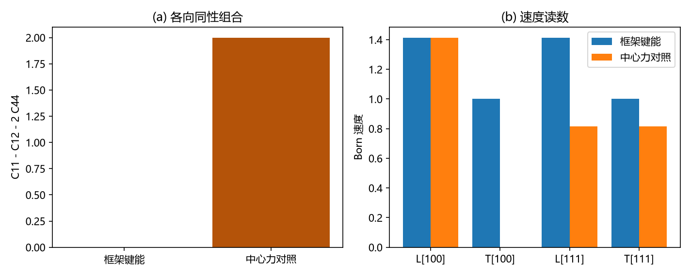

# 自旋 2 的涌现：记录场的约束结构、螺旋度正负 2 与引力子运动学

傅天行
（天行新学研究院）

**摘要**：本文把"记录场里为什么长出无质量自旋 2 的引力子运动学"写清。$自旋 2$ 在此指两支自由模在绕传播轴转动下的变换性质：转过 $\phi$ 时各带相因子 $e^{\mp 2i\phi}$，四维里无质量自旋 $s$ 的粒子恰有两个螺旋度态 $\pm s$，故"两支自由模、螺旋度 $\pm 2$"即无质量自旋 2 的定义性内容。文章按四步展开：记录场的载体与六分量的来处；体系自身两条守恒量给出的约束结构如何只留下两支（源锁定，用守恒量替代规范对称性，并给出其保护条件）；二次层与无质量自旋 2 标准二次形式的三项对齐（判据 L4）；螺旋度 $\pm 2$ 的显式算出、约束方向的螺旋度归属、以及传播中不混合且同速（判据 L5）。本文另给出三通道与螺旋度 $0$、$\pm 1$、$\pm 2$ 的对照，以及弹性各向同性的格点来源（键能罚差值向量的平方，$ C_{11} - C_{12} = 2C_{44}$ 构造性成立），后者是这条链上此前最薄弱一环的结构性回答。结论按三层声明：运动学已建立，动力学未建立，量子化属另一摊。

**关键词**：自旋 2；螺旋度；记录场；约束结构；TT 投影；各向同性封装；引力子运动学

**修订记录**：
  - **2026-09-16 初版**（作者指示：把自旋 2 涌现线写成独立论文）
    - 四步展开：载体与六分量、约束结构与源锁定、二次层对齐、螺旋度与传播
    - 给出三通道对照、各向同性的格点来源与三层口径
    - 严格程度分级与未解决问题清单
  - **2026-09-16 七维评审与逐条修复**（评审报告与修改报告同日）
    - A 级三条修复：第 2 节把六分量的对象来源与各向同性包装分开说（前者不属本文，其经验锚为光偏折系数）；第 5 节补判据的适用范围（只对横向均匀的平面波模成立）；第 6 节明确三通道与螺旋度的对照属表示论层面
    - 另修复摘要与图注表述、个别长句拆分
  - **2026-09-16 转正**（作者指示）
    - 登记入 理论总纲/子理论索引（时空与洛伦兹线，与《边际通道的封口与代价标尺》并列）
  - **2026-09-20 接口同步（G1b 转正）**（作者指示：完成形式收成论文并转正，接口处同步引用）
    - §10 其五与来源说明同步：《完成形式的四段判定》给出次阶（完成形式）的四段判定与携源剖面的源锁定复验（$\rho_{\mathrm{eff}} = \rho_m(1 - \frac92\theta)$），强场端按裁决归黑洞线
    - 依据：[[完成形式的四段判定：二阶靶子、装配恒等式、携源锁定与连续极限]]（2026-09-20 转正）
  - **2026-09-21 源锁定复验同步**（作者指示：把这几轮结果同步进相关文档）
    - §10 其五与来源说明补次阶源锁定三段（SS、TR、WV）与自由支计数（CT）；强场与非线性仍为余项

## 1 引言：这里的自旋 2 指什么

"自旋 2"在本文不指任何角动量测量结果，而指两支自由模在绕传播轴转动下的变换性质。转过角度 $\phi$，两支各带相因子 $e^{\mp 2i\phi}$；换成实形状，"加号"转九十度变成"叉号"，转一百八十度各自回原样。

四维里无质量自旋 $s$ 的粒子恰好有两个螺旋度态 $\pm s$。因此"只有两支自由模、且螺旋度为 $\pm 2$"就是无质量自旋 2 的定义性内容，不需要再补别的假设。

本文要回答的是：这个自旋 2 从哪里长出来，它与记录场的载体、与体系自身的守恒量各是什么关系。

## 2 载体与六分量的来处

载体是波性侧法线场，记录是质量缺陷压出的静倾角场，换算恒等为 $ h = l_P\theta $。本体层只有一个标量自由度：迹满足 $\operatorname{tr}h = 6\theta$（判据 U 的 U2，偏差 $3.5\times10^{-14}$）。

六分量是它被装进度规语言之后的包装，包装的形式是各向同性的：空间向按 $ h_{ij} = h_{00}\delta_{ij}$ 给出，等价于 PPN 参数 $\gamma = 1$。

这里要把两件事分开说。其一，六分量这个对象从何而来，属识别式与空间同幅条件的地位问题，其独立经验锚是光偏折系数，本文不回答。其二，包装为什么是各向同性的，本文第 7 节回答。

这一步是本文最需要交代的地方：自旋 2 的张量身份从"六分量"进来，而六分量来自各向同性包装。第 7 节给出它的格点层来源。

## 3 约束结构给出两支

朴素处理法线场（按 $\mathrm{SO}(3)$ 值场逐分量处理）会留下三支传播模，多出一支标量呼吸模，也就是第五种力最典型的现身方式。

体系自身有两条守恒量：密度通道与流通道。密度通道把迹锁定为记录场的密度源，流通道把纵向部分锁定为流源；四条约束恰好对四支，零空间维度为 2。

关键在于措辞：那四支从一开始就不作为独立自由度存在，投影算子只是这一事实的代数表述。判据 U 的六项判据在三个方向上都通过。

保护条件要写明。这一步用两条源守恒量替代了广义相对论里的规范对称性：两支偏振受保守恒量的精确性保护，高阶上守恒若破，呼吸模或纵向模就会重新获得传播自由度。

## 4 二次层与标准形式的对齐

把两支的动力学写成二次作用量，与无质量自旋 2 的标准二次形式对齐，判据 L4 的 13 项全过。

| 环节 | 读数 |
|---|---|
| 作用量到运动方程 | 数值泛函变分与解析算子一致到 $1.5\times10^{-10}$；离散色散零点残差 $1.7\times10^{-16}$ |
| 投影与计数 | 幂等与自伴至机器精度；TT 投影秩 2；余核 4 维由具名方向张成 |
| 单参数双极限 | 静态反解与波动实测共用同一个 $c_s$；换档后波速 $1.000000$ 与 $0.800000$ |
| 归一化 | $ A\kappa = 0.25$（代数恒等式）；锚定重建两条独立路径偏差 $1.06\times10^{-4}$ |

结论是二次层不可区分：形式、独立自由度计数、耦合归一化三项对齐。这个结论的分量归结为一个结构事实：静态极限与波动极限出自同一场方程、同一套系数，故波扇区不可能携带独立的归一化。

## 5 螺旋度正负 2 与传播

判据 L5 把两个螺旋度算出来。绕传播轴的转动生成元在六维对称张量空间上的谱为 $\{+2,+1,0,0,-1,-2\}$，与整数的偏差 $4.4\times10^{-15}$；限制到 TT 子空间后恰为 $\{\pm2\}$（迹 0、行列式 $-4$）。

两个本征矢在实基 $(h_+,h_\times)$ 下满足 $ v_\times = \pm i v_+$（偏差 $4.4\times10^{-16}$），即圆偏振基。螺旋度本征态与圆偏振态在此是同一件事。

约束方向的归属也点清了：迹方向与沿传播方向的无迹纵向-纵向方向给螺旋度 0，两条纵向-横向方向给 $\pm1$。

传播读数：纯螺旋度模式演化四十步后反分量 $8.3\times10^{-16}$，TT 占比 $1.000000$，两个螺旋度的相位推进之差 $1.3\times10^{-15}$，即同速、不混合、无双折射。灵敏度对照把两个线性偏振的响应拉开 $5\%$ 后，反分量涨到 $3.13$，说明这条判据能被推翻。

本节读数有一处适用范围须写明：它们取自沿传播方向横向均匀的平面波模。带横向结构的波包在固定传播方向下的分解本来就会混进约束分量，那种读数不适用本节判据，与精度无关。

## 6 三通道与螺旋度

| 通道 | 子空间维数 | 螺旋度 |
|---|---|---|
| 标量（迹） | 1 | 0 |
| 矢量（纵向-横向） | 2 | $\pm 1$ |
| 纵向-纵向无迹 | 1 | 0 |
| 张量（TT，应力通道） | 2 | $\pm 2$ |

这张表与判据 L1 的 $3+1+2$ 计数、判据 L2 的三通道归一化一致：被约束的四维给出 0 与 $\pm1$，自由的两维给出 $\pm2$。

这张表是表示论层面的对照，回答的是三个扇区在转动下各带什么量子数。各通道自身的微观来源由各自判据承担（密度通道、流通道、应力通道），本文不据此声称微观机制已经给出。

## 7 各向同性的格点来源

各向同性封装此前是这条链上最薄弱的一环。判据 E1 至 E4 给出它在格点层的位置：框架的键能是"罚差值向量的平方"。

| 键能形式 | $(C_{11}, C_{12}, C_{44})$ | 各向同性组合 |
|---|---|---|
| 框架所用（差值向量平方） | $(2k, 0, k)$ | 0 |
| 中心力对照（只罚键长变化） | $(2k, 0, 0)$ | $2k$（破坏） |

差别只在指标结构：不含方向指标者自动落在各向同性子空间；含方向指标者把三个立方常数推出该子空间，横波在 $[100]$ 方向刚度归零。故"用哪一种键能"是有后果的物理选择，框架用的是天生等向的那种。

## 8 口径分层与边界

运动学层已建立：两支、横向无迹、螺旋度 $\pm2$、标准二次形式、归一化单入口，并含传播上同速不混合。

动力学层未建立：它要求等效原理、任意物质源的普适耦合（张量桥分段 (d) 正在构造）与自作用迭代收敛到爱因斯坦方程。缺这一层，它仍是自旋 2 的自由场。

量子化层属另一摊：把波说成粒子需要框架自身的量子化叙事，本文与所引判据均为经典线性场层面的计算。

另有一处对象层次须说清：标准的引力子是四维时空上的对称二秩张量场（十分量约束到两态），本文的记录场是 $3+1$ 分解之后的空间对称二秩对象（六分量约束到两支）。说"引力子"时指的是前者。

## 9 严格程度声明

| 结论 | 严格程度 |
|---|---|
| 迹由密度源定值、纵向由流守恒定值，零空间维度 2 | 可复现数值加线性代数事实（判据 U1 至 U6） |
| 二次层与标准二次形式三项对齐 | 可复现数值加代数恒等式（判据 L4-1a 至 L4-4b） |
| 螺旋度 $\pm2$ 与圆偏振本征态 | 线性代数事实（判据 L5-1 至 L5-3） |
| 传播中不混合且同速 | 可复现数值（判据 L5-5a 至 L5-5c） |
| 三通道与 0、$\pm1$、$\pm2$ 的对照 | 表示论对照加既有判据 |
| 各向同性封装的格点来源 | 解析事实加可复现数值（判据 E1 至 E4） |
| 上述结论均在弱场线性层（条件性） | 条件性命题 |

## 10 未解决问题

其一，源项（张量桥分段 (d)）的显式构造与其归一化（后者已由锚链锁死）。

其二，动力学层的两项：普适耦合（等效原理）与自作用迭代（自耦合一致性）。

其三，量子化：记录场的二次量子化与粒子解释。

其四，$ N_c \approx 2.094$ 的几何来源，它是归一化链上最后一个无来源的非整数。

其五，强场与非线性：$\theta$ 达 $ O(1)$ 之外的区域未验证（强场端按裁决归黑洞线）。次阶的完成形式已由 [[完成形式的四段判定：二阶靶子、装配恒等式、携源锁定与连续极限]] 给出四段判定，其中含源锁定在携源剖面的复验（$\rho_{\mathrm{eff}} = \rho_m(1 - \frac92\theta)$）；源锁定的次阶复验已扩为三段（源侧守恒与装配、约束扇区的时间响应、波动扇区的单支结构，2026-09-21，判据 SS、TR、WV），自由支与三维 TT 的计数同一亦已落成（判据 CT）；自作用迭代（本文动力学层第二项）与之的对接仍待做。

## 11 结论

记录场里长出的这两支，在三维弱场线性层上具备无质量自旋 2 的全部运动学特征：只有两支、横向无迹、螺旋度 $\pm2$、与标准二次形式同形、归一化只有一个入口，且传播中两个螺旋度同速不混合。这些结论不是设定，其中约束侧的来源是体系自身的两条守恒量，张量侧的各向同性来自键能形式。动力学与量子化未建立，本文与所引判据的适用范围到此为止。

## 来源说明

- 判据 T、U、V（两支、约束结构与演化闭合）：[[识别式的弱场线性层机制来源：自旋 2 的自动投影与均匀标度的自动成立]]；读数见 [[验证脚本/注记-TT投影微观来源的最小验证：约束结构自动给出]]
- 判据 L4（二次层对齐）：[[验证脚本/注记-TT扇区二次作用量与无质量自旋2标准形式的匹配]]（脚本 `验证脚本/minimal_verification_tt_action.py`）
- 判据 L5（螺旋度）：[[验证脚本/注记-螺旋度正负2的显式确认：圆偏振本征态、通道对照与无色散差]]（脚本 `验证脚本/minimal_verification_helicity.py`）
- 判据 E1 至 E4（各向同性来源）：[[验证脚本/注记-框架格点的弹性常数与各向同性关系：边际各向异性被构造性杀死]]
- 机制分析与保护条件：[[内部草稿/注记-自旋2从哪来：源锁定、各向同性封装与守恒保护]]
- 指称口径：[[内部草稿/注记-这里的引力子指什么：运动学已建立、动力学与量子化未建立]]
- 通道归一化：[[验证脚本/注记-三通道归一化一致性的最小验证：单入口、4pi与外部锚]]
- 次阶（完成形式）与源锁定的携源复验：[[完成形式的四段判定：二阶靶子、装配恒等式、携源锁定与连续极限]]（G1b 四轮，21 条判据；2026-09-20 转正）
- 次阶源锁定三段复验与自由支计数：[[验证脚本/注记-次阶源锁定复验（首轮）：含动能与应力源的两条守恒、迹源装配与呼吸通道的唯一性（判据SS1至SS5）]]、[[验证脚本/注记-次阶源锁定复验·第二段：含时源的时间响应（约束逐时闭合、瞬时跟踪与调制无滞后）（判据TR1至TR5）]]、[[验证脚本/注记-次阶源锁定复验·第三段：波动扇区的响应侧（静态桥接、群速与色散、阻尼律与单支格林函数）（判据WV1至WV5）]]、[[验证脚本/注记-1D自由支与三维TT同一化的显式计数：秩二、约化两支与算符同一（判据CT1至CT4）]]（2026-09-21）
