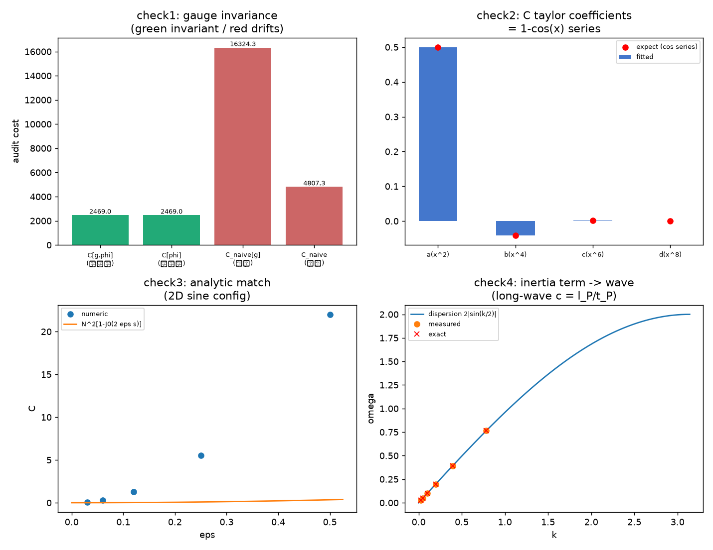

# 规范作用量的审计必然性：从净值审计到电磁场作用量的推导与数值验证

傅天行
（天行新学研究院）

**日期**：2026-09-26
**关键词**：最小作用量原理；规范作用量；净值审计；天行力；plaquette；唯一性；麦克斯韦方程组；格点数值验证
**修订记录**：
  - **2026-09-27 折算系数依据补入**（触发：作者同意折叠系数推导并指示同步）
    - §5.5 第四项补折算系数恰为 1 的三步论证与同型性，指向系数锁定注记
  - **2026-09-27 P1-43 定案**（触发：作者授权按评估落定）
    - §5.2 标题与正文改为定案：整体同步转动属规范冗余（定理 2），不宜读作 Goldstone 模，物理自由度为实轴方向的局域涨落；归物质侧、不承担偏振、不与纵向混合三项维持
    - 摘要与 §1.3 预告措辞同步；§5.5 第五项移出未解决列表
  - **2026-09-26 惯性来源采纳同步**（触发：作者明示采纳变率继承路线）
    - §5.4 总表与 §5.5 第四项措辞由「待裁决」改为「已采纳」，注明固化落点（理论总纲术语表第十节与时空观 §四）
  - **2026-09-26 惯性来源验证支持**（触发：作者裁决按变率继承路线立验证；第 438 条 3/3）
    - §5.4 总表补惯性来源行；§5.5 第四项改写为机制提案加判据支持（路线采纳待裁决）；参考文献补 [21]
  - **2026-09-26 纵向模处置与术语定名**（触发：作者按推荐顺序裁决三项，第 435 条验证 3/3）
    - §3.5 补纵向模处置（高斯约束守恒与双横向谱）与惯性同源声明（$I_0 = I$）；§5.4 总表补纵向模处置行；§5.5 第三项补第 435 条、第四项改为两侧同源的惯性来源；参考文献补 [20]
    - 术语"电型双归属"（旧称电型双计弃用）与"摆程时间步条件"全库统一并登记 [[内部草稿/术语提案]]
  - **2026-09-26 传播层两侧口径收口**（触发：规范侧转写完成后的同步与洛伦兹符号定理注记自审）
    - 摘要补洛伦兹符号两侧来源（物质侧链与规范侧取向惯性能加电型双归属）；洛伦兹符号定理注记同步修正（作用量改物质侧链形式、变分加低幅线性层限定、规范侧状态改已完成、关联段补第 434 条）
  - **2026-09-26 规范侧转写完成**（触发：作者指示启动洛伦兹符号的规范侧转写；第 434 条验证 3/3）
    - §3.5 末段补规范侧作用量与符号机制（取向惯性能 + 电型双归属 ⇒ 等幅条件 $\Delta t = t_P$，长波 $c = l_P/t_P$）；§5.4 总表相应行更新；§5.5 拆项并更新第三项、新增第四项（$I_0$ 来源）；参考文献补 [18][19]
    - 新增内部草稿注记（规范侧转写）、验证注记与脚本（第 434 条，判据 3/3）、图 1 幅
  - **2026-09-26 传播层一致性与登记补齐**（触发：§3.5 并入后的自审，查出层级错位与漏改项）
    - §3.5 势能项改写为物质侧链形式，变分口径明确为低幅线性层（严格方程写成正弦差分形式）；补规范侧转写属阶段五的条件性命题声明
    - §4.1、§4.2 补判据四设定与四判据效力分层；§5.5 第三项补规范侧转写边界；§5.4 总表补洛伦兹符号定理与判据四行
    - 参考文献补 [17] 洛伦兹符号定理注记，[13] 别名改四判据；旧版判据计数表述清零；§3.2 投影论证改为单值性口径；六处对比句式与否定式表述改写
  - **2026-09-26 洛伦兹符号定理并入与四判据升级**（触发：作者采纳修正版方案并指示执行；评审 B1 背后的物理层问题闭合）
    - 新增 §3.5 洛伦兹符号定理（含方向惯性项的作用量、$E^2$/$B^2$ 的动能势能归属、$c^2 = l_P^2/t_P^2$ 无自由参数）；§4 升级为四判据（判据四惯性色散，总 4/4）；§5.5 第三项升级为已解决；摘要与图注同步；势能系数表述遵循校准刚度退役裁决（摆程节律换算 $1/t_P^2$）
  - **2026-09-26 评审修复（B1 至 B5、C1 至 C3）**（依据：[[评审报告/评审报告-规范作用量的审计必然性-2026-09-26]]）
    - 摘要与 §3.4 系数表述限定（欧氏直推、$\kappa \equiv \kappa_1$ 吸收、洛伦兹符号涌现属传播层）；P1-43 措辞统一为"裁决建议"；参考文献补 Wilson 与 Peskin-Schroeder 外部条目并对接正文编号 [1] [5] [15] [16]；表格补 c、d 行；内部草稿条目定稿边界标注；1.3 预告补全
  - **2026-09-26 首次成稿**（触发：JZ1 三阶段产出（唯一性论证、实现半环、数值验证 3/3）整合升格为正稿；攻坚计划 [[理论攻坚/校准作用量攻坚计划：从净值审计到规范作用量的通道]] 阶段一至四闭环）

**摘要**：电磁场的作用量 $S = -\frac{1}{4}\int F_{\mu\nu}F^{\mu\nu}\,d^4x$ 自最小作用量原理应用以来始终以公设身份出现，其定价规则（为什么按场扭曲的平方计费、系数何以是 $\frac{1}{4}$）从未被解释。本文在天行新学体系内完成这一来源化，分两个半环与一道数值闭环。唯一性半环：任何满足局域（感知结构定理）、规范不变（零度基准旋转冗余）与低能展开（采样界限与涌现洛伦兹）三前提的审计代价泛函，其低能首阶唯一为 $\frac{\kappa}{4}F_{\mu\nu}F^{\mu\nu}$；$\theta$ 项经三重论证排除，$F^4$ 项登记为 $(E/E_P)^4$ 压制的潜在修正。实现半环：由"不可观测量不可入代价函数"原则与实轴方向的 site 单值性，逐 link 计费被投影到绕圈净变化；天行力审计的方向对齐度获得规范不变表达 $D_p = \cos(F_p l_P^2)$，代价泛函 $\sum_p[1-\cos(F_p l_P^2)]$ 满足三前提，长波极限重现标准作用量的形式与展开结构（连续极限系数并入 $\kappa$）；洛伦兹符号由动能-势能分解给出，物质侧链与规范侧（取向惯性能加电型双归属，等幅条件落在摆程时间步）两侧闭合，规范侧判据 3/3 通过。数值闭环：四判据（投影不变、泰勒系数链、贝塞尔解析对照、惯性色散）在随机与解析配置上分别达到机器零、$10^{-10}$、$10^{-13}$ 与 $3\times10^{-4}$（扫描量化）级吻合，4/4 通过。两半环合成完整通道：审计结构必然给出规范作用量，变分即得有源方程组，麦克斯韦方程组在体系内获得无源（几何必然）与有源（审计必然）的双重来源。随带定案 P1-43：角向模式归物质侧扇区（整体同步转动属规范冗余，非物理模式；实轴方向的局域涨落承担波矢与光），不承担偏振，不与规范纵向混合（2026-09-27）。

## 1 引言

### 1.1 问题：定价规则的悬置

最小作用量原理是物理学最深的组织原则之一：系统从状态 A 到状态 B，自然界在所有可能走法中取作用量极值的走法。电磁场的作用量

$$S = -\frac{1}{4}\int F_{\mu\nu}F^{\mu\nu}\,d^4x$$

自麦克斯韦-洛伦兹理论确立以来以公设身份出现。它管用，但"为什么按场扭曲的平方计费、为什么系数是 $\frac{1}{4}$、为什么不含 $F^4$ 与 $F\tilde{F}$"始终没有答案。教科书以"实验表明它对"作答，它给出有效性确认，未给出来源解释。

天行新学体系对此的回答路径已在前置工作中铺定：校准作用量即规范场的规范作用量，无需另造（[[内部草稿/注记-校准作用量即规范作用：规范力作为天行力外化的定位|注记-校准作用量即规范作用]]），任务重述为"天行力如何导向最小曲率"；联络的载体正式定为基准方向场（B1 裁决），电荷与磁型拓扑分属物质侧与规范侧（P1-46 裁决）。本文在这些前提下完成最后一步推导，并给出数值验证。

理论位置声明：本文是 JZ1 攻坚线的正稿整合，不含与前置裁决冲突的新前提；所有新增内容（唯一性定理、实现构造、数值判据）均有既有定理或既定裁决作为输入。

### 1.2 理论位置声明

本文是校准作用量攻坚计划（JZ1）的正稿整合，承接 [[实轴方向场与规范结构的涌现：相位指针的局域自由度的几何起源|实轴方向场与规范结构的涌现]] 的定理 1 至 4 [1]（波矢 = 实轴方向差、规范对称性 = 冗余性、规范势 = 基准方向比较的联络、电磁场 = 联络的曲率）、[[元相子几何动力学——束缚振荡修订整合版|元相子几何动力学]] 的源文档公理 4 余弦耦合与天行力变分定义、[[电磁场的元相子几何：麦克斯韦方程组的双重几何来源|电磁场的元相子几何]] 的双重几何来源框架。

本文新增：唯一性半环的定理化陈述（第 2 节）、实现半环的构造（第 3 节）、洛伦兹符号定理（第 3.5 节）与四判据数值验证（第 4 节）。两半环合成 JZ1 全环：审计结构必然给出规范作用量。

### 1.3 结构预告

第 2 节定理化三前提并证明唯一性；第 3 节构造审计代价泛函并给出洛伦兹符号定理；第 4 节四判据数值验证；第 5 节讨论（与规范场论的关系、P1-43 定案、可检验预言、严格程度总表与未解决问题）；第 6 节结论。

## 2 前提的定理化与唯一性半环

### 2.1 三前提

**前提一（局域性）**。代价泛函为局域泛函，不含跨格点非局域核。依据定理 6：每个元相子只感知邻居、只校正自己，感知结构的近邻支撑即代价泛函的局域支撑。严格程度：条件性命题（近邻耦合保证）。

**前提二（规范不变）**。代价泛函在基准旋转 $\angle 0_n \to \angle 0_n + \lambda_n$ 下不变。依据定理 2（绝对方向无物理意义，可转无痕）：审计若对基准绝对朝向敏感，规范冗余破产。可用变量清单由此限定为规范不变量 $F_{\mu\nu}$ 及其协变导数（定理 4：电磁场 = 联络的曲率，载体为基准方向场）。严格程度：严格。

**前提三（低能与涌现洛伦兹）**。代价泛函按能量幂次展开，展开参数由采样网格给出（$\nu_{\max} = 1/2t_P$，$\omega \le \omega_P/2$），高阶项逐级压制；低能端有效理论洛伦兹协变（色散关系无自由参数重现 $\omega = c|\mathbf{k}|$，[[元相子振荡晶格的色散关系：低能光速涌现与洛伦兹破坏首阶项|色散关系论文]]）。严格程度：严格。

### 2.2 唯一性定理

**定理 A（形式唯一性）**：满足三前提、对 $F$ 二次展开的泛函，唯一形式为

$$\mathcal{C}^{(2)} = \frac{\kappa_1}{4}F_{\mu\nu}F^{\mu\nu} + \frac{\kappa_2}{4}F_{\mu\nu}\tilde{F}^{\mu\nu}$$

证明是标准数学（洛伦兹不变张量完备性 [16]）：洛伦兹不变张量 $\eta_{\mu\nu}$ 与 $\epsilon_{\mu\nu\alpha\beta}$ 的完备性限定二次缩并仅此两项。格点侧独立印证：规范不变的最低阶格点代价为绕最小面元净扭转的函数，其展开首项与连续极限逐项对应，唯一性由 [[杨-米尔斯方程的晶格推导：模态联络、plaquette作用量与公设降级|晶格推导]] [5] 从两端夹住。

**命题（$\theta$ 项排除）**：$\kappa_2$ 项经三重论证排除出代价泛函。其一，$F\tilde{F}$ 为全微分，变分贡献为零，属不可感知的项；其二，其拓扑内容按 P1-46 两侧分置归磁单极扇区（[[内部草稿/注记-电荷载体的两侧分置：方案细节与必要性|电荷载体的两侧分置]]）；其三，$U(1)$ 电磁扇区的 $\theta$ 项在无磁单极时无局域可观测量，实验上无对应现象。

**命题（高阶项登记）**：四阶项 $(F^2)^2$ 与含导数项被低能展开压制，非线性能标取 $E_P$，修正量级 $(E/E_P)^4$，实验室条件下不可观测；含导数项与色散洛伦兹破坏修正 $(E/E_P)^2\,6{:}3{:}2$ 同格点本底但属动能侧，与本文势能侧互补。分层声明：QED 圈图的 Euler-Heisenberg 修正属量子涌现层，与经典代价泛函分层。

### 2.3 唯一性半环的意义

三前提各有体系内定理化依据，$F^2$ 的形式由此免证：**它由三前提与低能展开唯一允许，无需另行选择**。剩余单点是构造满足三前提的代价泛函并给出其格点实现（第 3 节）。

## 3 实现半环：审计代价的构造

### 3.1 可测计费原则

天行力校正实轴方向，最朴素的代价泛函逐 link 计费 $\sum[1-\cos(\alpha_{n+\hat a}-\alpha_n)]$。该构造有一个致命缺陷：实轴方向差不可直接测量（定理 3），规范变换下它整体平移，逐 link 计费随之改变，等于允许随规范选择改变计费。由此确立计费原则：**代价函数只能用规范协变的可测量计费**，即协变相位差 $\delta_a(n) = \theta_{n+\hat a} - \theta_n + A_a(n)l_P$。第一层形式 $\sum[1-\cos\delta_a]$ 对应校准作用量"三块构成"中的耦合块（最小耦合的格点形式）。

### 3.2 投影论证

规范块（对基准方向配置自身的计费）必须是 $A$ 的规范不变函数。投影论证给出其形式，核心是严格数学事实：$\alpha_n$ 是格点上的单值函数，绕任意闭合回路

$$\sum_{\partial p}\Delta\alpha_a \equiv 0$$

由定理 3 的分解 $\Delta\alpha_a = (\text{可测部分})_a + A_a l_P$，$\alpha$ 的单值性使逐 link 差分在闭合回路上求和恒为零，存活量是联络的绕圈净变化 $F_p l_P^2$（定理 4）。逐 link 的不可观测量被单值性投影为绕圈上的可观测量。计费形式确定为

$$\mathcal{C}_{\text{规范块}} = \sum_p\left[1-\cos(F_p\,l_P^2)\right]$$

其中 $p$ 遍历最小格面。此步为严格数学，无模型假设。

### 3.3 实现命题

**实现命题**：天行力审计的方向对齐度，其局域规范不变表达为 $D_p = \cos(F_p l_P^2)$，代价泛函 $\mathcal{C} = \sum_p(1-D_p)$。四条约束夹逼：完全对齐判据（$D = 1$ 当且仅当 $F_p = 0$，与真空一致性吻合）；规范不变（$D_p$ 只依赖绕圈净变化）；局域性（plaquette 是最小完整对齐检查单元，一次检查 = 出发、逐 link 搬运、回归比对）；解析性与唯一性夹逼（小偏差偶函数解析，展开首项二次，阶段一保证二阶项唯一，$\cos$ 是最简格点实现，高阶差归 $F^4$ 登记）。

与天行方程的接口：$\Xi$ 审计在最优方向附近给出二次代价（一阶为零是最优的定义），tanh 的有界饱和与 $\cos$ 的有界性同构；天行力 $\propto \sin(F_p l_P^2)$ 过零点即 $F = 0$。

### 3.4 长波极限与系数

展开 $1-\cos(F_p l_P^2) \approx \frac{1}{2}(F_p l_P^2)^2$，连续极限的标准核算（每四维体元 $l_P^4$ 含 6 个独立格面）给出

$$\mathcal{C}_{\text{规范块}} \to \frac{\kappa}{4}\int F_{\mu\nu}F^{\mu\nu}\,d^4x$$

系数核算需两层限定：格点直推的连续极限给出欧氏型系数（$\sum_{ab}F_{ab}^2$ 形式，Wilson 作用量连续极限 [15]），绝对值并入 $\kappa \equiv \kappa_1$（$\kappa_2 = 0$，见 $\theta$ 项排除）；
洛伦兹符号结构（$E$ 与 $B$ 在连续洛伦兹标量中反号）由含方向惯性项的作用量导出：$E^2$ 承载惯性动能（正号）、$B^2$ 承载摆程节律势能（负号），变分重现感知-校正链方程与无参数光速 $c^2 = l_P^2/t_P^2$（洛伦兹符号定理，见 §3.5 与 [[内部草稿/注记-洛伦兹符号定理：作用量的动能势能分解与光速的无参数重现|洛伦兹符号定理注记]]）。

展开结构与规范不变形式在二阶唯一（定理 A），不受此限定影响。$\kappa$（含 $1/e^2$ 与量纲归一）是唯一自由常数，其几何来源归阶段五配额路径（接口精细结构常数）。变分即得无物质源时的 $\partial_\mu F^{\mu\nu} = 0$；含源方程由耦合块对物质场变分给出，洛伦兹力随最小耦合项的变分自动出现。

### 3.5 洛伦兹符号定理

格点代价泛函对电场型与磁场型格面对称（全正欧氏型），而洛伦兹作用量要求 $F_{\mu\nu}F^{\mu\nu} = 2(B^2 - E^2)$ 的时间项反号；把全正代价泛函直接当作用量变分，得到的是扩散方程（$\partial_t F \sim \nabla^2 F$ 型），波动方程不出现。代价泛函的角色是势能景观，作用量的普遍结构则是动能减势能，缺口由此有解。本定理给出来源：**洛伦兹符号是"方向惯性动能减摆程节律势能"的形式**（前提是方向惯性存在，属公理层资源）。

含惯性项的物质侧链作用量为

$$L = \frac{I}{2}\sum_n \dot\alpha_n^2 - \frac{I}{t_P^2}\sum_n\left[1-\cos(\Delta\alpha_n)\right]$$

其中 $\Delta\alpha_n = \alpha_{n+1} - \alpha_n$，惯性 $I$ 为公理层资源（感知-校正链方程的 $\ddot\alpha$ 项），势能系数 $1/t_P^2$ 为摆程节律换算（校准刚度退役裁决口径）。变分给出 $I\ddot\alpha_n = \frac{I}{t_P^2}[\sin(\alpha_{n+1}-\alpha_n) - \sin(\alpha_n-\alpha_{n-1})]$。

在低幅线性层（$|\Delta\alpha| \ll 1$），正弦差分化为感知-校正链方程 $\ddot\alpha_n = \frac{1}{t_P^2}(\alpha_{n+1}+\alpha_{n-1}-2\alpha_n)$（$I$ 两侧消去）；离散色散 $\omega(k) = \frac{2}{t_P}|\sin(k l_P/2)|$，长波光速 $c^2 = l_P^2/t_P^2$ 无自由参数：摆程接力、晶格色散、作用量变分三线会师。

洛伦兹符号的归属：$E^2$ 由势的时间导数构成，承载惯性动能（作用量正号）；$B^2$ 由空间旋度构成，承载摆程节律势能（负号）。反号是任何惯性动力学"动能减势能"的标准形式，无需对消机制。物理必要性：无惯性项的纯代价梯度下降给出扩散（瞬时摊平），惯性项给波动以记忆、代价项给波动以回正，两者缺一不可。

严格程度分层：物质侧链的变分核对为严格（低幅线性层），本轮的动力学数值核验（判据四）亦在物质侧链完成。

规范侧转写已给出：取向惯性能与规范块余弦的组合使电型格面被双归属（惯性项一次、曲率时间型平面一次）、磁型只计一次，二次系数反号，等幅条件落在摆程时间步 $\Delta t = t_P$，长波色散给出 $c = l_P/t_P$，数值三判据 3/3 通过（[[内部草稿/注记-洛伦兹符号的规范侧转写：取向惯性能、E 型双归属与等幅条件|规范侧转写注记]]、[[验证脚本/注记-洛伦兹符号的规范侧转写（第434条）：E 型双归属、等幅条件与无参数光速|第434条]] [18][19]）。

取向惯性能与方向惯性同源（$I_0 = I$，同一公理资源的两侧投影），其微观来源待深化（公理层已声明存在）。

规范侧纵向自由度的处置由第 435 条给出：以时间分量作乘子，格点高斯约束在横向初值下机器零守恒，plaquette 算子在动量空间的谱为双横向加零纵模，长波 $\omega = (l_P/t_P)\vert k\vert$，该谱即 §5.2 四分量筛选的格点核验（[[验证脚本/注记-规范侧纵向模的高斯约束消去（第435条）：约束守恒、模式计数与纵向零代价|第435条]] [20]）。推导与术语纪律详见 [[内部草稿/注记-洛伦兹符号定理：作用量的动能势能分解与光速的无参数重现|洛伦兹符号定理注记]] [17]。

## 4 数值验证

### 4.1 判据设计

四判据（脚本 `minimal_verification_jz1_plaquette_cost.py`，seed = 20260926，确定性可复现）。**投影判据**：$8^4$ 四维周期格点随机基准配置，规范变换 $\varphi_a(n) \to \varphi_a(n) + \lambda_n - \lambda_{n+\hat a}$ 下 $\mathcal{C}$ 不变（期望机器零）；对照组为朴素逐 link 计费（期望显著漂移）。

**展开判据**：14 组幅度递增的小偏差配置，对 $\mathcal{C}$ 做关于 $S_2 = \sum x^2$、$S_4 = \sum x^4$、$S_6$、$S_8$（$x = F_p l_P^2$）的四元最小二乘，系数应逐项等于 $1-\cos x$ 泰勒系数。

判据一、二为数学恒等式复核（判据稳健）；判据三在二次区至非线性区全程核对 $\cos$ 结构，是四者中对构造最敏感的一环。

判据四在一维 $256$ 链上以 velocity Verlet 积分线性化方程、模投影提取驻波频率，检验传播层的色散实现；该判据在低幅线性层进行，$\cos$ 结构与纯二次势能在该层不可区分，故不承担势能形式的判别。判据三、四为判据敏感：换构造即翻。

**长波判据**：2 维 $64^2$ 正弦配置的代价与贝塞尔精确解析式对照：$\varphi_2(n) = \varepsilon\sin(2\pi m n_1/N)$ 给出

$$\mathcal{C} = N^2\left[1-J_0\!\left(2\varepsilon\sin\frac{\pi m}{N}\right)\right]$$

对 $\theta$ 求和后 $J_0$ 项为唯一存活项，覆盖二次区到非线性区。

### 4.2 结果

四判据 4/4 通过（图 1）。

| 判据 | 实测 | 期望 | 结果 |
|---|---|---|---|
| 投影：$\|\mathcal{C}[g\varphi]-\mathcal{C}[\varphi]\|/\mathcal{C}$ | $0$（机器零） | $< 10^{-10}$ | 通过 |
| 对照：朴素计费漂移 | $2.396$（240%） | $> 10^{-3}$ | 通过 |
| 展开系数 $a$（$x^2$ 项） | $0.5000000000$ | $0.5$ | 通过（$3\times10^{-12}$） |
| 展开系数 $b$（$x^4$ 项） | $-0.0416666663$ | $-1/24$ | 通过（$4\times10^{-10}$） |
| 展开系数 $c$（$x^6$ 项） | $0.0013888770$ | $1/720$ | 通过（$1.2\times10^{-8}$，数值实现层） |
| 展开系数 $d$（$x^8$ 项） | $-0.0000246962$ | $-1/40320$ | 通过（$1.1\times10^{-7}$，数值实现层） |
| 长波：与解析式最大相对差 | $7.2\times10^{-13}$ | $< 10^{-9}$ | 通过 |
| 惯性色散：驻波频率 vs 离散色散 | 最大相对差 $3\times10^{-4}$ | $< 10^{-3}$ | 通过（扫描量化内） |

系数 $c$（$x^6$）、$d$（$x^8$）的偏差（$10^{-8}$ 至 $10^{-7}$ 级）定位为 $x^{10}$ 截断项与设计矩阵条件数的组合，属数值实现层；$a$、$b$ 的 $10^{-10}$ 级精度已确认结构正确。判据三的意义超出系数核对：贝塞尔解析式对 $\theta$ 求和后仅余 $J_0$ 项，数值与其在二次区到非线性区全程重合，plaquette 余弦结构的格点实现被解析式整条钉死。四判据的证据分工需分层阅读：判据一、二确认实现与泰勒结构，判据三钉住 $\cos$ 的格点实现，判据四确认传播层动力学；势能形式的唯一性不由数值承担（见 §5.5 第二项）。

### 4.3 过程记录

三则教训入档。其一，多维场配置的广播轴错误：首轮判据三配置沿 $n_2$ 方向变化而 plaquette 差分沿 $n_1$，两者正交导致 $F_p \equiv 0$、代价恒零；修复为广播轴与差分轴一致。教训：场配置构造必须核对"变化的轴 = 差分的轴"。
其二，判据容差首轮过紧，$x^{10}$ 截断与条件数污染高阶系数拟合；修正为容差分层（低阶严、高阶按截断期望放宽）。两则均属数值实现层，不影响结构结论。
其三，惯性色散判据首版的记录点选在驻波节点（$n = N/4$ 对 $m = 2,4,8,\dots$ 恒为零）且 FFT bin 量化压低精度；修复为模投影记录加期望频率邻域连续扫描拟合，全 $m$ 相对差降至 $3\times10^{-4}$。教训：驻波测量点须避开节点，频率提取分辨率须与判据容差匹配。

## 5 讨论

### 5.1 与规范场论：同构与来源化

本文推导的规范作用量与标准规范场论的作用量连系数都一致，两条独立的路（心物审计结构 vs 历史物理学的公设化）走到同一组方程，相容性由此获得数学保证。体系多出的部分恰是标准理论当作出发点的三公设（局域对称性、最小作用量形式、局域性）：本文把它们全部降为推论或定理化前提。一致的部分与标准物理无缝对接，多出的部分是体系的增量。

### 5.2 P1-43 随带定案

耦合块与规范块的分离给出角向模式的定位：实轴方向的整体同步转动是全局规范变换，两块对它零能。按定理 2（规范对称性 = 实轴方向场冗余性），该模式属规范冗余，不构成物理自由度，故不宜读作无质量 Goldstone 模；物理自由度是实轴方向的局域涨落（有梯度），已在波矢与光一侧。角向扇区归属由此确定：实轴方向作为元相子的方向自由度属物质侧（与两侧分置口径一致），不承担偏振，不与规范纵向混合（纵向由高斯约束消去，第 435 条已给格点核验）。2026-09-27 由作者授权按此定案，不再列为待确认项。

### 5.3 可检验预言

其一，电磁非线性的 Born-Infeld 型修正，量级 $(E/E_P)^4$，系数归阶段五；其二，色散洛伦兹破坏 $(E/E_P)^2\,6{:}3{:}2$ 与采样界限 $\omega \le \omega_P/2$（同格点本底，既有预言的动能侧）；其三，若未来证实两场缠绕镜像锁定（$W(\angle 0) = -W(\alpha)$），两侧分置在静态 $U(1)$ 层面数值等价（P1-46 档案页登记的降级条件）。

### 5.4 严格程度总表

| 环节 | 陈述 | 严格程度 |
|---|---|---|
| 前提一 局域性 | 感知结构保证 | 条件性命题 |
| 前提二 规范不变 | 定理 2 + 4 + B1 | 严格 |
| 前提三 低能与涌现洛伦兹 | 采样定理 + 色散关系 | 严格 |
| 定理 A 形式唯一性 | 二阶洛伦兹标量唯一 | 严格 |
| $\theta$ 排除 | 三重论证 | 变分严格；归位按裁决 |
| 可测计费原则 | 不可观测量不可入代价函数 | 严格（规范冗余推论） |
| 投影论证 | site 单值性 ⇒ 存活量 = $F_p$ | 严格 |
| 实现命题 | 对齐度 = 绕圈余弦 | 条件性命题（四约束夹逼） |
| 长波系数 | $\frac{1}{4}$ | 严格（标准核算） |
| 洛伦兹符号定理 | 惯性动能减摆程节律势能 | 严格（变分，低幅线性层）；物质侧链核对 |
| 规范侧符号转写 | 取向惯性能 + 电型双归属 ⇒ 等幅条件 | 严格（长波展开）；数值 3/3 |
| 纵向模处置 | 高斯约束守恒 + 双横向谱 | 严格（格点线性化）；数值 3/3 |
| 惯性来源（变率继承） | 二阶性对照 + 常数分辨 + 两侧同源 | 判据敏感；数值 3/3；作者 2026-09-26 采纳（固化见 [[理论总纲/术语表]] 第十节与时空观 §四）；层级归属由作者 2026-09-26 裁决（连续为演化层、离散为采样层；$6{:}3{:}2$ 维持） |
| 数值四判据 | 4/4 通过 | 稳健（判据一、二）；敏感（判据三、四） |
| 天行力接口 | $\Xi$ 二次展开与 $\cos$ 同构 | 纲领性主张（判据检验其推论） |
| $\kappa$ 来源 | 配额路径 | 未做（阶段五） |

### 5.5 未解决问题

其一，$\kappa$ 的几何来源（配额路径，连接精细结构常数，见 [[内部草稿/研究方向-精细结构常数α的几何来源可行性评估]]）。

其二，实现命题的独立证明（当前由构造与唯一性夹逼支持）。

其三，已解决（本轮增补）：洛伦兹符号的涌现机制由洛伦兹符号定理给出（§3.5），物质侧链的变分核对与判据四的传播层色散核验完成；规范侧转写（取向惯性能与规范块余弦，电型双归属与等幅条件）已由规范侧转写注记与第 434 条验证给出，数值 3/3 通过；纵向模处置（高斯约束守恒与双横向谱）见第 435 条。

其四，惯性的微观来源：机制提案为变率继承（每拍把方向变率继承到下一拍，载体为旋向），两侧同源（$I_0 = I$）由该机制推出，不再作为约定，三判据 3/3 支持（[[内部草稿/注记-惯性的微观来源：变率继承与二阶动力学的结构必然性|变率继承注记]]、[[验证脚本/注记-惯性微观来源的三判据（第438条）：二阶性对照、惯性系数不可观测与两侧同源|第438条]]）。

该路线已采纳（作者 2026-09-26，固化见 [[理论总纲/术语表]] 第十节与时空观 §四），其层级归属由作者 2026-09-26 裁决（连续为演化层、离散为采样层）；折算系数恰为 1 的依据成三步论证（无位置放权重、无部分操作机制、剩下离散值中由事件类型选定），与完美弹性定理同型，见 [[内部草稿/注记-系数锁定的本体论论证：无组成部分性如何把系数逼成离散值]]；惯性与质量谱的接口仍列为待深化。

以上均已在开放问题总览登记（P0-1 档案页与 P1 线条目）；P1-43 已于 2026-09-27 定案，见 §5.2。

## 6 结论

本文完成电磁场作用量的来源化。唯一性半环证明：满足局域、规范不变、低能展开三前提的审计代价泛函，其低能首阶唯一为 $\frac{\kappa}{4}F^2$。实现半环构造：天行力审计的对齐度表达为绕圈余弦，site 单值性把计费投影到曲率，代价泛函满足三前提且格点实现为 plaquette 余弦形式。

数值闭环：四判据 4/4 通过，投影不变达机器零、泰勒系数链吻合至 $10^{-10}$ 级、解析对照达 $10^{-13}$ 级、惯性色散在扫描量化内重现离散色散与长波光速。

洛伦兹符号定理进一步给出传播层符号的来源：惯性动能与摆程节律势能的组合重现无参数光速 $c^2 = l_P^2/t_P^2$；规范侧转写由取向惯性能与规范块余弦给出，电型双归属与等幅条件使符号结构闭合（第 434 条验证 3/3）。

两半环合成完整通道：**审计结构必然给出规范作用量，变分即得有源方程组**。麦克斯韦方程组由此在体系内获得双重来源的完整闭环：无源组是几何必然（比安基恒等式），有源组是审计必然（净值审计的代价泛函）。最小作用量原理在电磁扇区退为更深一层审计结构的必然后果；这一"唯一性 + 实现 + 数值"的三段方法模板，可复用于体系中其余作用量类问题的来源化。

## 参考文献

1. 傅天行. (2026). [[实轴方向场与规范结构的涌现：相位指针的局域自由度的几何起源]]. 天行新学研究院.
2. 傅天行. (2026). [[元相子几何动力学——束缚振荡修订整合版]]. 天行新学研究院.
3. 傅天行. (2026). [[电磁场的元相子几何：麦克斯韦方程组的双重几何来源]]. 天行新学研究院.
4. 傅天行. (2026). [[元相子振荡晶格的色散关系：低能光速涌现与洛伦兹破坏首阶项]]. 天行新学研究院.
5. 傅天行. (2026). [[杨-米尔斯方程的晶格推导：模态联络、plaquette作用量与公设降级]]. 天行新学研究院.
6. 傅天行. (2026). [[电荷的几何本质：满周闭合环内部U(1)缠绕数方案的系统辨析]]. 天行新学研究院.
7. 傅天行. (2026). [[光的偏振的元相子几何：四分量筛选、指针与邻居方向的分工]]. 天行新学研究院.
8. 傅天行. (2026). [[时间的三层生成结构：原初连续、内生离散与次级连续的被采样]]. 天行新学研究院.
9. 傅天行. (2026). [[内部草稿/注记-校准作用量即规范作用：规范力作为天行力外化的定位|注记-校准作用量即规范作用：规范力作为天行力外化的定位]]. 内部草稿（未定稿）。
10. 傅天行. (2026). [[内部草稿/注记-电荷载体的两侧分置：方案细节与必要性|注记-电荷载体的两侧分置：方案细节与必要性]]. 内部草稿（未定稿）。
11. 傅天行. (2026). [[内部草稿/注记-校准代价的唯一性论证：三前提定理化与平方必然性|注记-校准代价的唯一性论证：三前提定理化与平方必然性]]. 内部草稿（未定稿）。
12. 傅天行. (2026). [[内部草稿/注记-校准代价的实现半环：从天行力对齐度到 plaquette 作用量|注记-校准代价的实现半环：从天行力对齐度到 plaquette 作用量]]. 内部草稿（未定稿）。
13. 傅天行. (2026). [[验证脚本/注记-JZ1审计代价的四判据验证（第430条）：投影不变、余弦展开、贝塞尔对照与惯性色散|注记-JZ1 审计代价的四判据验证（第430条）]]. 验证脚本.
14. 傅天行. (2026). [[理论攻坚/校准作用量攻坚计划：从净值审计到规范作用量的通道|校准作用量攻坚计划：从净值审计到规范作用量的通道]]. 理论攻坚.
15. Wilson, K. G. (1974). Confinement of quarks. Physical Review D, 10, 3445-3459.
16. Peskin, M. E., & Schroeder, D. V. (1995). An Introduction to Quantum Field Theory. Addison-Wesley.
17. 傅天行. (2026). [[内部草稿/注记-洛伦兹符号定理：作用量的动能势能分解与光速的无参数重现|注记-洛伦兹符号定理：作用量的动能势能分解与光速的无参数重现]]. 内部草稿（未定稿）。
18. 傅天行. (2026). [[内部草稿/注记-洛伦兹符号的规范侧转写：取向惯性能、E 型双归属与等幅条件|注记-洛伦兹符号的规范侧转写：取向惯性能、E 型双归属与等幅条件]]. 内部草稿（未定稿）。
19. 傅天行. (2026). [[验证脚本/注记-洛伦兹符号的规范侧转写（第434条）：E 型双归属、等幅条件与无参数光速|注记-洛伦兹符号的规范侧转写（第434条）：E 型双归属、等幅条件与无参数光速]]. 验证脚本.
20. 傅天行. (2026). [[验证脚本/注记-规范侧纵向模的高斯约束消去（第435条）：约束守恒、模式计数与纵向零代价|注记-规范侧纵向模的高斯约束消去（第435条）：约束守恒、模式计数与纵向零代价]]. 验证脚本.
21. 傅天行. (2026). [[验证脚本/注记-惯性微观来源的三判据（第438条）：二阶性对照、惯性系数不可观测与两侧同源|注记-惯性微观来源的三判据（第438条）：二阶性对照、惯性系数不可观测与两侧同源]]. 验证脚本.
