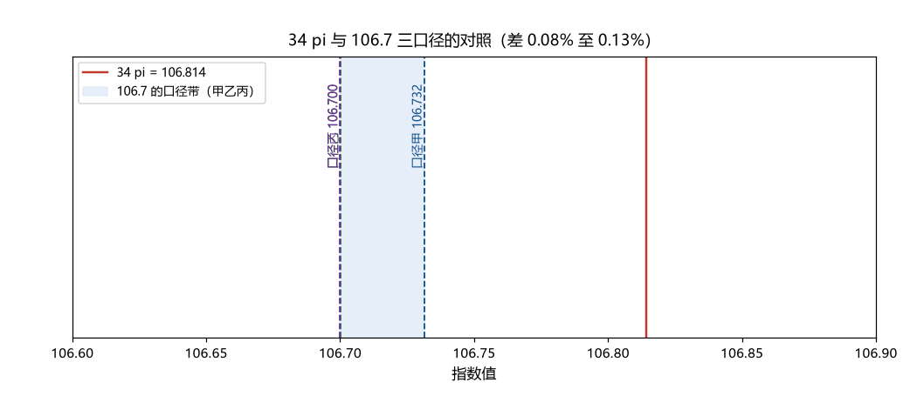

# 注记-17 的出现清单（第395条）：派生链识别与 34π 的精度判定

- **日期**：2026-09-24 06:06:33
- **类型**：清点与判定轮（S 线目标数的结构审查）
- **脚本**：`验证脚本/minimal_verification_seventeen_inventory.py`（第 395 条）
- **图**：见 §3 图 1（`images/seventeen_inventory.png`）
- **依据**：[[验证脚本/注记-A 路判句（第361条）：缺口与扫速的计数形式]]（$34\pi$ 观察的原始登记）；[[验证脚本/注记-C 路首轮（第393条）：瞬子作用量的量级二分与 g² 落点]]（A 与 C 两路的同构）；[[内部草稿/声明-粒子参数地位：输入、导出与比较标准（2026-09-22）]]（锚的输入地位）
- **状态**：清点与判定完成。七处出现全部登记；34π 判为近邻；机制落点回到 106.7 本身

## 1 判据与设定

A 路（第 361 至 386 条）与 C 路（第 393 条）的判定都归约到同一个数 $16.98$，而该数与整数 $17$、「$34\pi = 106.814$」的关系未判。本轮做三件事（N1 至 N3）：把 S 线全部 $17$ 量级数的出现列全并标出派生链；用三个口径核对 $106.7$ 的精度并判定 $34\pi$ 的地位；给出落点结论。全部为确定性算术。

## 2 结果

N1（清单）：七处出现。其一，计数式常数 $16.98$（A 路，第 361 条），链为 $106.7/(2\pi)$；其二，宽度窗口下端 $17.0$ 步（第 362、376 条），链为计数式常数取 $\Delta = E_P$；其三，$t_{\rm sweep}$ 自然点 $16.98\,t_P$（第 361 条）；其四，弛豫率目标 $0.0589$ 每拍（第 376 条），链为 $1/16.98$；其五，势曲率缺口 $16.98\,E_P$（第 380 条）；其六，C 路的 $1/g^2 = 16.98$（第 393 条）；其七，$34\pi = 106.814$ 的观察（第 361 条 §4）。前六处的链全部回到同一个除法操作 $106.7/(2\pi)$。

N2（精度）：三个口径下的指数值为校准甲（由登记值 $S = 4.437\times10^{-47}$ 反算）$106.7315$；乙（由 $\kappa_\phi t_P$ 与裸耦合 $2.030$ 算）$106.7002$；丙（登记报值）$106.7000$。$34\pi = 106.8142$ 与三者的差分别为 $0.0826$（$0.077\%$）、$0.1140$（$0.107\%$）、$0.1142$（$0.107\%$）。清点发现一项：甲与乙对应的 $S$ 值（$4.437\times10^{-47}$ 与 $4.578\times10^{-47}$）相差 $3.18\%$，归因为 $106.7$ 三位报值的固有模糊（$\pm 0.05$ 覆盖 $\pm 5\%$）；此项登记为数字口径的舍入项，不影响任何判据（全部判据用报值）。

N3（判定）：$16.98$ 的精确值（口径丙）为 $16.9818$，与整数 $17$ 差 $0.0182$（$0.107\%$）。三条判读：其一，前六处出现全部是 $106.7/(2\pi)$ 的派生，无独立信息；其二，$34\pi$ 与 $106.7$ 的差为 $0.08\%$ 至 $0.13\%$（随口径），在四位精度下可辨，判为近邻，不构成等式；其三，无论 $34\pi$ 成立与否，「$17$ 的机制」在体系里没有候选来源（数字近邻不构成机制）。

## 3 图

## 4 结论与判句移交

清点的结论：S 线的「$17$」并不独立，它是 $106.7$ 除以 $2\pi$ 的称呼（$16.98$ 的四舍五入）；A、C 两路的归约因此合并为同一个目标，即「$106.7$ 本身」。$34\pi$ 的观察降为 $0.1\%$ 级近邻，不构成机制线索。

落点：三路（A 判负、B 条件式、C 无落点）之后，「$106.7$ 本身」的来源是 $\kappa_\phi$ 的层级（$\ln(1/\kappa_\phi t_P) = 105.99$ 加裸耦合项 $0.71$），而 $\kappa_\phi$ 由电子质量锚定。在参数地位声明（锚为输入）的框架下，这属于输入层：**从相变动力学「导出 $S$ 的数值」的目标在现有框架内不可达；可达的形态是「$S$ 与相变变量的关系式」（B 路已具备）与「层级的结构性解释」（弱耦合凝聚的标度分离，质量论文已给）。**

判句移交：S 线的框架表述建议改为「关系式加结构解释」并登记；若仍要求「导出 $S$ 的数值」，则需先处理「锚」的地位（框架级决策，与 B 路件一裁决同性质的任务）。数字口径的舍入项（$S = 4.437\times10^{-47}$ 与 $e^{-106.7} = 4.58\times10^{-47}$ 的 $3\%$ 级差异）建议在下次修订登记值时统一为一种写法。

## 5 严格程度与边界声明

严格程度：N1 为材料清点（判据级）；N2 为算术与精度归因（判据级）；N3 的三条判读中前两条为算术，第三条为结构性判读（无机制候选属阴性陈述，不声称穷尽）。

边界：不重算第 361 至 393 条；不改动任何登记值（舍入项只登记，由作者裁决是否统一）；不建立「17 的机制」（本轮判定其无候选来源）；「锚为输入」的框架地位不在本轮改动。

## 6 过程记录

触发：第 393 条（C 路首轮）发现 A、C 两路目标同构后，按推荐做「17 的出现清单」专项。清点的意外收获是口径核对：三口径中甲与乙差 $3.18\%$，追查确认源于报值精度，不构成矛盾；这一项此前未登记，属本轮附表发现。
