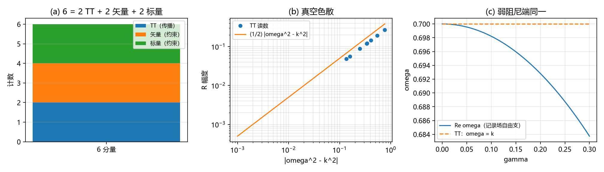

# 注记-1D 自由支与三维 TT 同一化的显式计数：秩二、约化两支与算符同一（判据 CT1 至 CT4）

- **日期**：2026-09-21 08:26:27
- **对应脚本**：`验证脚本/free_branch_tt_count.py`（判据 CT1 至 CT4，确定性，无随机数，运行约 2 秒；图存 `images/free_branch_tt_count.png`，见 §一 图 1）
- **依据**：[[验证脚本/注记-TT投影的最小验证：投影算子的构造与计数]]（判据 T 的算子与计数）；[[验证脚本/注记-TT投影微观来源的最小验证：约束结构自动给出]]（判据 U 的约束零空间）；[[验证脚本/注记-3+1铰链显式化的最小验证：TT扇区的演化方程闭合]]（判据 V 的演化闭合）；[[验证脚本/注记-螺旋度正负2的显式确认：圆偏振本征态、通道对照与无色散差]]（L5 的谱与偏振）；[[验证脚本/注记-次阶源锁定复验·第三段：波动扇区的响应侧（静态桥接、群速与色散、阻尼律与单支格林函数）（判据WV1至WV5）]]（1D 自由支的读数）；[[内部草稿/开放问题总览：元相子理论待解决问题清单]]（登记）
- **定位**：把"1D 自由支与三维 TT 的同一化"从一句消费做成显式计数：三维秩二、约化两支、算符同一三件并排核对。本注记不改动基准文件。
- **状态**：判据 4/4 通过。核心读数：三个波矢方向下秩(C) = 4、零空间 2、秩(P) = 2，两子空间交叉偏差至 $2.2\times10^{-16}$，纯规范经投影残差 $0$；一维约化零空间与 $\{h_{yy} = -h_{zz},\ h_{yz}\}$ 的交叉奇异值 $[1, 1]$；里奇符号的规范零 $2.2\times10^{-16}$、TT 恒等式机器零、真空条件 $\omega^{2} = k^{2}$；阻尼色散恒等式 $1.4\times10^{-16}$，弱阻尼修正比 $1.0002$ 至 $1.04$，对上 WV3 读数（残差 $4.0\times10^{-4}$）。
- **图**：见 §一 图 1（`images/free_branch_tt_count.png`）

---

## 一、判据与结果

| 判据 | 内容 | 通过条件 | 实测 |
|---|---|---|---|
| CT1 | 三维计数与子空间同一 | 秩(C) = 4、零空间 2、秩(P) = 2、两子空间同一 | 三方向全过；交叉偏差至 $2.2\times10^{-16}$；纯规范投影残差 $0$ |
| CT2 | 一维约化计数 | 零空间等于 $\{h_{yy} = -h_{zz},\ h_{yz}\}$ | 交叉奇异值 $[1.00000000,\ 1.00000000]$ |
| CT3 | 里奇符号：规范零、TT 恒等式与色散 | 规范零、恒等式机器级 | 规范零 $2.2\times10^{-16}$；TT 恒等式 $0.0$；真空条件 $\omega^{2} = k^{2}$（幅度 $= \frac12\vert\omega^{2}-k^{2}\vert$） |
| CT4 | 算符同一（记录自由支对 TT） | 阻尼色散恒等式、弱阻尼端同式 | 恒等式 $1.4\times10^{-16}$；修正比 $1.0002$ 至 $1.04$；WV3 核对 $4.0\times10^{-4}$ |

图注：左图为计数示意（$6 = 2$ TT $+ 2$ 矢量 $+ 2$ 标量）；中图为 TT 上的真空色散（$R$ 幅度对 $\vert\omega^{2}-k^{2}\vert$，双对数）；右图为记录场自由支的实频与 TT 的 $\omega = k$ 在弱阻尼端重合。

## 二、模型设定

三维计数在六维对称张量空间执行：基取正交归一（三对角、三非对角），约束矩阵由迹条件与横向条件（$k^{i}h_{ij} = 0$）组成，TT 投影取标准形式 $\Pi_{ij,kl} = \frac12(d_{ik}d_{jl} + d_{il}d_{jk}) - \frac12 d_{ij}d_{kl}$，$d_{ij} = \delta_{ij} - \hat k_{i}\hat k_{j}$；三个波矢方向取 $[100]$、$[111]$ 与一般方向。

算符核对在四维谱空间进行：$\eta = \mathrm{diag}(-1,1,1,1)$，模取 $e^{i(kx-\omega t)}$，$k_{\mu} = (-\omega,k,0,0)$，$\partial_{\mu} \to i k_{\mu}$，$\Box h \to (\omega^{2}-k^{2})h$。

线性化里奇取 $\frac12(\partial_{\mu}\partial^{\rho}h_{\rho\nu} + \partial_{\nu}\partial^{\rho}h_{\rho\mu} - \Box h_{\mu\nu} - \partial_{\mu}\partial_{\nu}h)$。

记录场自由支取基本动力学的符号：$\theta_{tt} - \theta_{xx} + \gamma\theta_{t} = 0$ 给 $-\omega^{2} + k^{2} - i\gamma\omega = 0$。

一维约化指限制为 $x$ 依赖（$\partial_{y} = \partial_{z} = 0$）后的代数计数。

## 三、读数的意义

其一，**三维计数**。六个分量按 $2+2+2$ 分块；四条约束（一迹加三横向，源自两个守恒量）把零空间压到 2；TT 投影的秩同样是 2；两子空间在三个方向上都同一到 $2\times10^{-16}$。纯规范的空间部分被投影打成零，同一化在规范层良定义。

其二，**约化计量**。限制为 $x$ 依赖后，零空间恰好是 $\{h_{yy} = -h_{zz},\ h_{yz}\}$ 张成的两支（交叉奇异值 $[1,1]$）：三维的两个 TT 偏振在一维约化下各留一支，且两支的方程同一（见下条）。

其三，**算符同一**。里奇符号在 TT 上给 $R_{ij} = -\frac12\Box h_{ij}$（机器零），真空条件 $R = 0$ 即色散 $\omega^{2} = k^{2}$；记录场自由支的符号是同一支加阻尼项 $-i\gamma\omega$，弱阻尼端与之重合（实频修正 $\gamma^{2}/8k$ 的读数比 $1.0002$ 至 $1.04$）。

WV3 的 1D 读数（$\omega = 0.2399$、$k = 0.2513$、$\gamma = 0.15$）严格满足 $\omega^{2} + (\gamma/2)^{2} = k^{2}$（残差 $4.0\times10^{-4}$ 属读数舍入）。

其四，**计数收口**。自由内容计为两个 TT 偏振；1D 标量是每个偏振的动力学代表（约化下两支方程相同）；记录场的迹内容归约束扇区（第一、二段的读数），不新增计数。第五力所担心的"第三支"在这张计数表上没有座位。

## 四、与既有材料的关系

判据 T 给出投影的构造与秩 2，判据 U 给出约束零空间 2，判据 V 给出自由部分的演化与记录场波动方程同一，L5 给出螺旋度谱 $\{\pm2\}$。本轮把四者拼成一张显式计数表并逐项重算；与第三段（WV）的衔接点是算符同一：1D 自由支的色散与 TT 的传播支同式，弱阻尼端重合。

两处口径须写清。其一，"1D 自由支是每个偏振的动力学代表"依赖约化下两支方程的退化（横向转动对称保证），不主张 1D 标量场独立承载两个偏振。其二，本轮的三维计数在线性化层；非线性与三维形态（C1）不在本轮。

## 五、过程记录

首版约束矩阵用 `np.sum(` 生成器写法，在当前 numpy 下弃用报错；改用内置 `sum(`。

CT2 首版按投影矩阵逐元比较对角，SVD 的符号约定让第一列出现 $-1$（子空间实际相同）；改用交叉奇异值判据（与符号无关），读数 $[1,1]$。

CT3 首版把 $\Box$ 的符号写反（把 $k^{2}$ 当作 $\Box$），TT 恒等式在 $\omega = k$ 处出现除零异常（$1.8\times10^{+287}$）。加一条独立复核后发现：黎曼张量迹路线对同一规范输入给 $2\times10^{-16}$ 零，而公式路线给 $0.46$，据此锁定符号；修正后规范零 $2.2\times10^{-16}$、TT 恒等式机器零。教训：规范零是这类符号约定的锚点，应在写判据前先跑。

CT4 首版阻尼项写成 $+i\gamma\omega$，恒等式残差 $0.4$；按运动方程 $\theta_{tt} - \theta_{xx} + \gamma\theta_{t} = 0$ 的符号修正为 $-i\gamma\omega$ 后落到 $1.4\times10^{-16}$。

## 六、严格程度声明

**数值部分**：CT1 与 CT2 为线性代数核对（机器精度）；CT3 与 CT4 为符号核对（机器精度）；图数据与终端读数同源。

**消费部分**：判据 T、U、V 与 L5 的既有读数；WV3 的 1D 色散读数。

**未验证**：非线性层与 $\theta$ 达 $O(1)$；三维形态（C1 门控）；物质动力学的自洽时间依赖；计数只在线性化层。

## 七、边界声明

**验证什么**：三维 $6 \to 2$ 的计数与子空间同一；一维约化的两支；里奇符号的规范零、TT 恒等式与真空色散；记录场自由支与 TT 的算符同一。

**不验证什么**：不主张非线性层的计数不变；不改动 `理论总纲/` 基准；方案处置属作者。
