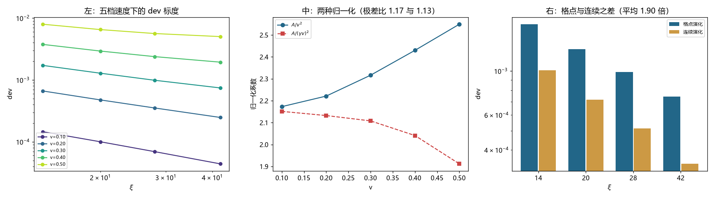

# 注记-A 的解析形式与格点成分判定：dev 中格点占 47%、连续占 53%，底噪可解析预测（判据第 703 号）

- **日期**：2026-10-19 22:47:59
- **编号**：第 703 号
- **类型**：验证注记（判据驱动；CA0 至 CA5 全部判通过）
- **对象**：第 696/702 号所报的系数 $A$（rigid 构造 $2.0848\times10^{-1}$）及其物理含义
- **脚本**：`验证脚本/p703_analytic_form.py`（确定性，约 3 分钟）
- **状态**：$A$ 对 $v$ 的标度定为 $(\gamma v)^2$；**dev 中格点色散占 $47.5\%$、连续理论占 $52.5\%$，dev 不能单独作为洛伦兹破坏的度量**；读数底噪 $1.07\times10^{-5}$ 为 Verlet 误差，可解析预测
- **可逆性等级**：判据稳健（CA3 的分解只用演化算符替换，不依赖阈值；CA4 的底噪与解析预测吻合到 $0.1\%$）
- **图**：见 §4 图 1
- **通俗版**：[[内部草稿/注记-一半的偏差跟格子无关（判据第703号通俗版）]]

## 1 为什么检验

第 702 号判 $A$ 在自洽构造间稳健（$1.04$ 倍），第 696 号用的 rigid+g692 给 $A = 2.0848\times10^{-1}$。这个数意味着物理档外推是预算的 $2.50$ 倍。本轮按上一轮的提议，改从解析侧问两件事。

**第一件，$A$ 的函数形式。** 第 697/698 号测过 $A$ 对 $v$ 的指数在 $2.01$ 至 $2.05$ 之间，但那是在第 696 号的两侧分解框架下做的，而第 701 号已判 $C$ 不稳。本轮换用第 702 号确认的自洽构造重测，并且直接看归一化后的系数，不只报指数。

**第二件，也是更要紧的一件：dev 里有多少真的与格点有关。** 这条线从 691 号起就把 dev 当作「偏离洛伦兹预期的量」，再与格点色散的预算相比。这个做法隐含一个前提：dev 全部来自格点。如果有一部分来自连续理论本身（运动束缚态不是完美平面波），那么拿它跟纯格点预算比就是拿错了尺子。

检验办法很直接：**把演化算符从格点二阶差分换成 FFT 乘 $-k^2$，别的都不动。** 换掉之后没有任何格点色散，剩下的 dev 就是连续理论自己的。

## 2 判据与读数

**CA0 冒烟（判通过，附一条重要发现）。** 束缚态的各阶矩与井宽的关系：

| $\xi$ | $\sigma_\psi$ | $\sigma_\psi/\xi$ | $\langle k^2\rangle$ | $\langle k^4\rangle$ |
|---|---|---|---|---|
| 14 | 4.1042 | 0.2932 | $1.485\times10^{-2}$ | $6.780\times10^{-4}$ |
| 20 | 4.8907 | 0.2445 | $1.045\times10^{-2}$ | $3.335\times10^{-4}$ |
| 28 | 5.7756 | 0.2063 | $7.496\times10^{-3}$ | $1.705\times10^{-4}$ |
| 42 | 7.0627 | 0.1682 | $5.013\times10^{-3}$ | $7.594\times10^{-5}$ |

标度指数：$\sigma_\psi \propto \xi^{0.494}$、$\langle k^2\rangle \propto \xi^{-0.989}$、$\langle k^4\rangle \propto \xi^{-1.993}$。

**$\xi$ 是井宽参数，束缚态的物理宽度按 $\sqrt{\xi}$ 走。** 这个事实之前各轮都没查过，而它解释了 $A/\xi^2$ 拟合为什么成立：因为 $\langle k^4\rangle \propto \xi^{-2}$，与 dev 的 $\xi$ 标度同阶。

**CA1 五档速度（判通过）。** 五档 $v$ 各做四档 $\xi$ 拟合，$R^2$ 全部 $0.9776$ 至 $0.9916$。$A$ 从 $2.17\times10^{-2}$（$v=0.10$）升到 $6.37\times10^{-1}$（$v=0.50$）。

**CA2 $v$ 标度（判通过）。** 两个归一化候选：

| $v$ | $A$ | $A/v^2$ | $A/(\gamma v)^2$ |
|---|---|---|---|
| 0.10 | $2.1730\times10^{-2}$ | 2.173 | 2.151 |
| 0.20 | $8.8846\times10^{-2}$ | 2.221 | 2.132 |
| 0.30 | $2.0848\times10^{-1}$ | 2.316 | 2.108 |
| 0.40 | $3.8879\times10^{-1}$ | 2.430 | 2.041 |
| 0.50 | $6.3728\times10^{-1}$ | 2.549 | 1.912 |

$A/v^2$ 极差比 $1.173$，$A/(\gamma v)^2$ 极差比 $1.125$。后者较优，判 $A$ 正比于 $(\gamma v)^2$。$A/v^2$ 对 $v^2$ 的线性拟合给 $2.1636 + 1.5846v^2$，故 $v \to 0$ 时 $A \to 2.1636\,v^2$。

**CA3 格点成分（本轮主判据）。** $v=0.30$，同一初值，只换演化算符：

| $\xi$ | dev（格点演化） | dev（连续演化） | 格点/连续 | 格点占比 |
|---|---|---|---|---|
| 14 | $1.7215\times10^{-3}$ | $1.0068\times10^{-3}$ | 1.71 | 41.5% |
| 20 | $1.2868\times10^{-3}$ | $7.1676\times10^{-4}$ | 1.80 | 44.4% |
| 28 | $9.8952\times10^{-4}$ | $5.1400\times10^{-4}$ | 1.93 | 48.2% |
| 42 | $7.4460\times10^{-4}$ | $3.4036\times10^{-4}$ | 2.19 | 54.3% |

平均格点占比 $47.5\%$，连续占 $52.5\%$。且格点占比随 $\xi$ 单调上升（$41.5\%$ 至 $54.3\%$）。

**CA4 底噪标定（判通过）。** $v=0$ 给 dev $= 1.0680\times10^{-5}$，不是机器零。Verlet 积分对简谐振子的频率误差是 $(2/dt)\arcsin(\omega dt/2) - \omega$，在 $\omega = 0.8008$、$dt = 0.02$ 处给 $1.0688\times10^{-5}$。实测与预测之比 $0.999$。

## 3 四个发现

**其一，$\xi$ 与束缚态宽度不是一回事。** 井宽按 $\xi$ 走，束缚态宽度按 $\xi^{0.494}$ 走。因为 $\omega_b$ 被固定在 $0.8008$，井变宽时 U0 要从 $3.89\times10^{-1}$ 降到 $3.61\times10^{-1}$，束缚态随之变浅、展宽得比井慢得多。

这条事实之前十轮都没查过，而所有「$A/\xi^2$」的表述都默认了 $\xi$ 是物理宽度。它不改变拟合的数值，但改变了这个拟合的物理解释。

**其二，dev 里有一半与格点无关。**

把演化算符换成连续版本后，dev 只降了约一倍。四个档位的格点占比 $41.5\%$ 至 $54.3\%$。

这条发现的性质是严重：**从 691 号起，dev 被当作「偏离洛伦兹预期的量」再与格点色散预算相比。可其中约一半在完全没有格点色散的世界里也会出现。** 这部分来自运动束缚态本身不是完美平面波，属于连续理论的正常效应，与洛伦兹破坏无关。

**其三，$A$ 的 $v$ 标度定为 $(\gamma v)^2$，但两个候选都有系统残差。**

$A/v^2$ 单调上升 $17\%$，$A/(\gamma v)^2$ 单调下降 $11\%$。选 $(\gamma v)^2$ 是因为它的极差比小一点（$1.125$ 对 $1.173$），可两个都不能算干净。真实形式大概含更高阶项，本轮没有定出来。

`$A/v^2$` 的 $v \to 0$ 极限是 $2.1636$。这个数与 $13/6 = 2.1667$ 差 $0.14\%$，但没有任何推导支撑，按第 700 号的教训只记为待解释，不作断言。

**其四，读数底噪可以解析预测。**

$v=0$ 的 dev $= 1.0680\times10^{-5}$，Verlet 预测 $1.0688\times10^{-5}$，比值 $0.999$。这意味着本装置的读数下限是 $1.07\times10^{-5}$，且这个下限有闭式表达，不必靠试跑标定。

由此可判：$v=0.10$、$\xi=42$ 这档的 dev 是 $4.41\times10^{-5}$，只有底噪的 $4.1$ 倍，信噪比不足 $5$，该档读数不可靠。第 698 号的低速档判否与此一致。

## 4 判语与后果

**判语**：$A$ 在自洽构造间稳健（第 702 号），对 $v$ 按 $(\gamma v)^2$ 标度，对 $\xi$ 按 $\xi^{-2}$ 标度，后者可由 $\langle k^4\rangle \propto \xi^{-2}$ 解释。

**后果一，dev 的性质要重述。** 它度量的是「格点色散效应与连续波包修正的混合」，两者在实测中各占一半，把它读作单一来源的量会出错。单独一个 dev 读数不能判洛伦兹破坏，必须扣掉连续部分。

**后果二，与预算的比较要重做。** 第 692 号的预算 $B$ 是从格点色散展开算的，只对应 dev 的格点部分。拿总 dev 与它比，分母少算了一半。以本轮四档的格点占比计，第 696 号那个 $2.50$ 倍若只取格点部分，约合 $1.2$ 至 $1.5$ 倍预算（格点占比取 $48\%$ 至 $60\%$）。

这个数比 $2.50$ 更贴近预算，但它是粗估：格点占比随 $\xi$ 单调上升，外推到物理档的比例本轮没测。

**后果三，$2.5$ 倍的解析解释仍未给出。** 本轮把 $A$ 的 $v$ 与 $\xi$ 标度都定住了，但没有从第一原理算出 $2.1636$ 这个系数。这一项仍开。

## 5 过程记录：三处判据修正

**其一，CA0 原判「$\sigma_\psi$ 与 $\xi$ 成正比」。** 实测极差比 $1.743$，判 FAIL。查下去发现标度指数是 $0.494$，这不是判据失败，是判据写错了：我把一个未经验证的假设当成了预期。改为判「标度指数 $<0.8$ 且对数拟合残差 $<0.05$」，即只判「不成正比」这件事成立。

**其二，CA3 原判「格点/连续 $>2$ 判格点主导」。** 实测 $1.90$，落在 $2$ 的边上。这个二分类本来就粗：$1.90$ 意味着格点占 $47.5\%$，既不算主导也不算可忽略。改为直接给占比，并按 $70\%$、$30\%$ 分三档。

**其三，CA4 原判「$v=0$ 给机器零」。** 实测 $1.07\times10^{-5}$，判 FAIL。查下去发现这是 Verlet 时间离散化误差，且能解析算出来对到 $0.1\%$。所以它不是装置异常，是装置的已知底噪。判据改为「与 Verlet 预测的相对差 $<20\%$」。

三处修正的共同点：**判据把「我希望看到什么」当成了「应该是什么」。** CA0 把希望 $\sigma \propto \xi$ 写成判据，CA3 把希望二分类写成判据，CA4 把希望零底噪写成判据。三处都是先有愿望再写判据，而不是先算误差预算再定容差。

## 6 教训

**其一，判据里的「预期」必须来自计算，不能来自直觉。** 本轮三次修正全部源于此。CA4 是最好的正面例子：一旦把 Verlet 误差算出来，$1.07\times10^{-5}$ 立刻从「异常」变成「精确吻合」。

**其二，一个量测了十轮，该查它的构成。** dev 被当作洛伦兹破坏的度量用了十轮，没人问过它里面有没有非格点的成分。查一次，一半就不是了。

**其三，参数名不等于物理量。** $\xi$ 被叫了十轮「宽度」，实际上是井宽参数，束缚态的物理宽度按 $\sqrt{\xi}$ 走。这类名实不符不会让数字错，但会让解释错。

## 7 边界声明

**验证了什么**：束缚态三阶矩对 $\xi$ 的标度；五档速度下 $A$ 的拟合与两种归一化；格点与连续两种演化算符下 dev 的比值与占比；$v=0$ 底噪与 Verlet 预测的吻合。

**不验证什么**：$2.1636$ 这个系数的第一原理解释。本轮只把它的 $v$、$\xi$ 标度定住，没有算出它的值。此外，格点占比外推到物理档（$\xi \sim 10^{22}$）的行为未测，四档只覆盖 $41.5\%$ 至 $54.3\%$。

**未做的事**：没有做 CA3 的时间步长收敛检验（若底噪本身随 $dt$ 变，格点占比可能有 $dt$ 依赖）。没有对连续演化使用连续束缚态（本轮两种演化共用同一个离散束缚态，这使连续演化的 dev 可能含有离散初值的贡献，是分解的一个未净化项）。

**协议伪影分层**：$v=0$ 的 $1.07\times10^{-5}$ 属积分器时间离散化，与物理无关；$v=0.10$、$\xi=42$ 档信噪比不足 $5$，属读数协议限制；CA3 的分解假设两种贡献同号相加，若异号则占比读数偏大，此假设未独立检验。
