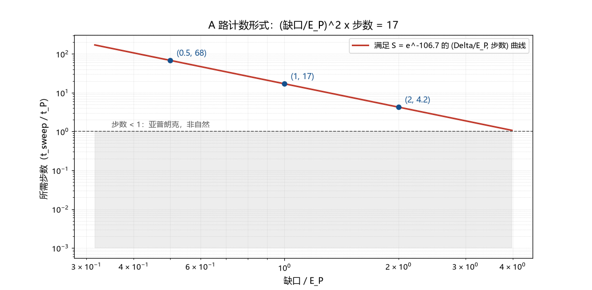

# 注记-A 路判句（第361条）：缺口与扫速的计数形式

- **日期**：2026-09-22 07:31:45
- **类型**：判据执行轮（朗道-齐纳路线的判句收窄）
- **脚本**：`验证脚本/lz_counting_form.py`（第 361 条）
- **图**：见 §2 图 1（`images/lz_counting_form.png`）
- **依据**：[[验证脚本/注记-S 的机制候选（第360条）：四种指数抑制的参数量级与判句]]（A 路扫速 $0.0589\,\hbar/t_P^2$）；[[有质量粒子的形成：大爆炸同步相变的局域缺陷方案]] §7.2 第四项（裁决二十八）；[[π扭转的层次分解：旋量结构与费米统计的边界]]（P8a 为共同瓶颈）
- **状态**：判句收窄完成；$\Delta$ 与 $t_{\rm sweep}$ 的模型来源待 P8a 供给

## 1 判据与设定

A 路（朗道-齐纳）指数为 $2\pi\Delta^2/(\hbar v)$。取扫速为 $v = E_P/t_{\rm sweep}$（能级交叉在 $t_{\rm sweep}$ 内线性扫过），指数化为 $2\pi(\Delta/E_P)^2(t_{\rm sweep}/t_P)$。第 360 条已算出所需扫速 $0.0589\,\hbar/t_P^2$，即 $t_{\rm sweep} = 16.98\,t_P$（取 $\Delta = E_P$）。本轮把该条件写成不含自由参数的计数形式，并检查软缺口路线。

## 2 结果：计数形式

判据式为 $(\Delta/E_P)^2 \times (t_{\rm sweep}/t_P) = 16.98$。自然点：

| $\Delta/E_P$ | 所需步数 $t_{\rm sweep}/t_P$ |
| --- | --- |
| $0.25$ | $271.7$ |
| $0.5$ | $67.9$ |
| $1$ | $17.0$ |
| $2$ | $4.25$ |
| $4$ | $1.06$ |

两端边界给出两条硬约束：若扫过时间不能短于一个普朗克步，则缺口须不小于 $4.12\,E_P$；若缺口不超过 $E_P$，则扫过时间须不少于 $17$ 个普朗克步。软缺口路线判负：取 $\Delta = \hbar\omega_0 = m_ec^2$（$\Delta/E_P = 4.19\times10^{-23}$）时所需步数为 $9.7\times10^{45}$，与格的离散更新（每步 $t_P$）不相容。

## 3 P8a 判句

留给相变动力学线的判句：给出交叉缺口 $\Delta$ 与扫过时间 $t_{\rm sweep}$ 的模型来源（前沿速度与前沿宽度决定扫过时间，锁定混合矩阵元决定缺口），二者代入 $(\Delta/E_P)^2(t_{\rm sweep}/t_P)$ 落在 $16.98$ 即 $S = e^{-106.7}$ 被解释。旁证判据：扫速须与相变前沿的物理速度自洽，不得为凑数引入新的自由参数。

## 4 结构性数字（仅登记）

$2\pi\times16.982 = 106.70$；$34\pi = 106.814$，与登记指数相对差 $0.107\%$。两条同源，均只作提示登记。

## 5 严格程度与边界声明

严格程度：计数形式与两端边界为算术（判据级）；$\Delta$ 与 $t_{\rm sweep}$ 尚未导出（纲领级）。边界：不建立相变模型，不重算第 360 条的四路线参数，不涉及谱形侧。

## 6 过程记录

触发：第 360 条判定「数值可行性不是瓶颈，判别落下哪一路与同步冻结图像自洽」之后，A 路首先被开工。本轮把 A 路从参数档推进到一个纯计数问题：一个乘积等于 $16.98$。副产品是软缺口路线的排除与两条边界约束。
