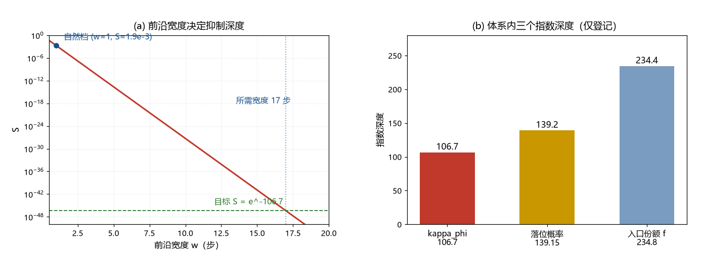

# 注记-A 路前沿侧侦察（第362条）：前沿速度已知、宽度缺失

- **日期**：2026-09-22 07:43:57
- **类型**：侦察轮（A 路判句的前沿侧输入清点）
- **脚本**：`验证脚本/front_width_audit.py`（第 362 条）
- **图**：见 §3 图 1（`images/front_width_audit.png`）
- **依据**：[[元相子生成论：从本原到万物的自否定链条]]（相变波前只能以光速扫过，视界外各自独立成核）；[[wiki/位错]]（波前推进埋下位错与接缝，Kibble 必然性）；因果前沿「每拍一格 = c」的既有读数；[[验证脚本/注记-A 路判句（第361条）：缺口与扫速的计数形式]]
- **状态**：侦察完成。前沿速度有明确陈述，前沿宽度与缺口缺失；自然档推算已给

## 1 侦察目标

第 361 条把 A 路化为计数式 $(\Delta/E_P)^2(t_{\rm sweep}/t_P) = 16.98$。本轮清点体系里已有什么可以喂给它：前沿速度（或等价地，前沿扫过每个格点所需的步数 $w$）与交叉缺口 $\Delta$。

## 2 侦察结果

已有：前沿速度。生成论写明「光速有限，相变波前只能以光速扫过，视界之外的区域各自独立成核，相遇时相位秩序无法对接」；因果前沿的既有读数也是「每拍一格，等于 $c$」。两条合起来给出 $v_{\rm front} = c = l_P/t_P$。

缺失：前沿宽度 $w$（波前剖面跨几个格点）与交叉缺口 $\Delta$。有质量粒子论文 §7.2 明言缺陷密度、关联长度与 CMB 对照「全部缺失」，本轮确认该缺口仍未补。

## 3 自然档推算：尖锐前沿

取最自然的尖锐前沿（$w = 1$，即每个格点在一个普朗克步内被扫过），指数为 $2\pi$，得 $S = 1.87\times10^{-3}$。目标为 $e^{-106.7} = 4.58\times10^{-47}$，指数缺口 $100.4$，约 $43.6$ 个数量级。两条补足路线：

| 固定量 | 要求 |
| --- | --- |
| $\Delta = E_P$ | 前沿宽度 $w = 16.98$ 步 |
| $w = 1$ | 缺口 $\Delta = 4.12\,E_P$ |
| $w = 2$ | 缺口 $\Delta = 2.91\,E_P$ |
| $w = 4$ | 缺口 $\Delta = 2.06\,E_P$ |

## 4 结论与判句

前沿速度已知为 $c$；缺的是宽度或缺口。A 路的自然版本（尖沿、缺口取普朗克档）只给 $S \sim 2\times10^{-3}$，与目标差约 44 个数量级。因此 A 路若要成立，必须给出 $17$ 步宽的前沿，或大于 $E_P$ 的缺口，二者都须由 P8a 供给。另一条待定项：$S$ 对应朗道-齐纳的哪一支概率（透热支或绝热支），这决定「慢扫变成绝热」还是「快扫留下透热份额」，须在相变模型里定死后再对数值。

判句移交：P8a 给出前沿剖面（成核-相遇图像下的宽度 $w$），并给出 $S$ 的概率语义；二者到位后代入 $2\pi(\Delta/E_P)^2 w$ 与 $106.7$ 对表。

## 5 附带观察（仅登记）

体系内现有三个指数深度：$\kappa_\phi$ 的 $106.7$、落位概率 $3H_0t_P$ 的 $139.15$（元相常数词条）、入口份额 $f$ 的 $234.4$。三者未发现彼此关系，只作登记。

## 6 严格程度与边界声明

严格程度：侦察为文献级；自然档推算与两路线要求为算术（判据级）。边界：不建立前沿模型，不重算第 361 条，不涉及成核率定量。

## 7 过程记录

触发：第 361 条收窄后，先查体系是否已有前沿速度与宽度。结果：速度有、宽度无。副产品是「自然档差 44 个数量级」这一负面读数，它把 A 路的门槛从「参数可行性」提高到「前沿宽度必须为 17 步或缺口须大于普朗克档」。
