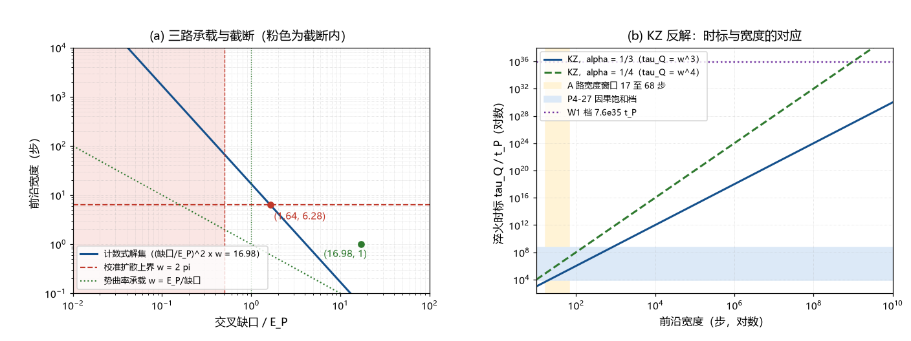

# 注记-A 路宽度来源三路审查（第380条）：校准扩散与势曲率判负、KZ 冻结活口与淬火时标窗口

- **日期**：2026-09-24 03:31:27
- **类型**：判据执行轮（A 路宽度来源的机制审查）
- **脚本**：`验证脚本/minimal_verification_a_path_width_sources.py`（第 380 条）
- **图**：见 §3 图 1（`images/a_path_width_sources.png`）
- **依据**：[[验证脚本/注记-P8a 前沿剖面最小模型（第376条）：紫外截断封缺口与宽度翻译为弛豫率]]（宽度窗口 17 至 68 步）；[[束缚振荡动力学的物侧闭合：完美弹性定理、交错基态与校准通道]] §五（校准率定标与结构上界 $\kappa < \omega_P$）；[[验证脚本/注记-校准通道的动力学形式：相位表扇区的扩散型弛豫与分扇区条件]]（扩散型弛豫形式）；[[内部草稿/开放问题总览：元相子理论待解决问题清单]]（P4-27 相变时标带与 W1 档）
- **状态**：三路审查完成。校准扩散与势曲率判负；KZ 冻结活口，淬火时标窗口与登记时标带相交

## 1 判据与设定

第 376 条把 A 路压成宽度条件：前沿剖面须跨 $17.0$ 至 $67.9$ 步（计数式 $(\Delta/E_P)^2 w = 16.98$，缺口已由紫外截断封顶）。本轮审查宽度的三个来源：校准通道的扩散弛豫（$w = \kappa/v$）、势的曲率（$w = E_P/\Delta$）、KZ 冻结关联（$w = (\tau_Q/t_P)^\alpha$）。判据 W1 至 W4，全部为确定性算术，格点单位取 $l_P = t_P = 1$。

## 2 结果

W1（校准扩散承载）：$w = \kappa/v$，$v = 1$ 格每步；$\kappa$ 有结构上界 $\omega_P = 2\pi$（校准不得快于摆程本身，正稿 §五）。故 $w \le 2\pi = 6.28$ 步，比 A 路窗口下端低 $2.70$ 倍、上端低 $10.81$ 倍。换算成缺口：$\Delta \ge 1.644\,E_P$，超截断 $64.4\%$（松读法）与 $228.8\%$（两摆程）。判负。

W2（势曲率承载）：若宽度由势的曲率给出，$w = E_P/\Delta$；代入计数式得 $\Delta/E_P = 16.98$，即 $\Delta = 16.98\,E_P$，超截断 $16.98$ 倍与 $33.96$ 倍。判负。

W3（KZ 冻结承载）：$w = (\tau_Q/t_P)^\alpha$，取 $\alpha = \nu/(1+\nu z)$ 的 $1/3$ 与 $1/4$ 两档。反解 A 路窗口：$\alpha = 1/3$ 给 $\tau_Q = 4.90\times10^3$ 至 $3.13\times10^5\,t_P$；$\alpha = 1/4$ 给 $8.32\times10^4$ 至 $2.13\times10^7\,t_P$。时标档正算（$\alpha = 1/3$）：登记相变时标带 $10^{-39.4}$ 至 $10^{-34.5}$ 秒（$7.38\times10^3$ 至 $5.87\times10^8\,t_P$）给 $w = 19.5$ 至 $837$ 步、$\Delta = 0.93$ 至 $0.14\,E_P$；W1 档 $7.59\times10^{35}\,t_P$ 给 $w = 9.12\times10^{11}$ 步、$\Delta = 4.3\times10^{-6}\,E_P$。判为活口。

W4（交集与对照）：两摆程截断（$\Delta \le E_P/2$）要求 $\tau_Q \ge 3.13\times10^5\,t_P$，与时标带的交集为 $[3.13\times10^5, 5.87\times10^8]\,t_P$（非空）；松读法（$\Delta \le E_P$）下交集为全带。B 路对照：若缺口取定居密度势垒 $246\,\mathrm{GeV} = 2.01\times10^{-17}\,E_P$，则需 $w = 4.18\times10^{34}$ 步、$\tau_Q = 7.32\times10^{103}\,t_P$（超宇宙年龄 $43$ 个数量级）。A 路 KZ 档与 B 路的缺口差 $15.8$ 至 $16.7$ 个数量级。

## 3 图

## 4 结论与判句移交

三条承载中两条判负：校准扩散被 $\kappa$ 的结构上界封死，势曲率被截断封死。宽度来源收窄到 KZ 冻结关联，其所需淬火时标 $4.90\times10^3$ 至 $3.13\times10^5\,t_P$ 与登记相变时标带 $[7.38\times10^3, 5.87\times10^8]\,t_P$ 相交。一条邻接观察：时标带下端 $7.38\times10^3$ 与 A 路窗口下端反解 $4.90\times10^3$ 同量级（相差 $1.51$ 倍），只作登记。

判句移交：下一轮钉定两件输入，KZ 指数 $\alpha$（相变临界指数 $\nu$ 与 $z$）与淬火时标 $\tau_Q$（相变时标带的物理确定）。两件到位后 KZ 宽度被算出，A 路的指数 $106.7$ 闭合或判负。附带主轴：A、B 两路要求的缺口差约 $16$ 个数量级，缺口的物理身份是两路判别的主轴。

## 5 严格程度与边界声明

严格程度：W1 为算术加一条结构上界（$\kappa < \omega_P$ 属正稿 §五的结构性定标级）；W2 为量级口径（宽度与曲率的比例因子未定，缺口要求的量级不受影响）；W3、W4 为算术反解与时标带对照（判据级）。

边界：不重算第 376 条；不建立相变模型；KZ 公式取标准标度形式，其适用性（相变属 KZ 类）未独立验证；时标带两个端点的定性（上界或区间）以登记原文为准；W1 的判负限于纯扩散承载口径，长程校准核与非线性平衡宽度不在本轮审查范围。

## 6 过程记录

触发：第 376 条把 A 路压成「宽度 17 至 68 步」后，宽度来源成为唯一问题。本轮清点三个来源，前两个判负是本轮的实质负面读数，第三个活口把判句压成两件输入。过程修正三处：B 路换算首版把 $E_P$ 写成电子伏数值（差 9 个数量级）、两摆程交集上端被多余截断、交集下界用错变量，均在复算中发现并修正，最终读数经独立复算核对。
