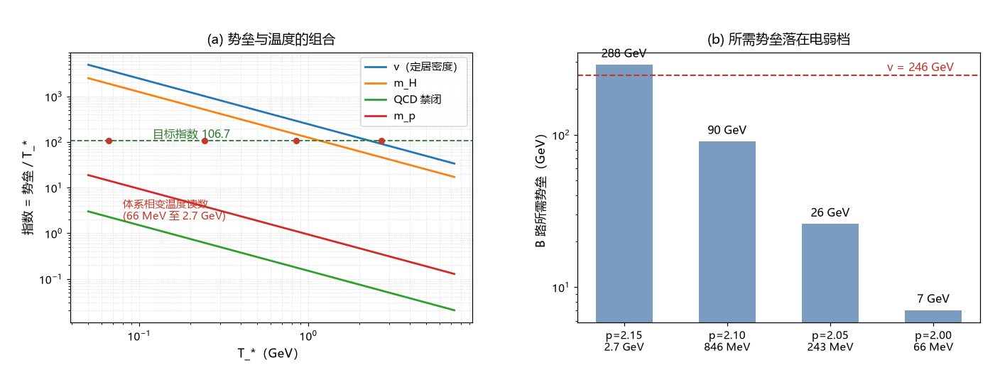

# 注记-B 路冻结温度审查（第364条）：所需势垒落在电弱档，体系温度族内有一对近合

- **日期**：2026-09-22 08:06:45
- **类型**：审查轮（B 路冻结温度的来源清点与定量对照）
- **脚本**：`验证脚本/minimal_verification_freezeout_temperature_audit.py`（第 364 条）
- **图**：见 §3 图 1（`images/freezeout_temperature_audit.png`）
- **依据**：[[内部草稿/审查报告-约束计数与独立性审查：m_delta 线的方程、自由度与读数形态]]（$t_*$ 与「$T$（标准热史换算）」表）；[[元相子理论中的温度定义：相位无序度的能量化与宇宙学意义]]（$k_BT = E_P(1-\eta)$）；[[验证脚本/注记-S 的机制候选（第360条）：四种指数抑制的参数量级与判句]]（B 路要求 $T = T_P/106.7$）
- **状态**：审查完成。体系有相变温度读数；B 路所需势垒为 7 至 288 GeV；族内出现一对近合（见 §3）

## 1 目标

B 路要求 $S = e^{-\Delta E/(k_BT)}$、指数 $106.7$。第 360 条按普朗克档算出 $T = T_P/106.7 = 1.33\times10^{30}$ K。本轮查体系能否给出真正的冻结温度与势垒。

## 2 体系已有的温度读数

定义侧：温度是相位无序度的能量化标度，$k_BT = E_P(1-\eta)$，上限为普朗克温度。相变侧：m_delta 线把相变时标钉成单参数族 $t_*(p)$，并按标准热史换算给出温度表：$p = 2.15$ 给 $t_* = 4.1\times10^{-8}$ 秒、$T_* = 2.7$ GeV；$p = 2.10$ 给 $846$ MeV；$p = 2.05$ 给 $243$ MeV；$p = 2.00$ 给 $66$ MeV。

## 3 对照：所需势垒

由 $\Delta E = 106.7\,k_BT_*$，所需势垒分别为 $288$、$90$、$26$、$7.0$ GeV。即整条族要求的势垒都落在电弱十年级，普朗克档与 MeV 档都被排除。候选势垒对照（指数 = 势垒$/T_*$）：

| 势垒 | $T_*=2.7$ GeV | $846$ MeV | $243$ MeV | $66$ MeV |
| --- | --- | --- | --- | --- |
| $v = 246$ GeV | $91.1$ | $290.8$ | $1012$ | $3727$ |
| $m_H = 125$ GeV | $46.3$ | $147.8$ | $514$ | $1894$ |
| $m_Z = 91.19$ GeV | $33.8$ | $107.8$ | $375$ | $1382$ |
| QCD 禁闭 $150$ MeV | $0.06$ | $0.18$ | $0.62$ | $2.3$ |

近合两条：其一，取势垒 $v = 246$ GeV，所需温度为 $2.306$ GeV，与族内 $p \approx 2.14$ 的读数相邻（$p = 2.15$ 给 $2.7$ GeV，指数 $91.1$）；其二，取势垒 $m_Z = 91.19$ GeV，所需温度为 $855$ MeV，与族内 $p = 2.10$ 的 $846$ MeV 相差 $1\%$，该点的指数为 $107.8$，与 $106.7$ 相差 $1.1$（即 $S$ 相差约三分之一）。

## 4 判读与判句

判读：B 路不再需要普朗克档的势垒，它要的是一个电弱档势垒与一个 GeV 级冻结温度。体系两样都有（$v$、$m_Z$ 与温度族），且族内存在近合点。留着三件待判：其一，势垒身份，冻结势垒为何取 $v$ 或 $m_Z$ 而不是别的电弱量；其二，族成员的选择（$p$ 目前是角点读数，$p$ 定不下来则温度定不下来）；其三，标准热史假设，$T_*$ 表依赖框架膨胀史复现标准热史，该对接尚未逐段核过。

判句移交：宇宙学线给出势垒的机制身份与 $p$ 的独立钉定；二者到位后代入 $\Delta E/(k_BT_*)$ 与 $106.7$ 对表。近合到 $1\%$ 的读数属提示，不构成证明。

## 5 严格程度与边界声明

严格程度：温度族读数为既有换算（条件性）；所需势垒与近合为算术（判据级）；势垒身份与 $p$ 钉定为纲领级。边界：不建立冻结模型，不重算 m_delta 线，不裁 $p$。

## 6 过程记录

触发：A 路前沿侧侦察把门槛抬到「17 步宽前沿或超普朗克缺口」后，转 B 路。本轮发现 B 路的门槛低于预期：不需要普朗克档，电弱档即可，且体系温度族内已有近合点（$m_Z$ 配 $846$ MeV 给指数 $107.8$）。
