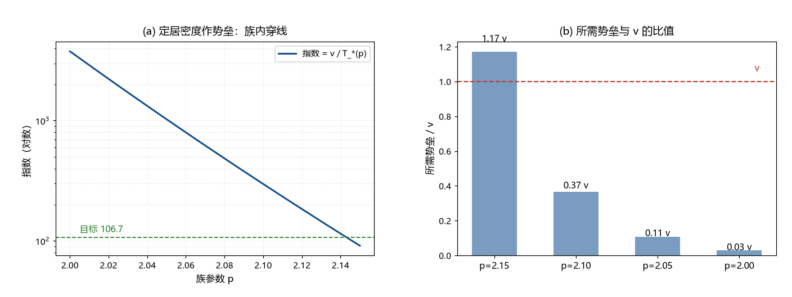

# 注记-B 路势垒身份审查（第365条）：定居密度作锁定势垒，身份自然但有两项代价

- **日期**：2026-09-22 08:16:37
- **类型**：审查轮（B 路势垒身份的体系内清点）
- **脚本**：`验证脚本/minimal_verification_barrier_identity_audit.py`（第 365 条）
- **图**：见 §3 图 1（`images/barrier_identity_audit.png`）
- **依据**：[[三代费米子质量谱的模态轮换方案：Z₃对称与实轴投影]] §9.4（$v$ 是真空定居密度、相位锁定凝聚的序参量）；[[元相子几何动力学——束缚振荡修订整合版]]（集体序参量相位的第三层，标注为定居密度/希格斯）；[[元相子理论中的温度定义：相位无序度的能量化与宇宙学意义]]（阈叙事）；[[内部草稿/注记-10^-17与10^-61共同结构的探索]]（$v/E_P$ 的小量登记）；[[验证脚本/注记-B 路冻结温度审查（第364条）：所需势垒落在电弱档，体系温度族内有一对近合]]
- **状态**：审查完成。身份自然；两项代价与一项精度要求列出

## 1 目标

第 364 条给出 B 路所需势垒为 $7$ 至 $288$ GeV，落在电弱十年级。本轮判它在体系里能否找到身份。

## 2 侦察：电弱档量的体系角色

$v = 246$ GeV 在体系里有明确身份：真空定居密度，相位锁定凝聚的序参量，负责 $W^\pm$、$Z^0$ 质量与电弱对称性破缺，也是三代共享的标度公因子。所以「锁定势垒由凝聚尺度决定」在语言上顺畅：一个格点要锁进凝聚态，越过的是凝聚自身的势垒。

$m_Z$ 与 $m_H$ 属已测质量，体系未给独立身份；温度定义论文的阈叙事（夸克禁闭 150 MeV 等）与 $v$ 无关。故候选身份取定居密度一支。

## 3 定量：所需势垒与 $v$ 的比值

| 族成员 | $T_*$ | 所需势垒 | 与 $v$ 的比 | 取势垒 $=v$ 时的指数 |
| --- | --- | --- | --- | --- |
| $p = 2.15$ | $2.7$ GeV | $288$ GeV | $1.17\,v$ | $91$ |
| $p = 2.10$ | $846$ MeV | $90$ GeV | $0.37\,v$ | $291$ |
| $p = 2.05$ | $243$ MeV | $26$ GeV | $0.10\,v$ | $1012$ |
| $p = 2.00$ | $66$ MeV | $7$ GeV | $0.03\,v$ | $3727$ |

数值上：$v/E_P = 2.02\times10^{-17}$（对上既有登记）；取势垒为 $v$，族内存在穿线点（$p \approx 2.14$ 处指数经过 $106.7$）。

## 4 两项代价与一项精度要求

代价一：$v$ 目前是观测输入，而参数地位声明的输入清单只列两项（尺度锚与 $G$）。把势垒取作 $v$ 等于引入第三项输入，或要求体系先给出 $v$。代价二：$v$ 自身的小量另有登记（$v/E_P \sim 2\times10^{-17}$），$S$ 的问题会转化成 $v$ 的问题，属换位而非免费。精度要求：由 $t_*(p)$ 的敏感度 $\mathrm{d}\ln T/\mathrm{d}p = 23.1$，要把指数对上 $1\%$，需 $p$ 精度 $4.3\times10^{-4}$；对 $5\%$ 需 $2.2\times10^{-3}$。

## 5 结论与判句

结论：B 路的势垒身份以定居密度为最佳候选，语言与量级都顺（所需为 $0.03$ 至 $1.17\,v$）；但闭环需要三件：其一，$v$ 的来源（或把它列入输入清单）；其二，$p$ 的独立钉定到 $10^{-3}$ 至 $10^{-4}$ 档；其三，凝聚势给出那个 O(1) 系数（为何取 $1.17\,v$ 或 $0.37\,v$）。

判句移交：宇宙学线与三代质量谱线各自可动其一（$v$ 机制、$p$ 钉定），势垒系数需从凝聚势形状读出。

## 6 严格程度与边界声明

严格程度：侦察为文献级；比值与精度要求为算术（判据级）；身份成立与否未判（纲领级）。边界：不改动任何定稿值，不裁 $p$，不建立 $v$ 机制。

## 7 过程记录

触发：第 364 条近合之后，按建议先判势垒身份。结果：身份候选唯一且语言顺畅（定居密度即锁定凝聚尺度），代价是 $v$ 要进输入清单且其小量另有欠账；精度要求把 $p$ 的钉定抬为必需。
