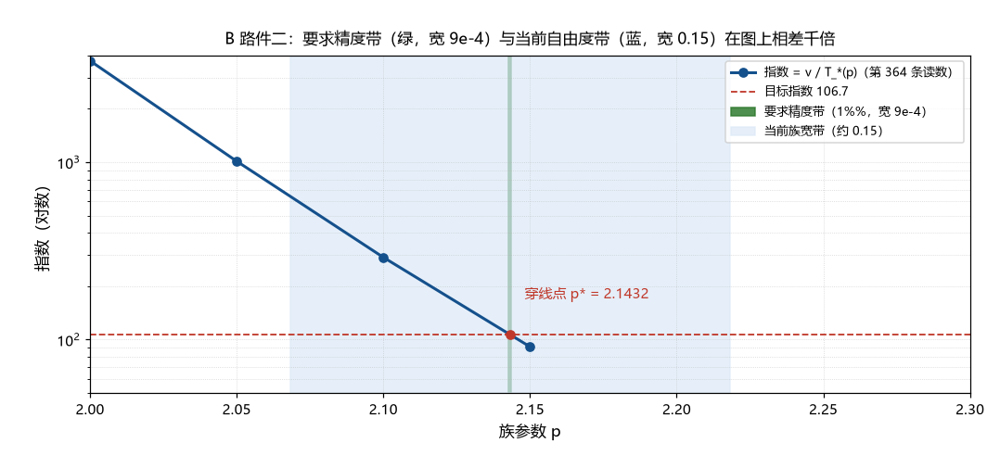

# 注记-B 路收尾判定（第390条）：三件闭环条件的可达性与精度缺口

- **日期**：2026-09-24 04:58:07
- **类型**：收尾判定轮（B 路三件闭环条件的可达性）
- **脚本**：`验证脚本/minimal_verification_b_path_closure.py`（第 390 条）
- **图**：见 §3 图 1（`images/b_path_closure.png`）
- **依据**：[[验证脚本/注记-B 路冻结温度审查（第364条）：所需势垒落在电弱档，体系温度族内有一对近合]]；[[验证脚本/注记-B 路势垒身份审查（第365条）：定居密度作锁定势垒，身份自然但有两项代价]]；[[内部草稿/结晶时刻的定位：时间零点身份、时标约束链与初条件交付]]（时标角点与 ξ 自由度）
- **状态**：收尾判定完成。B 路取「条件性候选（三件未齐）」；件二有 2.5 至 3.0 个数量级的定量缺口；件一已裁（2026-09-24 作者取选项甲：$v$ 列入输入清单）

## 1 判据与设定

B 路的闭环需要三件（第 365 条登记）：件一，定居密度 $v$ 的来源或输入地位；件二，族参数 $p$ 独立钉定到 $10^{-3}$ 至 $10^{-4}$ 档；件三，凝聚势给出 $O(1)$ 系数。本轮给三件做可达性判定：B1 复核第 364、365 条的敏感度与穿线点算术；B2 把件二的精度要求与 $p$ 的当前自由度对照；B3 给件一与件三的判定类型；B4 综合状态。全部为确定性算术加材料清点。

## 2 结果

B1（复核）：三点族读数的敏感度逐段为 $26.1$、$24.9$、$23.2$（与第 365 条采用的 $23.1$ 一致，无勘误）；取势垒为 $v = 246$ GeV 时指数穿线点 $p^{*} = 2.1432$（目标指数 $106.7$）。

B2（件二，$p$ 的精度）：指数对上 $1\%$ 需 $\Delta p = 4.33\times10^{-4}$，对上 $5\%$ 需 $2.17\times10^{-3}$，对上 $2$ 倍需 $3.00\times10^{-2}$。当前自由度两口径：族宽口径 $\Delta p \sim 0.15$，ξ 折算口径（九个数级时标移动、辐射主导 $T \propto t^{-1/2}$）$\Delta p \sim 0.449$。缺口：分别 $346$ 倍（$2.5$ 个数量级）与 $1036$ 倍（$3.0$ 个数量级）；即便只要求指数对上 $2$ 倍，族宽口径也差 $5$ 倍。件二在当前确定度下不可达。

B3（件一与件三）：件一（$v$ 的输入地位）为框架决策，两个选项见 §4，产出裁决请求；若走推导路线，$v/E_P = 2.02\times10^{-17}$ 的小量另有登记，属换位，并不免费。件三（$O(1)$ 系数）需要凝聚势的形状，属可建模的小任务，尚未执行。

B4（综合）：B 路的状态取「条件性候选（三件未齐）」：件一属框架决策、件二有 $2.5$ 至 $3.0$ 个数量级的定量缺口、件三属未执行的建模。状态取「条件性候选（三件未齐）」。

## 3 图

## 4 结论与裁决请求

B 路的收尾结论：三件未齐中，件二是唯一的定量缺口（且缺口达 $2.5$ 至 $3.0$ 个数量级），件三可执行，件一需要框架决策。

**裁决请求（件一：$v$ 的输入地位）**。两个选项：

- 选项甲（推荐）：把 $v$ 列入参数地位声明的输入清单（与尺度锚、$G$ 并列）。后果：B 路成为条件性关系「给定 $v$ 与 $T_*$（$p$ 钉定后），$S = e^{-v/(k_BT_*)}$」，其价值在把存活因子与电弱标度接通，并与 A 路的判负形成对照；代价是输入清单扩为三项。
- 选项乙：要求体系推导 $v$ 的来源。后果：B 路闭环完全依赖 $v$ 机制（一项与存活因子同量级的开放问题，$v/E_P \sim 2\times10^{-17}$），闭环成本高于选项甲一个机制层级。

推荐理由：选项乙把「$S$ 的问题」换成「$v$ 的问题」（第 365 条已识别为换位）；选项甲则保留 B 路作为「用现有输入表达 $S$」的条件性结果，其可检验性（$v$ 与 $T_*$ 的独立测定）与 A 路的对照价值都不受损。件二与件三不受该裁决影响。

**裁决结果（2026-09-24）**：作者取选项甲。定居密度 $v$ 列入参数地位声明的输入清单（[[内部草稿/声明-粒子参数地位：输入、导出与比较标准（2026-09-22）]] 已同步，输入数由 2 项改为 3 项；[[理论总纲/术语表]] 的参数地位条目同步）。件一关闭；B 路的剩余项为件二与件三。

判句移交：若取选项甲，B 路的剩余项为件二（$p$ 钉定，属 m_delta 与结晶时刻线）与件三（凝聚势系数）；两项到位后 B 路给条件性闭环。若取选项乙，登记为「$v$ 机制」新工作项。

## 5 严格程度与边界声明

严格程度：B1 的复核为算术（判据级）；B2 的缺口为算术加一个换算法（ξ 折算口径依赖 $T \propto t^{-1/2}$ 的标准热史假设，条件性）；B3 的判定类型为材料清点级。

边界：不建立冻结模型；不改第 364、365 条的任何读数；不裁 $p$；不建立 $v$ 机制；裁决请求只报选项与推荐，决定权在作者。

## 6 过程记录

触发：A 路判定链完整（第 360 至 386 条）后，按 S 机制线顺序收尾 B 路。判定路径：先复核 364/365 算术（无勘误），再把件二的精度要求与 $p$ 的两个自由度口径对照（发现 2.5 至 3.0 个数量级缺口），最后把件一归为裁决、件三归为建模。附带读数：即便只要求指数对上 2 倍，族宽口径也差 5 倍，这解释了为什么 B 路此前停在「近合提示」而不前进。
