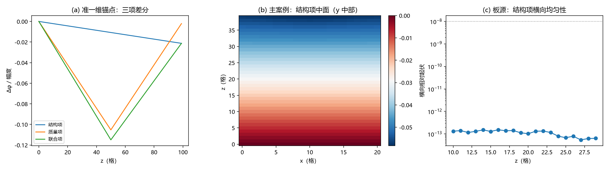

# 注记-BH3-3后续（三维衔接）：层收缩静态痕迹验证

- **日期**：2026-09-19 05:14:47
- **层级**：验证脚本/（理论验证材料，未确认）
- **脚本**：验证脚本/minimal_verification_bh33_3d_trace.py（系统 Python 3.13 + numpy + scipy + matplotlib，确定性、无随机数，运行约 10 秒）
- **定位**：里程碑 M8（BH3-3 后续的三维衔接，按裁决二十二取候选一「沿主轴层收缩」）：把 BH3-5 一维先导的 J1/J2 判据三维化，在 S1 写法的真实场源构型（$M/m_P = 4$ 档，容量状态经饱和轮复核订正）上取层收缩的静态痕迹读数；并给出准一维锚点与横向均匀性两项对照。
- **关联**：[[验证脚本/注记-BH3-5留痕判据的一维先导：自动闭合几何与结构留痕]]（一维锚点）；[[验证脚本/注记-M6-S1（可做部分）：真实场构型的写入律与容量裁剪]]（源构型写法；容量标定订正见饱和轮材料）；[[验证脚本/注记-BH3-3后续（时标侧）：格点退出的完成时标与重标瞬时性]]（姊妹轮，时标侧）；[[理论攻坚/黑洞线攻坚计划：坍缩机制重定位与强场终态]]（§六 J 组、§7.6 扩展交付与里程碑 M8）
- **状态**：里程碑 M8 执行完成，判据 6/6 全过；读数：准一维锚点复现一维读数；三维结构留痕 $4.19\times10^{-2}$、结构/质量比 4.12、分解残差 0.0011、横向起伏 $1.5\times10^{-13}$
- **图**：images/bh33_3d_trace.png（三面板：锚点三项差分、主案例结构项中面、板源横向均匀性；见 §三 图 1）
- **修订记录**：
  - **2026-09-19 初版**（作者裁决：M8 开工）
  - **2026-09-19 容量状态订正**（饱和档轮复核）
    - 主案例档 $M/m_P = 4$ 线性解 $h_{\max} = 1.3926 > 1$（过阈点 $\approx 2.872$），「未饱和档」表述订正；定位、关联、§二、§五、§六 同步

---

## 一、验证目标与判据

目标：BH3-5 的衔接判据（格点退出应在记录场留下独立痕迹）此前只在一维先导上执行；本材料按裁决二十二的三维几何规定（候选一：沿主轴层收缩，退出沿一轴让位、表现为一个方向的坐标压缩一格）三维化，并在 S1 写法的真实场源构型上取读数。

判据（先立判据，再实现）：L0 准一维锚点复现 BH3-5 读数（结构 $2.13\times10^{-2}$、比 0.202、残差 0.018；相对偏差 ≤ 5%）；L1 层收缩几何（层数减一、格距恒 1、坐标变动 ≤ 1 格、格点数减一个横截面）；L2 结构留痕非零（相对幅度 > 1e-4）；L3 两项均非零且量级可比（比值 ∈ [1e-2, 1e2]，比值作读数）；L4 线性分解残差 < 0.1；L5 板源下结构项横向与位置无关（相对起伏 < 1e-8）。

## 二、模型设定

三维简单立方、格距 1；横向（x、y）周期边界、z 两端 Dirichlet 0；静态方程 Lφ = −s（七点拉普拉斯，稀疏直接求解）。层收缩取「41 转 40」：沿 z 去一层让位，源图案按 BH3-5 同口径保持原索引。三组构型与 BH3-5 一致：基准（原尺寸、全源）、结构项（层收缩、全源）、质量项（原尺寸、去被清除格点源）、联合项（层收缩、去该源）；差分取共同前缀窗口（与 BH3-5 同口径）。

准一维锚点：1×1 链（101 转 100、源 46 至 55 去 50），与 BH3-5 完全同构。主案例：球源按 S1 写法（均匀球 $R_s = 6$ 格、$s_{\text{tot}} = 4\pi M/m_P$、$M/m_P = 4$；读数按线性（无裁剪）口径，线性解 $h_{\max} = 1.3926$ 经饱和轮复核属超阈档（见 [[验证脚本/注记-BH3-3后续（饱和档三维痕迹）：容量裁剪在场的层收缩痕迹读数与档位订正]]）），被清除质量取球心单格点。板源案例：$z$ 向 16 至 24 的横截面均匀源，用于横向均匀性检查。

## 三、结果

判据 6/6 全过（运行约 10 秒）。读数如下。

| 判据 | 结果 |
|---|---|
| L0 准一维锚点复现 BH3-5 | 通过（结构 2.126e-2；质量 0.10526；比 0.2020；残差 0.0183） |
| L1 层收缩几何 | 通过（41 转 40；格距恒 1；坐标变动 ≤ 1；格点数减 441） |
| L2 结构留痕非零 | 通过（$4.185\times10^{-2}$，阈值 1e-4） |
| L3 两项量级可比 | 通过（比 4.1151；区间 [1e-2, 1e2]） |
| L4 线性分解 | 通过（残差 0.0011） |
| L5 横向均匀性（板源） | 通过（相对起伏 $1.538\times10^{-13}$，阈值 1e-8） |

主案例读数汇总：结构项 $4.185\times10^{-2}$、质量项 $1.017\times10^{-2}$、比 4.1151、残差 0.0011。球源格点数 925、单点源 0.054341、总源 50.2655。

## 四、解读

其一，一维锚点保持：三维代码在 1×1 链上与 BH3-5 逐位一致（结构 2.126e-2、比 0.2020、残差 0.0183），三维实现没有改变一维语义。

其二，三维结构留痕独立存在且量级升到全场效应：层收缩是整域压缩（$1/41 \approx 2.4\%$ 量级），实测结构项 $4.19\times10^{-2}$ 与压缩因子同量级；质量项（清除球心单格点源）$1.02\times10^{-2}$。其三，两项性质不同：一维里「层」恰为一格，结构与质量作用于同点位，比 0.202（质量占优）；三维里层收缩作用于整个横截面（441 格）而质量项只清一格，比 4.12（结构占优）。

衔接判据的实质内容（结构项非零、与质量项可分、分解清洁）在三维更强成立。其四，几何的横向纯净性：板源下结构项的横向起伏 $1.5\times10^{-13}$，说明层收缩在横向上是严格均匀的纯 z 操作。

其五，与时标侧的衔接：上一轮（时标侧）给出重标瞬时、痕迹经记录场弛豫约 $0.64\,r_h$ 完成；本轮的痕迹读数是该弛豫的终态差，两轮合读即「退出在记录场里留下层收缩印记，印记以记录场弛豫速率长成」。

## 五、严格程度声明

L0 至 L5 为可复现数值事实（确定性脚本、判据先写、图存档；稀疏直接求解，无迭代收敛问题）。几何规定（层收缩）为裁决二十二所定；源构型写法引自 S1（均匀球与总额），主案例读数按线性（无裁剪）口径，容量状态订正见 §二与修订记录。

## 六、诚实边界

其一，静态：本轮只取痕迹的静态读数（弛豫终态差），动力学已由时标侧覆盖；两者不互相替代。其二，容量状态（订正）：$M/m_P = 4$ 档线性解 $h_{\max} = 1.3926 > 1$（过阈点 $\approx 2.872$），属超阈档；本材料读数按线性（无裁剪）口径；容量裁剪在场读数已由饱和轮执行（判据 9/9，见 [[验证脚本/注记-BH3-3后续（饱和档三维痕迹）：容量裁剪在场的层收缩痕迹读数与档位订正]]）。其三，几何：层收缩取「整层让位、坐标压缩一格」的最小实现；单点退出引发的局部重连变体（候选二）已按裁决不采用。其四，布局：横向周期边界为模型选择（消除横向边界效应，便于均匀性检查）；z 两端 Dirichlet 与 BH3-5 同口径。其五，本材料不改动任何基准文件。

## 七、过程记录

一处判据修正。首版 L3 沿用 BH3-5 的「结构/质量比 < 1（结构留痕不主导）」，实测三维比 4.1151 判为 FAIL。复核确认这不是实现错误：一维里「层」恰为一格、结构与质量作用于同一尺度，质量项占优是特例；三维层收缩是全场压缩（441 格对 1 格），结构项主导属预期。判据据此改为「两项均非零且量级可比（比值 ∈ [1e-2, 1e2]）」，比值作读数报告；一维锚点 0.2020 与三维 4.1151 均落在区间内。教训：一维先导的数值关系不可直接当三维判据，凡「比值的期望范围」类判据须先核几何量级（本轮为压缩因子 1/N 与单点源 1/N³ 之比）。

## 八、登记衔接

- 验证脚本/README.md 第 158 条（本注记落盘时同步）。
- [[理论攻坚/黑洞线攻坚计划：坍缩机制重定位与强场终态]] 附里程碑 M8 行改「完成」；§7.6 扩展交付行补执行状态；§二 BH3 行同步。
- [[内部草稿/开放问题总览：元相子理论待解决问题清单]] P1-34a：关联行补入本材料与 M8 完成状态。
