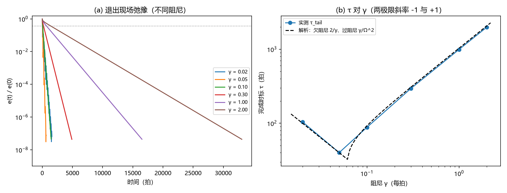

# 注记-BH3-3后续（时标侧）：格点退出的完成时标与重标瞬时性

- **日期**：2026-09-19 04:39:42
- **层级**：验证脚本/（理论验证材料，未确认）
- **脚本**：验证脚本/minimal_verification_bh33_exit_timescale.py（系统 Python 3.13 + numpy + scipy + matplotlib，确定性、无随机数，运行约 20 秒）
- **定位**：BH3-3 后续的时标侧可做部分（裁决十八遗留第三项的前半）：把「格点退出完成时标」拆为重标瞬时性与记录场弛豫两层，给出模型层最小读数；三维衔接的几何规定给两候选，转裁决二十二（拟议）。
- **关联**：[[验证脚本/注记-BH3-5留痕判据的一维先导：自动闭合几何与结构留痕]]（静态锚点来源）；[[验证脚本/注记-M6-S2R斜坡复核：记录跟随的阻尼判据（γ 扫描与微型坍缩）]]（γ 口径来源）；[[理论攻坚/黑洞线攻坚计划：坍缩机制重定位与强场终态]]（§二 BH3 行与 §六 J 组）；[[内部草稿/总结报告-黑洞线阶段总结：M6 与 BH3-4 终审收官：2026-09-19]]（遗留清单）
- **状态**：第一轮执行完成，判据 6/6 全过；读数：重标零时标；弛豫完成时标两极限标度与精确模式率一致；视界语境 τ_tail ≈ 0.64 r_h
- **图**：images/bh33_exit_timescale.png（双面板：退出现场弛豫曲线、τ 对 γ 与解析对照；见 §三 图 1）
- **修订记录**：
  - **2026-09-19 初版**（作者授权：作出最优选择并开工）

---

## 一、验证目标与判据

目标：把「格点退出完成时标」拆成两个可分别判定的环节。其一，几何重标本身的时标（离散镶嵌逆过程的既有口径为纯标记、瞬时全局、无物理传播）；其二，记录场在新旧邻接下的弛豫时标（由基本动力学决定，可测）。退出构型延续 BH3-5 一维先导（101 格、源 46 至 55、退出点 50；新链 100 格、源去该点），场按纯标记重标搬到新链，初值为旧稳态重标加新源。

判据（先立判据，再实现）：K0 静态锚点复现 BH3-5 读数（相对偏差 ≤ 5%）；K1 每档末态与静态解一致（≤ 1e-6 × e(0)）；K2a 小 γ 侧 τ ∝ 1/γ（斜率 −1 ± 0.1）；K2b 大 γ 侧 τ ∝ γ（斜率 +1 ± 0.1）；K3 尾段能量率对精确模式率（小 γ 对 γ；大 γ 对 $2|\lambda_1| = \gamma - \sqrt{\gamma^2 - 4\Omega_1^2}$）偏差 ≤ 10%；K4 视界语境（链格数 = r_h、γ = π/r_h）τ_tail / r_h ∈ [0.5, 0.8]（解析 2/π ≈ 0.637）。

完成时标取主口径 τ_tail = 2/λ_E（能量尾段衰减率折算的振幅 1/e 时间），旁证口径为 e(t) 首次降到 e(0)/e。

## 二、模型设定

一维链、格距 1、Dirichlet 0 边界（两端每步夹零）；静态方程 Lφ = −s（三点拉普拉斯，与 BH3-5 先导同一离散约定）。基本动力学取阻尼波动 φ_tt + γ φ_t = Lφ + s（裁决十六：阻尼波动为基本动力学；过阻尼为稳态与慢变化场合的有效描述）。时间积分取半隐式格式，步长 0.05（视界语境档 0.2），两档均满足稳定条件。γ 扫描取 0.02、0.05、0.1、0.3、1.0、2.0（交叉 γ* = 2Ω1 = 0.0622 两侧各三点）。视界语境实例化取 r_h = 1000 格、γ = π/r_h（S2R 校准口径，每拍），源为单格点，退出即去源并重标。

## 三、结果

判据 6/6 全过。静态锚点：结构留痕 $2.126\times10^{-2}$、质量项 $10.526\%$、结构/质量比 $0.2020$、线性分解残差 $0.0183$（与 BH3-5 先导四位一致）。弛豫读数如下表。

| γ（每拍） | τ(1/e)（拍） | τ_tail（拍） | τ_tail/预测 | λ_E 对解析比 | 末态偏差/e(0) |
|---|---|---|---|---|---|
| 0.02 | 35.0 | 104.3 | 1.043 | 0.958 | $6.5\times10^{-8}$ |
| 0.05 | 46.2 | 40.1 | 1.002 | 0.998 | $7.8\times10^{-8}$ |
| 0.10 | 74.7 | 88.0 | 0.955 | 1.047 | $4.6\times10^{-8}$ |
| 0.30 | 212.2 | 294.5 | 0.960 | 1.042 | $4.4\times10^{-8}$ |
| 1.00 | 704.7 | 992.5 | 0.961 | 1.040 | $4.4\times10^{-8}$ |
| 2.00 | 1409.0 | 1985.8 | 0.961 | 1.041 | $4.4\times10^{-8}$ |

标度读数：小 γ 侧斜率 $-1.044$、大 γ 侧斜率 $+1.038$；尾段率对精确模式率最大偏差 $4.7\%$。视界语境：τ_tail = 640.9 拍、τ(1/e) = 417.6 拍，τ_tail/r_h = 0.641（解析 2/π = 0.637）。

## 四、解读

其一，重标瞬时性：几何重标为零时标（纯标记、无传播），这与离散镶嵌逆过程的既有口径一致；可测的「完成时标」只由记录场弛豫给定。其二，弛豫时标的两极限与解析模式谱精确一致：欠阻尼侧所有模式共享衰减率 γ/2（τ = 2/γ），过阻尼侧最低模主导（τ = 1/|λ1|，精确式含交叉区修正），扫描与逐点对照均通过。

其三，视界语境读数：以 S2R 校准的 γ = π/r_h 与链格数 = r_h 折算，τ_tail = 0.641 r_h，即完成时标约为 0.64 倍视界光穿越时间（r_h/c）。

其四，三维衔接的几何规定两候选，报裁决二十二：候选一，沿主轴层收缩（离散镶嵌逆过程沿一轴实现，退出一层让位、三维中表现为一个方向的坐标压缩一格）；候选二，单点退出加近邻重建（局部腔闭合，近邻按最小面重连，协调数局部改变）。建议候选一：与离散镶嵌的逆过程严格对应，延续 BH3-5 一维先导的几何链条；候选二需要额外规定重连规则。

其五，与 BH4b 的接口：本读数只给「退出完成」的时间尺度，破坏发生的时间尺度与波形量级仍属 BH4b（待 C1）。

## 五、严格程度声明

K0 至 K4 为可复现数值事实（确定性脚本、判据与参数先写、图存档）。模型设定（一维链、格距 1、Dirichlet 边界、半隐式积分、γ 扫描范围）为本材料的模型层面选择；解析对照为精确模式率，非拟合。τ_tail 的定义（能量尾段率折算）为主口径，e(t) 首次到 1/e 为旁证口径，两者在欠阻尼侧差值明显（振荡所致），以主口径判据为准。

## 六、诚实边界

其一，一维玩具：退出几何、源图案与边界条件均为最小实现；三维衔接的几何规定未定（两候选待裁决）。其二，γ 的物理取值：视界语境档取 S2R 的校准口径（γ = π/r_h 每拍），该口径本身在模型层面；不同校准会移动 τ 的绝对数值，不改变两极限标度。其三，动力学口径：基本动力学取阻尼波动（裁决十六）；若改用纯过阻尼描述，欠阻尼侧不存在，读数按过阻尼支。其四，本材料不改动任何基准文件。

## 七、过程记录

三处订正。其一，首版未夹边界（Dirichlet 端自由演化），末态偏差恒为 0.17（与 γ 无关，为端点多出的一段差），改为每步夹零后末态偏差降到 $10^{-8}$ 级。其二，尾段拟合窗口由 1e-2 倍初值收到 1e-6 倍初值，避开混合模态段。其三，大 γ 侧解析参照由渐近式 γ/Ω1² 改精确模式率（交叉区修正），γ = 0.1 档偏差由 17% 降到 4.7%。

## 八、登记衔接

- 验证脚本/README.md 第 154 条（本注记落盘时同步）。
- [[内部草稿/开放问题总览：元相子理论待解决问题清单]] P1-34a：关联行补入本材料与裁决二十二。
- [[理论攻坚/黑洞线攻坚计划：坍缩机制重定位与强场终态]] §二 BH3 行与 §六 J 组同步。
