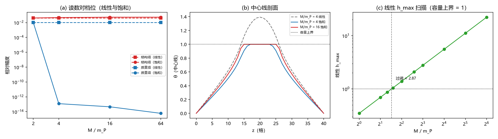

# 注记-BH3-3后续（饱和档三维痕迹）：容量裁剪在场的层收缩痕迹读数与档位订正

- **日期**：2026-09-19 08:46:37
- **层级**：验证脚本/（理论验证材料，未确认）
- **脚本**：验证脚本/minimal_verification_bh33_3d_sat_trace.py（系统 Python 3.13 + numpy + scipy + matplotlib，确定性、无随机数，运行约 55 秒）
- **定位**：M8 后续轮的饱和档部分（2026-09-19 作者裁决「列为后续轮」）：把三维层收缩痕迹读数推进到容量裁剪在场（写入律迭代稳态，与 S1 同源），并复核 M8 主案例档的容量状态。
- **关联**：[[验证脚本/注记-BH3-3后续（三维衔接）：层收缩静态痕迹验证]]（基线与本轮订正对象）；[[验证脚本/注记-M6-S1（可做部分）：真实场构型的写入律与容量裁剪]]（写入迭代与容量口径）；[[验证脚本/注记-BH3-5留痕判据的一维先导：自动闭合几何与结构留痕]]（判据源头）；[[理论攻坚/黑洞线攻坚计划：坍缩机制重定位与强场终态]]（附里程碑 M8 行与后续轮登记）
- **状态**：判据 9/9 全过。三组读数：容量状态订正（$M/m_P = 4$ 档线性 $h_{\max} = 1.3926 > 1$，过阈点 ≈ 2.872）；饱和档质量项吞没（≤ $1.2\times10^{-13}$）而结构项保留并略升（$4.185\times10^{-2}$ 至 $5.365\times10^{-2}$）；球面清除对照恢复非零（$1.32\times10^{-2}$ 与 $1.03\times10^{-1}$）。
- **图**：images/bh33_3d_sat_trace.png（三面板：读数对档位、中心线剖面、线性 h_max 扫描；见 §四 图 1）
- **修订记录**：
  - **2026-09-19 初版**（作者裁决：开工饱和档轮）

---

## 一、验证目标与判据

M8 的层收缩痕迹读数此前按线性（无裁剪）口径给出（结构留痕 $4.185\times10^{-2}$、比 4.1151、残差 0.0011），其容量裁剪在场版本留作后续轮。本材料执行该轮：饱和稳态用写入迭代（与 S1 同源），四档读数全面对照，并先复核 M8 主案例档的容量状态。

判据（先立判据，再实现）：

- S0a 复现：线性解在 M8 主案例（$R_s = 6$、$M/m_P = 4$）复现 M8 读数（结构 $4.185\times10^{-2}$、质量 $1.017\times10^{-2}$、比 4.1151、残差 0.0011；相对偏差 ≤ 5%）。
- S0b 容量状态复核：线性 $h_{\max}$ 在 $M/m_P = 2$ 档 < 1，在 4 档 > 1。
- S1 裁剪激活：饱和稳态在 4、16、64 档 $h_{\max} = 1$；裁剪格点数 > 0 且随档位单调不减。
- S2 锚点退化：2 档非线性解与线性解一致（场最大偏差 ≤ $10^{-9}$ 乘幅度）。
- S3 结构留痕非零：饱和档结构项 > $10^{-4}$。
- S4 质量项吞没：饱和档质量项 < $10^{-12}$。
- S5 分解残差：饱和档残差 < 0.1。
- S6 横向均匀性：饱和板源结构项横向相对起伏 < $10^{-8}$。
- S7 平台边界对照：清除格点移至球面外缘时质量项恢复非零（> $10^{-6}$，4 与 64 档）。

## 二、模型设定

几何与 M8 同口径：三维简单立方、格距 1，横向（x、y）周期、z 两端 Dirichlet 0；层收缩取 41 转 40（沿 z 去一层让位，源图案保持原索引）；差分取共同前缀窗口。球源为均匀球 $R_s = 6$ 格、总源 $s_{\text{tot}} = 4\pi M/m_P$；被清除质量取球心单格点（S7 对照取球面极格点 $(10, 10, 26)$）。

饱和稳态用写入迭代：$\theta \leftarrow \min(\bar\theta_{nn} + w, 1)$，$w = s/6$；未饱和区固定点满足 $L\theta = -s$，与 M8 线性方程同口径（S1 的写入律即此迭代，本轮把边界条件换成 M8 的横向周期加 z 狄利克雷）。线性参照解仍用稀疏直接求解（M8 同码），作同盒对照与迭代初值。

三组构型与 M8 一致：基准（原尺寸、全源）、结构项（层收缩、全源）、质量项（原尺寸、去清除格点源）、联合项（层收缩、去该源）。档位取 $M/m_P \in \{2, 4, 16, 64\}$（2 为未饱和锚点、4 为 M8 档、16 与 64 为饱和档）。板源案例取 z 向 16 至 24 的横截面均匀源、每格强度 1（与 M8 同口径），用于横向均匀性检查。

## 三、结果

判据 9/9 全过（运行约 55 秒）。

| 判据 | 结果 |
|---|---|
| S0a 复现 M8 读数 | 通过（结构 $4.185\times10^{-2}$、质量 $1.017\times10^{-2}$、比 4.1151、残差 0.0011，逐位） |
| S0b 容量状态复核 | 通过（2 档 0.6963 < 1；4 档 1.3926 > 1，超阈档） |
| S1 裁剪激活 | 通过（$h_{\max} = 1$；裁剪格点 215 / 871 / 925，单调不减） |
| S2 锚点退化 | 通过（2 档最大场偏差 $2.11\times10^{-15}$） |
| S3 结构留痕非零 | 通过（0.04765 / 0.05345 / 0.05365） |
| S4 质量项吞没 | 通过（$1.20\times10^{-13}$ / $4.55\times10^{-14}$ / $6.00\times10^{-15}$，阈值 $10^{-12}$） |
| S5 分解残差 | 通过（$4.4\times10^{-12}$ / $2.3\times10^{-13}$ / $3.5\times10^{-14}$） |
| S6 横向均匀性 | 通过（相对起伏 0.000） |
| S7 平台边界对照 | 通过（球面清除 1.322e-2 / 1.029e-1） |

| M/m_P | 线性 h_max | 裁剪格点 | 结构项（线性转饱和） | 质量项（线性转饱和） | 残差（线性转饱和） | 迭代数（基/构/质/联） |
|---|---|---|---|---|---|---|
| 2 | 0.6963 | 0 | 0.04185 转 0.04185 | 0.01017 转 0.01017 | 0.0011 转 0.0011 | 1/1/1/1 |
| 4 | 1.3926 | 215 | 0.04185 转 0.04765 | 0.01017 转 1.20e-13 | 0.0011 转 4.4e-12 | 8486/8364/8484/8362 |
| 16 | 5.5705 | 871 | 0.04185 转 0.05345 | 0.01017 转 4.55e-14 | 0.0011 转 2.3e-13 | 5603/5462/5603/5462 |
| 64 | 22.2820 | 925 | 0.04185 转 0.05365 | 0.01017 转 6.00e-15 | 0.0011 转 3.5e-14 | 5480/5329/5480/5329 |

读数的三点判读如下。

容量状态订正。扫描给出过阈点 $M/m_P \approx 2.872$：2 档与 2.5 档的线性解低于容量上界，3 档起越过。M8 主案例档（$M/m_P = 4$、$R_s = 6$）的线性 $h_{\max} = 1.3926$，属超阈档。M8 注记原「未饱和档」标定转引自 S1 在 $R_s = 8$ 的扫描（同档未过阈），跨构型转引不成立；M8 的读数本身（无裁剪线性解）逐位复现无误，本轮只订正其容量标定。

饱和读数三点。其一，容量裁剪在场后结构项保留并略升：$4.185\times10^{-2}$ 升到 $4.765\times10^{-2}$、$5.345\times10^{-2}$、$5.365\times10^{-2}$。其二，质量项被容量吞没：$1.017\times10^{-2}$ 降到 $10^{-13}$ 级（迭代噪声量级）。其三，线性分解残差随吞没一并归零（$10^{-12}$ 级以下）。

吞没的机制直接可读：被清除的球心格点及其六个邻格全部处于裁剪平台（取值恰为 1），移除该格源后其更新值仍被平台钉住，其余格的方程与取值不变，故差分精确为零（数值残留为迭代噪声）。该掩蔽是位置性的：把清除格点移到球面外缘（邻域不全在平台内），质量项恢复非零，且随饱和档增大（4 档 $1.32\times10^{-2}$、64 档 $1.03\times10^{-1}$）。

板源对照：饱和求解下横向均匀性保持机器级（相对起伏 0.000），容量操作不破坏横向对称。

## 四、图

## 五、严格程度

本材料为可复现数值事实（确定性脚本、判据先写、图存档）。两套求解器：线性参照用稀疏直接解（M8 同码），饱和稳态用写入迭代（S1 同码形），四套配置全部收敛（末拍 dmax ≤ $1.0\times10^{-12}$；迭代数 5329 至 8486）。锚点校验：2 档非线性解与线性解逐位一致（$2.11\times10^{-15}$）。全部结论以脚本内判据为准，运行约 55 秒。

## 六、诚实边界

其一，静态：本轮只取痕迹的静态读数（弛豫终态差），动力学与时标不涉及。其二，模型层面：$J = \lambda = 1$ 惯例、层收缩几何（裁决二十二）、横向周期与 z 狄利克雷为 M8 同口径。其三，吞没判读限于「清除格点及邻域处于裁剪平台内」的情形；平台外照常留痕（S7 对照），S7 的球面位置取球面极格点。其四，收敛水平 $10^{-12}$：对 $10^{-2}$ 级读数无影响，$10^{-13}$ 级残留按噪声读，不作物理量。其五，$M/m_P$ 的物理标定待 P1-2（$\kappa_\phi$ 上限与单格点容量），与 S1-3 门槛不齐同源。其六，本材料不改动任何基准文件。

## 七、过程记录

其一，容量状态订正（本轮主要发现）：开工探针即测出 M8 档线性 $h_{\max} = 1.3926 > 1$，「未饱和档」表述不成立。教训：凡声明无裁剪的档位必须直接测该构型的 $h_{\max}$，不得从他构型的扫描转引（S1 扫描固定 $R_s = 8$，M8 取 $R_s = 6$，过阈位置随之移动）。

其二，判据订正一处：S4 初版写「质量项随档位下降（4 > 16 > 64）」，实测为机器零级吞没，判据以噪声级残留形式通过，不稳健；订正为阈值型「< $10^{-12}$（吞没）」。教训：对不可达零的读数不设单调型判据，改用阈值或零位判据。

其三，设计补项：为支撑「吞没限于平台内部」的判读，首轮后增设 S7 平台边界对照（球面清除），预算内增两套求解。

## 八、登记衔接

- 验证脚本/README.md 第 177 条（本注记落盘时同步）。
- M8 注记：定位、关联、§二、§五、§六 的容量标定订正并补修订记录。
- [[黑洞强场判别的适用域：有效描述、口径纪律与观测对照]]：§5.2 标定订正、§7 同步（修订记录补记）。
- [[内部草稿/开放问题总览：元相子理论待解决问题清单]]：新增本材料关联子项。
- [[理论攻坚/黑洞线攻坚计划：坍缩机制重定位与强场终态]] 附里程碑 M8 行同步；修订记录补执行条。
