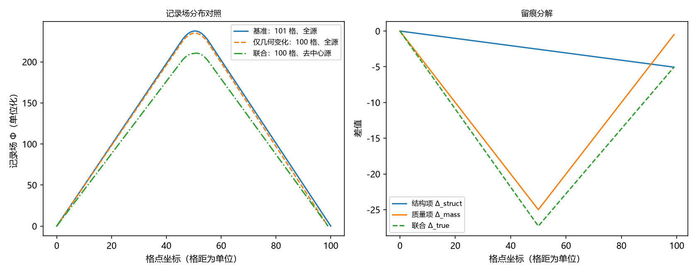

# 注记-BH3-5留痕判据的一维先导：自动闭合几何与结构留痕

- **日期**：2026-09-16 07:55:09
- **层级**：验证脚本/（理论验证材料，未确认）
- **脚本**：`验证脚本/autoclose_trace.py`（系统 Python 3.13 + numpy 2.4.1 + matplotlib 3.11.0，确定性、无随机数，运行约 1 秒）
- **定位**：BH3-5 衔接判据（格点退出应留下可观测痕迹）的一维先导执行：检验自动闭合几何（J1）与结构留痕的存在性与可分离性（J2、J3）。判据 5 项全过。
- **关联**：[[内部草稿/注记-BH3-5执行：终态图景与二候选的对应关系、绕数去向与留痕判据]]（判定与判据设计处）；[[内部草稿/注记-黑洞内部机制的候选方案：物质汇聚、晶格破坏与本原吸收]]（自动闭合机制原文）；[[理论总纲/元相子理论的时空观：体系对时空的完整认识]] §8（离散镶嵌与让位链）；[[内部草稿/注记-强场三候选的表述层次审查：回绕的物理内容与缠绕的第一道闸门]] 第八节（衔接判据来源）；开放问题总览 P1-34a
- **状态**：第一轮执行完成，判据 5 项全过。未提交作者裁决。
- **图**：`images/autoclose_trace.png`（两面板：记录场分布对照、留痕分解；见 §三 图 1）
- **修订记录**：
  - **2026-09-16 初版**（作者指示：做 BH3-5）
    - 自动闭合几何与结构留痕的五项判据；一维泊松对照与留痕分解
  - **2026-09-16 同日修订**（作者指出：财会类隐喻违反写作铁律）
    - 三处财会类隐喻表述改写（质量项、两项、分解）

---

## 一、验证目标与判据（判据先行）

J1a 坐标差收缩：退出点两侧邻居的坐标差由 2 变 1。

J1b 格距与计数：全链相邻坐标差恒为 1；格点总数减一；总跨度减一；重标中任何格点坐标变动不超过一个格距。

J2a 结构留痕非零：源图案固定、只变格点几何（链 101 与 100）时，记录场最大相对差大于 $1\times10^{-4}$。

J2b 项可分离：结构项与质量项之比小于 1（结构留痕不主导）。

J3 线性分解：联合项与结构项加质量项的残差小于 0.1。

预期先行：J1 三条是自动闭合机制原文的直接转写，应当精确成立；J2a 预期在 $10^{-3}$ 至 $10^{-1}$ 量级（结构效应为链长倒数量级）；J2b 预期结构项小于质量项。

## 二、模型设定

**框架**。一维链，格距为 1（单位化）；记录场取离散泊松方程 $(\Phi_{i+1} - 2\Phi_i + \Phi_{i-1}) = -s_i$，Dirichlet 零边界（场在两端外趋于零）；源为固定图案的 10 个质量单元（位置 46 至 55，各源强 1）。单位化：格距、源强与 $4\pi G$ 均取 1，结论只用量级与相对值。

**格点退出的实现**。退出点取 50 号格点：删除该格点，其右侧格点的坐标各减一（让位链反向重标）；于是 49 与 51 的坐标差由 2 变 1，格距全程不变，链长减一。三条机制文字（坐标差 2 变 1、格距不变、边界靠拢）由 J1 逐条核对。

**四个配置**。其一，基准：链 101 格、源齐全。其二，仅几何变化：链 100 格、源齐全（源图案固定在绝对位置，检验「空间收缩一格」本身的印记）。其三，仅质量变化：链 101 格、去掉中心一个源。其四，联合：链 100 格、去掉中心一个源（真实情形：空间收缩与质量离场同时发生）。

**留痕分解**。结构项 $= \Phi_{二} - \Phi_{一}$；质量项 $= \Phi_{三} - \Phi_{一}$；联合项 $= \Phi_{四} - \Phi_{一}$。判据要求结构项非零（退出事件的印记不能被完全归入质量变化），且三者的线性可加性成立。

## 三、结果

| 判据 | 读数 | 结果 |
|---|---|---|
| J1a | 邻居坐标差 2 变 1 | PASS |
| J1b | 总数 101 变 100；跨度 100 变 99；最大坐标变动 1 格距 | PASS |
| J2a | 结构留痕相对幅度 $2.13\times10^{-2}$ | PASS |
| J2b | 结构与质量之比 0.202 | PASS |
| J3 | 线性分解残差 0.018 | PASS |

幅度明细：基准幅 237.5；结构项幅 5.05；质量项幅 25.0；联合项幅 27.30。

## 四、解读

其一，结构留痕非零且量级自洽。空间收缩一格在记录场上留下约 $2.1\%$ 的印记，与链长倒数（约 $2\%$）一致；质量项约 $10.5\%$，是结构项的五倍。判据要求的「结构项非零、且不被质量项吞并」成立。

其二，两项近似独立。联合项与结构加质量的残差 $1.8\%$，线性分解可用。这给「留痕 = 结构印记 + 质量印记」的分解方式提供了数值支持。

其三，边界附近的差异（判据原话的「边界附近」）在右面板可见：差值集中在源区与退出点一侧，远离源区处迅速减小；这与「边界附近的记录场分布与无破坏情形不同」的表述方向一致。

其四，注意事项：本先导只检验机制必要性（留痕存在、可分离），幅度为链长倒数量级、温和而非剧烈；黑洞语境的可观测版本（三维、强场）不在本材料范围。

## 五、严格程度声明

- J1 三条：自动闭合机制原文（离散镶嵌逆过程）的实现层核对。
- J2a、J2b、J3：一维最小模型（线性泊松响应、固定源图案、Dirichlet 边界、单位化）上的机制必要性演示。
- 阈值 $1\times10^{-4}$ 为宽松下界（防平凡零），非物理门槛。

## 六、诚实边界

其一，一维、线性、无自引力反馈（场不反作用于源与格点）；源图案固定是刻意的对照设计，不模拟 kink 随结构重排的动力学。

其二，「纯几何变化」的实现为链长 101 变 100（边界靠拢一格）；未覆盖「退出点位于源区内部时 kink 落点」的细节（该细节依赖复合位错动力学，属 C1 与 M4 接口）。

其三，本先导不涉及绕数（波性侧荷），只涉及记录场（法线场）；三维版留痕判据属 M4 之后。

## 七、过程记录

其一，设计迭代一处：源图案若取「相对链中心对称」的布置，在均匀收缩下两侧效应互抵、结构留痕会被对称性掩盖；改为固定绝对位置布置后结构效应显现（$2.1\%$）。

其二，初版判据全过，无读数修正；图注按绘图代码逐面板核对。

## 八、登记衔接

- 开放问题总览 P1-34a 的 BH3-5 子项补脚本与注记路径（已同步）。
- `验证脚本/README.md` 第 69 条（已同步）。
