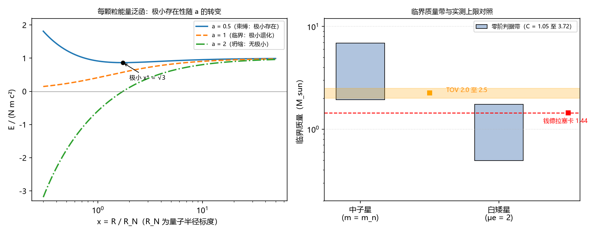

# 注记-BH4a支撑失效的最大质量零阶判据：相空间压缩、相对论化软化与临界质量带

- **日期**：2026-09-16 06:55:53
- **层级**：验证脚本/（理论验证材料，未确认）
- **脚本**：`验证脚本/minimal_verification_bh4a_max_mass.py`（系统 Python 3.13 + numpy 2.4.1 + matplotlib 3.11.0，确定性、无随机数，运行数秒）
- **定位**：BH4a 的零阶执行：把「支撑失效」落实为「有限半径束缚极小不存在」，导出临界质量的结构 $M_c = C\,m_P^3/m^2$ 与量级带，与钱德拉塞卡极限（1.44 M☉）和 TOV 极限（2.0 至 2.5 M☉）对照。判据 12 项全过。
- **关联**：[[理论攻坚/黑洞线攻坚计划：坍缩机制重定位与强场终态]]（BH4a 任务定义）；[[内部草稿/注记-黑洞坍缩机制的方案重定位：补位排除、时标论证与候选排序]]（输入清单）；[[内部草稿/注记-P1-34a零阶平衡方程：写入-补位竞赛的阈值分析与作用域诊断]]（时标口径的互补判据）；[[内部草稿/研究方向-统一奇点截断原理：温度截断与几何饱和的合流]]；[[理论总纲/元相子理论的时空观：体系对时空的完整认识]] §7、§8；[[碰撞写入标架几何：引力场的碰撞写入与费米子的转换波运动]]；[[冲突诊断/注记-粒子运动速度的决定因素：质量、动量与色散]]；[[温度的波粒互补定义：复相干无序度作为热力学标尺]]；[[内部草稿/注记-普朗克质量的角色：引力响应的满量程标度，非空间实体质量]]；开放问题总览 P1-34a、P1-33
- **状态**：第一轮执行完成，判据 12 项全过。未提交作者裁决。
- **图**：`images/bh4a_max_mass.png`（两面板：能量泛函极小存在性转变、临界质量带与 TOV 与钱德拉塞卡对照；见 §三 图 1）
- **修订记录**：
  - **2026-09-16 初版**（作者指示：从 BH4a 开工）
    - 三项输入的核对、能量泛函与临界条件的解析构造
    - 脚本判据 B1 至 B5 共 12 项全过；图 1（两面板）
    - B2 判据由倍率阈值改为带覆盖式（见过程记录）
  - **2026-09-16 同日修订**（作者指示：图应在 markdown 内直接显示）
    - 元数据补「图」行（见 §三 图 1）；正文图 1 嵌入复核

---

## 一、判据先行

BH4a 的任务是写出引力势阱、缺陷动能与传播上限三者的平衡关系，给出最大质量的量级与常数因子，对照白矮星与中子星上限。执行前先把任务翻译为可证伪的判据。

**B1（结构）**：把「支撑失效」定义为「能量泛函 $E(R)$ 不再存在有限半径的束缚极小」。解析期望：临界条件 $a = 0.6w = 1$（$a$ 与 $w$ 见第二节）；$a<1$ 有极小、$a=1$ 极小退化到压缩端、$a>1$ 无局部极小。

**B2（量级）**：临界质量带与两类实测上限对照。期望：TOV 区间与钱德拉塞卡值落在带内。

**B3（必要性）**：去掉相对论化（等效于去掉传播上限的软化角色）后，任意 $N$ 都应有束缚极小，最大质量消失。

**B4（不活跃性）**：温度（无序度）上限在恒星尺度不活跃，不应进入判据。期望：每颗粒引力束缚能与 $E_P$ 之比小于 $10^{-15}$。

**B5（同构）**：作为对照，数值解 $n=3$ 多方球（Lane-Emden）方程，复核标准精密解的系数，确认零阶判据与标准结构同构。

## 二、模型设定

**三项输入**。引力势阱取定案的碰撞写入静态势阱，颗粒模型下 $E_g = -\frac{3}{5}\frac{GM^2}{R}$（均匀密度球的位力系数，零阶）。

缺陷动能由转换波承载，两个要素。其一，波包被压缩到颗粒间距 $d = (N/V)^{1/3}$ 时，相位梯度（动量）有下界 $k \gtrsim (N/V)^{1/3}$（傅里叶共轭，波性侧的粗粒推论）。其二，能动量关系取相对论形式 $E = \sqrt{m^2c^4 + \hbar^2c^2k^2}$（洛伦兹结构定理化；kink 色散的具体形式属 P1-33 待验证期望）。

传播上限即每拍一格的晶格因果（几何恒等式 $c = l_P/t_P$）。它在判据里的物理角色是**软化**：当相位梯度给出的群速度逼近 $c$，动能对压缩的响应由 $R^{-2}$（非相对论）转为 $R^{-1}$（极端相对论），引力才可能在系数竞争中取胜。若无软化，动能以 $R^{-2}$ 抬升，任何 $N$ 都有平衡解（B3 验证）。

**无量纲化**。记量子半径标度 $R_N = \frac{\hbar}{mc}\left(\frac{3N}{4\pi}\right)^{1/3}$、$x = R/R_N$，每颗粒能量（以 $mc^2$ 为单位）为

$$f(x) = \sqrt{1 + x^{-2}} - \frac{3}{5}\frac{w}{x}, \qquad w = \left(\frac{4\pi}{3}\right)^{1/3} N^{2/3} \left(\frac{m}{m_P}\right)^2.$$

求导得 $f'(x) = \frac{1}{x^2}\left(a - \frac{1}{\sqrt{x^2+1}}\right)$，$a = 0.6w$。三个区间随之确定：$a<1$ 极小存在，位置 $x^* = \sqrt{1/a^2-1}$；$a=1$ 全域 $f'>0$ 且 $f(0^+)\to 0^+$（极小退化到压缩端）；$a>1$ 全域 $f'>0$ 而压缩端无下界（$f \to -\infty$，坍缩）。

**临界与质量**。$a=1$ 给出 $N_c^{2/3} = \frac{5}{3}\left(\frac{3}{4\pi}\right)^{1/3}\left(\frac{m_P}{m}\right)^2$，即

$$M_c = C\,\frac{m_P^3}{m^2}, \qquad C_{lo} = 1.0513\ (\text{下界口径}).$$

**对照口径**。极端相对论费米气的精确动能系数 $\frac{3}{4}\left(\frac{9\pi}{4}\right)^{1/3} = 1.4394$（标准物理），对应 $C_F = 3.7156$，作为统计参考口径。两个口径构成质量带，宽度 3.53 倍。

**两类天体**。中子星：颗粒即中子（$m = m_n$），$M = m_n N$。白矮星：支撑颗粒为电子、重力质量为每电子 $\mu_e m_u$（取 $\mu_e = 2$），临界质量写成 $M_c = C\,\frac{m_P^3}{(\mu_e m_u)^2}$。

## 三、结果

| 判据 | 读数 | 结果 |
|---|---|---|
| B1a 极小位置（$a=0.5$） | 数值 1.732051 对解析 $\sqrt{3}$，偏差 0.0000% | PASS |
| B1a 极小值 | 数值 0.866025 对 $\sqrt{3}/2$，偏差 0.0000% | PASS |
| B1b 极小消失（$a=2$） | 全域 $f' > 0$ | PASS |
| B1c 临界单调（$a=1$） | 全域 $f' > 0$；$f(0.01) = 0.005000$ 趋 $0^+$ | PASS |
| B2 中子星带 | 1.943 至 6.867 M☉；TOV 2.0 至 2.5 落在带内 | PASS |
| B2 白矮星带 | 0.494 至 1.747 M☉；钱德拉塞卡 1.44 落在带内 | PASS |
| B3 非相对论仍有极小 | 数值 0.046416 对解析，偏差 0.0000% | PASS |
| B3 相对论同 $N$ 无极小 | 单调下行至 $-\infty$ | PASS |
| B4 温度不活跃 | 中子星 $1.9\times10^{-20}$、白矮星 $3.2\times10^{-23}$ | PASS |
| B5 多方球系数 | $\omega_3 = 2.018236$ 对文献 2.018236，偏差 0.0000% | PASS |
| B5 标准组装 | $M_{Ch} = 1.4563$ M☉ 对名义 1.44，偏差 1.13% | PASS |

## 四、临界质量的结构与读法

**公式的形式**。$M_c = C\,m_P^3/m^2$ 与钱德拉塞卡公式同构：标准精密解的系数为 $\omega_3\sqrt{3\pi}/2 = 3.098$（除以 $\mu_e^2$，对应 1.456 M☉），零阶判据把它换成 $O(1)$ 量级带 $[1.05, 3.72]$。同构的两侧是同一件事：量子压缩动能（$\hbar c$ 层）与引力（$G$ 层）的系数竞争。

**物理内容三层**。其一，波包压缩使相位梯度（动能）随密度抬升，支撑依赖量子压缩；其二，传播上限使高动量端能量线性化（$E \approx \hbar c k$），压缩响应软化，引力不再必输；其三，胜负由无量纲数 $a$ 的系数比较决定，临界时 $N^{2/3} \sim (m_P/m)^2$，即「普朗克-颗粒质量比的平方」。

**$m_P$ 的角色**。公式里的 $m_P = \sqrt{\hbar c/G}$ 是引力的量纲入口与写入满偏标度（[[内部草稿/注记-普朗克质量的角色：引力响应的满量程标度，非空间实体质量]]），不含「空间实体质量」的读法；恒星质量尺度由 $(\hbar c/G)$ 与颗粒质量组合而成。

**两类天体的数字**。中子星带 1.943 至 6.867 M☉，TOV 2.0 至 2.5 落在带内（对照/下界口径 = 1.13 倍，对照/费米口径 = 0.32 倍）；白矮星带 0.494 至 1.747 M☉，1.44 落在带内（对照/下界 = 2.91 倍，对照/费米 = 0.82 倍）。

**三输入必要性**。引力提供坍缩趋势（去之则无判据对象）；相空间下界提供支撑需量（去之则无抵抗）；传播上限提供软化（去之则无最大质量，B3 给出数值对照：非相对论动能下 $N = 100N_c$ 仍有有限极小）。

**与 P1-34a 的关系**。P1-34a 的时标口径（$\tau_{ff} = R/c$）给出紧致度条件 $\theta \sim 1$，回答「准静态图像何时失效」；BH4a 回答「为何在某个质量上突然坍缩」，给出的是相空间-系数条件。两者互补，前者管星体整体，后者管颗粒压缩。

**温度的位置**。温度上限（$D \le 1$，定理级）在恒星尺度差 19 至 22 个数量级（B4），不参与判据；本判据的「热」内容全部住在动能-相空间语言里，温度定义只用于这项活跃性核查。

## 五、严格程度声明

- 引力势阱与每拍一格：定案 / 几何恒等式（判据级）。
- 相空间下界 $k \gtrsim n^{1/3}$：模型假设（量级下界；傅里叶共轭的粗粒形式，结构因子与统计未计）。
- 能动量关系的相对论形式：条件性命题（洛伦兹结构定理化；kink 色散属 P1-33 待验证）。
- 均匀密度位力系数 $3/5$：零阶近似。
- 温度-无序度定义：定理级（本注记只用于活跃性核查）。
- 临界质量：量级判据（系数带 $C \in [1.05, 3.72]$，宽度 3.53 倍，不承诺精确常数）。
- B5 对照：标准物理的精确数值（用于同构展示，不属体系断言）。

## 六、诚实边界

其一，本材料验证的是结构与量级：临界质量的存在性、$N_c$ 的解析形式、量级带与两类对照。不验证精确常数；不验证动力学过程（坍缩时标与触发，BH4b）；不验证强场终态（BH3）；不构成对 P1-34a 三候选的裁决。

其二，相空间下界为粗粒取法；若做统计处理（费米 / 玻色、结构因子、三维缺陷形态），系数会移动，费米参考口径由此把带上端从 1.05 移到 3.72。体系未定案费米统计，故本判据不依赖统计细节，这一点的代价是无法替代精确系数的统计推导。

其三，牛顿引力零阶：GR 修正未纳入。已知标准方向是 GR 强场效应把中子星上限下拉（TOV 低于牛顿估算），与统计加成的抬升方向相反；中子星「下界口径 1.94 M☉」与真实 TOV 的接近含两条修正相抵的成分，如实标注。

其四，未验证项：kink 色散（P1-33）、缺陷统计（未定案）、相空间下界的微观推导（傅里叶形式到晶格结构的严格化）。

## 七、过程记录

其一，判据修正一处。B2 初版按「对照 / 带两端倍率 ≤ 3」判定，中子星费米口径 0.291 倍边缘判负；生效判据改为「对照区间落在带内」并补带宽报告。理由：零阶判据的产出是量级带（宽 3.53 倍），对照的合理检验是落在带内，倍率阈值把带宽当成了误差。

其二，实现修补一处（首轮运行缺 matplotlib 导入，补入；不影响读数）。

其三，图注按脚本绘图代码逐面板核对（本机图像查看不可用，以绘图代码与像素有效性检查替代）。

## 八、登记衔接

本注记落盘时已同步两处：开放问题总览 P1-34a 条目补注；`验证脚本/README.md` 第 62 条。

建议：BH4c（运动引力增强）执行时在势阱项上加 $\gamma$ 修正并重算临界带，本判据可作为其对照基线。
