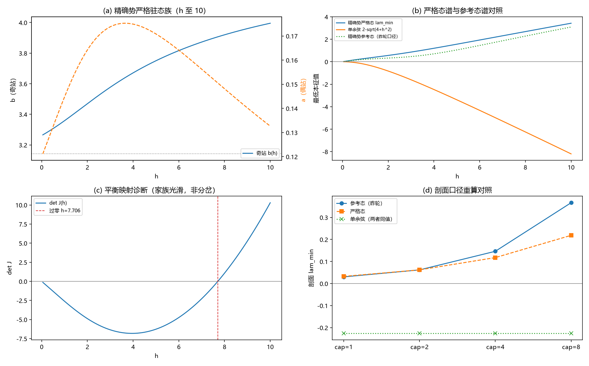

# 注记-BH6 可选后续二轮（严格驻态族）：h 至 10 的驻态连续化、稳定性与剖面口径重算

- **日期**：2026-09-20 00:09:58
- **层级**：验证脚本/（理论验证材料，未确认）
- **脚本**：验证脚本/bh6_strict_family.py（系统 Python 3.13 + numpy + scipy + matplotlib，确定性、固定种子，运行约 40 秒）
- **定位**：把上一轮登记的「全 h 严格驻态扫描与参考态口径重算」执行完毕：给出精确势严格驻态族 (a(h), b(h)) 的连续解与稳定谱，重算剖面口径，补足延长斜坡的时域覆盖，并澄清昨轮时域帽的运行长度口径。
- **关联**：[[验证脚本/注记-BH6 可选后续（滑移与超满偏）：稳定性图谱与触发通道判定]]（上一轮与登记）；[[验证脚本/注记-BH6 后续轮（口径重设）：时域触发的平衡背景重设与静态-动态一致性]]（参考态口径与 S3N 锚）；[[理论攻坚/黑洞线攻坚计划：坍缩机制重定位与强场终态]]（BH6 行与里程碑 M9）
- **状态**：执行完成，判据 11/11 全过；读数：严格族 $h \in [0.05, 10]$ 全程存在且稳定（$\lambda_{\min}$ 由 $+0.0173$ 到 $+3.4267$）；参考口径重算同向（差值 $\le 0.1479$）；时域补至 $h = 10$ 不触发
- **图**：images/bh6_strict_family.png（四面板：驻态族、谱对照、映射诊断、剖面口径重算；见 §三 图 1）
- **修订记录**：
  - **2026-09-20 初版**（作者指示：优选并执行）
  - **2026-09-20 后续三轮回填（大种子扫掠）**（作者指示：大种子扫掠）：诚实边界其四改「已由后续三轮执行」；势垒门与落点读数见 [[验证脚本/注记-BH6 后续三轮（大种子扫掠）：势垒门的幅度定位与落点分类]]

---

## 一、目标与判据

上一轮把精确势档的参考背景定性为参考态而非严格驻态（偶站力 $2\vert\sin\bar\theta\vert$ 随 $h$ 增大），并登记两项后续：全 $h$ 的严格驻态扫描、参考态口径的重算。本轮把两项执行完毕，并顺带补足时域覆盖（延长斜坡至 $h = 10$）与一处运行长度口径澄清。

判据（先立判据，再实现）：Q1 单余弦严格族（$(0, \pi)$ 全程驻定，残差 $\le 10^{-12}$）；Q2 精确势严格族（$h \in [0.05, 10]$ 连续解，残差 $\le 10^{-9}$，导数有界）；Q3 锚点（$a(1) = 0.144743$、$b(1) = 3.358391$，偏差 $\le 10^{-5}$）；Q4 严格谱（闭式对全数值 $\le 10^{-9}$；精确势全正、单余弦全负）；Q5 映射诊断（det J 的符号与过零位置；过零邻域光滑、解支数不变）。

Q6 剖面严格驻态（牛顿松弛残差 $\le 10^{-9}$；精确势全正；参考态重算复现昨轮读数 $\le 10^{-6}$）；Q7 通道（严格态上滑移与交错 Rayleigh 商为正）；Q8 时域（单余弦静态档触发；精确势静态档与延长斜坡不触发，背景偏移 $\le 10^{-9}$）；Q9 能量（全部运行漂移 $\le 20\%$）。

## 二、模型设定

模型与约定同前两轮：一维周期链（$N = 256$、$J = \lambda = 1$、$\mathrm dt = 0.02$、漏斗剖面 $h_0$、阈值 $0.3$、$\Gamma = 0.001$），势取单余弦与归一化精确势（$V''(0) = 1$）；交错规范 Hessian 与前两轮同式。

严格驻态指两元力平衡（偶站 $a$、奇站 $b$）的连续解：$2\sin(b - a) = hV'(b)$ 与 $V'(a) = -V'(b)$。剖面严格驻态由当地构造初值（按各点局部 $h$ 插值取 $(a, b)$）加牛顿松弛（解析 Jacobian）得到；时域静态档指 $h(a)$ 恒为 cap 与剖面的乘积（无斜坡），延长斜坡指 $a_{\max} = 10$。

## 三、结果

判据 11/11 全过（运行约 40 秒）。

| 判据 | 结果 |
|---|---|
| Q1 单余弦严格族 | 通过（最大梯度 $9.8\times10^{-16}$） |
| Q2 连续化 | 通过（200 点，最大残差 $1.8\times10^{-15}$） |
| Q3 锚点 | 通过（0.144743 / 3.358391） |
| Q4 严格谱 | 通过（闭式偏差 $\le 8.9\times10^{-16}$；最小 $+0.017299$，$h = 10$ 处 $+3.426662$） |
| Q5 映射诊断 | 通过（过零 $h = 7.7060$；邻域光滑 0.01%；非分岔） |
| Q6 剖面重算 | 通过（四档残差 $\le 1.3\times10^{-11}$；参考态复现偏差 $\le 1.8\times10^{-07}$） |
| Q7 通道 | 通过（滑移 $+1.926910$、交错 $+4.104868$） |
| Q8 时域 | 通过（单余弦 0.059；精确势三档不触发） |
| Q9 能量 | 通过（延长斜坡漂移 $1.00\times10^{-01}$） |

严格族关键读数（两元力平衡的连续解）：

| h | a（偶站） | b（奇站） | det J | $\lambda_{\min}$ |
|---|---|---|---|---|
| 0.5 | 0.132494 | 3.307070 | -1.3043 | +0.158961 |
| 1 | 0.144743 | 3.358391 | -2.6050 | +0.296284 |
| 2 | 0.164224 | 3.469669 | -4.8788 | +0.561167 |
| 4 | 0.174933 | 3.671107 | -6.8093 | +1.198623 |
| 8 | 0.148144 | 3.919967 | +1.0745 | +2.685595 |
| 10 | 0.132661 | 3.995592 | +10.2933 | +3.426662 |

剖面口径重算对照（$\lambda_{\min}$；cap = 1 / 2 / 4 / 8）：

| 口径 | 1 | 2 | 4 | 8 |
|---|---|---|---|---|
| 参考态（昨轮） | +0.030219 | +0.061949 | +0.146291 | +0.366600 |
| 严格态（本轮） | +0.032523 | +0.062157 | +0.117717 | +0.218681 |
| 差值 | +0.002304 | +0.000208 | -0.028574 | -0.147919 |
| 单余弦（同昨轮读数） | -0.226039 | -0.818250 | -2.464485 | -6.241595 |

时域读数：

| 运行 | a_trig | 末端 $\vert z\vert$ | 背景偏移 | 漂移 |
|---|---|---|---|---|
| 单余弦静态档 cap = 1 | 0.059 | 3.034 | （触发后不适用） | 0.00 |
| 精确势静态档 cap = 1 | 未触发 | $5.193\times10^{-14}$ | $2.3\times10^{-11}$ | 0.00 |
| 精确势静态档 cap = 4 | 未触发 | $4.587\times10^{-14}$ | $1.8\times10^{-12}$ | 0.00 |
| 精确势延长斜坡 cap = 10 | 未触发 | 0 | （跟踪态不适用） | $1.00\times10^{-01}$ |

## 四、解读

其一，严格族全程存在且稳定。两元力平衡的连续解在 $h \in [0.05, 10]$ 上逐点可解（残差机器级）；$a(h)$ 在 $h \approx 4$ 处取极大 0.174933 后回落，$b(h)$ 单调上行（3.307 到 3.996）；严格谱 $\lambda_{\min}$ 全程为正，由 $+0.017299$（$h = 0.05$）升到 $+3.426662$（$h = 10$）。单余弦档 $(0, \pi)$ 恒为严格驻态，谱为 $2 - \sqrt{4 + h^2}$ 恒负。

其二，参考态口径重算同向。剖面四档的参考态读数与严格态读数同号，差值最大 0.147919（cap = 8，严格态更低）；cap 1 与 cap 2 的差值在 0.003 以内。昨轮以参考态给出的「精确势档正谱、不触发」在严格口径下成立，参考态读数是该量级的忠实近似。

其三，映射诊断（观察项）。平衡映射的雅可比行列式 det J 在 $h = 7.706$ 过零（最小 $-6.8102$ 于 $h = 3.95$，最大 $+10.2933$ 于 $h = 10$），但过零邻域家族光滑（步长加倍导数变化 0.01%）、解支数不变（窗口内两支持续存在），故非分岔；该过零的物理含义未定，登记为观察项备查。

其四，时域。单余弦静态档以最快速率触发（$a_{\text{trig}} = 0.059$，与谱同量级）；精确势静态档（cap 1、4）不触发且背景偏移仅 $10^{-11}$ 至 $10^{-12}$（严格驻态上背景不再滑动，与昨轮参考态运行的滑动形成对照）；延长斜坡（$a_{\max} = 10$）不触发、末端衰减为零、能量漂移 10%。

其五，口径澄清。昨轮时域三档中，cap 4 档受运行长度限制（$a_{\max} = 2.5$）实际止于 $h = 2.5$；本轮以延长斜坡补至 $h = 10$，结论不变（不触发）。该澄清已回填昨轮注记。

## 五、严格程度声明

Q1 至 Q9 为可复现数值事实（确定性脚本、判据先写、图存档；连续解残差 $\le 1.8\times10^{-15}$；严格谱闭式对全数值偏差 $\le 8.9\times10^{-16}$；剖面严格态牛顿残差 $\le 1.3\times10^{-11}$；锚点与昨轮逐位一致）。

## 六、诚实边界

其一，一维；三维推广未做。其二，剖面严格驻态的牛顿初值取当地构造，不排除异支（已核残差与谱的正性）。其三，det J 过零的物理含义未定（观察项）。其四，大种子扫掠已由后续三轮执行（门读数与落点分类见 [[验证脚本/注记-BH6 后续三轮（大种子扫掠）：势垒门的幅度定位与落点分类]]）。其五，本材料不改动任何基准文件。

## 七、过程记录

三处。其一，Q5 判据首版差分口径写错（分子同段除以 0.1），修正后过零邻域光滑度 0.01%。其二，时域帽的覆盖受 $a_{\max}$ 限制是昨轮未登记的隐性口径（cap 4 档实际至 $h = 2.5$），本轮以延长斜坡补足并回填。其三，det J 过零一度疑为折点，经导数光滑性与解支核查排除，降级为观察项。

## 八、登记衔接

- 验证脚本/README.md 第 188 条（本注记落盘时同步）。
- [[理论攻坚/黑洞线攻坚计划：坍缩机制重定位与强场终态]]：§二 BH6 行与附里程碑 M9 行补严格驻态族轮状态；修订记录补一条。
- [[内部草稿/开放问题总览：元相子理论待解决问题清单]] P1-34a：关联行补入本材料。
- [[验证脚本/注记-BH6 可选后续（滑移与超满偏）：稳定性图谱与触发通道判定]]：修订记录补回填一条；诚实边界其四改「已由后续二轮执行」。
