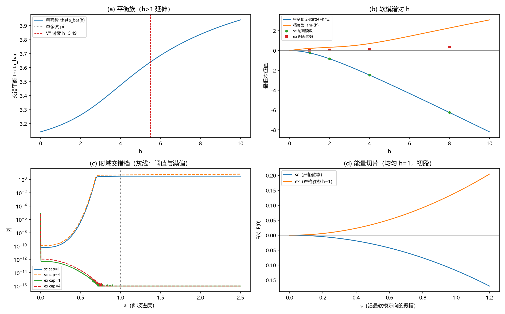

# 注记-BH6 可选后续（滑移与超满偏）：稳定性图谱与触发通道判定

- **日期**：2026-09-19 22:20:50
- **层级**：验证脚本/（理论验证材料，未确认）
- **脚本**：验证脚本/bh6_h_gt_1.py（系统 Python 3.13 + numpy + scipy + matplotlib，确定性、固定种子，运行约 45 秒）
- **定位**：BH6 可选后续轮：把上一轮登记的两项候选（滑移或均匀位移种子、$h > 1$ 参数区）做成判据并执行，判定精确势档的触发缺口能否由换种子方向或超满偏参数区补上；并交叉核对上一轮的两处口径（曲率对比数值、参考背景驻定性）。
- **关联**：[[验证脚本/注记-BH6 后续轮（口径重设）：时域触发的平衡背景重设与静态-动态一致性]]（上一轮与两项候选登记）；[[验证脚本/注记-BH6（大振幅非线性）：精确异类势下的失稳时钟与两通道核对]]（M9 首轮）；[[理论攻坚/黑洞线攻坚计划：坍缩机制重定位与强场终态]]（BH6 行与里程碑 M9）
- **状态**：执行完成，判据 10/10 全过；读数：两项候选均为否（滑移与均匀种子、$h$ 至 10 都不补精确势档的触发缺口）；势形敏感为结构性；附曲率对比订正（$1.34h$）与参考背景驻定性限定
- **图**：images/bh6_h_gt1.png（四面板：平衡族、软模谱、时域模式幅度、能量切片；见 §三 图 1）
- **修订记录**：
  - **2026-09-19 初版**（作者指示：开工 BH6 可选后续轮）
  - **2026-09-20 后续三轮回填（大种子扫掠）**（作者指示：大种子扫掠）：诚实边界其三补阈值协议门扫描的指向（门 1.61 至 2.72 弧度/点）
  - **2026-09-20 后续二轮回填（严格驻态族）**（作者指示：优选并执行）：严格族全 $h$ 连续化与剖面口径重算已执行（判据 11/11，结论同向，剖面差值 $\le 0.15$）；时域 cap 覆盖的口径澄清（cap 4 档实际止于 $h = 2.5$）见 [[验证脚本/注记-BH6 可选后续二轮（严格驻态族）：h 至 10 的驻态连续化、稳定性与剖面口径重算]]

---

## 一、目标与判据

上一轮把两项候选留在登记：其一，其他种子方向（滑移或均匀位移）能否让精确势档触发；其二，$h > 1$（满偏之外）参数区是否出现触发。本轮把两项做成可证伪判据，并顺带交叉核对上一轮的曲率对比数值与参考背景驻定性。

判据（先立判据，再实现）：P1 锚点（$\bar\theta(1) = 3.19002$、剖面谱 $-0.22604$ 与 $+0.03022$、均匀 $h = 1$ 精确势 $+0.21802$，偏差 $\le 10^{-4}$）；P2 谱延伸（两组八档均匀背景的全数值最低本征值与二维子格闭式一致，偏差 $\le 10^{-8}$）；P3 符号图谱（$h \in [0.5, 10]$ 上单余弦全负、精确势全正；剖面加帽 cap $\in \{1, 2, 4, 8\}$ 符号不翻转）；P4 通道（滑移与交错方向的物理 Rayleigh 商两模型均正，均匀方向在精确势上正）。

P5 时域（锚点档复现 0.674；精确势五档均不触发且衰减到底；单余弦 cap = 4 触发量级一致）；P6 能量（阈值档运行漂移 $\le 20\%$）；P7 势形（单余弦沿软模切片下降；精确势严格驻态的 $\lambda_{\min}$ 为正且切片上升）。

## 二、模型设定

主协议与上一轮一致：一维周期链（$N = 256$、$J = \lambda = 1$、过阻尼梯度流 $\mathrm dt = 0.02$、漏斗剖面 $h(a) = \min(ah_0, \mathrm{cap})$、种子 $\pm\varepsilon_0 u$、阈值 $0.3$、$\Gamma = 0.001$），势取单余弦与归一化精确势（$V''(0) = 1$）；交错规范 Hessian 与前两轮同式（脚本式 $K$）。

本轮新增三件事。其一，参数区扩到 $h \le 10$；时域帽 cap $\in \{1, 2, 4\}$。其二，三个种子方向：交错（$\pm\varepsilon_0(-1)^n$）、滑移（奇子格整体位移）、均匀位移（全链同移），观测量取各自方向，静态通道强度用物理 Rayleigh 商（$K_{\mathrm{true}} = D K_{\mathrm{script}} D$，$D = \mathrm{diag}((-1)^n)$）。其三，严格驻态抽点：精确势档在 $h = 1$ 解两元力平衡（偶站 $a$、奇站 $b$），核对驻定性并计算该态谱。

## 三、结果

判据 10/10 全过（运行约 45 秒）。

| 判据 | 结果 |
|---|---|
| P1 锚点 | 通过（3.190018 / -0.226039 / +0.030219 / +0.218016） |
| P2 谱延伸 | 通过（八组偏差 $\le 1.8\times10^{-15}$） |
| P3 符号图谱 | 通过（单余弦最大 -0.061553、精确势最小 +0.130267；剖面四帽不翻转） |
| P4 通道 | 通过（滑移 +1.710945 / +1.898228；交错 +3.999971 / +4.090096） |
| P5 时域 | 通过（0.674 / 0.670；精确势五档不触发、末端 0） |
| P6 能量 | 通过（阈值档漂移 $\le 5.82\times10^{-2}$） |
| P7 势形 | 通过（单余弦 -0.004721；精确势 $\lambda_{\min} = +0.296284$、切片 +0.005884） |

关键读数表（左列留空处两列依次为单余弦与精确势）：

| 项 | 单余弦 | 精确势 |
|---|---|---|
| 平衡族扩展 | $\bar\theta = \pi$（恒） | $\bar\theta(2) = 3.261310$、$\bar\theta(4) = 3.475467$、$\bar\theta(8) = 3.837815$、$\bar\theta(10) = 3.941005$ |
| 均匀背景软模（$h = 1$ / 2 / 4 / 8） | -0.236068 / -0.828427 / -2.472136 / -6.246211 | +0.218016 / +0.327316 / +0.704373 / +2.280652 |
| 剖面加帽（cap = 1 / 2 / 4 / 8） | -0.226039 / -0.818250 / -2.464485 / -6.241595 | +0.030219 / +0.061949 / +0.146291 / +0.366600 |
| 通道 Rayleigh（交错 / 滑移 / 均匀） | +3.999971 / +1.710945 / -0.000029 | +4.090096 / +1.898228 / +0.094785 |
| 软模投影（交错 / 滑移 / 均匀；上一轮口径） | 0.312 / 0.271 / 0.072 | 0.515 / 0.370 / 0.008 |
| 时域 a_trig（交错 cap 1 / 4；滑移；均匀） | 0.674 / 0.670；0.568；0.554 | 五档均未触发（末端 $\vert z\vert = 0$） |
| 参考背景偶站力 $2\vert\sin\bar\theta\vert$（$h = 1$ / 2 / 4 / 8） | $2.4\times10^{-16}$（严格驻态） | 0.096814 / 0.238864 / 0.655411 / 1.282648 |

## 四、解读

其一，两项候选均为否。$h$ 从 1 扩到 10，精确势档的软模本征值全程为正（均匀背景最小值 $+0.130267$ 在 $h = 0.5$；剖面加帽四档全正），时域三档帽（1、2、4；cap 4 档受运行长度限制实际止于 $h = 2.5$）全部不触发且差分衰减到底；滑移与均匀位移两个种子方向在精确势档同样不触发。触发缺口不能靠换种子方向或超满偏补上。

其二，原因在软模曲率的闭式里。交错扇区的二维子格约化给出 $\lambda_-(h) = -2\cos\bar\theta + h(V''_0 + v_2)/2 - \sqrt{[h(V''_0 - v_2)/2]^2 + 4\cos^2\bar\theta}$。

其中 $\bar\theta = \bar\theta(h)$、$v_2 = V''(\bar\theta(h))$、$V''_0 = V''(0) = 1$。单余弦退化为 $2 - \sqrt{4 + h^2}$，对全部 $h > 0$ 恒负。

精确势的曲率对比 $V''_0 - v_2$ 为 1.34（单余弦为 2），且 $v_2$ 随 $\bar\theta(h)$ 上行于 $h = 5.4946$ 过零后转正，使 $\lambda_-$ 持续上行（$h = 8$ 处已到 $+2.280652$）。两侧符号的差异在全部 $h > 0$ 上结构性存在，并无参数窗口可以翻转。

其三，滑移方向的静态强度在两模型上均为正（1.710945 与 1.898228），均匀方向在精确势上为正（$+0.094785$）、在单余弦上为边缘零模（$-2.9\times10^{-5}$，近零）。单余弦档三种种子仍全部触发（0.674 / 0.568 / 0.554），触发时刻按初始投影（$5.0\times10^{-6}$ / $1.13\times10^{-5}$ / $1.60\times10^{-5}$）排序，可见增长由同一不稳定扇区承载，差异只在初始投影。

其四，触发形态：单余弦档沿软模能量下降（$s = 0.2$ 处 $-0.004721$，弱失稳、无正垒），精确势档在严格驻态（偶站 0.144743、奇站 3.358391，梯度残差 $1.4\times10^{-16}$）上 $\lambda_{\min} = +0.296284$、切片初段上升（$+0.005884$）；配大种子探针（$\varepsilon = 0.5$，初始投影 4.12）末态回落至 0。精确势档的触发为势垒型，越过需要非线性通道，小种子一律回弹。

其五，两处口径交叉核对。曲率对比数值订正：$h[V''(0) - V''(3.19)] = 1.34h$（上一轮解读句原记 0.92h 系笔误，已同步订正）。

参考背景驻定性限定：单余弦档的参考背景严格驻定（梯度 $2.4\times10^{-16}$）；精确势档的参考背景（偶站 0、奇站 $\bar\theta(h)$）满足奇站力平衡、偶站不满足，偶站力 $2\vert\sin\bar\theta\vert$ 随 $h$ 从 0.097 增到 1.28，属参考态而非严格驻态。本轮谱读数按参考态口径计算，时域判定（差分动力学）不依赖该驻定性，严格驻态在 $h = 1$ 的抽点已补。

## 五、严格程度声明

P1 至 P7 为可复现数值事实（确定性脚本、判据先写、图存档；平衡族根用区间法求到机器级；谱为稠密矩阵本征分解，均匀背景与二维子格闭式偏差 $\le 1.8\times10^{-15}$；严格驻态用 fsolve 求根，残差 $1.4\times10^{-16}$）。锚点（3.19002 / -0.22604 / +0.03022 / +0.21802）与上一轮逐位一致，构成跨轮交叉锚点。

## 六、诚实边界

其一，一维；三维推广未做。其二，阈值口径（0.3）与漏斗剖面沿用 S3N，未扫描。其三，大种子探针只做一例（$\varepsilon = 0.5$），非阈值协议，作定性回弹证据；阈值协议的门扫描与落点分类见后续三轮（[[验证脚本/注记-BH6 后续三轮（大种子扫掠）：势垒门的幅度定位与落点分类]]）。

其四，严格驻态族只抽 $h = 1$ 一点；全 $h$ 的严格驻态扫描与参考态口径的重算已由后续二轮执行（剖面差值 $\le 0.15$、同向，见 [[验证脚本/注记-BH6 可选后续二轮（严格驻态族）：h 至 10 的驻态连续化、稳定性与剖面口径重算]]）。其五，精确势参考背景的非驻定性（偶站力随 $h$ 增大）使剖面加帽谱与严格驻态谱之间存在口径差；本轮两种口径给出同向结论（均为正、均不触发）。其六，本材料不改动任何基准文件。

## 七、过程记录

三处教训。其一，能量漂移判据首版把 $\varepsilon = 0.5$ 的大种子探针纳入，运行得 72% 判 FAIL；探针属非阈值协议，判据作用域应写清，修正后阈值档最大漂移 5.82%。

其二，能量切片首版直接做在精确势参考背景上，出现 $+0.132$（$s = 0.2$）的线性项；顺藤核出参考背景非严格驻态（偶站力 $2\vert\sin\bar\theta\vert$），改用严格驻态抽点后切片干净（$+0.005884$，$\lambda_{\min} = +0.296284$）。

其三，曲率对比数值 0.92h 经 $V''(3.19002) = -0.343976$ 复核为 1.34h，已同步上一轮注记、README 第 169 条与开放问题登记行。

## 八、登记衔接

- 验证脚本/README.md 第 185 条（本注记落盘时同步）。
- [[理论攻坚/黑洞线攻坚计划：坍缩机制重定位与强场终态]]：§二 BH6 行与附里程碑 M9 行补可选后续状态；修订记录补一条。
- [[内部草稿/开放问题总览：元相子理论待解决问题清单]] P1-34a：关联行补入本材料，两处口径订正同步。
- [[验证脚本/注记-BH6 后续轮（口径重设）：时域触发的平衡背景重设与静态-动态一致性]]：修订记录补订正与限定一条。
