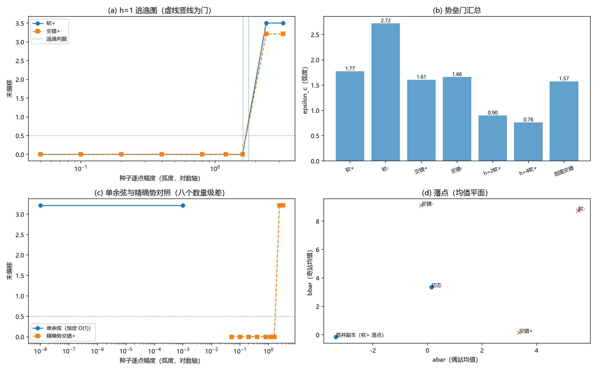

# 注记-BH6 后续三轮（大种子扫掠）：势垒门的幅度定位与落点分类

- **日期**：2026-09-20 02:49:36
- **层级**：验证脚本/（理论验证材料，未确认）
- **脚本**：验证脚本/bh6_large_seed.py（系统 Python 3.13 + numpy + scipy + matplotlib，确定性，运行约 45 秒）
- **定位**：把两侧登记的「大种子扫掠」执行完毕：在严格驻态上把势垒型触发从定性升级为幅度读数（四个方向的势垒门、门上方落点分类、h 与剖面档趋势），并对照单余弦的无垒行为。
- **关联**：[[验证脚本/注记-BH6 可选后续二轮（严格驻态族）：h 至 10 的驻态连续化、稳定性与剖面口径重算]]（严格驻态与登记）；[[验证脚本/注记-BH6 可选后续（滑移与超满偏）：稳定性图谱与触发通道判定]]（单例大种子探针与登记）；[[理论攻坚/黑洞线攻坚计划：坍缩机制重定位与强场终态]]（BH6 行与里程碑 M9）
- **状态**：执行完成，判据 7/7 全过；读数：势垒门 1.61 至 2.72 弧度/点（四方向）；门上方落点为简并副本或低能态（后者能量低 182.4661）；单余弦 1e-8 弧度即逃逸
- **图**：images/bh6_large_seed.png（四面板：逃逸图、门汇总、单余弦对照、落点平面；见 §三 图 1）
- **修订记录**：
  - **2026-09-20 初版**（作者指示：大种子扫掠）

---

## 一、目标与判据

前两轮把精确势档的触发形态判为势垒型（小种子回弹、严格驻态正谱），但只有一例大种子探针（0.5 弧度量级，非阈值协议）。本轮以严格驻态为背景做阈值协议扫描，把势垒型升级为可用的幅度读数。

判据（先立判据，再实现）：T1 驻定与锚点（h=1 均匀严格态 (a,b) = (0.144743, 3.358391)、梯度 $\le 10^{-6}$、$\lambda_{\min} = +0.296284$）；T2 小种子回归（0.1 与 1.0 弧度、两方向四种种子全部完整回归：末偏移 $\le 10^{-4}$、末端梯度 $\le 10^{-9}$、能量回到 $E_{\mathrm{bg}}$）；T3 门定位（四方向二分，精度 $\le 1\%$）；T4 落点分类（门上方一档的落点、简并性核验）。

T5 h 依赖（h=2、4）；T6 剖面档；T7 单余弦对照（1e-8 即逃逸）；T8 稳健性（确定性、逃逸档末端梯度、时长）。

## 二、模型设定

模型与约定同前三轮（$N = 256$、$J = \lambda = 1$、$\mathrm dt = 0.02$、$\Gamma = 0.001$）；均匀档 $h$ 恒为常数，剖面档 $h = \mathrm{cap}\cdot h_0$。

种子按逐点幅度口径：软模方向取 $\sqrt N$ 归一（逐点均方根 = 幅度），交错方向逐点位移即幅度。运行长度：均匀档 $a_{\max} = 0.3$、剖面档 $0.6$；逃逸判据为末偏移 $> 0.5$（回归档实测 $\le 10^{-4}$ 量级，两带之间裕度极大）。h=2、4 档的种子方向固定取 h=1 的软模（同方向不同背景的对照口径）。

## 三、结果

判据 7/7 全过（运行约 45 秒）。

| 判据 | 结果 |
|---|---|
| T1 锚点 | 通过（0.144743 / 3.358391；梯度 $1.4\times10^{-16}$；谱 $+0.296284$） |
| T2 小种子回归 | 通过（八档全部回归：末偏移 $\le 2.6\times10^{-14}$、梯度 $\le 1.1\times10^{-14}$、能量回零） |
| T3 门定位 | 通过（软+ 1.7704；软- 2.7205；交错+ 1.6069；交错- 1.6590） |
| T4 落点分类 | 通过（四方向均逃逸；三类落点，见下表） |
| T5 h 依赖 | 通过（h=2：0.8986；h=4：0.7621） |
| T6 剖面档 | 通过（cap=1 交错方向：1.5733） |
| T7 单余弦对照 | 通过（$10^{-8}$ 弧度即逃逸；末偏移 1.823；能量降 32.000） |

门汇总表（逐点幅度口径，弧度）：

| 方向/档 | 软+ | 软- | 交错+ | 交错- | h=2 软+ | h=4 软+ | 剖面交错 | 单余弦交错 |
|---|---|---|---|---|---|---|---|---|
| 门 epsilon_c | 1.7704 | 2.7205 | 1.6069 | 1.6590 | 0.8986 | 0.7621 | 1.5733 | <= 1e-8 |

落点分类（门上方 1.1 倍幅度处）：

| 方向 | 幅度 | (abar, bbar) | 子格内 std | E_fin - E_bg | 键 + 位分解 | 类别 |
|---|---|---|---|---|---|---|
| 软+ | 1.9474 | (-3.358, -0.145) | 0.000 / 0.000 | -0.000 | -255.3 + 189.2 | 镜像副本 |
| 软- | 2.9926 | (+5.527, +8.741) | 0.000 / 0.000 | +0.000 | -255.3 + 189.2 | 镜像副本（跨周期） |
| 交错+ | 1.7676 | (+3.358, +0.145) | 0.000 / 0.000 | -0.000 | -255.3 + 189.2 | 交换副本 |
| 交错- | 1.8249 | (-0.216, +9.102) | 0.000 / 0.000 | -182.466 | -254.5 + 5.9 | 低能态 |

低能态精确化（独立核对）：$a = -\delta$、$b = 2\pi\sqrt2 + \delta$，$\delta = 0.216025$（平衡残差 $5\times10^{-16}$）；$E = -248.5984$（低 182.4661）；谱全正（$\lambda_{\min} = +0.965249$、$\lambda_{\max} = +4.942389$），为稳定驻态。

## 四、解读

其一，门读数。h=1 四个方向的势垒门在 1.61 至 2.72 弧度/点之间（软+ 1.77、软- 2.72、交错+ 1.61、交错- 1.66）；1.02 弧度及以下的种子全部完整回归（末偏移机器级、能量回零），说明精确势档的稳定性不是缓慢回弹，而是硬门。

其二，门与单余弦的量级差。单余弦档 $10^{-8}$ 弧度即逃逸（末态偏移 1.823、能量降 32），精确势档门为 O(1) 弧度：两者相差约八个数量级，把势形敏感在触发侧的量级写实。

其三，落点分类。三个方向的门上方落点为简并副本（镜像 $(-b, -a)$ 或交换 $(b, a)$，能量与初态差 $\le 10^{-3}$）；交错- 方向落点为低能态（能量低 182.4661）：$a = -\delta$、$b = 2\pi\sqrt2 + \delta$、$\delta = 0.216025$ 的 ± 对称构型（键 -254.5、位 +5.9），谱全正，属体系的新驻态候选。该态此前各轮未出现，为本轮首次登记。

其四，h 与剖面趋势。门随 h 下降（h=1 的 1.77 到 h=2 的 0.90、h=4 的 0.76）；剖面档 cap=1 的 1.5733 与均匀档同量级。趋势方向与背景更硬、盆更浅的直觉一致。

其五，与触发图像的关系。本轮把势垒型判据补全为三段式：门以下完整回归、门以上落入简并副本或低能态；结合前两轮的线性谱全正，精确势档在扰动协议下的触发语义至此完整。

## 五、严格程度声明

T1 至 T7 为可复现数值事实（确定性脚本、判据先写、图存档；门为二分定位，精度 $\le 1\%$；落点为准驻态核验，末端梯度 $\le 4.4\times10^{-14}$；低能态有独立精确解核对）。

## 六、诚实边界

其一，一维；三维推广未做。其二，门依赖运行长度（$a_{\max} = 0.3/0.6$）与末偏移判据（0.5）：临界带内为慢速穿越，门值有运行长度依赖。

其三，落点分类取门上方 1.1 倍幅度处的读数，边界邻域可能混合。其四，种子只有两方向四符号，非全空间最优（门为所选方向上的读数）。其五，低能态只核对了 h=1 一点，其族与全局最优性未扫。其六，本材料不改动任何基准文件。

## 七、过程记录

三处。其一，T7 首版解包笔误（run_static 返回六元组），修正后通过。其二，交错- 的低能落点由能量诊断发现（初版只打印均值；补子格内 std 与键/位分解后确认是均匀驻态），并以独立精确解（$\delta$ 的区间法）核对。其三，h=2、4 档固定用 h=1 软模方向（同方向对照口径），已在 §二声明。

## 八、登记衔接

- 验证脚本/README.md 第 193 条（本注记落盘时同步）。
- [[理论攻坚/黑洞线攻坚计划：坍缩机制重定位与强场终态]]：§二 BH6 行与附里程碑 M9 行补大种子扫掠状态；修订记录补一条。
- [[内部草稿/开放问题总览：元相子理论待解决问题清单]] P1-34a：关联行补入本材料。
- [[验证脚本/注记-BH6 可选后续二轮（严格驻态族）：h 至 10 的驻态连续化、稳定性与剖面口径重算]] 与 [[验证脚本/注记-BH6 可选后续（滑移与超满偏）：稳定性图谱与触发通道判定]]：诚实边界对应条改「已由后续三轮执行」，修订记录各补一条。
