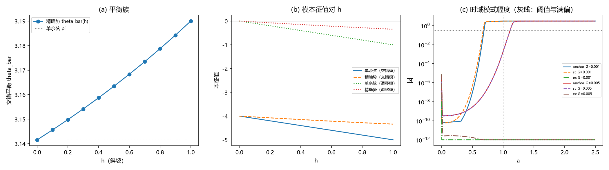

# 注记-BH6 后续轮（口径重设）：时域触发的平衡背景重设与静态-动态一致性

- **日期**：2026-09-19 06:09:37
- **层级**：验证脚本/（理论验证材料，未确认）
- **脚本**：验证脚本/minimal_verification_bh6_convention.py（系统 Python 3.13 + numpy + scipy + matplotlib，确定性、固定种子，运行约 30 秒）
- **定位**：BH6 后续轮（M9 口径发现的处置）：把时域触发比较的背景、种子与观测量按各模型自身的驻态族重设后重新对照，并给出「触发与否」与「平衡族静止谱符号」的逐组一致性核对。
- **关联**：[[验证脚本/注记-BH6（大振幅非线性）：精确异类势下的失稳时钟与两通道核对]]（M9 首轮与口径发现）；[[验证脚本/注记-M6-S3N（非线性在场一读）：斜坡驱动的交错失稳与线性时钟定性对照]]（时域协议与参考模锚点）；[[理论攻坚/黑洞线攻坚计划：坍缩机制重定位与强场终态]]（裁决二十三与 BH6 行）
- **状态**：执行完成，判据 8/8 全过；读数：精确势交错平衡族存在（$\bar\theta(1) = 3.19002$）、剖面静止谱最低本征值 $+0.03022$（单余弦 $-0.22604$）；重设口径后精确势档两档不触发、与谱符号逐组一致（四组）
- **图**：images/bh6_convention.png（三面板：平衡族、模本征值对 h、时域模式幅度；见 §三 图 1）
- **修订记录**：
  - **2026-09-19 初版**（作者指示：接 BH6 后续轮）

---

## 一、目标与判据

M9 首轮的时域对照暴露一处口径问题：单余弦档用的 $\pi$ 绕数交错背景在精确势下不是驻态（$V_{ex}'(\pi) = -0.0793$），种子在背景迁移中被消耗，两档不触发。本轮按 M9 §四之四登记的三件套（各自驻态背景、同型种子、各自不稳定模观测量）重设口径，重新对照。

判据（先立判据，再实现）：D1 平衡族（偶站 0、奇站 $\bar\theta$ 的交错背景满足 $2\sin\bar\theta = h\,V'(\bar\theta)$；单余弦 $\bar\theta = \pi$ 机器级，精确势数值根残差 $\le 1\times10^{-12}$）。

D2 静止谱（各自平衡背景的 Hessian 最低本征值与最低模对交错种子的重叠；单余弦剖面须复现 S3N 参考模 $-0.22604$）；D3 时域锚点（单余弦档按 S3N 原口径复现 $0.689$ / $1.113$，偏差 $\le 5\%$）；D4 静态-动态一致性（口径重设后四组「触发与否」与各自谱符号逐组一致，能量漂移 $\le 20\%$）；D5 口径登记。

## 二、模型设定

一维周期链（$N = 256$、过阻尼梯度流 $\mathrm dt = 0.02$、漏斗剖面 $h(a) = \min(ah_0,1)$、种子 $\pm\varepsilon_0(-1)^n$、阈值 $0.3$）；$J = \lambda = 1$；势取单余弦与归一化精确势（$V''(0) = 1$，同 M9）。

交错平衡族由背景 Hessian 取 $K_{nn} = -J[\cos(\Delta_{n-1}) + \cos(\Delta_n)] + \lambda h_n V''(\theta_n)$、$K_{n,n\pm1} = -J\cos(\Delta_n)$，最低本征值 $\mu_{\min}$ 的符号即该背景的交错失稳判据。时域观测量：锚点档沿用 S3N 的投影向量；对照档取各模型自身平衡背景的最低模投影。

## 三、结果

判据 8/8 全过（运行约 30 秒）。

| 判据 | 结果 |
|---|---|
| D1 平衡族 | 通过（单余弦 $\bar\theta = \pi$，残差 $2.4\times10^{-16}$；精确势 $\bar\theta(1) = 3.19002$，最大残差 $3.3\times10^{-15}$） |
| D2 静止谱（锚点） | 通过（单余弦剖面 $\mu_{\min} = -0.22604$，与 S3N 参考模逐位一致；最低模对交错种子重叠 0.312） |
| D2 静止谱（精确势） | 报告（$\mu_{\min} = +0.03022$；均匀 $h = 1$ 档 $+0.21802$；重叠 0.515） |
| D3 时域锚点 | 通过（0.689 / 1.113；锁定 3.0664） |
| D4 静态-动态一致性 | 通过（四组一致：单余弦两档触发（0.674 / 1.113）、精确势两档不触发；能量漂移 $\le 0.001$） |
| D5 口径登记 | 通过 |

## 四、解读

其一，精确势的交错平衡族存在且随 h 移动：$\bar\theta$ 由 $\pi$（h = 0）移到 3.19002（h = 1），残差在机器级；单余弦族恒为 $\pi$。其二，静止谱给出本轮核心读数：单余弦剖面 $\mu_{\min} = -0.22604$（弱不稳定，与 S3N 逐位一致），精确势剖面 $\mu_{\min} = +0.03022$（微弱稳定）。来源是曲率对比的下降：单余弦的对比为 $h[V''(0) - V''(\pi)] = 2h$，精确势降为 $h[V''(0) - V''(3.19)] = 0.92h$，把弱不稳定推过了零点。

其三，口径重设后的时域与谱逐组一致（四组）：单余弦档照常触发（重设口径后 0.674 / 1.113），精确势档两档均不触发。M9 的「不触发」属势形引起的真实差异（$\pi$ 绕数背景的非驻定性只解释了 M9 那一轮的一部分）。

其四，触发语义的移动：交错种子类在精确势下不触发；要看到精确势的触发，需要其他种子方向（滑移或均匀位移）或 $h > 1$（满偏之外）的参数区，属后续可选轮。

其五，对 BH6 首轮结论的补充：有限振幅时钟移动（$\le 3$ 倍）与两通道核对不受本轮影响；本轮补充的是「触发判据（哪种种子会生长）对势形敏感」这一适用域限定。

## 五、严格程度声明

D1 至 D5 为可复现数值事实（确定性脚本、判据先写、图存档；平衡族根用区间法求到机器级；谱为稠密矩阵本征分解）。D2 的单余弦剖面与 S3N 参考模逐位一致，构成本轮 Hessian 约定的交叉锚点。

## 六、诚实边界

其一，一维；三维推广未做。其二，阈值口径（0.3）与漏斗剖面沿用 S3N，未扫描；精确势 $\mu_{\min} = +0.03$ 属微弱稳定，阈值与剖面的变化可能使边缘行为移动（口径敏感性登记）。其三，观测量：对照档用各自最低模投影、锚点档用 S3N 的投影，两种观测量给出的 $a_{\text{trig}}$ 有小差（0.674 对 0.689），属观测量敏感而非失稳差异。其四，滑移模与 $h > 1$ 的触发回合作后续可选轮。其五，本材料不改动任何基准文件。

## 七、过程记录

一处实现错误与一处教训。首版背景 Hessian 的对角项符号写反（写成 $+J\cos$ 而非 $-J\cos$），读数成了谱值的整体平移（约 $-4$），D4 首跑被判 FAIL。以「单余弦档必须复现 S3N 参考模 $-0.22604$」为交叉锚点抓出：修正后逐位一致。教训：涉及背景态的线性化，先以既有材料的参考模数值做交叉锚点，再使用谱结论；本轮同时复核了 M9 的时域对照，其「不触发」在新谱下获得完整解释。

## 八、登记衔接

- 验证脚本/README.md 第 169 条（本注记落盘时同步）。
- [[理论攻坚/黑洞线攻坚计划：坍缩机制重定位与强场终态]]：§二 BH6 行补后续轮状态；修订记录补一条。
- [[内部草稿/开放问题总览：元相子理论待解决问题清单]] P1-34a：关联行补入本材料。
