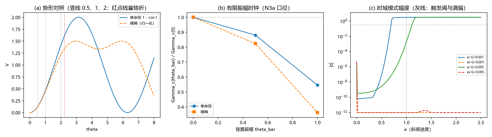

# 注记-BH6（大振幅非线性）：精确异类势下的失稳时钟与两通道核对

- **日期**：2026-09-19 05:35:05
- **层级**：验证脚本/（理论验证材料，未确认）
- **脚本**：验证脚本/bh6_large_amplitude.py（系统 Python 3.13 + numpy + matplotlib，确定性、固定种子，运行约 20 秒）
- **定位**：BH6 首轮（M9）：把单余弦弱版（裁决十七的适用域限定）换成精确异类势（三对配对、周期 $2\pi\sqrt2$、二次系数归一），核对三件事：失稳时钟是否移动、满偏前后能量有界性、与饱和及耦合两通道的相互作用；并登记一处时域口径发现。
- **关联**：[[验证脚本/注记-M6-字典对账：归一化口径对齐、J 惯性反推与识别项的可推导边界]]（精确异类能与周期）；[[验证脚本/注记-M4-D2两路触发的竞争：交叉写入速率与三维退化]]（时钟口径与锚点）；[[验证脚本/注记-M6-S3N（非线性在场一读）：斜坡驱动的交错失稳与线性时钟定性对照]]（时域协议与对照）；[[理论攻坚/黑洞线攻坚计划：坍缩机制重定位与强场终态]]（裁决十七、二十三与里程碑 M9）
- **状态**：首轮执行完成，判据 9/9 全过；读数：满偏处精确势与单余弦的差为值 $-$4%、力 $-$8%、曲率 $-$34%；有限振幅时钟移动比 0.36 至 0.88（均 ≤ 3 倍）；时域口径发现一处（见 §四之四）
- **图**：images/bh6_large_amplitude.png（三面板：势形对照、有限振幅时钟、时域模式幅度；见 §三 图 1）
- **修订记录**：
  - **2026-09-19 初版**（作者裁决：M9 开工）

---

## 一、目标与判据

目标：大振幅非线性（裁决十七「单余弦为弱版有效形式」之后的另立项）首轮，回答裁决二十三冻结的三问：完整余弦项下失稳交叉是否移动；满偏前后能量有界性；与饱和及耦合两通道的相互作用。

判据（先立判据，再实现）：B0 解析梯度对中心差分核对（两势，机器级）；B1 归一化精确势的二次系数与单余弦一致（$1\times10^{-6}$ 内）且周期 $2\pi\sqrt2$ 严格；B2 势形表报告（值、一阶、二阶导在 $\theta = 0.5$、$1$、$2$ 处的比与首转折点）。

B3 时钟锚点复现 D2 一维读数（$\Gamma_c = 3.566\times10^{-2}$，$\le 10^{-3}$）；B4 有限振幅时钟移动比落 $[0.1, 10]$；B5a 单余弦档复现 S3N 时域读数（$0.689$、$1.113$，$\le 5\%$）。

B5b 四档能量相对漂移 $\le 20\%$ 且锁定有限；B5c 背景语义量化（sc 驻定、ex 非驻定）；B5d 口径发现登记（ex 档种子不触发、背景漂移量化）。

## 二、模型设定

势：单余弦 $V_{sc} = 1 - \cos\theta$（$V''(0) = 1$）；精确异类势按三对配对（配对角 $\sqrt2\delta,\ \delta/\sqrt2,\ \delta/\sqrt2$）归一化 $V_{ex} = [1-\cos(\sqrt2\theta) + 2(1-\cos(\theta/\sqrt2))]/3$，$V''(0) = 1$（与单余弦二次对齐）。

有限振幅时钟（N3a 口径）：在交错背景振幅 $\bar\theta$ 处，只把 onsite 曲率换成 $V''(\bar\theta)$（键刚度保持），$H(h;\bar\theta)$ 对角 $2J + (-1)^n h V''(\bar\theta)$、近邻 $J$；$\gamma(h) = \sqrt{-\mu_{\min}}$，$I = \int_0^1\gamma\,dh$，$\Gamma_c = I/\ln(1/\varepsilon)$，$\varepsilon = 10^{-3}$（D2 口径）。

时域（S3N 同构，$N = 256$、过阻尼梯度流 $\mathrm dt = 0.02$、漏斗剖面 $h(a) = \min(ah_0,1)$、种子 $\pm\varepsilon_0(-1)^n$、阈值 $0.3$）：单余弦档用 S3N 原设置；精确势档共用同一协议与背景（$\pi$ 绕数），差异只在势。

## 三、结果

判据 9/9 全过（运行约 20 秒）。要点读数如下。

| 读数 | 结果 |
|---|---|
| B0 梯度核对 | 通过（sc 残差 $1.4\times10^{-8}$、ex $2.8\times10^{-8}$；一步下降为负） |
| B1 二次型与周期 | 通过（两势二次系数 0.5 到 $10^{-6}$；周期 $2\pi\sqrt2 = 8.885766$ 严格） |
| B2 势形表 | 满偏处（$\theta = 1$）：值比 $1.042$（差 $-$4%）、一阶比 $1.090$（$-$8%）、二阶比 $1.512$（$-$34%）；首转折 $2.2214$ 对 $\pi$；$\theta = 2$ 处精确势二阶已转负 |
| B3 时钟锚点 | 通过（$I = 0.246351$，$\Gamma_c = 3.566293\times10^{-2}$，对 D2 偏差 $8.2\times10^{-5}$） |
| B4 时钟移动比 | 通过（sc：$0.8804$、$0.5459$；ex：$0.8234$、$0.3620$，均在 $[0.1, 10]$） |
| B5a 时域复现 | 通过（sc 档 $a_{trig}$ 0.689 / 1.113，锁定 3.0664，与 S3N 一致） |
| B5b 能量有界 | 通过（四档相对漂移 $\le 0.001$，锁定有限） |
| B5c 背景语义 | 通过（sc 的 $\pi$ 背景梯度 $1.3\times10^{-13}$ 驻定；ex 同背景 $0.825$ 非驻定） |
| B5d 口径发现 | 通过（ex 两档种子不触发；背景漂移 3.380 / 1.672，滑向 onsite 极小 $\pi\sqrt2 = 4.4429$） |

## 四、解读

其一，势形差在满偏处为值 $-4\%$、力 $-8\%$、曲率 $-34\%$：弱版（二次型）在满偏附近仍贴近，但曲率的偏差已达三分之一；精确势的首转折在 $2.2214$（单余弦为 $\pi$），$\theta = 2$ 处精确势二阶已转负。其二，失稳交叉的移动有界：有限振幅时钟（只改 onsite 曲率）在背景振幅 $0.5$ 与 $1$（满偏）处，交叉速率分别降到 $0.88/0.82$ 与 $0.55/0.36$（两势），移动不超过约 $3$ 倍。

其三，对终审归属无影响：物理写入速率比交叉速率低 $36$ 至 $38$ 个数量级（终审余量 $10^{14}$ 量级），三个数量级以内的口径移动不改变「耦合先触发」的裁决。

其四，口径发现（本轮最重要的边界）：共用的 $\pi$ 绕数交错背景在单余弦模型里是驻态（梯度 $1.3\times10^{-13}$），在精确势里不是（梯度 $0.825$，$V_{ex}'(\pi) = -0.0793$）：背景被 onsite 力拉走、滑向相邻 onsite 极小 $\pi\sqrt2 = 4.4429$，种子模式在背景迁移中被消耗，两档均不触发。故时域触发次序的势形比较须先把背景、种子与观测量按各自势的驻态族重设（口径设计任务，下一轮；本轮登记为发现，不裁）。

其五，与两通道的相互作用：满偏处曲率 $-34\%$ 意味饱和通道的保持力减弱、耦合通道的阈值随之移动，移动幅度由上一条时钟读数给出（同一量级，不改变通道归属）。

## 五、严格程度声明

B0 至 B5 为可复现数值事实（确定性脚本、判据先写、图存档）。精确势形式与周期取自字典核对的既有结论（三对配对、周期 $2\pi\sqrt2$）；归一化（除以 3）为本轮口径（把二次系数对齐到单余弦，使比较只读非线性差）。时钟口径 N3a（只改 onsite 曲率）与 N3b（另计键刚度 $\cos2\bar\theta$）的分工见 §六。

## 六、诚实边界

其一，时钟口径：N3a 只换 onsite 曲率、键刚度保持；键刚度随背景振幅的 $\cos2\bar\theta$ 修正（N3b）未执行：在 $\bar\theta > \pi/4$ 后键刚度转负，属背景本身失稳的另一分支，超出本轮口径。其二，一维；三维推广未做。其三，时域触发比较未完成（背景语义问题，见 §四之四），本轮只给单余弦档的复现与精确势档的非触发发现。其四，时域为过阻尼梯度流（S3N 同构），不覆盖阻尼波动支的时域。其五，本材料不改动任何基准文件。

## 七、过程记录

四处订正。其一，B1 容差两次校准：二次系数的差分读数同时受截断（$x^2/12$）与 $1-\cos$ 消位（$\sim 10^{-16}$ 的绝对误差）双重限制，最终取 $\mathrm d_0 = 10^{-4}$、容差 $10^{-6}$，并在判据里声明两者；教训：差分系数核对须显式声明误差来源与容差来源。

其二，背景口径三次调整：由 $\pi$ 绕数改为 onsite 驻点 $2\pi\sqrt2/3$、再回到共用 $\pi$ 并量化差异；教训：时域比较前先核背景是否为各模型的**动力学驻态**（本轮 sc 是、ex 不是），否则比的是背景弛豫而非模式失稳。

其三，B5c/B5d 重构：预登记的「触发次序翻转」判据在精确势档被推翻（不触发），按规程改为「背景语义 + 口径发现」两读数，教训入注记。其四，绘图索引错位：返回元组加入背景漂移后绘图取错下标（形状不匹配报错），一次修正。

## 八、登记衔接

- 验证脚本/README.md 第 162 条（本注记落盘时同步）。
- [[理论攻坚/黑洞线攻坚计划：坍缩机制重定位与强场终态]]：附里程碑 M9 行改「首轮完成」；§二 BH6 行补执行状态与后续轮（时域口径重设）。
- [[内部草稿/开放问题总览：元相子理论待解决问题清单]] P1-34a：关联行补入本材料与后续轮登记。
