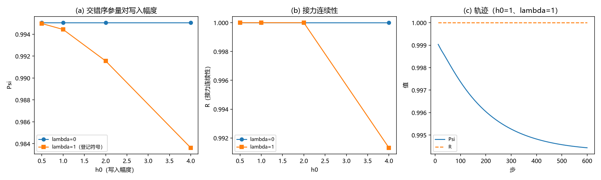

# 注记-BH7-W1：交错序参量读数（结构序破坏的微观判据：无阈值的平滑退化）

- **日期**：2026-09-20 06:44:00
- **层级**：验证脚本/（理论验证材料，未确认）
- **脚本**：验证脚本/minimal_verification_bh7_w1_staggered.py（系统 Python 3.13 + numpy + matplotlib，确定性，运行约 2 秒）
- **判据草案**：[[内部草稿/判据草案-第二主问题：普朗克质量与晶格损坏的判别（W系列）]]（W1）
- **定位**：第二主问题第三件最小实现：把「结构序破坏」（损坏三档之一）锚到可测读数，并在登记符号与登记协议下扫写入幅度，检验是否存在破坏阈值。
- **关联**：[[验证脚本/注记-M4-D3视界线自洽性与写入判据：饱和源模型与写-弛豫协议]]（BH3-3 协议原样复用；D3-7 口径）；[[内部草稿/裁定材料-耦合符号与强度：登记符号（回拉）与强度惯例]]（登记符号）；[[内部草稿/判别准备-BH7-W2：满偏可达性总表与越界路径盘点：2026-09-20]]；[[验证脚本/注记-BH7-W4：封顶曲线（满偏逼近的连续极限与有效荷封顶）]]
- **状态**：执行完成，判据 4/4 通过。读数：无写入锚 $\Psi = 0.995054$（耦合不可分辨）；登记符号下 $\Psi$ 随写入幅度平滑退化（$h_0 = 4$ 时 $\Psi = 0.9836$、$R = 0.9913$），**扫描域内无破坏阈值**
- **图**：images/bh7_w1_staggered.png（三面板，见 §三 图 1）
- **修订记录**：
  - **2026-09-20 初版**（承接：第二主问题判据草案 W1）

---

## 一、口径（W1-1）

三个读数在摆动解卷后定义。终端摆动相位为 $2\pi$ 整数倍（600 步 = 50 拍，每拍整圈），故相位偏差取 $d = \mathrm{wrap}(\theta - \mathrm{base})$。交错序参量 $\Psi = \vert\overline{e^{id}}\vert$；接力连续性 $R = \overline{[\vert d\vert < \pi/2]}$；偏尾 $P_{90}$ 为 $\vert d\vert$ 的 90 分位。理想基态 $\Psi = 1$、$R = 1$。缺陷密度口径（接口 C1）仍待，登记为开放。

## 二、模型设定

BH3-3 摆程层协议原样复用：$12^3$ 格点、交错基态 $\mathrm{base} = \pi(i+j+k)$、$\sigma$ 交错场、半径 2 的滴与滴表面写入位、过阻尼弛豫与节拍驱动（$T_{\text{beat}} = 12$、$dt = 0.02$、600 步）、登记符号实现 $\theta \leftarrow \theta - dt(-g + \lambda\sin\theta\,h) + \text{drive}$；耦合符号臂取登记值（回拉，裁决二十六）；噪声种子固定。

## 三、结果

判据 4/4 通过（一次运行，无修正；约 2 秒）。

| 判据 | 结果 |
|---|---|
| W1-2 对照锚 | 通过（无写入 $\Psi = 0.995054$；$\lambda = 0$ 与 $1$ 差 $0.0$；种子散布 $1.4\times10^{-10}$） |
| W1-3 序破坏扫描 | 通过（$\Psi$ 单调平滑退化；最小 $\Psi = 0.9836$） |
| W1-4 登记符号臂对照 | 通过（$\lambda = 1$ 对 $0$ 的最大差 $0.0114$） |
| W1-5 轨迹 | 通过（$\Psi(t)$ 由 $0.9970$ 缓降至 $0.9944$） |

关键读数。其一，$\lambda = 0$ 臂对 $h_0$ 完全无响应（$\Psi$ 恒 $0.995054$）：写入只在耦合开启时有通道（与 D3-7 同口径）。其二，$\lambda = 1$ 臂的退化量 $\Delta\Psi$：$7.7\times10^{-5}$（$h_0 = 0.5$）、$6.2\times10^{-4}$（$1$）、$3.5\times10^{-3}$（$2$）、$1.14\times10^{-2}$（$4$）；接力连续性至 $h_0 = 2$ 保持 $R = 1.0000$，$h_0 = 4$ 时 $0.9913$；偏尾 $P_{90}$ 由 $0.19$ 升至 $0.335$。其三，轨迹单调缓降、无翻转或丢失窗口。

## 四、解读

其一，**结构序在扫描域内无破坏阈值**。写入幅度提到协议参考值的四倍，交错序参量仅降 $1.1\%$、接力连续性保持 $99.1\%$：退化平滑且量级小，未见任何阈值型或失控型行为。与 U2（登记符号拉回）与 W4（无硬封顶、不越界）同向：三条微观判据在各自扫描域内都指向「稳健」。

其二，**退化量的标度**。$\Delta\Psi$ 随 $h_0$ 的增长介于二次与三次之间（逐倍率 $8.0$、$5.6$、$3.3$），无发散迹象；在协议域内可用平滑律概括（登记为报告级观察）。

其三，**对第二主问题的意义**。「结构序破坏」是损坏三档里唯一可由本协议直接读数的一档；本读数把它在 $h_0 \le 4$ 内判为闭合（无破坏）。剩余开域：更大 $h_0$（对数倍）、更长时间（多拍累计）、更大格点（有限尺寸）与缺陷密度口径（C1 接口）。

其四，与满偏链的接口：$h_0$ 是写入幅度参数，与 $s_0$ 及 $m/m_P$ 的映射未定（同 W4 §六）；因此本轮只报"协议域内无阈值"，不报"物理上无破坏"。

## 五、严格程度声明

确定性脚本、判据先写、图存档；协议与符号实现原样复用既有登记（BH3-3 与裁决二十六）；读数口径在本注记 §一 定义并随注记落盘；单格点尺寸（$12^3$）与单时长（50 拍），无尺寸与时长外推。

## 六、诚实边界

其一，覆盖域有限（$h_0 \le 4$、600 步、$12^3$），阈值的存在性不能外推否定；其二，缺陷密度（位错、畴壁）读数未做（接口 C1）；其三，读数定义选择一个口径（解卷后相位偏差），其他口径（键级关联、拓扑荷）未并行核；其四，模型层，与物理量（$m/m_P$）的映射未定。

## 七、过程记录

一处（无判据修正）。首版即 4/4 通过；登记一处口径选择：终端取 600 步（50 拍）使摆动相位回到 $2\pi$ 整数倍，解卷读数无须插值。无教训条目。

## 八、登记衔接

- 验证脚本/README.md 第 222 条（本注记落盘时同步）。
- [[内部草稿/判据草案-第二主问题：普朗克质量与晶格损坏的判别（W系列）]]：W1 行补执行句；§三 第三件标记。
- [[理论攻坚/黑洞线攻坚计划：坍缩机制重定位与强场终态]]：§二 BH7 行更新；修订记录补一条。
- [[内部草稿/开放问题总览：元相子理论待解决问题清单]] P1-34a：补注。
