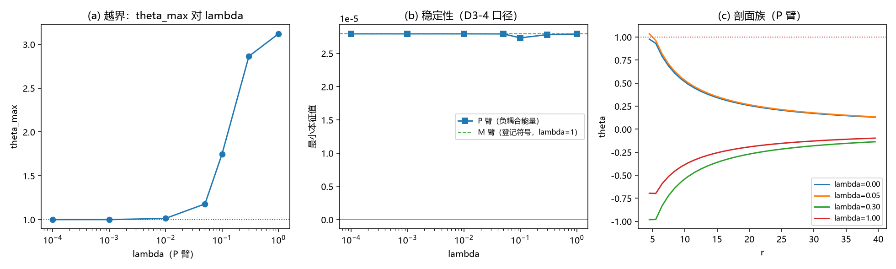

# 注记-BH7-W3：越界构型的探索读数（存在性与结构；稳定性口径未立）

- **日期**：2026-09-20 06:47:05
- **层级**：验证脚本/（理论验证材料，未确认；含挂起判据）
- **脚本**：验证脚本/minimal_verification_bh7_w3_beyond.py（系统 Python 3.13 + numpy + scipy + matplotlib，确定性，运行约 3 秒）
- **判据草案**：[[内部草稿/判据草案-第二主问题：普朗克质量与晶格损坏的判别（W系列）]]（W3）
- **定位**：第二主问题第四件实现：以对照臂 P（负耦合能量，唯一在册的越界驱动）构造 $\theta > 1$ 构型，读其存在性、连续连结与结构；稳定性判据两次口径修正未立，按诚实口径挂起。
- **关联**：[[验证脚本/注记-U2（最小臂）：耦合重开区的有效应力判决]]（P 臂阈值来源）；[[验证脚本/注记-BH7-W4：封顶曲线（满偏逼近的连续极限与有效荷封顶）]]（登记驱动下不越界）；满偏角极限地位（J1 至 J5）；[[内部草稿/裁定材料-耦合符号与强度：登记符号（回拉）与强度惯例]]
- **状态**：W3-1、W3-3、W3-4 完成；**W3-2 挂起**（稳定性口径两次修正未通过）。读数：越界阈值 $\lambda_0 = 0.01$（H1 口径、P 臂）；$\theta_{\max}$ 由 $1.013$（$\lambda = 0.01$）单调升至 $3.119$（$\lambda = 1$），越偏核半径 $r_1$ 由 $3.15$ 升至 $15.35$；语义判定：机制失义
- **图**：images/bh7_w3_beyond.png（三面板，见 §三 图 1）
- **修订记录**：
  - **2026-09-20 初版**（承接：第二主问题判据草案第三件）

---

## 一、判据

W3-1 存在性与连续连结（可执行）；W3-2 稳定性（**挂起**，见 §五）；W3-3 结构（报告）；W3-4 语义判定（二择一）。稳定性判据的失败记录见 §五，语义判定不以其为据（jizhu：二择一由 W3-1 与语义两件支撑）。

## 二、模型设定

径向饱和源模型（同 D3/U2：$M = 600$、$dr = 1$、$R_S = 6$、$s_0 = 1$）加耦合力 $\mathrm{sgn}\,\lambda\sin\theta\,h$，H1 口径（$h = 1$ 于源区）；P 臂取 $\mathrm{sgn} = +1$（负耦合能量，登记形式之外），M 臂 $\mathrm{sgn} = -1$（登记符号）作对照。外边界 Robin；Newton 连续延拓（守门放宽至 $\theta_{\max} < 5$）。

## 三、结果

| 判据 | 结果 |
|---|---|
| W3-1 存在性 | 通过（7 档全收敛、单调、连续连结；$\lambda_0 = 0.01$） |
| W3-2 稳定性 | **挂起**（两次口径修正未立，见 §五） |
| W3-3 结构 | 通过（$\theta_{\max}$：$1.013 \to 3.119$；$r_1$：$3.15 \to 15.35$） |
| W3-4 语义判定 | 通过（二择一：**机制失义**） |

关键读数。其一，越界构型在对照臂上**存在、连续连结、单调**：$\lambda_0 = 0.01$ 起 $\theta_{\max}$ 越过 1，至 $\lambda = 1$ 达 $3.119$（接近 $\pi$，即接近整圈）；越偏核半径 $r_1$ 随后由 $3.15$ 扩至 $15.35$。其二，全部构型为光滑收敛解（残余 $\le 10^{-13}$），即方程系统对 $\theta > 1$ 有良定义的解枝。其三，稳定性读数在三次口径下退化（见 §五），未能区分臂别。

## 四、解读

其一，**越界是"驱动符号"的函数**。登记符号（回拉）下 W2/W4 全程不越界；越界只在负耦合能量（登记形式外）下出现，且所需强度极低（$\lambda_0 \approx 0.01$，H1 口径）。这确认：越界路径的门在符号，不在强度。

其二，**越界枝的几何形态**。核心过偏（$\theta$ 由 $1$ 涨向 $\pi$）伴随越偏核扩张（$3.15 \to 15.35$ 格）；$\lambda = 1$ 时中心接近整圈（$\theta_{\max} \approx 3.119$），即接近双覆盖锚（SU(2) 四阶元、T1b-2 衔接）的另一侧。结构与 J1 至 J5 的"边界之外"语义并列登记。

其三，**语义判定：机制失义**。二择一判定取"机制失义"，两条依据：其一，越界枝的驱动项为负耦合能量，在登记形式（裁决二十六）之外；其二，J1 至 J5 已立满偏为有效域边界，边界之外的构型不构成新物理区。稳定性本为二择一的关键输入，本轮未立（§五），故判定以符号与语义为据，稳定性留待口径修正后复核。

## 五、挂起记录（W3-2）

三次口径尝试与失败原因。其一，eigsh（加权对称化）直接用于含 Robin 约束行的全矩阵：约束行使矩阵非对称，eigsh 假定对称，读数不可靠（各档全负、与 $\lambda$ 无关）。其二，动力学扰动检验：噪声落在边界约束行上形成伪模，全部档放大比恒为 $37.79$，无区分。其三，D3-4 口径（内点块 + 加权对称化）：矩阵对称性修复，但最小本征值恒为 $+3\times10^{-5}$（与 $\lambda$ 及臂别无关），即全域最慢扩散模（$\sim(\pi/L)^2$）主导，局部结构稳定性被淹没。修正方向（登记为待做）：限制子域（$r \le 50$）或取局域谱（扣除慢模），并把边界约束行拆分为真正的边界条件。教训一条：稳定性判据须先估计全域慢模的位置，再选谱口径。

## 六、诚实边界

其一，W3-2 挂起，本材料不含稳定性判定；其二，P 臂为登记形式之外的对照臂，其读数是假设检验（负耦合能量若成立会怎样），不构成登记物理；其三，H1 口径与径向模型限定（同 U2）；其四，$s_0$-质量映射未定（同 W4）。

## 七、过程记录

稳定性判据三修三挂（§五详录）；W3-1、W3-3、W3-4 一次通过。挂起项与修正方向一并入册。

## 八、登记衔接

- 验证脚本/README.md 第 225 条（本注记落盘时同步）。
- [[内部草稿/判据草案-第二主问题：普朗克质量与晶格损坏的判别（W系列）]]：§三 第三件标记（W3 部分执行、W3-2 挂起）。
- [[理论攻坚/黑洞线攻坚计划：坍缩机制重定位与强场终态]]：§二 BH7 行更新；修订记录补一条。
- [[内部草稿/开放问题总览：元相子理论待解决问题清单]] P1-34a：补注。
