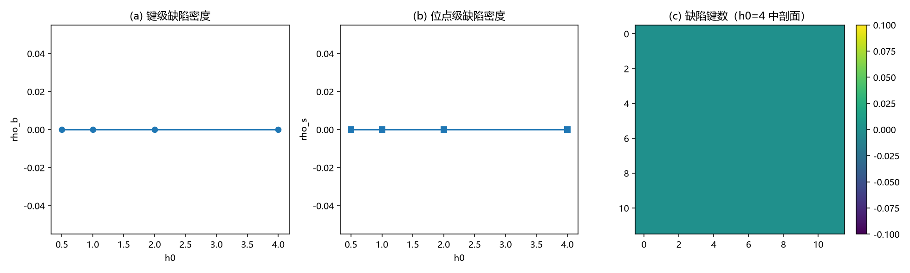

# 注记-BH7xC1 接口：缺陷密度代理读数（键级零缺陷与位点漂移的分离）

- **日期**：2026-09-20 07:00:38
- **层级**：验证脚本/（理论验证材料，未确认）
- **脚本**：验证脚本/minimal_verification_bh7_c1_interface.py（系统 Python 3.13 + numpy + matplotlib，确定性，运行约 2 秒）
- **接口材料**：[[内部草稿/接口材料-BH7xC1：缺陷密度读数（反相键与缺陷位点代理）与最小实现]]
- **定位**：接 BH7 首轮小结开放项其一：在 BH3-3 摆程层协议上定义并测量键级缺陷密度 $\rho_b$、位点级缺陷密度 $\rho_s$，与 W1 的位点相干 $R$ 并测。
- **关联**：[[验证脚本/注记-BH7-W1：交错序参量读数（结构序破坏的微观判据：无阈值的平滑退化）]]；[[理论攻坚/三维复合位错攻坚计划：形态、驻留与宽度窗口]]（形态接口）
- **状态**：执行完成，判据 4/4 通过（C1-4 经口径修正）。读数：**键级零缺陷**（$\rho_b = 0$、$\rho_s = 0$，全 $h_0$ 至 $4$）；位点级 $R$ 由 $1.00000$ 降至 $0.99132$；定义分离量 $8.7\times10^{-3}$
- **图**：images/bh7_c1_interface.png（三面板，见 §三 图 1）
- **修订记录**：
  - **2026-09-20 初版**（承接：C1 缺陷密度接口）

---

## 一、判据与口径

C1-1 对照锚（无写入 $\rho_b = \rho_s = 0$）；C1-2 单调性（报告）；C1-3 量级（报告）；C1-4 **定义分离核验**（口径修正，见 §四）。缺陷键 = $\vert\mathrm{wrap}(\Delta - \pi)\vert > \pi/2$（$\Delta$ 为键相位差）；缺陷位点 = 含 $\ge 2$ 个缺陷键的格点。

## 二、模型

BH3-3 摆程层协议原样复用（$12^3$、交错基态、过阻尼弛豫、登记符号臂、$600$ 步；同 W1）。

## 三、结果

判据 4/4 通过；**键级与位点级读数分离**。

| 判据 | 结果 |
|---|---|
| C1-1 对照锚 | 通过（$\rho_b = \rho_s = 0$，两臂） |
| C1-2 单调性 | 通过（$\rho_b$ 恒 $0$） |
| C1-3 量级 | 通过（$h_0 = 4$：$\rho_b = 0$、$\rho_s = 0$） |
| C1-4 定义分离 | 通过（修正后报告；分离量 $8.7\times10^{-3}$） |

关键读数：$\rho_b = 0$ 与 $\rho_s = 0$ 出现在全部 $h_0$（$0.5$ 至 $4$）与两臂；位点相干 $R = 1.00000$（$h_0 \le 2$）、$0.99132$（$h_0 = 4$）。

## 四、解读

其一，**反相键结构在扫描域内零缺陷**：位错环、畴壁、点的格点级代理（缺陷键链、缺陷键面、孤立缺陷键团）在 $h_0 \le 4$ 下均不出现，与 W1 的「无破坏阈值」互证并加深：不是"退化小"，而是**键级结构零痕迹**。

其二，**位点漂移与键缺陷的分离**：$h_0 = 4$ 时位点相干 $R$ 降 $0.87\%$，但缺陷键为零——位点漂移是**集体性**的（邻域同步漂移，保持反相关系），不构成结构序破坏。这条分离是接口的第一个实质读数：结构序的两级读数（位点对基准、键对反相）不可互推。

其三，**口径修正**：接口材料原写「$R = 1 - \rho_b$（同一判据的两种书写）」，实测分离量 $8.7\times10^{-3}$ 证伪之；C1-4 修正为"定义分离核验"（两读数为独立量）。原表述撤回，本注记与接口材料同步更正。

其四，**对 C1 接口的意义**：键级缺陷密度给出干净的零底数，C1 形态（位错环、畴壁、点）的同一性判定与密度换算（每形态格点计数到连续密度）留待 C1 工具；本轮把"共用一个可测读数"的最小形式坐实。

## 五、严格程度声明

确定性脚本、判据先写、图存档；协议与符号实现与 W1 一致；读数定义在接口材料与本节同步登记。

## 六、诚实边界

其一，格点级代理（缺陷键与缺陷位点）非 C1 连续形态本体；其二，扫描域有限（$h_0 \le 4$、$600$ 步、$12^3$）；其三，模型层（同 W1）。

## 七、过程记录

一处（判据修正）。C1-4 初版写成恒等式 $R = 1 - \rho_b$，实测 $8.7\times10^{-3}$ 分离 → 更正为定义分离核验并把分离量登记为读数。教训：位点级与键级判据虽同用 $\pi/2$ 阈值，量本身不可互推。

## 八、登记衔接

- 验证脚本/README.md 第 228 条（本注记落盘时同步）。
- [[内部草稿/接口材料-BH7xC1：缺陷密度读数（反相键与缺陷位点代理）与最小实现]]：状态与 §二、§四 同步更正。
- [[理论攻坚/黑洞线攻坚计划：坍缩机制重定位与强场终态]]：BH7 行与修订记录。
- [[内部草稿/开放问题总览：元相子理论待解决问题清单]] P1-34a：补注。
- [[理论攻坚/三维复合位错攻坚计划：形态、驻留与宽度窗口]]：接口登记行（本材料）。
