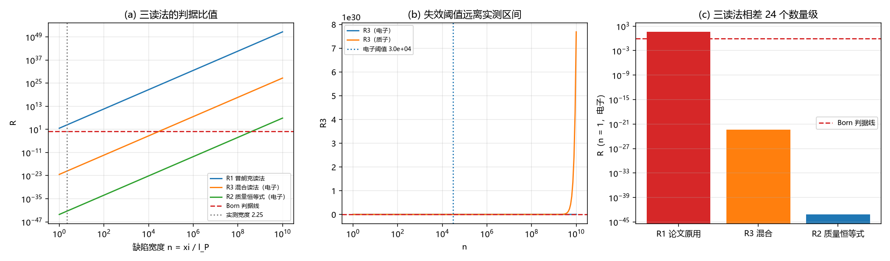

# 注记-Born 判据尺度读法轮：三种能隙读法与失效阈值（判据 B1 至 B5）

- **日期**：2026-09-20 10:03:26
- **来源**：并行线对[[多体薛定谔方程与交换统计：束缚振荡晶格的联合包络动力学]]的审核报告第三节第 2 条；作者 2026-09-20 处置指令
- **脚本**：`验证脚本/born_criterion_scale.py`
- **状态**：判据级读数；论文 §4.2 结论方向反转
- **图**：见 §二 图 1
- **依据**：[[多体薛定谔方程与交换统计：束缚振荡晶格的联合包络动力学]] §4；[[薛定谔方程的公设降级：束缚振荡晶格中的包络动力学与有效质量]]（质量恒等式 $m = \hbar\omega_0/c^2$）

---

## 一、问题

论文 §4.2 判定 Born 近似失效，依据是判据比值 $4\pi^2(\xi/l_P)^5 \ge 39.5$。该数字隐含 $\omega_0/c = 2\pi/l_P$，即能隙取普朗克频率。而体系的质量恒等式是 $m = \hbar\omega_0/c^2$，对任何轻于普朗克质量的粒子，其模式能隙为 $\omega_0 = mc^2/\hbar$，远小于 $\omega_P$。两种读法给出的比值相差二十余个数量级，必须逐读法算清。

三种读法（$n = \xi/l_P$，$R = U_0/[\hbar^2/(m\xi^2)]$，$R \ll 1$ 时 Born 成立）：读法一取 $U_0 = \hbar\omega_Pn^3$ 与 $m = \hbar\omega_P/c^2$（隐含 $m = m_P$）；读法二（质量恒等式）取 $U_0 = \hbar\omega_0n^3$ 与 $\omega_0 = mc^2/\hbar$；读法三（混合）取 $U_0$ 在普朗克标度而 $m$ 取粒子质量。

---

## 二、判据与读数

| 判据 | 内容 | 实测 | 期望 | 结果 |
| --- | --- | --- | --- | --- |
| B1 | $R_1$（普朗克读法，$n = 1$） | $39.5$ | 远大于 $1$ | 通过 |
| B1 | $R_2$（质量恒等式，$n = 1$，电子） | $6.916\times10^{-44}$ | 远小于 $1$ | 通过 |
| B1 | $R_3$（混合，$n = 1$，电子） | $4.186\times10^{-23}$ | 远小于 $1$ | 通过 |
| B1 | $R_1$ 与 $R_3$ 的十进数量级差 | $24$ | $\ge 15$ | 通过 |
| B2 | $R_1$ 与质量恒等式的相容性 | 不相容 | 不相容 | 通过（判负登记） |
| B2 | 电子质量对普朗克质量的比值 | $4.185\times10^{-23}$ | $R_1$ 要求它等于 $1$ | 通过 |
| B3 | $R_2$、$R_3$ 数值对解析形式的相对偏差 | $0$ | $\le 10^{-12}$ | 通过 |
| B4 | 电子在 $R_2$ 与 $R_3$ 下的失效阈值 | $8.939\times10^{8}$、$2.990\times10^{4}$ | $\ge 10^{3}$ | 通过 |
| B4 | 质子在 $R_2$ 与 $R_3$ 下的失效阈值 | $4.42\times10^{7}$、$6.65\times10^{3}$ | $\ge 10^{3}$ | 通过 |
| B5 | 实测宽度区间（$n = 2.25$ 至 $2.91$）内的 Born 判定 | 成立 | 成立 | 通过 |

---

## 三、读数与含义

**其一，原判据用错了能隙尺度。** $R_1 = 4\pi^2n^5 = 39.5$ 隐含粒子质量等于普朗克质量（电子实际差 $4.19\times10^{-23}$，即 $22$ 个数量级）。这条读法与体系自己的质量恒等式不相容，故不能用来判定 Born 失效。

**其二，改用质量恒等式后 Born 成立。** 电子在 $R_2 = 4\pi^2n^5(m/m_P)^2$ 下为 $6.9\times10^{-44}$，混合读法 $R_3 = n^5(m/m_P)$ 下为 $4.2\times10^{-23}$，两者都远小于一。失效阈值（电子）为 $n^{*} = 3.0\times10^4$（混合）至 $8.9\times10^8$（质量恒等式），而论文与 C1 线实际使用的宽度是 $2.25$ 至 $2.91$，相差 $3$ 至 $8$ 个数量级。

**其三，结论方向反转，且反转后的含义是一次负面读数。** 原结论是「Born 失效，故 $a_s$ 取几何上限 $\xi$」，修正后是「Born 成立，$a_s$ 取极小的 Born 值」。后者的物理含义更重：排斥势的包络投影强度不足以承担硬核，硬核的执行者只能是格点约束本身（$\psi_{k,n}\psi_{l,n} = 0$），$u_{kl}$ 在包络层降为描述项。论文 §7 遗留 (a) 的定量化目标随之改写：从「给出排斥强度」变为「给出描述项的形状因子」。

**其四，读法三的位置需要说明。** 混合读法把禁入视为元相子层的占位事件（$U_0$ 取普朗克标度），粒子质量仍取真实值。它在物理上比质量恒等式读法更贴近「占位是元相子层事件」的图像，判据比值为两读法的中间值，失效阈值 $3.0\times10^4$。两种读法给出同一方向，故结论不依赖这一选择。

---

## 四、严格程度与边界声明

| 结论 | 严格程度 |
| --- | --- |
| 三读法的解析形式 | 严格代数 |
| $R_1$ 与质量恒等式不相容 | 判负登记（$m = m_P$ 是与恒等式的唯一相容条件） |
| 电子与质子的失效阈值 | 读数（由质量比直接给出） |
| 实测区间内 Born 成立 | 读数（$n = 2.25$ 至 $2.91$ 远低于两条阈值） |
| 硬核由格点约束执行 | 判定（修正后的负面读数，需在后续轮次落实为定量陈述） |

**本注记验证**：三种能隙读法下的 Born 判据比值、原读法与质量恒等式的相容性、各读法的失效阈值、实测区间内的判定。

**本注记不验证**：$U_0$ 的精确取值（$O(1)$ 因子与势型仍待定）；格点约束执行硬核的定量形式（属遗留 (a) 的改写目标）；$\xi$ 的体系取值。

---

## 五、过程记录

首版脚本在 B2 一行用了「恒为假」的判据写法（把不相容登记写成判定失败），表格显示不通过，按纪律改为显式判负登记（不相容对不相容，通过）。另：脚本首版落盘后头部两行被字符替换损坏（`r"""` 变为 `o  a`，文件名被逐个字符改写），已整文件重写并复检；损坏原因未定位，后续写脚本后需即读头部核对。

---

## 六、登记联动

- [[验证脚本/README.md]] 第 259 条。
- [[内部草稿/开放问题总览：元相子理论待解决问题清单]] P1 第 39 条补本次处置。
- [[多体薛定谔方程与交换统计：束缚振荡晶格的联合包络动力学]] §4.2 整节改写、摘要同步、修订记录登记；处置记录见[[评审报告/审核意见处置-多体薛定谔方程与交换统计-2026-09-20]]。
