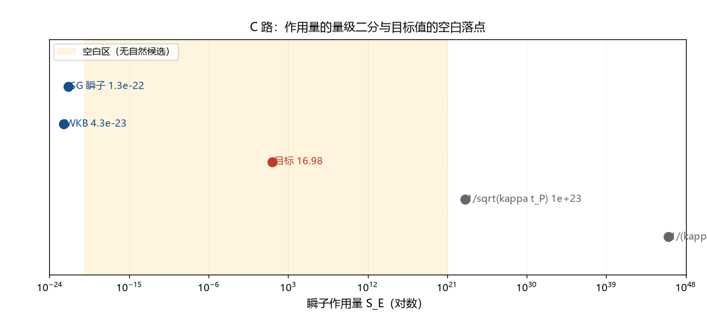

# 注记-C 路首轮（第393条）：瞬子作用量的量级二分与 g² 落点

- **日期**：2026-09-24 05:14:28
- **类型**：首轮判定（S 机制第四路：瞬子的体系内清点）
- **脚本**：`验证脚本/c_path_instanton.py`（第 393 条）
- **图**：见 §3 图 1（`images/c_path_instanton.png`）
- **依据**：[[验证脚本/注记-S 的机制候选（第360条）：四种指数抑制的参数量级与判句]]（C 路参数要求 $g^2 = 0.0589$）；[[缺陷动力学：孤子的质量、迁移率与最小量子化]]（$K$、$k_b$ 与缺口闭式）；[[验证脚本/注记-量纲桥MB-9：惯性归一的独立导出：公理4哈密顿的显式系数（判据MB9-a至MB9-e）]]（$J$ 归一）
- **状态**：首轮完成。作用量候选与 $g^2$ 落点两条清点完毕；判定归约为「$16.98$ 的机制」

## 1 判据与设定

第 360 条把瞬子路线（C 路）列为指数抑制的候选之一，参数要求为 $g^2 = 2\pi/106.7 = 0.0589$（取 $S_E = 2\pi/g^2$）。本轮做四件事：C1 清点瞬子标准形式的系数约定与各自的 $g^2$ 要求；C2 把 $g^2$ 目标与体系耦合谱对照；C3 给四个体系内作用量候选的数值；C4 综合判定与结构观察。全部为确定性算术。

## 2 结果

C1（标准形式）：指数 $= S_E = c/g^2 = 106.7$ 在四种系数约定下要求 $g^2 = 0.0589$（$2\pi$ 型）、$0.0294$（$\pi$ 型）、$0.3700$（$4\pi^2$ 型）、$0.7400$（$8\pi^2$，SU(2) 瞬子型）。系数约定本身是有后果的选择，四种档的 $g$ 从 $0.17$ 到 $0.86$。

C2（耦合谱落点）：体系耦合谱为 $\kappa_\phi t_P = 9.29\times10^{-47}$、$K = 2.79\times10^{-46}$、$J = 1$（归一）、$\kappa_\phi/K = 1/3$、$1/(2\pi)$。目标 $g^2$ 与它们的距离：与 $\kappa_\phi t_P$ 差 $44.8$ 个数量级，与 $J$ 差 $1.2$，与 $1/3$ 差 $0.8$，与 $1/(2\pi)$ 差 $0.4$。最接近者 $1/(2\pi)$ 与 $0.0589$ 差 $2.7$ 倍；目标在全谱上无自然落点。

C3（作用量候选）：四个体系内候选的作用量为：sine-Gordon 瞬子 $8\sqrt{JK} = 1.336\times10^{-22}$；WKB 势垒穿透 $2\sqrt{2K}\times0.900 = 4.251\times10^{-23}$；$1/\sqrt{\kappa_\phi t_P} = 1.037\times10^{23}$；$1/(\kappa_\phi t_P) = 1.076\times10^{46}$。目标 $S_E = 16.98$。**量级二分**：候选落在 $10^{-22}$ 侧或 $10^{23}$ 侧，目标落在两者之间的空白区（离两侧分别 $23$ 个与 $21$ 至 $44$ 个数量级）。

C4（综合与结构观察）：目标 $16.98 = 106.7/(2\pi)$，与 A 路计数式常数 $(\Delta/E_P)^2 w = 16.98$ 同值。两路（A 与 C）由此共享同一反解结构，C 路的判定归约为「$16.98$ 的机制」（或等价地「$17$ 的机制」）。

## 3 图

## 4 结论与判句移交

C 路首轮的两个否证性读数：其一，$g^2$ 的四个目标档（0.029 至 0.740）在体系耦合谱上无自然落点（最近的 $1/(2\pi)$ 差 2.7 倍，其余更远）；其二，体系自然作用量候选呈量级二分（$10^{-22}$ 或 $10^{23}$ 侧），目标值落在空白区。

S 机制四路全景至此齐备：A 路（朗道-齐纳）判定链九轮完整、判负；B 路（热冻结）条件性候选、三件未齐（件一已裁：$v$ 列入输入清单）；C 路（瞬子）首轮归约为「$16.98$ 的机制」；D 路（基布尔-祖雷克）判为不产生指数（第 360 条）。

判句移交：A、C 两路共享的「$16.98$ 的机制」成为 S 线的新聚焦点。该数在体系里已有两处登记观察：$106.7$ 与 $34\pi = 106.814$ 的 $0.107\%$ 相容（第 360、361 条），以及 $106.7/2\pi = 16.98$ 的固有结构。下一轮可选做「$17$ 的出现清单」专项：把 S 线全部出现 $17$ 量级数的位置（A 路窗口下端、C 路 $1/g^2$、$34\pi$ 观察、追赶标度）列全并找共性，或判定为反解结构的必然。

## 5 严格程度与边界声明

严格程度：C1 至 C3 为算术（判据级）；C4 的量级二分与同构观察为结构性读数（判据级）；「归约为 $16.98$ 的机制」为等价改写。

边界：不建立瞬子模型；不重算第 360 条；作用量候选的系数约定（如 $8\sqrt{JK}$ 的归一化）属量级口径；不宣称 C 路判负（首轮只给「无自然落点」与「归约」两个读数）。

## 6 过程记录

触发：B 路收尾（第 390 条）与件一裁决落定后，S 机制线只剩 C 路未动，本轮补齐。首轮的设计要点是把「瞬子」拆成两个可算的侧面（$g^2$ 落点与作用量量级），避免在缺乏拓扑过程定义时空转。附带发现：A、C 两路的目标数同构（$16.98$），这把两路的缺口合并为一个。
