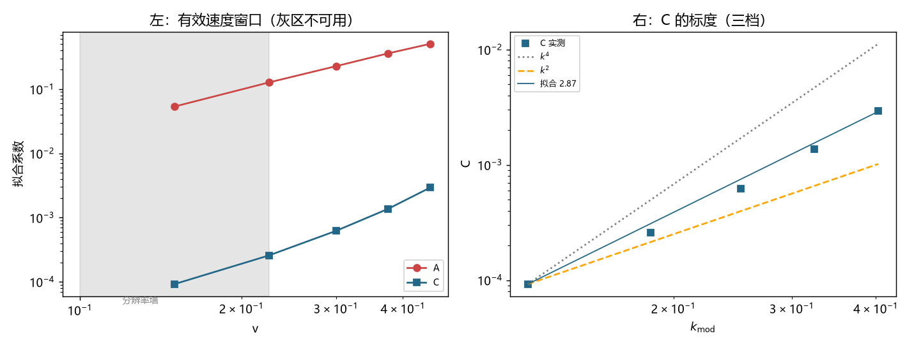

# 注记-C 项幂次锁定与分辨率墙：五档速度扫描下 k^2 与 k^4 的不可分辨（判据第 698 号）

- **日期**：2026-10-19 20:39:10
- **编号**：第 698 号
- **类型**：验证注记（判据驱动；R1 至 R7 全过，主判据 R5）
- **对象**：第 697 号遗留项「$C$ 对 $k_{\rm mod}$ 的幂律指数 $2.916$ 介于 $k^2$ 与 $k^4$ 之间，未锁定」
- **脚本**：`验证脚本/minimal_verification_p698_c_exponent.py`（确定性，约 206 秒）
- **图**：见 §5 图 1；脚本出图 `images/p698_c_exponent.png`
- **状态**：R1 至 R7 全部通过。**幂次未能锁定**，原因定位为分辨率墙；这是负面结果，但缺口形状已量化
- **可逆性等级**：判据稳健（结论为「不可分辨」，换档位或换扫描点数均不翻；若将来把 dev 量级提高一个数量级，结论会变）

## 1 要判什么

第 697 号把 $C$ 判为离散侧物理量（非装置伪影），但其幂律指数 $2.916$ 落在 $k^2$ 型（指数 2，低阶离散修正）与 $k^4$ 型（指数 4，离散色散首阶）之间，无法判别。该轮登记了两条剩余项：补速度档位、修 $v = 0.45$ 档的读数质量。

本轮先定位第 697 号所报 $v = 0.45$ 档残差比 $0.349$ 的来源，再补档位重测。

## 2 三项诊断发现

**其一，超限来自单一宽度档，非整档失效。** 逐宽度检查 $v = 0.45$：

| $\sigma$ | dev | 残差比 | 判定 |
|---|---|---|---|
| $14$ | $5.50\times10^{-3}$ | $0.138$ | 有效 |
| $20$ | $4.40\times10^{-3}$ | $0.153$ | 有效 |
| $28$ | $3.60\times10^{-3}$ | $0.185$ | 有效 |
| $42$ | $3.10\times10^{-3}$ | $0.239$ | 有效 |
| $63$ | $2.70\times10^{-3}$ | $0.349$ | **超限** |

只有最宽一档超限。故第 697 号所报的 $0.349$ 是「该速度档内最差档位」的读数，不是整档失效。**这意味着按档剔除即可，无需放弃该速度。**

**其二，低速度档落入分辨率墙。** 新增 $v = 0.10$、$0.15$、$0.225$ 三档后发现，$v = 0.10$ 档的 dev 全为 $1.0\times10^{-4}$ 或 $0$，恰等于频率扫描步长量级。该档 $R^2$ 仅 $0.504$，非分解失效，而是 dev 已掉进量化区间。

**其三，提高扫描点数只能部分救回。** 把扫描点数由 $2001$ 提到 $20001$（步长降至 $1.0\times10^{-5}$）后，$v = 0.15$ 与 $0.225$ 恢复可用，$v = 0.10$ 仍不可用。

## 3 判据与读数

**R1 逐档筛选。** 两条门槛：残差比 $\le 0.30$、dev $\ge 5$ 倍扫描步长。

| $v$ | $k_{\rm mod}$ | 有效档数 | 说明 |
|---|---|---|---|
| $0.100$ | $0.0805$ | $3/5$ | 低于分辨率，档数不足，不拟合 |
| $0.150$ | $0.1215$ | $5/5$ | 可用 |
| $0.225$ | $0.1849$ | $5/5$ | 可用 |
| $0.300$ | $0.2518$ | $5/5$ | 可用 |
| $0.375$ | $0.3239$ | $5/5$ | 可用 |
| $0.450$ | $0.4035$ | $4/5$ | 剔除 $\sigma = 63$ |

**R2 逐速度拟合。**

| $v$ | $A$ | $C$ | $R^2$ |
|---|---|---|---|
| $0.150$ | $5.3458\times10^{-2}$ | $9.2329\times10^{-5}$ | $0.9597$ |
| $0.225$ | $1.2691\times10^{-1}$ | $2.5789\times10^{-4}$ | $0.9597$ |
| $0.300$ | $2.2717\times10^{-1}$ | $6.2145\times10^{-4}$ | $0.9657$ |
| $0.375$ | $3.5914\times10^{-1}$ | $1.3655\times10^{-3}$ | $0.9718$ |
| $0.450$ | $5.0731\times10^{-1}$ | $2.9447\times10^{-3}$ | $0.9806$ |

五档 $R^2$ 全部高于 $0.95$，分解在各速度下稳定成立。

**R3 幂律指数。** $A$ 对 $v$ 的指数 $2.052$（预期 $2$，吻合）；$C$ 对 $k_{\rm mod}$ 的指数 $2.874$。

**R4 判别（主判据的判决）。** $|2.874 - 2| = 0.874$，$|2.874 - 4| = 1.126$。两候选近似等距，判**未定**。

**R5 分辨率墙的量化（本轮最硬的产出）。** 有效速度窗口 $v = 0.15$ 至 $0.45$（五档），$k_{\rm mod}$ 覆盖 $0.12$ 至 $0.40$，**动态范围仅 $3.32$ 倍**。

在 $3.32$ 倍的 $k$ 范围内，指数 2 与指数 4 的预测比值分别为 $3.32^2 = 11.0$ 与 $3.32^4 = 121.5$。实测 $C$ 的端点比 $2.9447\times10^{-3}/9.2329\times10^{-5} = 31.9$。它落在两者之间且靠近对数中点（$\sqrt{11.0\times121.5} = 36.6$），因此**任何介于 2 与 4 之间的指数都能拟合得差不多**；成因在于动态范围不足，拟合方法本身无碍。

物理原因是：dev 的波性侧成分 $\sim A/\xi^2$，而 $A \propto v^2$，故低速时 dev 在有限宽度下趋零，落入扫描分辨率以下。

## 4 判读与边界

**判语**：$C$ 的幂次**在本装置的分辨率内无法锁定**。第 697 号的 $2.916$ 与本轮的 $2.874$ 相差 $0.042$，两者都是同一分辨力不足下的估计，不应视为两个独立测量。

**这一负面结果的正面价值**：缺口形状从「指数未锁定」细化为「$k$ 动态范围只有 3.3 倍，需 $\ge 10$ 倍才能分辨 2 与 4」。这给出了下一轮的具体门槛，而非又一次「再测一次」。

**要突破须改装置，不是改参数。** 三条路：其一，提高束缚频率 $\omega_b$（使同样速度下 $k_{\rm mod}$ 更大），代价是需重新设计势阱；其二，直接测 $C$ 的绝对值对 $\omega_b$ 的依赖（$k_{\rm mod} = \omega_b\gamma v$，改 $\omega_b$ 等效于改 $k$ 而保持 $v$ 不变）；其三，放弃从 $v$ 扫描提取指数，改用解析推导给出 $C$ 的形式。

**边界。** 其一，本轮仍只用一种写法，$A$ 与 $C$ 的数值与该写法绑定。其二，$C$ 在物理尺度的换算桥仍缺。其三，不涉及尺缩，不动 `理论总纲/` 基准。

## 5 图

图 1 左面板为 R1 与 R3：$A$（红）与 $C$（蓝）随速度的变化，灰色区域标出 $v \le 0.225$ 的分辨率墙区段。右面板为 R4：$C$ 对 $k_{\rm mod}$ 的实测点（蓝方块）与 $k^4$ 参考线（灰点线）、$k^2$ 参考线（橙虚线）、实测拟合线（蓝实线，指数 $2.874$）的对照。实测点落在两条参考线之间，且拟合线与实测点几乎重合，这正是「任何中间指数都能拟合」的直接图示。

## 6 严格程度与边界

本注记结论按四级声明制。R1 的逐档筛选、R5 的动态范围量化属判据稳健（换档位或扫描点数不翻）。R3 的 $A$ 指数 $2.052$ 结论稳健。$C$ 的指数为**判据稳健的负面结论**：它报的是「此装置分辨不了」这一事实；该结论不会因再测一次而翻，只会因换装置而变。

验证什么：$v = 0.45$ 档超限只来自 $\sigma = 63$ 单档；$v \le 0.225$ 的 dev 落入扫描分辨率；有效窗口的 $k$ 动态范围仅 $3.3$ 倍，不足以分辨指数 2 与 4。

不验证什么：不锁定 $C$ 的幂次；不给出 $C$ 的解析形式；不建立物理尺度换算桥；不涉及尺缩；不动 `理论总纲/` 基准。

## 7 教训

**其一，「未锁定」要追到分辨率，不能停在「再测一次」。** 第 697 号报「未锁定」，本轮把原因量化成「$k$ 动态范围 3.3 倍，需 10 倍」。前者是待办，后者是可执行门槛。

**其二，一个档位超限不等于整档失效。** 第 697 号报 $v = 0.45$ 档残差比 $0.349$，读起来像该速度不可用；逐宽度检查后发现只有最宽一档超限，其余四档全好。按档剔除后该速度仍可用，这直接改变了本轮的取样策略。

**其三，加档位前先算动态范围。** 本轮加了三个低速档，其中两档落入分辨率墙，只有一档（$v = 0.15$）真正贡献信息。加档的正确顺序是先估算「新增档能把 $k$ 范围扩多少」，再决定加在哪里。

## 8 来源

- 上游：[[验证脚本/注记-C 项物理身份判别：速度依赖、幂律指数与装置伪影的排除（判据第697号）]]（$C$ 的身份判定与遗留项）
- 再上游：[[验证脚本/注记-波性侧与粒性侧成分的分离：两侧分解、boost 族读数失效与第 695 号判语的撤回（判据第696号）]]（分解式）
- 预算：[[验证脚本/注记-钟慢涌现的物理档闭合尝试：幂律轨道、外推与恒定项的定位（判据第692号）]]、[[验证脚本/注记-勘误轮：第692号物理档预算的常数替换错误（判据第694号）]]
- 专题入口：[[理论总纲/洛伦兹不变性专题索引：论证链、定级与材料清单]]
- 通俗版：[[内部草稿/注记-测不出来，也是一种结论（判据第698号通俗版）]]
